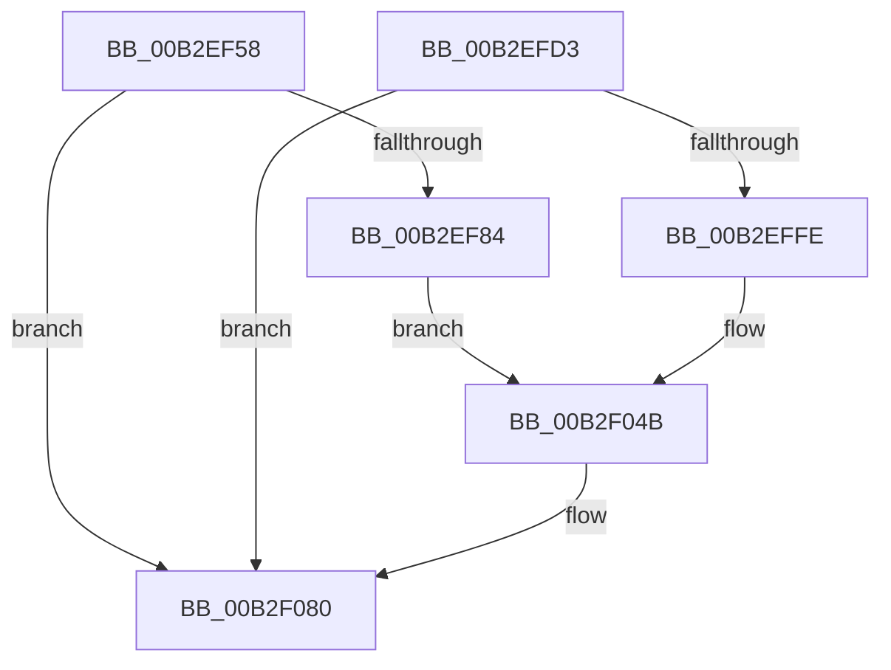

# sub_00B2EF58

- RVA: `0x00B2EF58`–`0x00B2F08F` (길이 `311` bytes)
- VA: `0x0000000140B2EF58`
- 실행 섹션: `PAGE`
- PDB 이름 있음: `아니요`; PDB Function 태그: `아니요`
- unwind 정보 RVA: `0x0009F77C`
- 디코드: `67`개 명령, `311/311` bytes 표시
- 미해석 바이트: `0` (있으면 어셈블리에 `.byte`로 보존)

> 이 문서는 커널 이미지의 기계어와 PDB 기호를 분석해 생성했습니다. 4번과 5번은 함수 원형과 자료형을 바이너리 사용 방식에서 추정한 C 해석이며 원본 소스 복구 결과는 아닙니다.

## 1. Dependencies

- 직접 호출 지점: **6**; 고유 호출 대상: **4**
- 직접 호출자로 확인된 함수: **0**
- RIP 상대 이미지 참조: **3**

### Outgoing calls
- `0x00B2EF64` → [PiUEventGatherEventData](../A6/PiUEventGatherEventData_function_00A6EBAC.md) (function, `0x00A6EBAC`)
- `0x00B2EF71` → [PiUEventGetProcessImagePath](../AB/PiUEventGetProcessImagePath_function_00AB76F0.md) (function, `0x00AB76F0`)
- `0x00B2EFDF` → [PiUEventGatherEventData](../A6/PiUEventGatherEventData_function_00A6EBAC.md) (function, `0x00A6EBAC`)
- `0x00B2EFEC` → [PiUEventGetProcessImagePath](../AB/PiUEventGetProcessImagePath_function_00AB76F0.md) (function, `0x00AB76F0`)
- `0x00B2F07B` → [McTemplateK0qqzqqtjqzjzttx_EtwWriteTransfer](../../text/5A/McTemplateK0qqzqqtjqzjzttx_EtwWriteTransfer_function_005A7708.md) (function, `0x005A7708`)
- `0x00B2F084` → [PiUEventFreeProcessImagePath](../AC/PiUEventFreeProcessImagePath_function_00AC8C44.md) (function, `0x00AC8C44`)

### Direct callers
- 이 함수 시작 RVA로 연결되는 직접 call은 확인되지 않았습니다. 간접 호출은 완전히 역산할 수 없습니다.

### Static image references
- `0x00B2EF76` → RVA `0x00EF012C` (`.data`; read)
- `0x00B2EFCA` → RVA `0x00027450` (`.rdata`; read)
- `0x00B2F044` → RVA `0x00026FE0` (`.rdata`; read)

## 2. Other-region calls and transfers

- 다른 실행 섹션으로 향하는 call: **1**
  - `0x00B2F07B` → [McTemplateK0qqzqqtjqzjzttx_EtwWriteTransfer](../../text/5A/McTemplateK0qqzqqtjqzjzttx_EtwWriteTransfer_function_005A7708.md) (`PAGE` → `.text`)
- call이 아닌 외부 분기/꼬리 이동: **1**
  - `0x00B2F08A` → [PiUEventDequeuePendingEventWorker + 0xC2](../9C/PiUEventDequeuePendingEventWorker_function_009C29C0.md) (`tail-transfer`)

## 3. Assembly (complete function range)

```asm
00B2EF58  4C 8D 4D 27                     lea r9, [rbp + 0x27]
00B2EF5C  4C 8D 45 2F                     lea r8, [rbp + 0x2f]
00B2EF60  48 8D 55 37                     lea rdx, [rbp + 0x37]
00B2EF64  E8 43 FC F3 FF                  call 0x140a6ebac
00B2EF69  48 8B 4F 30                     mov rcx, qword ptr [rdi + 0x30]
00B2EF6D  48 8D 55 6F                     lea rdx, [rbp + 0x6f]
00B2EF71  E8 7A 87 F8 FF                  call 0x140ab76f0
00B2EF76  8A 05 B0 11 3C 00               mov al, byte ptr [rip + 0x3c11b0]
00B2EF7C  84 C0                           test al, al
00B2EF7E  0F 89 FC 00 00 00               jns 0x140b2f080
00B2EF84  4C 8B 4B 18                     mov r9, qword ptr [rbx + 0x18]
00B2EF88  48 8B 45 27                     mov rax, qword ptr [rbp + 0x27]
00B2EF8C  48 89 B4 24 80 00 00 00         mov qword ptr [rsp + 0x80], rsi
00B2EF94  44 89 74 24 78                  mov dword ptr [rsp + 0x78], r14d
00B2EF99  41 0F B6 49 4C                  movzx ecx, byte ptr [r9 + 0x4c]
00B2EF9E  49 8D 51 50                     lea rdx, [r9 + 0x50]
00B2EFA2  89 4C 24 70                     mov dword ptr [rsp + 0x70], ecx
00B2EFA6  48 89 44 24 68                  mov qword ptr [rsp + 0x68], rax
00B2EFAB  48 8B 45 2F                     mov rax, qword ptr [rbp + 0x2f]
00B2EFAF  48 89 44 24 60                  mov qword ptr [rsp + 0x60], rax
00B2EFB4  48 8B 45 37                     mov rax, qword ptr [rbp + 0x37]
00B2EFB8  48 89 44 24 58                  mov qword ptr [rsp + 0x58], rax
00B2EFBD  41 8B 41 60                     mov eax, dword ptr [r9 + 0x60]
00B2EFC1  89 44 24 50                     mov dword ptr [rsp + 0x50], eax
00B2EFC5  48 89 54 24 48                  mov qword ptr [rsp + 0x48], rdx
00B2EFCA  48 8D 15 7F 84 4F FF            lea rdx, [rip - 0xb07b81]
00B2EFD1  EB 78                           jmp 0x140b2f04b
00B2EFD3  4C 8D 4D 27                     lea r9, [rbp + 0x27]
00B2EFD7  4C 8D 45 2F                     lea r8, [rbp + 0x2f]
00B2EFDB  48 8D 55 37                     lea rdx, [rbp + 0x37]
00B2EFDF  E8 C8 FB F3 FF                  call 0x140a6ebac
00B2EFE4  48 8B 4F 30                     mov rcx, qword ptr [rdi + 0x30]
00B2EFE8  48 8D 55 6F                     lea rdx, [rbp + 0x6f]
00B2EFEC  E8 FF 86 F8 FF                  call 0x140ab76f0
00B2EFF1  F6 05 34 11 3C 00 02            test byte ptr [rip + 0x3c1134], 2
00B2EFF8  0F 84 82 00 00 00               je 0x140b2f080
00B2EFFE  4C 8B 4B 18                     mov r9, qword ptr [rbx + 0x18]
00B2F002  48 8B 45 27                     mov rax, qword ptr [rbp + 0x27]
00B2F006  48 89 B4 24 80 00 00 00         mov qword ptr [rsp + 0x80], rsi
00B2F00E  44 89 74 24 78                  mov dword ptr [rsp + 0x78], r14d
00B2F013  41 0F B6 49 4C                  movzx ecx, byte ptr [r9 + 0x4c]
00B2F018  49 8D 51 50                     lea rdx, [r9 + 0x50]
00B2F01C  89 4C 24 70                     mov dword ptr [rsp + 0x70], ecx
00B2F020  48 89 44 24 68                  mov qword ptr [rsp + 0x68], rax
00B2F025  48 8B 45 2F                     mov rax, qword ptr [rbp + 0x2f]
00B2F029  48 89 44 24 60                  mov qword ptr [rsp + 0x60], rax
00B2F02E  48 8B 45 37                     mov rax, qword ptr [rbp + 0x37]
00B2F032  48 89 44 24 58                  mov qword ptr [rsp + 0x58], rax
00B2F037  41 8B 41 60                     mov eax, dword ptr [r9 + 0x60]
00B2F03B  89 44 24 50                     mov dword ptr [rsp + 0x50], eax
00B2F03F  48 89 54 24 48                  mov qword ptr [rsp + 0x48], rdx
00B2F044  48 8D 15 95 7F 4F FF            lea rdx, [rip - 0xb0806b]
00B2F04B  8B 87 88 00 00 00               mov eax, dword ptr [rdi + 0x88]
00B2F051  44 8B 8F 84 00 00 00            mov r9d, dword ptr [rdi + 0x84]
00B2F058  44 89 7C 24 40                  mov dword ptr [rsp + 0x40], r15d
00B2F05D  89 44 24 38                     mov dword ptr [rsp + 0x38], eax
00B2F061  8B 87 80 00 00 00               mov eax, dword ptr [rdi + 0x80]
00B2F067  89 44 24 30                     mov dword ptr [rsp + 0x30], eax
00B2F06B  48 8B 45 6F                     mov rax, qword ptr [rbp + 0x6f]
00B2F06F  48 89 44 24 28                  mov qword ptr [rsp + 0x28], rax
00B2F074  8B 47 30                        mov eax, dword ptr [rdi + 0x30]
00B2F077  89 44 24 20                     mov dword ptr [rsp + 0x20], eax
00B2F07B  E8 88 86 A7 FF                  call 0x1405a7708
00B2F080  48 8D 4D 6F                     lea rcx, [rbp + 0x6f]
00B2F084  E8 BB 9B F9 FF                  call 0x140ac8c44
00B2F089  90                              nop
00B2F08A  E9 F3 39 E9 FF                  jmp 0x1409c2a82
```

## 4. C-style interpretation (structured pseudocode)

```c
__int64 __fastcall sub_00B2EF58(void)
{
    __int64 result;
    unsigned int v_stack_p20;
    unsigned __int64 v_stack_p28;
    unsigned int v_stack_p30;
    unsigned int v_stack_p38;
    unsigned int v_stack_p40;
    unsigned __int64 v_stack_p48;
    unsigned int v_stack_p50;
    unsigned __int64 v_stack_p58;
    unsigned __int64 v_stack_p60;
    unsigned __int64 v_stack_p68;
    unsigned int v_stack_p70;
    unsigned int v_stack_p78;
    unsigned __int64 v_stack_p80;

    result = PiUEventGatherEventData(a1, v_rbp + 55, v_rbp + 47, v_rbp + 39);
    result = PiUEventGetProcessImagePath(*(unsigned __int64 *)(v_rdi + 48), v_rbp + 111, v_rbp + 47, v_rbp + 39);
    if (!sign_flag) goto loc_00B2F080;
    v_stack_p80 = v_rsi;
    v_stack_p78 = (unsigned int)(v_r14);
    v_stack_p70 = (unsigned int)(*(unsigned __int8 *)(*(unsigned __int64 *)(v_rbx + 24) + 76));
    v_stack_p68 = *(unsigned __int64 *)(v_rbp + 39);
    v_stack_p60 = *(unsigned __int64 *)(v_rbp + 47);
    v_stack_p58 = *(unsigned __int64 *)(v_rbp + 55);
    v_stack_p50 = (unsigned int)((unsigned int)(*(unsigned int *)(*(unsigned __int64 *)(v_rbx + 24) + 96)));
    v_stack_p48 = *(unsigned __int64 *)(v_rbx + 24) + 80;
    goto loc_00B2F04B;
loc_00B2F04B:
    v_stack_p40 = (unsigned int)(v_r15);
    v_stack_p38 = (unsigned int)((unsigned int)(*(unsigned int *)(v_rdi + 136)));
    v_stack_p30 = (unsigned int)((unsigned int)(*(unsigned int *)(v_rdi + 128)));
    v_stack_p28 = *(unsigned __int64 *)(v_rbp + 111);
    v_stack_p20 = (unsigned int)((unsigned int)(*(unsigned int *)(v_rdi + 48)));
    result = McTemplateK0qqzqqtjqzjzttx_EtwWriteTransfer(*(unsigned __int8 *)(*(unsigned __int64 *)(v_rbx + 24) + 76), v_rip - 11565953, v_rbp + 47, (unsigned int)(*(unsigned int *)(v_rdi + 132)));
loc_00B2F080:
    result = PiUEventFreeProcessImagePath(v_rbp + 111, v_rip - 11565953, v_rbp + 47, (unsigned int)(*(unsigned int *)(v_rdi + 132)));
}
```

## 5. (Beta) C Style

```c
void sub_00B2EF58(void)
{
    int64_t result;
    uint32_t v_stack_p20;
    uint64_t v_stack_p28;
    uint32_t v_stack_p30;
    uint32_t v_stack_p38;
    uint32_t v_stack_p40;
    uint64_t v_stack_p48;
    uint32_t v_stack_p50;
    uint64_t v_stack_p58;
    uint64_t v_stack_p60;
    uint64_t v_stack_p68;
    uint32_t v_stack_p70;
    uint32_t v_stack_p78;
    uint64_t v_stack_p80;

    result = PiUEventGatherEventData(a1, local_rbp + 55, local_rbp + 47, local_rbp + 39);
    result = PiUEventGetProcessImagePath(*(uint64_t *)(local_rdi + 0x30), local_rbp + 111, local_rbp + 47, local_rbp + 39);
    if (!sign_flag) goto loc_00B2F080;
    v_stack_p80 = local_rsi;
    v_stack_p78 = (uint32_t)(local_r14);
    v_stack_p70 = (uint32_t)(*(uint8_t *)(*(uint64_t *)(local_rbx + 0x18) + 0x4C));
    v_stack_p68 = *(uint64_t *)(local_rbp + 0x27);
    v_stack_p60 = *(uint64_t *)(local_rbp + 0x2F);
    v_stack_p58 = *(uint64_t *)(local_rbp + 0x37);
    v_stack_p50 = (uint32_t)((uint32_t)(*(uint32_t *)(*(uint64_t *)(local_rbx + 0x18) + 0x60)));
    v_stack_p48 = *(uint64_t *)(local_rbx + 0x18) + 80;
    goto loc_00B2F04B;
loc_00B2F04B:
    v_stack_p40 = (uint32_t)(local_r15);
    v_stack_p38 = (uint32_t)((uint32_t)(*(uint32_t *)(local_rdi + 0x88)));
    v_stack_p30 = (uint32_t)((uint32_t)(*(uint32_t *)(local_rdi + 0x80)));
    v_stack_p28 = *(uint64_t *)(local_rbp + 0x6F);
    v_stack_p20 = (uint32_t)((uint32_t)(*(uint32_t *)(local_rdi + 0x30)));
    result = McTemplateK0qqzqqtjqzjzttx_EtwWriteTransfer(*(uint8_t *)(*(uint64_t *)(local_rbx + 0x18) + 0x4C), v_rip - 11565953, local_rbp + 47, (uint32_t)(*(uint32_t *)(local_rdi + 0x84)));
loc_00B2F080:
    result = PiUEventFreeProcessImagePath(local_rbp + 111, v_rip - 11565953, local_rbp + 47, (uint32_t)(*(uint32_t *)(local_rdi + 0x84)));
}
```

## 6. Execution-region graph

[열기: 2D/3D 그래프와 함수 탐색 컨트롤 패널](../../../control-panel.html?section=page&rva=0x00B2EF58&view=graph)

- 2D 그래프는 위에서 아래로 흐르고, 3D 그래프는 빈 공간을 드래그해 회전합니다. Shift+드래그는 이동, 휠은 확대·축소, 함수 노드 선택은 대상 보고서 이동입니다.

### Static fallback


