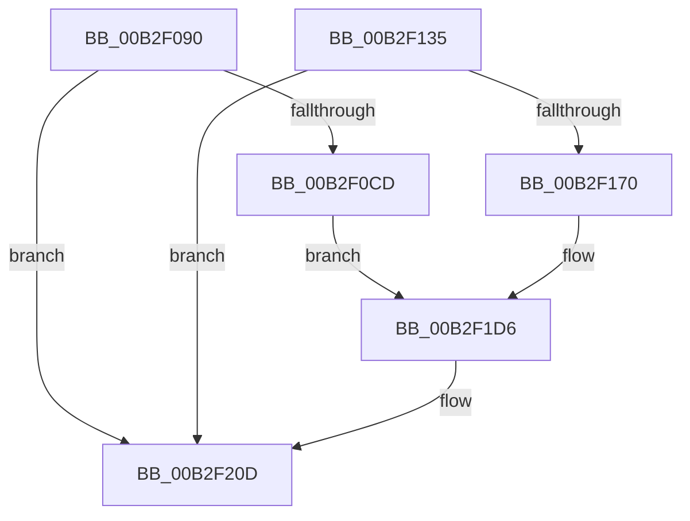

# sub_00B2F090

- RVA: `0x00B2F090`–`0x00B2F220` (길이 `400` bytes)
- VA: `0x0000000140B2F090`
- 실행 섹션: `PAGE`
- PDB 이름 있음: `아니요`; PDB Function 태그: `아니요`
- unwind 정보 RVA: `0x0009F7BC`
- 디코드: `72`개 명령, `400/400` bytes 표시
- 미해석 바이트: `0` (있으면 어셈블리에 `.byte`로 보존)

> 이 문서는 커널 이미지의 기계어와 PDB 기호를 분석해 생성했습니다. 4번과 5번은 함수 원형과 자료형을 바이너리 사용 방식에서 추정한 C 해석이며 원본 소스 복구 결과는 아닙니다.

## 1. Dependencies

- 직접 호출 지점: **6**; 고유 호출 대상: **4**
- 직접 호출자로 확인된 함수: **0**
- RIP 상대 이미지 참조: **3**

### Outgoing calls
- `0x00B2F0A8` → [PiUEventGatherEventData](../A6/PiUEventGatherEventData_function_00A6EBAC.md) (function, `0x00A6EBAC`)
- `0x00B2F0B9` → [PiUEventGetProcessImagePath](../AB/PiUEventGetProcessImagePath_function_00AB76F0.md) (function, `0x00AB76F0`)
- `0x00B2F14D` → [PiUEventGatherEventData](../A6/PiUEventGatherEventData_function_00A6EBAC.md) (function, `0x00A6EBAC`)
- `0x00B2F15E` → [PiUEventGetProcessImagePath](../AB/PiUEventGetProcessImagePath_function_00AB76F0.md) (function, `0x00AB76F0`)
- `0x00B2F208` → [McTemplateK0qqzqqtjqzjzttx_EtwWriteTransfer](../../text/5A/McTemplateK0qqzqqtjqzjzttx_EtwWriteTransfer_function_005A7708.md) (function, `0x005A7708`)
- `0x00B2F215` → [PiUEventFreeProcessImagePath](../AC/PiUEventFreeProcessImagePath_function_00AC8C44.md) (function, `0x00AC8C44`)

### Direct callers
- 이 함수 시작 RVA로 연결되는 직접 call은 확인되지 않았습니다. 간접 호출은 완전히 역산할 수 없습니다.

### Static image references
- `0x00B2F0BE` → RVA `0x00EF012C` (`.data`; read)
- `0x00B2F125` → RVA `0x00027450` (`.rdata`; read)
- `0x00B2F1CA` → RVA `0x00026FE0` (`.rdata`; read)

## 2. Other-region calls and transfers

- 다른 실행 섹션으로 향하는 call: **1**
  - `0x00B2F208` → [McTemplateK0qqzqqtjqzjzttx_EtwWriteTransfer](../../text/5A/McTemplateK0qqzqqtjqzjzttx_EtwWriteTransfer_function_005A7708.md) (`PAGE` → `.text`)
- call이 아닌 외부 분기/꼬리 이동: **1**
  - `0x00B2F21B` → [PiUEventHandleGetEvent + 0x1CE](../9C/PiUEventHandleGetEvent_function_009C2C30.md) (`tail-transfer`)

## 3. Assembly (complete function range)

```asm
00B2F090  4C 8D 8C 24 90 00 00 00         lea r9, [rsp + 0x90]
00B2F098  4C 8D 84 24 98 00 00 00         lea r8, [rsp + 0x98]
00B2F0A0  48 8D 94 24 A0 00 00 00         lea rdx, [rsp + 0xa0]
00B2F0A8  E8 FF FA F3 FF                  call 0x140a6ebac
00B2F0AD  49 8B 4E 30                     mov rcx, qword ptr [r14 + 0x30]
00B2F0B1  48 8D 94 24 00 01 00 00         lea rdx, [rsp + 0x100]
00B2F0B9  E8 32 86 F8 FF                  call 0x140ab76f0
00B2F0BE  0F B6 05 67 10 3C 00            movzx eax, byte ptr [rip + 0x3c1067]
00B2F0C5  84 C0                           test al, al
00B2F0C7  0F 89 40 01 00 00               jns 0x140b2f20d
00B2F0CD  48 8B 8C 24 A8 00 00 00         mov rcx, qword ptr [rsp + 0xa8]
00B2F0D5  48 89 BC 24 80 00 00 00         mov qword ptr [rsp + 0x80], rdi
00B2F0DD  33 FF                           xor edi, edi
00B2F0DF  89 7C 24 78                     mov dword ptr [rsp + 0x78], edi
00B2F0E3  48 8B 09                        mov rcx, qword ptr [rcx]
00B2F0E6  0F B6 41 4C                     movzx eax, byte ptr [rcx + 0x4c]
00B2F0EA  48 8D 51 50                     lea rdx, [rcx + 0x50]
00B2F0EE  89 44 24 70                     mov dword ptr [rsp + 0x70], eax
00B2F0F2  48 8B 84 24 90 00 00 00         mov rax, qword ptr [rsp + 0x90]
00B2F0FA  48 89 44 24 68                  mov qword ptr [rsp + 0x68], rax
00B2F0FF  48 8B 84 24 98 00 00 00         mov rax, qword ptr [rsp + 0x98]
00B2F107  48 89 44 24 60                  mov qword ptr [rsp + 0x60], rax
00B2F10C  48 8B 84 24 A0 00 00 00         mov rax, qword ptr [rsp + 0xa0]
00B2F114  48 89 44 24 58                  mov qword ptr [rsp + 0x58], rax
00B2F119  8B 41 60                        mov eax, dword ptr [rcx + 0x60]
00B2F11C  89 44 24 50                     mov dword ptr [rsp + 0x50], eax
00B2F120  48 89 54 24 48                  mov qword ptr [rsp + 0x48], rdx
00B2F125  48 8D 15 24 83 4F FF            lea rdx, [rip - 0xb07cdc]
00B2F12C  89 7C 24 40                     mov dword ptr [rsp + 0x40], edi
00B2F130  E9 A1 00 00 00                  jmp 0x140b2f1d6
00B2F135  4C 8D 8C 24 90 00 00 00         lea r9, [rsp + 0x90]
00B2F13D  4C 8D 84 24 98 00 00 00         lea r8, [rsp + 0x98]
00B2F145  48 8D 94 24 A0 00 00 00         lea rdx, [rsp + 0xa0]
00B2F14D  E8 5A FA F3 FF                  call 0x140a6ebac
00B2F152  49 8B 4E 30                     mov rcx, qword ptr [r14 + 0x30]
00B2F156  48 8D 94 24 00 01 00 00         lea rdx, [rsp + 0x100]
00B2F15E  E8 8D 85 F8 FF                  call 0x140ab76f0
00B2F163  F6 05 C2 0F 3C 00 02            test byte ptr [rip + 0x3c0fc2], 2
00B2F16A  0F 84 9D 00 00 00               je 0x140b2f20d
00B2F170  48 8B 8C 24 A8 00 00 00         mov rcx, qword ptr [rsp + 0xa8]
00B2F178  45 33 C0                        xor r8d, r8d
00B2F17B  48 89 BC 24 80 00 00 00         mov qword ptr [rsp + 0x80], rdi
00B2F183  44 89 44 24 78                  mov dword ptr [rsp + 0x78], r8d
00B2F188  48 8B 09                        mov rcx, qword ptr [rcx]
00B2F18B  0F B6 41 4C                     movzx eax, byte ptr [rcx + 0x4c]
00B2F18F  48 8D 51 50                     lea rdx, [rcx + 0x50]
00B2F193  89 44 24 70                     mov dword ptr [rsp + 0x70], eax
00B2F197  48 8B 84 24 90 00 00 00         mov rax, qword ptr [rsp + 0x90]
00B2F19F  48 89 44 24 68                  mov qword ptr [rsp + 0x68], rax
00B2F1A4  48 8B 84 24 98 00 00 00         mov rax, qword ptr [rsp + 0x98]
00B2F1AC  48 89 44 24 60                  mov qword ptr [rsp + 0x60], rax
00B2F1B1  48 8B 84 24 A0 00 00 00         mov rax, qword ptr [rsp + 0xa0]
00B2F1B9  48 89 44 24 58                  mov qword ptr [rsp + 0x58], rax
00B2F1BE  8B 41 60                        mov eax, dword ptr [rcx + 0x60]
00B2F1C1  89 44 24 50                     mov dword ptr [rsp + 0x50], eax
00B2F1C5  48 89 54 24 48                  mov qword ptr [rsp + 0x48], rdx
00B2F1CA  48 8D 15 0F 7E 4F FF            lea rdx, [rip - 0xb081f1]
00B2F1D1  44 89 44 24 40                  mov dword ptr [rsp + 0x40], r8d
00B2F1D6  41 8B 86 88 00 00 00            mov eax, dword ptr [r14 + 0x88]
00B2F1DD  45 8B 8E 84 00 00 00            mov r9d, dword ptr [r14 + 0x84]
00B2F1E4  89 44 24 38                     mov dword ptr [rsp + 0x38], eax
00B2F1E8  41 8B 86 80 00 00 00            mov eax, dword ptr [r14 + 0x80]
00B2F1EF  89 44 24 30                     mov dword ptr [rsp + 0x30], eax
00B2F1F3  48 8B 84 24 00 01 00 00         mov rax, qword ptr [rsp + 0x100]
00B2F1FB  48 89 44 24 28                  mov qword ptr [rsp + 0x28], rax
00B2F200  41 8B 46 30                     mov eax, dword ptr [r14 + 0x30]
00B2F204  89 44 24 20                     mov dword ptr [rsp + 0x20], eax
00B2F208  E8 FB 84 A7 FF                  call 0x1405a7708
00B2F20D  48 8D 8C 24 00 01 00 00         lea rcx, [rsp + 0x100]
00B2F215  E8 2A 9A F9 FF                  call 0x140ac8c44
00B2F21A  90                              nop
00B2F21B  E9 DE 3B E9 FF                  jmp 0x1409c2dfe
```

## 4. C-style interpretation (structured pseudocode)

```c
__int64 __fastcall sub_00B2F090(__int64 a1, __int64 a2, __int64 a3, __int64 a4, __int64 a5, __int64 a6, __int64 a7, __int64 a8, __int64 a9, __int64 a10, __int64 a11, __int64 a12, __int64 a13, __int64 a14, __int64 a15, __int64 a16, __int64 a17, __int64 a18, __int64 a19, __int64 a20, __int64 a21, __int64 a22, __int64 a23, __int64 a24, __int64 a25, __int64 a26, __int64 a27, __int64 a28, __int64 a29, __int64 a30, __int64 a31, __int64 a32)
{
    __int64 result;
    __int64 v_rdi;
    unsigned __int64 v_stack_p100;
    unsigned int v_stack_p20;
    unsigned __int64 v_stack_p28;
    unsigned int v_stack_p30;
    unsigned int v_stack_p38;
    unsigned int v_stack_p40;
    unsigned __int64 v_stack_p48;
    unsigned int v_stack_p50;
    unsigned __int64 v_stack_p58;
    unsigned __int64 v_stack_p60;
    unsigned __int64 v_stack_p68;
    unsigned int v_stack_p70;
    unsigned int v_stack_p78;
    unsigned __int64 v_stack_p80;
    unsigned __int64 v_stack_p90;
    unsigned __int64 v_stack_p98;
    unsigned __int64 v_stack_pA0;
    unsigned __int64 v_stack_pA8;

    result = PiUEventGatherEventData(a1, a20, a19, a18);
    result = PiUEventGetProcessImagePath(*(unsigned __int64 *)(v_r14 + 48), a32, a19, a18);
    if (!sign_flag) goto loc_00B2F20D;
    v_stack_p80 = v_rdi;
    v_rdi = 0;
    v_stack_p78 = 0;
    v_stack_p70 = (unsigned int)(*(unsigned __int8 *)(*(unsigned __int64 *)(a21) + 76));
    v_stack_p68 = a18;
    v_stack_p60 = a19;
    v_stack_p58 = a20;
    v_stack_p50 = (unsigned int)((unsigned int)(*(unsigned int *)(*(unsigned __int64 *)(a21) + 96)));
    v_stack_p48 = *(unsigned __int64 *)(a21) + 80;
    v_stack_p40 = 0;
    goto loc_00B2F1D6;
loc_00B2F1D6:
    v_stack_p38 = (unsigned int)((unsigned int)(*(unsigned int *)(v_r14 + 136)));
    v_stack_p30 = (unsigned int)((unsigned int)(*(unsigned int *)(v_r14 + 128)));
    v_stack_p28 = a32;
    v_stack_p20 = (unsigned int)((unsigned int)(*(unsigned int *)(v_r14 + 48)));
    result = McTemplateK0qqzqqtjqzjzttx_EtwWriteTransfer(*(unsigned __int64 *)(a21), v_rip - 11566300, a19, (unsigned int)(*(unsigned int *)(v_r14 + 132)));
loc_00B2F20D:
    result = PiUEventFreeProcessImagePath(a32, v_rip - 11566300, a19, (unsigned int)(*(unsigned int *)(v_r14 + 132)));
}
```

## 5. (Beta) C Style

```c
int64_t sub_00B2F090(int64_t Arg1, int64_t Arg2, int64_t Arg3, int64_t Arg4, uint64_t Arg5, uint64_t Arg6, uint64_t Arg7, uint64_t Arg8, uint64_t Arg9, uint64_t Arg10, uint64_t Arg11, uint64_t Arg12, uint64_t Arg13, uint64_t Arg14, uint64_t Arg15, uint64_t Arg16, uint64_t Arg17, int64_t Arg18, int64_t Arg19, int64_t Arg20, void *Arg21, uint64_t Arg22, uint64_t Arg23, uint64_t Arg24, uint64_t Arg25, uint64_t Arg26, uint64_t Arg27, uint64_t Arg28, uint64_t Arg29, uint64_t Arg30, uint64_t Arg31, int64_t Arg32)
{
    uint8_t *arg21 = (uint8_t *)Arg21;

    int64_t result;
    int64_t local_rdi;
    uint64_t v_stack_p100;
    uint32_t v_stack_p20;
    uint64_t v_stack_p28;
    uint32_t v_stack_p30;
    uint32_t v_stack_p38;
    uint32_t v_stack_p40;
    uint64_t v_stack_p48;
    uint32_t v_stack_p50;
    uint64_t v_stack_p58;
    uint64_t v_stack_p60;
    uint64_t v_stack_p68;
    uint32_t v_stack_p70;
    uint32_t v_stack_p78;
    uint64_t v_stack_p80;
    uint64_t v_stack_p90;
    uint64_t v_stack_p98;
    uint64_t v_stack_pA0;
    uint64_t v_stack_pA8;

    result = PiUEventGatherEventData(Arg1, Arg20, Arg19, Arg18);
    result = PiUEventGetProcessImagePath(*(uint64_t *)(local_r14 + 0x30), Arg32, Arg19, Arg18);
    if (!sign_flag) goto loc_00B2F20D;
    v_stack_p80 = local_rdi;
    local_rdi = 0;
    v_stack_p78 = 0;
    v_stack_p70 = (uint32_t)(*(uint8_t *)(*(uint64_t *)(arg21) + 0x4C));
    v_stack_p68 = Arg18;
    v_stack_p60 = Arg19;
    v_stack_p58 = Arg20;
    v_stack_p50 = (uint32_t)((uint32_t)(*(uint32_t *)(*(uint64_t *)(arg21) + 0x60)));
    v_stack_p48 = *(uint64_t *)(arg21) + 80;
    v_stack_p40 = 0;
    goto loc_00B2F1D6;
loc_00B2F1D6:
    v_stack_p38 = (uint32_t)((uint32_t)(*(uint32_t *)(local_r14 + 0x88)));
    v_stack_p30 = (uint32_t)((uint32_t)(*(uint32_t *)(local_r14 + 0x80)));
    v_stack_p28 = Arg32;
    v_stack_p20 = (uint32_t)((uint32_t)(*(uint32_t *)(local_r14 + 0x30)));
    result = McTemplateK0qqzqqtjqzjzttx_EtwWriteTransfer(*(uint64_t *)(arg21), v_rip - 11566300, Arg19, (uint32_t)(*(uint32_t *)(local_r14 + 0x84)));
loc_00B2F20D:
    result = PiUEventFreeProcessImagePath(Arg32, v_rip - 11566300, Arg19, (uint32_t)(*(uint32_t *)(local_r14 + 0x84)));
}
```

### 관측된 메모리 오프셋

구조체 형식이 확인되지 않은 접근은 인자 기준의 오프셋으로만 기록했습니다.

| 기준 인자 | 오프셋 표현 | 폭 (bit) | 접근 |
|---|---:|---:|---|
| `Arg21` | `+ 0x0` | `64` | `R` |

## 6. Execution-region graph

[열기: 2D/3D 그래프와 함수 탐색 컨트롤 패널](../../../control-panel.html?section=page&rva=0x00B2F090&view=graph)

- 2D 그래프는 위에서 아래로 흐르고, 3D 그래프는 빈 공간을 드래그해 회전합니다. Shift+드래그는 이동, 휠은 확대·축소, 함수 노드 선택은 대상 보고서 이동입니다.

### Static fallback


