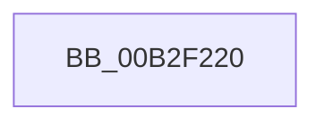

# sub_00B2F220

- RVA: `0x00B2F220`–`0x00B2F242` (길이 `34` bytes)
- VA: `0x0000000140B2F220`
- 실행 섹션: `PAGE`
- PDB 이름 있음: `아니요`; PDB Function 태그: `아니요`
- unwind 정보 RVA: `0x0009F7E4`
- 디코드: `6`개 명령, `34/34` bytes 표시
- 미해석 바이트: `0` (있으면 어셈블리에 `.byte`로 보존)

> 이 문서는 커널 이미지의 기계어와 PDB 기호를 분석해 생성했습니다. 4번과 5번은 함수 원형과 자료형을 바이너리 사용 방식에서 추정한 C 해석이며 원본 소스 복구 결과는 아닙니다.

## 1. Dependencies

- 직접 호출 지점: **1**; 고유 호출 대상: **1**
- 직접 호출자로 확인된 함수: **0**
- RIP 상대 이미지 참조: **0**

### Outgoing calls
- `0x00B2F230` → [memcpy](../../text/6C/memcpy_function_006C6840.md) (function, `0x006C6840`)

### Direct callers
- 이 함수 시작 RVA로 연결되는 직접 call은 확인되지 않았습니다. 간접 호출은 완전히 역산할 수 없습니다.

### Static image references
- 디코드된 RIP-relative 메모리 참조가 없습니다.

## 2. Other-region calls and transfers

- 다른 실행 섹션으로 향하는 call: **1**
  - `0x00B2F230` → [memcpy](../../text/6C/memcpy_function_006C6840.md) (`PAGE` → `.text`)
- call이 아닌 외부 분기/꼬리 이동: **1**
  - `0x00B2F23D` → [PiUEventCopyEventData + 0x244](../9C/PiUEventCopyEventData_function_009C2E90.md) (`tail-transfer`)

## 3. Assembly (complete function range)

```asm
00B2F220  4E 8D 04 45 02 00 00 00         lea r8, [r8*2 + 2]
00B2F228  49 8D 52 38                     lea rdx, [r10 + 0x38]
00B2F22C  49 8D 4E 24                     lea rcx, [r14 + 0x24]
00B2F230  E8 0B 76 B9 FF                  call 0x1406c6840
00B2F235  41 C7 46 1C 02 00 00 00         mov dword ptr [r14 + 0x1c], 2
00B2F23D  E9 92 3E E9 FF                  jmp 0x1409c30d4
```

## 4. C-style interpretation (structured pseudocode)

```c
__int64 __fastcall sub_00B2F220(__int64 a1, __int64 a2, __int64 a3)
{
    __int64 result;

    result = memcpy(v_r14 + 36, v_r10 + 56, a3 * 2 + 2, a4);
    *(unsigned int *)(v_r14 + 28) = 2;
}
```

## 5. (Beta) C Style

```c
int64_t sub_00B2F220(int64_t Arg1, int64_t Arg2, int64_t Arg3)
{
    int64_t result;

    result = memcpy(local_r14 + 36, local_r10 + 56, Arg3 * 2 + 2, a4);
    *(uint32_t *)(local_r14 + 0x1C) = 2;
}
```

## 6. Execution-region graph

[열기: 2D/3D 그래프와 함수 탐색 컨트롤 패널](../../../control-panel.html?section=page&rva=0x00B2F220&view=graph)

- 2D 그래프는 위에서 아래로 흐르고, 3D 그래프는 빈 공간을 드래그해 회전합니다. Shift+드래그는 이동, 휠은 확대·축소, 함수 노드 선택은 대상 보고서 이동입니다.

### Static fallback


