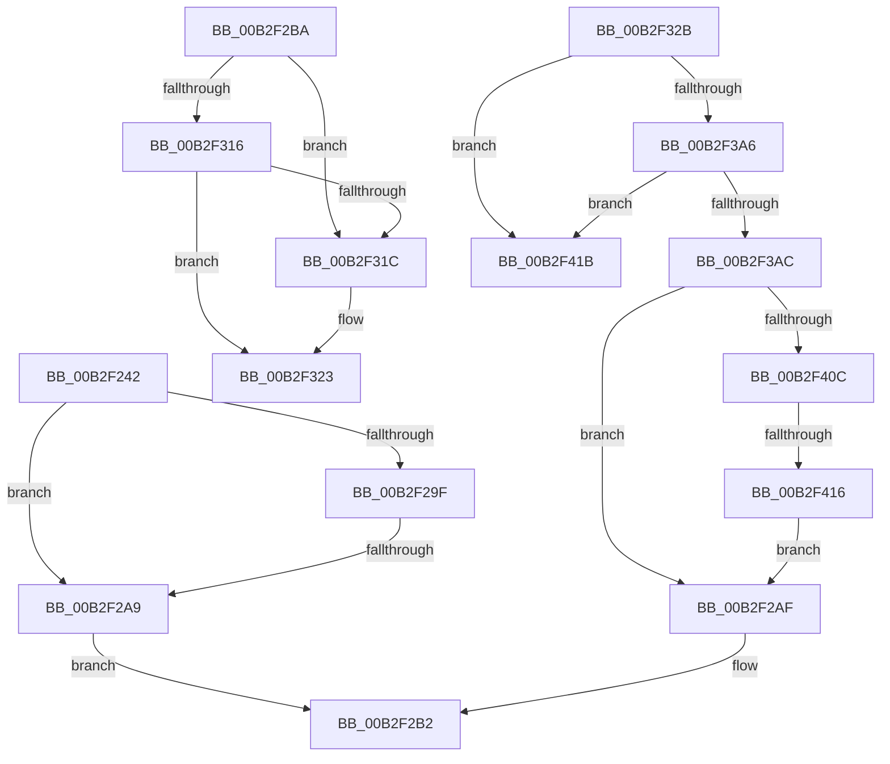

# sub_00B2F242

- RVA: `0x00B2F242`–`0x00B2F42E` (길이 `492` bytes)
- VA: `0x0000000140B2F242`
- 실행 섹션: `PAGE`
- PDB 이름 있음: `아니요`; PDB Function 태그: `아니요`
- unwind 정보 RVA: `0x0009F828`
- 디코드: `111`개 명령, `492/492` bytes 표시
- 미해석 바이트: `0` (있으면 어셈블리에 `.byte`로 보존)

> 이 문서는 커널 이미지의 기계어와 PDB 기호를 분석해 생성했습니다. 4번과 5번은 함수 원형과 자료형을 바이너리 사용 방식에서 추정한 C 해석이며 원본 소스 복구 결과는 아닙니다.

## 1. Dependencies

- 직접 호출 지점: **6**; 고유 호출 대상: **3**
- 직접 호출자로 확인된 함수: **0**
- RIP 상대 이미지 참조: **3**

### Outgoing calls
- `0x00B2F294` → [PnpGetObjectProperty](../8E/PnpGetObjectProperty_function_008E2180.md) (function, `0x008E2180`)
- `0x00B2F30B` → [PnpGetObjectProperty](../8E/PnpGetObjectProperty_function_008E2180.md) (function, `0x008E2180`)
- `0x00B2F339` → [RtlInitUnicodeString](../../text/42/RtlInitUnicodeString_function_0042A780.md) (function, `0x0042A780`)
- `0x00B2F39B` → [PnpGetObjectProperty](../8E/PnpGetObjectProperty_function_008E2180.md) (function, `0x008E2180`)
- `0x00B2F3FD` → [PnpGetObjectProperty](../8E/PnpGetObjectProperty_function_008E2180.md) (function, `0x008E2180`)
- `0x00B2F423` → [ExFreePoolWithTag](../../poolcode/B8/ExFreePoolWithTag_function_00B82870.md) (function, `0x00B82870`)

### Direct callers
- 이 함수 시작 RVA로 연결되는 직접 call은 확인되지 않았습니다. 간접 호출은 완전히 역산할 수 없습니다.

### Static image references
- `0x00B2F256` → RVA `0x00E66398` (`.data`; read)
- `0x00B2F27F` → RVA `0x00011460` (`.rdata`; read)
- `0x00B2F37B` → RVA `0x00011490` (`.rdata`; read)

## 2. Other-region calls and transfers

- 다른 실행 섹션으로 향하는 call: **2**
  - `0x00B2F339` → [RtlInitUnicodeString](../../text/42/RtlInitUnicodeString_function_0042A780.md) (`PAGE` → `.text`)
  - `0x00B2F423` → [ExFreePoolWithTag](../../poolcode/B8/ExFreePoolWithTag_function_00B82870.md) (`PAGE` → `POOLCODE`)
- call이 아닌 외부 분기/꼬리 이동: **5**
  - `0x00B2F2A3` → [PiUEventProcessBroadcastNotifications + 0x2C4](../9C/PiUEventProcessBroadcastNotifications_function_009C370C.md) (`tail-transfer`)
  - `0x00B2F2B5` → [PiUEventProcessBroadcastNotifications + 0x2C4](../9C/PiUEventProcessBroadcastNotifications_function_009C370C.md) (`tail-transfer`)
  - `0x00B2F326` → [PiUEventProcessBroadcastNotifications + 0x2C7](../9C/PiUEventProcessBroadcastNotifications_function_009C370C.md) (`tail-transfer`)
  - `0x00B2F410` → [PiUEventProcessBroadcastNotifications + 0x2C4](../9C/PiUEventProcessBroadcastNotifications_function_009C370C.md) (`tail-transfer`)
  - `0x00B2F429` → [PiUEventProcessBroadcastNotifications + 0xC2](../9C/PiUEventProcessBroadcastNotifications_function_009C370C.md) (`tail-transfer`)

## 3. Assembly (complete function range)

```asm
00B2F242  44 89 7C 24 50                  mov dword ptr [rsp + 0x50], r15d
00B2F247  4C 8D 70 18                     lea r14, [rax + 0x18]
00B2F24B  44 89 78 14                     mov dword ptr [rax + 0x14], r15d
00B2F24F  48 8D 97 80 00 00 00            lea rdx, [rdi + 0x80]
00B2F256  48 8B 0D 3B 71 33 00            mov rcx, qword ptr [rip + 0x33713b]
00B2F25D  48 8D 45 40                     lea rax, [rbp + 0x40]
00B2F261  48 89 44 24 48                  mov qword ptr [rsp + 0x48], rax
00B2F266  45 33 C9                        xor r9d, r9d
00B2F269  C7 44 24 40 04 00 00 00         mov dword ptr [rsp + 0x40], 4
00B2F271  48 8D 45 38                     lea rax, [rbp + 0x38]
00B2F275  4C 89 74 24 38                  mov qword ptr [rsp + 0x38], r14
00B2F27A  48 89 44 24 30                  mov qword ptr [rsp + 0x30], rax
00B2F27F  48 8D 05 DA 21 4E FF            lea rax, [rip - 0xb1de26]
00B2F286  48 89 44 24 28                  mov qword ptr [rsp + 0x28], rax
00B2F28B  45 8D 41 01                     lea r8d, [r9 + 1]
00B2F28F  4C 89 7C 24 20                  mov qword ptr [rsp + 0x20], r15
00B2F294  E8 E7 2E DB FF                  call 0x1408e2180
00B2F299  8B D8                           mov ebx, eax
00B2F29B  85 C0                           test eax, eax
00B2F29D  78 0A                           js 0x140b2f2a9
00B2F29F  83 7D 40 04                     cmp dword ptr [rbp + 0x40], 4
00B2F2A3  0F 84 27 47 E9 FF               je 0x1409c39d0
00B2F2A9  41 83 0E FF                     or dword ptr [r14], 0xffffffff
00B2F2AD  EB 03                           jmp 0x140b2f2b2
00B2F2AF  83 0F FF                        or dword ptr [rdi], 0xffffffff
00B2F2B2  41 8B DF                        mov ebx, r15d
00B2F2B5  E9 16 47 E9 FF                  jmp 0x1409c39d0
00B2F2BA  44 89 7C 24 50                  mov dword ptr [rsp + 0x50], r15d
00B2F2BF  4C 8D 70 18                     lea r14, [rax + 0x18]
00B2F2C3  C7 40 14 01 00 00 00            mov dword ptr [rax + 0x14], 1
00B2F2CA  45 33 C9                        xor r9d, r9d
00B2F2CD  48 8B 0D C4 70 33 00            mov rcx, qword ptr [rip + 0x3370c4]
00B2F2D4  48 8D 45 40                     lea rax, [rbp + 0x40]
00B2F2D8  48 89 44 24 48                  mov qword ptr [rsp + 0x48], rax
00B2F2DD  48 8B D6                        mov rdx, rsi
00B2F2E0  C7 44 24 40 04 00 00 00         mov dword ptr [rsp + 0x40], 4
00B2F2E8  48 8D 45 38                     lea rax, [rbp + 0x38]
00B2F2EC  4C 89 74 24 38                  mov qword ptr [rsp + 0x38], r14
00B2F2F1  45 8D 41 01                     lea r8d, [r9 + 1]
00B2F2F5  48 89 44 24 30                  mov qword ptr [rsp + 0x30], rax
00B2F2FA  48 8D 05 5F 21 4E FF            lea rax, [rip - 0xb1dea1]
00B2F301  48 89 44 24 28                  mov qword ptr [rsp + 0x28], rax
00B2F306  4C 89 7C 24 20                  mov qword ptr [rsp + 0x20], r15
00B2F30B  E8 70 2E DB FF                  call 0x1408e2180
00B2F310  8B D8                           mov ebx, eax
00B2F312  85 C0                           test eax, eax
00B2F314  78 06                           js 0x140b2f31c
00B2F316  83 7D 40 04                     cmp dword ptr [rbp + 0x40], 4
00B2F31A  74 07                           je 0x140b2f323
00B2F31C  41 83 0E FF                     or dword ptr [r14], 0xffffffff
00B2F320  41 8B DF                        mov ebx, r15d
00B2F323  48 8B CF                        mov rcx, rdi
00B2F326  E9 A8 46 E9 FF                  jmp 0x1409c39d3
00B2F32B  48 8D 9F 90 00 00 00            lea rbx, [rdi + 0x90]
00B2F332  48 8B D3                        mov rdx, rbx
00B2F335  48 8D 4D F0                     lea rcx, [rbp - 0x10]
00B2F339  E8 42 B4 8F FF                  call 0x14042a780
00B2F33E  44 89 7C 24 50                  mov dword ptr [rsp + 0x50], r15d
00B2F343  48 8D 45 48                     lea rax, [rbp + 0x48]
00B2F347  48 89 44 24 48                  mov qword ptr [rsp + 0x48], rax
00B2F34C  4C 8D 76 2C                     lea r14, [rsi + 0x2c]
00B2F350  B9 90 01 00 00                  mov ecx, 0x190
00B2F355  48 8D 45 38                     lea rax, [rbp + 0x38]
00B2F359  89 4C 24 40                     mov dword ptr [rsp + 0x40], ecx
00B2F35D  41 B8 03 00 00 00               mov r8d, 3
00B2F363  44 89 46 14                     mov dword ptr [rsi + 0x14], r8d
00B2F367  45 33 C9                        xor r9d, r9d
00B2F36A  0F 10 47 50                     movups xmm0, xmmword ptr [rdi + 0x50]
00B2F36E  4C 89 74 24 38                  mov qword ptr [rsp + 0x38], r14
00B2F373  48 8B D3                        mov rdx, rbx
00B2F376  48 89 44 24 30                  mov qword ptr [rsp + 0x30], rax
00B2F37B  48 8D 05 0E 21 4E FF            lea rax, [rip - 0xb1def2]
00B2F382  F3 0F 7F 46 1C                  movdqu xmmword ptr [rsi + 0x1c], xmm0
00B2F387  89 4D 48                        mov dword ptr [rbp + 0x48], ecx
00B2F38A  48 8B 0D 07 70 33 00            mov rcx, qword ptr [rip + 0x337007]
00B2F391  48 89 44 24 28                  mov qword ptr [rsp + 0x28], rax
00B2F396  4C 89 7C 24 20                  mov qword ptr [rsp + 0x20], r15
00B2F39B  E8 E0 2D DB FF                  call 0x1408e2180
00B2F3A0  8B D8                           mov ebx, eax
00B2F3A2  85 C0                           test eax, eax
00B2F3A4  78 75                           js 0x140b2f41b
00B2F3A6  83 7D 38 12                     cmp dword ptr [rbp + 0x38], 0x12
00B2F3AA  75 6F                           jne 0x140b2f41b
00B2F3AC  48 8B 0D E5 6F 33 00            mov rcx, qword ptr [rip + 0x336fe5]
00B2F3B3  48 8D 45 48                     lea rax, [rbp + 0x48]
00B2F3B7  44 89 7C 24 50                  mov dword ptr [rsp + 0x50], r15d
00B2F3BC  48 8D 7E 18                     lea rdi, [rsi + 0x18]
00B2F3C0  48 89 44 24 48                  mov qword ptr [rsp + 0x48], rax
00B2F3C5  45 33 C9                        xor r9d, r9d
00B2F3C8  C7 44 24 40 04 00 00 00         mov dword ptr [rsp + 0x40], 4
00B2F3D0  48 8D 45 38                     lea rax, [rbp + 0x38]
00B2F3D4  48 89 7C 24 38                  mov qword ptr [rsp + 0x38], rdi
00B2F3D9  49 8B D6                        mov rdx, r14
00B2F3DC  48 89 44 24 30                  mov qword ptr [rsp + 0x30], rax
00B2F3E1  48 8D 05 78 20 4E FF            lea rax, [rip - 0xb1df88]
00B2F3E8  48 89 44 24 28                  mov qword ptr [rsp + 0x28], rax
00B2F3ED  45 8D 41 01                     lea r8d, [r9 + 1]
00B2F3F1  4C 89 7C 24 20                  mov qword ptr [rsp + 0x20], r15
00B2F3F6  C7 45 48 04 00 00 00            mov dword ptr [rbp + 0x48], 4
00B2F3FD  E8 7E 2D DB FF                  call 0x1408e2180
00B2F402  8B D8                           mov ebx, eax
00B2F404  85 C0                           test eax, eax
00B2F406  0F 88 A3 FE FF FF               js 0x140b2f2af
00B2F40C  83 7D 38 07                     cmp dword ptr [rbp + 0x38], 7
00B2F410  0F 84 BA 45 E9 FF               je 0x1409c39d0
00B2F416  E9 94 FE FF FF                  jmp 0x140b2f2af
00B2F41B  BA 50 6E 70 59                  mov edx, 0x59706e50
00B2F420  48 8B CE                        mov rcx, rsi
00B2F423  E8 48 34 05 00                  call 0x140b82870
00B2F428  90                              nop
00B2F429  E9 A0 43 E9 FF                  jmp 0x1409c37ce
```

## 4. C-style interpretation (structured pseudocode)

```c
__int64 __fastcall sub_00B2F242(__int64 a1, __int64 a2, __int64 a3, int a4)
{
    __int64 result;
    unsigned __int64 v_stack_p20;
    unsigned __int64 v_stack_p28;
    unsigned __int64 v_stack_p30;
    unsigned __int64 v_stack_p38;
    unsigned int v_stack_p40;
    unsigned __int64 v_stack_p48;
    unsigned int v_stack_p50;

    v_stack_p50 = (unsigned int)(v_r15);
    *(unsigned int *)(result + 20) = (unsigned int)(v_r15);
    v_stack_p48 = v_rbp + 64;
    a4 = 0;
    v_stack_p40 = 4;
    v_stack_p38 = result + 24;
    v_stack_p30 = v_rbp + 56;
    v_stack_p28 = v_rip - 11656742;
    v_stack_p20 = v_r15;
    result = PnpGetObjectProperty(*(unsigned __int64 *)(v_rip + 3371323), v_rdi + 128, a4 + 1, a4);
    if (sign_flag) goto loc_00B2F2A9;
loc_00B2F2A9:
    goto loc_00B2F2B2;
loc_00B2F2B2:
}
```

## 5. (Beta) C Style

```c
int64_t sub_00B2F242(int64_t Arg1, int64_t Arg2, int64_t Arg3, int32_t Arg4)
{
    int64_t result;
    uint64_t v_stack_p20;
    uint64_t v_stack_p28;
    uint64_t v_stack_p30;
    uint64_t v_stack_p38;
    uint32_t v_stack_p40;
    uint64_t v_stack_p48;
    uint32_t v_stack_p50;

    v_stack_p50 = (uint32_t)(local_r15);
    *(uint32_t *)(result + 0x14) = (uint32_t)(local_r15);
    v_stack_p48 = local_rbp + 64;
    Arg4 = 0;
    v_stack_p40 = 4;
    v_stack_p38 = result + 24;
    v_stack_p30 = local_rbp + 56;
    v_stack_p28 = v_rip - 11656742;
    v_stack_p20 = local_r15;
    result = PnpGetObjectProperty(*(uint64_t *)(v_rip + 0x33713B), local_rdi + 128, Arg4 + 1, Arg4);
    if (sign_flag) goto loc_00B2F2A9;
loc_00B2F2A9:
    goto loc_00B2F2B2;
loc_00B2F2B2:
}
```

## 6. Execution-region graph

[열기: 2D/3D 그래프와 함수 탐색 컨트롤 패널](../../../control-panel.html?section=page&rva=0x00B2F242&view=graph)

- 2D 그래프는 위에서 아래로 흐르고, 3D 그래프는 빈 공간을 드래그해 회전합니다. Shift+드래그는 이동, 휠은 확대·축소, 함수 노드 선택은 대상 보고서 이동입니다.

### Static fallback


