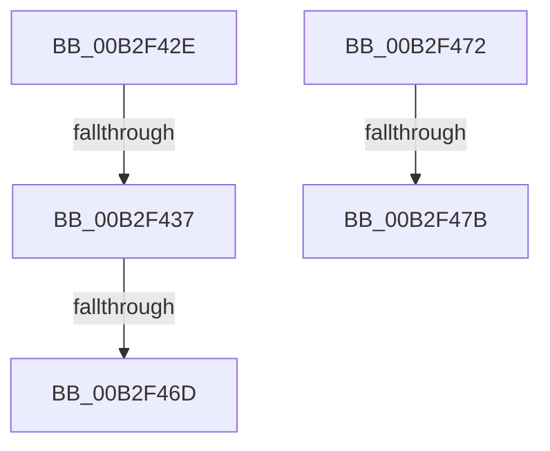

# sub_00B2F42E

- RVA: `0x00B2F42E`–`0x00B2F480` (길이 `82` bytes)
- VA: `0x0000000140B2F42E`
- 실행 섹션: `PAGE`
- PDB 이름 있음: `아니요`; PDB Function 태그: `아니요`
- unwind 정보 RVA: `0x0009F8BC`
- 디코드: `18`개 명령, `82/82` bytes 표시
- 미해석 바이트: `0` (있으면 어셈블리에 `.byte`로 보존)

> 이 문서는 커널 이미지의 기계어와 PDB 기호를 분석해 생성했습니다. 4번과 5번은 함수 원형과 자료형을 바이너리 사용 방식에서 추정한 C 해석이며 원본 소스 복구 결과는 아닙니다.

## 1. Dependencies

- 직접 호출 지점: **3**; 고유 호출 대상: **2**
- 직접 호출자로 확인된 함수: **0**
- RIP 상대 이미지 참조: **0**

### Outgoing calls
- `0x00B2F440` → [RtlInitUnicodeString](../../text/42/RtlInitUnicodeString_function_0042A780.md) (function, `0x0042A780`)
- `0x00B2F44E` → [RtlInitUnicodeString](../../text/42/RtlInitUnicodeString_function_0042A780.md) (function, `0x0042A780`)
- `0x00B2F460` → [RtlEqualUnicodeString](../93/RtlEqualUnicodeString_function_00932A20.md) (function, `0x00932A20`)

### Direct callers
- 이 함수 시작 RVA로 연결되는 직접 call은 확인되지 않았습니다. 간접 호출은 완전히 역산할 수 없습니다.

### Static image references
- 디코드된 RIP-relative 메모리 참조가 없습니다.

## 2. Other-region calls and transfers

- 다른 실행 섹션으로 향하는 call: **2**
  - `0x00B2F440` → [RtlInitUnicodeString](../../text/42/RtlInitUnicodeString_function_0042A780.md) (`PAGE` → `.text`)
  - `0x00B2F44E` → [RtlInitUnicodeString](../../text/42/RtlInitUnicodeString_function_0042A780.md) (`PAGE` → `.text`)
- call이 아닌 외부 분기/꼬리 이동: **5**
  - `0x00B2F431` → [PiUEventCoalesceBroadcastEvents + 0x38](../9C/PiUEventCoalesceBroadcastEvents_function_009C4000.md) (`tail-transfer`)
  - `0x00B2F467` → [PiUEventCoalesceBroadcastEvents + 0x4F](../9C/PiUEventCoalesceBroadcastEvents_function_009C4000.md) (`tail-transfer`)
  - `0x00B2F46D` → [PiUEventCoalesceBroadcastEvents + 0x38](../9C/PiUEventCoalesceBroadcastEvents_function_009C4000.md) (`tail-transfer`)
  - `0x00B2F475` → [PiUEventCoalesceBroadcastEvents + 0x4F](../9C/PiUEventCoalesceBroadcastEvents_function_009C4000.md) (`tail-transfer`)
  - `0x00B2F47B` → [PiUEventCoalesceBroadcastEvents + 0x38](../9C/PiUEventCoalesceBroadcastEvents_function_009C4000.md) (`tail-transfer`)

## 3. Assembly (complete function range)

```asm
00B2F42E  48 85 C9                        test rcx, rcx
00B2F431  0F 85 01 4C E9 FF               jne 0x1409c4038
00B2F437  48 8D 57 2C                     lea rdx, [rdi + 0x2c]
00B2F43B  48 8D 4C 24 30                  lea rcx, [rsp + 0x30]
00B2F440  E8 3B B3 8F FF                  call 0x14042a780
00B2F445  48 8D 53 2C                     lea rdx, [rbx + 0x2c]
00B2F449  48 8D 4C 24 20                  lea rcx, [rsp + 0x20]
00B2F44E  E8 2D B3 8F FF                  call 0x14042a780
00B2F453  41 B0 01                        mov r8b, 1
00B2F456  48 8D 54 24 20                  lea rdx, [rsp + 0x20]
00B2F45B  48 8D 4C 24 30                  lea rcx, [rsp + 0x30]
00B2F460  E8 BB 35 E0 FF                  call 0x140932a20
00B2F465  84 C0                           test al, al
00B2F467  0F 85 E2 4B E9 FF               jne 0x1409c404f
00B2F46D  E9 C6 4B E9 FF                  jmp 0x1409c4038
00B2F472  48 85 C9                        test rcx, rcx
00B2F475  0F 84 D4 4B E9 FF               je 0x1409c404f
00B2F47B  E9 B8 4B E9 FF                  jmp 0x1409c4038
```

## 4. C-style interpretation (structured pseudocode)

```c
__int64 __fastcall sub_00B2F42E(__int64 a1, __int64 a2, __int64 a3, __int64 a4, __int64 a5, __int64 a6)
{
    __int64 result;
    unsigned __int64 v_stack_p20;

    result = RtlInitUnicodeString(a6, v_rdi + 44, a3, a4);
    result = RtlInitUnicodeString(v_stack_p20, v_rbx + 44, a3, a4);
    result = RtlEqualUnicodeString(a6, v_stack_p20, 1, a4);
}
```

## 5. (Beta) C Style

```c
int64_t sub_00B2F42E(int64_t Arg1, int64_t Arg2, int64_t Arg3, int64_t Arg4, uint64_t Arg5, int64_t Arg6)
{
    int64_t result;
    uint64_t v_stack_p20;

    result = RtlInitUnicodeString(Arg6, local_rdi + 44, Arg3, Arg4);
    result = RtlInitUnicodeString(v_stack_p20, local_rbx + 44, Arg3, Arg4);
    result = RtlEqualUnicodeString(Arg6, v_stack_p20, 1, Arg4);
}
```

## 6. Execution-region graph

[열기: 2D/3D 그래프와 함수 탐색 컨트롤 패널](../../../control-panel.html?section=page&rva=0x00B2F42E&view=graph)

- 2D 그래프는 위에서 아래로 흐르고, 3D 그래프는 빈 공간을 드래그해 회전합니다. Shift+드래그는 이동, 휠은 확대·축소, 함수 노드 선택은 대상 보고서 이동입니다.

### Static fallback


