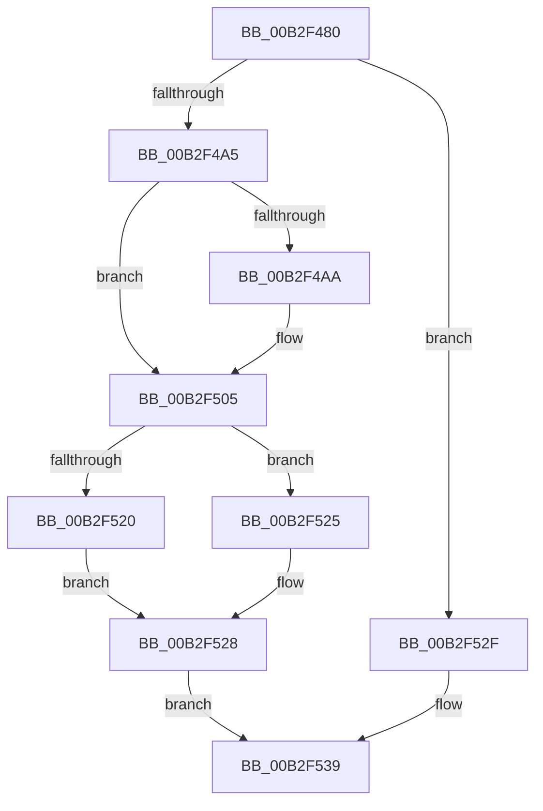

# sub_00B2F480

- RVA: `0x00B2F480`–`0x00B2F540` (길이 `192` bytes)
- VA: `0x0000000140B2F480`
- 실행 섹션: `PAGE`
- PDB 이름 있음: `아니요`; PDB Function 태그: `아니요`
- unwind 정보 RVA: `0x000A0724`
- 디코드: `45`개 명령, `192/192` bytes 표시
- 미해석 바이트: `0` (있으면 어셈블리에 `.byte`로 보존)

> 이 문서는 커널 이미지의 기계어와 PDB 기호를 분석해 생성했습니다. 4번과 5번은 함수 원형과 자료형을 바이너리 사용 방식에서 추정한 C 해석이며 원본 소스 복구 결과는 아닙니다.

## 1. Dependencies

- 직접 호출 지점: **1**; 고유 호출 대상: **1**
- 직접 호출자로 확인된 함수: **0**
- RIP 상대 이미지 참조: **0**

### Outgoing calls
- `0x00B2F4D2` → [RtlCopySid](../9A/RtlCopySid_function_009A9A50.md) (function, `0x009A9A50`)

### Direct callers
- 이 함수 시작 RVA로 연결되는 직접 call은 확인되지 않았습니다. 간접 호출은 완전히 역산할 수 없습니다.

### Static image references
- 디코드된 RIP-relative 메모리 참조가 없습니다.

## 2. Other-region calls and transfers

- 다른 실행 섹션으로 향하는 call: **0**
- call이 아닌 외부 분기/꼬리 이동: **1**
  - `0x00B2F53B` → [SepAdjustGroups + 0xB2](../9C/SepAdjustGroups_function_009C63A8.md) (`tail-transfer`)

## 3. Assembly (complete function range)

```asm
00B2F480  4C 8B 44 24 30                  mov r8, qword ptr [rsp + 0x30]
00B2F485  41 0F B6 40 01                  movzx eax, byte ptr [r8 + 1]
00B2F48A  8D 2C 85 0B 00 00 00            lea ebp, [rax*4 + 0xb]
00B2F491  83 E5 FC                        and ebp, 0xfffffffc
00B2F494  44 03 CD                        add r9d, ebp
00B2F497  44 89 4C 24 20                  mov dword ptr [rsp + 0x20], r9d
00B2F49C  45 84 D2                        test r10b, r10b
00B2F49F  0F 84 8A 00 00 00               je 0x140b2f52f
00B2F4A5  4D 85 ED                        test r13, r13
00B2F4A8  74 5B                           je 0x140b2f505
00B2F4AA  8B 0F                           mov ecx, dword ptr [rdi]
00B2F4AC  8B 44 24 38                     mov eax, dword ptr [rsp + 0x38]
00B2F4B0  48 03 CB                        add rcx, rbx
00B2F4B3  4C 8B A4 24 C0 00 00 00         mov r12, qword ptr [rsp + 0xc0]
00B2F4BB  48 03 C9                        add rcx, rcx
00B2F4BE  49 8B D4                        mov rdx, r12
00B2F4C1  41 89 44 CD 00                  mov dword ptr [r13 + rcx*8], eax
00B2F4C6  8B CD                           mov ecx, ebp
00B2F4C8  8B 07                           mov eax, dword ptr [rdi]
00B2F4CA  48 03 C0                        add rax, rax
00B2F4CD  4D 89 64 C5 08                  mov qword ptr [r13 + rax*8 + 8], r12
00B2F4D2  E8 79 A5 E7 FF                  call 0x1409a9a50
00B2F4D7  8B 54 24 24                     mov edx, dword ptr [rsp + 0x24]
00B2F4DB  44 8B 4C 24 20                  mov r9d, dword ptr [rsp + 0x20]
00B2F4E0  44 8A 94 24 98 00 00 00         mov r10b, byte ptr [rsp + 0x98]
00B2F4E8  44 8A 9C 24 A0 00 00 00         mov r11b, byte ptr [rsp + 0xa0]
00B2F4F0  8B C5                           mov eax, ebp
00B2F4F2  4C 03 E0                        add r12, rax
00B2F4F5  4C 89 A4 24 C0 00 00 00         mov qword ptr [rsp + 0xc0], r12
00B2F4FD  44 8B A4 24 A8 00 00 00         mov r12d, dword ptr [rsp + 0xa8]
00B2F505  4C 8B 84 24 90 00 00 00         mov r8, qword ptr [rsp + 0x90]
00B2F50D  33 ED                           xor ebp, ebp
00B2F50F  49 8B 88 98 00 00 00            mov rcx, qword ptr [r8 + 0x98]
00B2F516  42 8B 44 F1 08                  mov eax, dword ptr [rcx + r14*8 + 8]
00B2F51B  40 84 F6                        test sil, sil
00B2F51E  74 05                           je 0x140b2f525
00B2F520  83 C8 04                        or eax, 4
00B2F523  EB 03                           jmp 0x140b2f528
00B2F525  83 E0 FB                        and eax, 0xfffffffb
00B2F528  42 89 44 F1 08                  mov dword ptr [rcx + r14*8 + 8], eax
00B2F52D  EB 0A                           jmp 0x140b2f539
00B2F52F  4C 8B 84 24 90 00 00 00         mov r8, qword ptr [rsp + 0x90]
00B2F537  33 ED                           xor ebp, ebp
00B2F539  01 1F                           add dword ptr [rdi], ebx
00B2F53B  E9 1A 6F E9 FF                  jmp 0x1409c645a
```

## 4. C-style interpretation (structured pseudocode)

```c
__int64 __fastcall sub_00B2F480(__int64 a1, __int64 a2, __int64 a3, int a4, __int64 a5, __int64 a6, unsigned int a7, __int64 a8, __int64 a9, __int64 a10, __int64 a11, __int64 a12, __int64 a13, __int64 a14, __int64 a15, __int64 a16, __int64 a17, __int64 a18, unsigned __int8 a19, unsigned __int8 a20, unsigned int a21, __int64 a22, __int64 a23, __int64 a24)
{
    __int64 result;
    __int64 v_r10;
    __int64 v_r11;
    __int64 v_r12;
    __int64 v_rbp;
    unsigned int v_stack_p20;
    unsigned int v_stack_p24;
    unsigned __int64 v_stack_pC0;

    v_rbp = (unsigned int)((*(unsigned __int8 *)(a6 + 1) * 4 + 11) & (0xFFFFFFFCULL));
    a4 = (unsigned int)((a4) + ((unsigned int)(v_rbp)));
    v_stack_p20 = a4;
    if ((unsigned __int8)(v_r10) == 0) goto loc_00B2F52F;
    result = *(unsigned __int8 *)(a6 + 1);
    if (v_r13 != 0) {
        a1 = *(unsigned int *)(v_rdi);
        result = a7;
        a1 = (a1) + (v_rbx);
        v_r12 = a24;
        a1 = (a1) + (a1);
        a2 = v_r12;
        *(unsigned int *)(v_r13 + a1 * 8) = (unsigned int)(result);
        a1 = (unsigned int)(v_rbp);
        result = *(unsigned int *)(v_rdi);
        result = (result) + (result);
        *(unsigned __int64 *)(v_r13 + result * 8 + 8) = v_r12;
        result = RtlCopySid(a1, a2, a6, a4);
        a2 = v_stack_p24;
        a4 = v_stack_p20;
        v_r10 = a19;
        v_r11 = a20;
        result = (unsigned int)(v_rbp);
        v_r12 = (v_r12) + (result);
        v_stack_pC0 = v_r12;
        v_r12 = a21;
    }
    v_rbp = 0;
    if ((unsigned __int8)(v_rsi) == 0) goto loc_00B2F525;
    result = (unsigned int)(((unsigned int)(*(unsigned int *)(*(unsigned __int64 *)(a18 + 152) + v_r14 * 8 + 8))) | (4));
    goto loc_00B2F528;
loc_00B2F525:
    result = (unsigned int)((result) & (0xFFFFFFFBULL));
loc_00B2F528:
    *(unsigned int *)(*(unsigned __int64 *)(a18 + 152) + v_r14 * 8 + 8) = (unsigned int)(result);
    goto loc_00B2F539;
loc_00B2F52F:
    v_rbp = 0;
loc_00B2F539:
}
```

## 5. (Beta) C Style

```c
int64_t sub_00B2F480(int64_t Arg1, int64_t Arg2, int64_t Arg3, int32_t Arg4, uint64_t Arg5, void *Arg6, uint32_t Arg7, uint64_t Arg8, uint64_t Arg9, uint64_t Arg10, uint64_t Arg11, uint64_t Arg12, uint64_t Arg13, uint64_t Arg14, uint64_t Arg15, uint64_t Arg16, uint64_t Arg17, void *Arg18, uint8_t Arg19, uint8_t Arg20, uint32_t Arg21, uint64_t Arg22, uint64_t Arg23, int64_t Arg24)
{
    uint8_t *arg6 = (uint8_t *)Arg6;
    uint8_t *arg18 = (uint8_t *)Arg18;

    int64_t result;
    int64_t local_r10;
    int64_t local_r11;
    int64_t local_r12;
    int64_t local_rbp;
    uint32_t v_stack_p20;
    uint32_t v_stack_p24;
    uint64_t v_stack_pC0;

    local_rbp = (uint32_t)((*(uint8_t *)(arg6 + 0x1) * 4 + 11) & (0xFFFFFFFCULL));
    Arg4 = (uint32_t)((Arg4) + ((uint32_t)(local_rbp)));
    v_stack_p20 = Arg4;
    if ((uint8_t)(local_r10) == 0) goto loc_00B2F52F;
    result = *(uint8_t *)(arg6 + 0x1);
    if (local_r13 != 0) {
        Arg1 = *(uint32_t *)(local_rdi);
        result = Arg7;
        Arg1 = (Arg1) + (local_rbx);
        local_r12 = Arg24;
        Arg1 = (Arg1) + (Arg1);
        Arg2 = local_r12;
        *(uint32_t *)(local_r13 + Arg1 * 8) = (uint32_t)(result);
        Arg1 = (uint32_t)(local_rbp);
        result = *(uint32_t *)(local_rdi);
        result = (result) + (result);
        *(uint64_t *)(local_r13 + result * 8 + 0x8) = local_r12;
        result = RtlCopySid(Arg1, Arg2, Arg6, Arg4);
        Arg2 = v_stack_p24;
        Arg4 = v_stack_p20;
        local_r10 = Arg19;
        local_r11 = Arg20;
        result = (uint32_t)(local_rbp);
        local_r12 = (local_r12) + (result);
        v_stack_pC0 = local_r12;
        local_r12 = Arg21;
    }
    local_rbp = 0;
    if ((uint8_t)(local_rsi) == 0) goto loc_00B2F525;
    result = (uint32_t)(((uint32_t)(*(uint32_t *)(*(uint64_t *)(arg18 + 0x98) + local_r14 * 8 + 0x8))) | (4));
    goto loc_00B2F528;
loc_00B2F525:
    result = (uint32_t)((result) & (0xFFFFFFFBULL));
loc_00B2F528:
    *(uint32_t *)(*(uint64_t *)(arg18 + 0x98) + local_r14 * 8 + 0x8) = (uint32_t)(result);
    goto loc_00B2F539;
loc_00B2F52F:
    local_rbp = 0;
loc_00B2F539:
}
```

### 관측된 메모리 오프셋

구조체 형식이 확인되지 않은 접근은 인자 기준의 오프셋으로만 기록했습니다.

| 기준 인자 | 오프셋 표현 | 폭 (bit) | 접근 |
|---|---:|---:|---|
| `Arg6` | `+ 0x1` | `8` | `R` |
| `Arg18` | `+ 0x98` | `64` | `R` |

## 6. Execution-region graph

[열기: 2D/3D 그래프와 함수 탐색 컨트롤 패널](../../../control-panel.html?section=page&rva=0x00B2F480&view=graph)

- 2D 그래프는 위에서 아래로 흐르고, 3D 그래프는 빈 공간을 드래그해 회전합니다. Shift+드래그는 이동, 휠은 확대·축소, 함수 노드 선택은 대상 보고서 이동입니다.

### Static fallback


