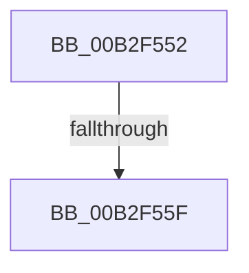

# sub_00B2F552

- RVA: `0x00B2F552`–`0x00B2F569` (길이 `23` bytes)
- VA: `0x0000000140B2F552`
- 실행 섹션: `PAGE`
- PDB 이름 있음: `아니요`; PDB Function 태그: `아니요`
- unwind 정보 RVA: `0x000A1390`
- 디코드: `7`개 명령, `23/23` bytes 표시
- 미해석 바이트: `0` (있으면 어셈블리에 `.byte`로 보존)

> 이 문서는 커널 이미지의 기계어와 PDB 기호를 분석해 생성했습니다. 4번과 5번은 함수 원형과 자료형을 바이너리 사용 방식에서 추정한 C 해석이며 원본 소스 복구 결과는 아닙니다.

## 1. Dependencies

- 직접 호출 지점: **0**; 고유 호출 대상: **0**
- 직접 호출자로 확인된 함수: **0**
- RIP 상대 이미지 참조: **0**

### Outgoing calls
- 직접 디코드된 call 명령이 없습니다.

### Direct callers
- 이 함수 시작 RVA로 연결되는 직접 call은 확인되지 않았습니다. 간접 호출은 완전히 역산할 수 없습니다.

### Static image references
- 디코드된 RIP-relative 메모리 참조가 없습니다.

## 2. Other-region calls and transfers

- 다른 실행 섹션으로 향하는 call: **0**
- call이 아닌 외부 분기/꼬리 이동: **2**
  - `0x00B2F559` → [_CmGetDeviceMappedPropertyKeys + 0xE8](../9D/_CmGetDeviceMappedPropertyKeys_function_009D0D78.md) (`tail-transfer`)
  - `0x00B2F564` → [_CmGetDeviceMappedPropertyKeys + 0x156](../9D/_CmGetDeviceMappedPropertyKeys_function_009D0D78.md) (`tail-transfer`)

## 3. Assembly (complete function range)

```asm
00B2F552  8B 03                           mov eax, dword ptr [rbx]
00B2F554  8D 48 01                        lea ecx, [rax + 1]
00B2F557  3B C8                           cmp ecx, eax
00B2F559  0F 82 01 19 EA FF               jb 0x1409d0e60
00B2F55F  89 0B                           mov dword ptr [rbx], ecx
00B2F561  44 8B D2                        mov r10d, edx
00B2F564  E9 65 19 EA FF                  jmp 0x1409d0ece
```

## 4. C-style interpretation (structured pseudocode)

```c
__int64 __fastcall sub_00B2F552(__int64 a1, int a2)
{
    *(unsigned int *)(v_rbx) = (unsigned int)((unsigned int)(*(unsigned int *)(v_rbx)) + 1);
}
```

## 5. (Beta) C Style

```c
int64_t sub_00B2F552(int64_t Arg1, int32_t Arg2)
{
    *(uint32_t *)(local_rbx) = (uint32_t)((uint32_t)(*(uint32_t *)(local_rbx)) + 1);
}
```

## 6. Execution-region graph

[열기: 2D/3D 그래프와 함수 탐색 컨트롤 패널](../../../control-panel.html?section=page&rva=0x00B2F552&view=graph)

- 2D 그래프는 위에서 아래로 흐르고, 3D 그래프는 빈 공간을 드래그해 회전합니다. Shift+드래그는 이동, 휠은 확대·축소, 함수 노드 선택은 대상 보고서 이동입니다.

### Static fallback


