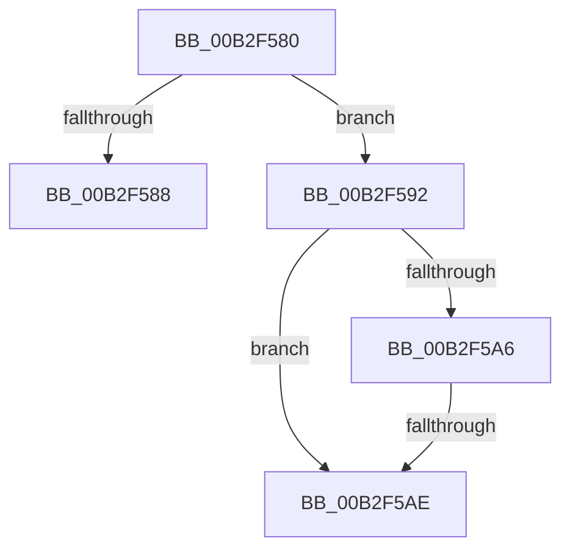

# sub_00B2F580

- RVA: `0x00B2F580`–`0x00B2F5B8` (길이 `56` bytes)
- VA: `0x0000000140B2F580`
- 실행 섹션: `PAGE`
- PDB 이름 있음: `아니요`; PDB Function 태그: `아니요`
- unwind 정보 RVA: `0x000A1514`
- 디코드: `16`개 명령, `56/56` bytes 표시
- 미해석 바이트: `0` (있으면 어셈블리에 `.byte`로 보존)

> 이 문서는 커널 이미지의 기계어와 PDB 기호를 분석해 생성했습니다. 4번과 5번은 함수 원형과 자료형을 바이너리 사용 방식에서 추정한 C 해석이며 원본 소스 복구 결과는 아닙니다.

## 1. Dependencies

- 직접 호출 지점: **0**; 고유 호출 대상: **0**
- 직접 호출자로 확인된 함수: **0**
- RIP 상대 이미지 참조: **0**

### Outgoing calls
- 직접 디코드된 call 명령이 없습니다.

### Direct callers
- 이 함수 시작 RVA로 연결되는 직접 call은 확인되지 않았습니다. 간접 호출은 완전히 역산할 수 없습니다.

### Static image references
- 디코드된 RIP-relative 메모리 참조가 없습니다.

## 2. Other-region calls and transfers

- 다른 실행 섹션으로 향하는 call: **0**
- call이 아닌 외부 분기/꼬리 이동: **3**
  - `0x00B2F58D` → [_CmGetDeviceMappedPropertyFromInstanceKeyRegValue + 0x106](../9D/_CmGetDeviceMappedPropertyFromInstanceKeyRegValue_function_009D2F44.md) (`tail-transfer`)
  - `0x00B2F5A8` → [_CmGetDeviceMappedPropertyFromInstanceKeyRegValue + 0x106](../9D/_CmGetDeviceMappedPropertyFromInstanceKeyRegValue_function_009D2F44.md) (`tail-transfer`)
  - `0x00B2F5B3` → [_CmGetDeviceMappedPropertyFromInstanceKeyRegValue + 0x106](../9D/_CmGetDeviceMappedPropertyFromInstanceKeyRegValue_function_009D2F44.md) (`tail-transfer`)

## 3. Assembly (complete function range)

```asm
00B2F580  8B 47 18                        mov eax, dword ptr [rdi + 0x18]
00B2F583  39 45 F0                        cmp dword ptr [rbp - 0x10], eax
00B2F586  74 0A                           je 0x140b2f592
00B2F588  BB 0D 00 00 C0                  mov ebx, 0xc000000d
00B2F58D  E9 B8 3A EA FF                  jmp 0x1409d304a
00B2F592  8B 45 60                        mov eax, dword ptr [rbp + 0x60]
00B2F595  48 8B 55 78                     mov rdx, qword ptr [rbp + 0x78]
00B2F599  89 02                           mov dword ptr [rdx], eax
00B2F59B  8B 47 08                        mov eax, dword ptr [rdi + 8]
00B2F59E  41 89 45 00                     mov dword ptr [r13], eax
00B2F5A2  85 C9                           test ecx, ecx
00B2F5A4  75 08                           jne 0x140b2f5ae
00B2F5A6  85 F6                           test esi, esi
00B2F5A8  0F 85 9C 3A EA FF               jne 0x1409d304a
00B2F5AE  BB 23 00 00 C0                  mov ebx, 0xc0000023
00B2F5B3  E9 92 3A EA FF                  jmp 0x1409d304a
```

## 4. C-style interpretation (structured pseudocode)

```c
__int64 __fastcall sub_00B2F580(int a1)
{
    if ((*(unsigned int *)(v_rbp - 16)) == ((unsigned int)((unsigned int)(*(unsigned int *)(v_rdi + 24))))) goto loc_00B2F592;
loc_00B2F592:
    *(unsigned int *)(*(unsigned __int64 *)(v_rbp + 120)) = (unsigned int)((unsigned int)(*(unsigned int *)(v_rbp + 96)));
    *(unsigned int *)(v_r13) = (unsigned int)((unsigned int)(*(unsigned int *)(v_rdi + 8)));
    if (a1 != 0) goto loc_00B2F5AE;
loc_00B2F5AE:
}
```

## 5. (Beta) C Style

```c
int64_t sub_00B2F580(int32_t Arg1)
{
    if ((*(uint32_t *)(local_rbp - 0x10)) == ((uint32_t)((uint32_t)(*(uint32_t *)(local_rdi + 0x18))))) goto loc_00B2F592;
loc_00B2F592:
    *(uint32_t *)(*(uint64_t *)(local_rbp + 0x78)) = (uint32_t)((uint32_t)(*(uint32_t *)(local_rbp + 0x60)));
    *(uint32_t *)(local_r13) = (uint32_t)((uint32_t)(*(uint32_t *)(local_rdi + 0x8)));
    if (Arg1 != 0) goto loc_00B2F5AE;
loc_00B2F5AE:
}
```

## 6. Execution-region graph

[열기: 2D/3D 그래프와 함수 탐색 컨트롤 패널](../../../control-panel.html?section=page&rva=0x00B2F580&view=graph)

- 2D 그래프는 위에서 아래로 흐르고, 3D 그래프는 빈 공간을 드래그해 회전합니다. Shift+드래그는 이동, 휠은 확대·축소, 함수 노드 선택은 대상 보고서 이동입니다.

### Static fallback


