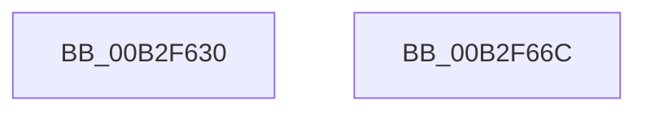

# sub_00B2F630

- RVA: `0x00B2F630`–`0x00B2F6AB` (길이 `123` bytes)
- VA: `0x0000000140B2F630`
- 실행 섹션: `PAGE`
- PDB 이름 있음: `아니요`; PDB Function 태그: `아니요`
- unwind 정보 RVA: `0x000A1574`
- 디코드: `29`개 명령, `123/123` bytes 표시
- 미해석 바이트: `0` (있으면 어셈블리에 `.byte`로 보존)

> 이 문서는 커널 이미지의 기계어와 PDB 기호를 분석해 생성했습니다. 4번과 5번은 함수 원형과 자료형을 바이너리 사용 방식에서 추정한 C 해석이며 원본 소스 복구 결과는 아닙니다.

## 1. Dependencies

- 직접 호출 지점: **2**; 고유 호출 대상: **2**
- 직접 호출자로 확인된 함수: **0**
- RIP 상대 이미지 참조: **0**

### Outgoing calls
- `0x00B2F661` → [CmSetInstallerClassMappedProperty](../83/CmSetInstallerClassMappedProperty_function_008310E8.md) (function, `0x008310E8`)
- `0x00B2F6A0` → [CmGetMatchingCommonClassList](../82/CmGetMatchingCommonClassList_function_0082D120.md) (function, `0x0082D120`)

### Direct callers
- 이 함수 시작 RVA로 연결되는 직접 call은 확인되지 않았습니다. 간접 호출은 완전히 역산할 수 없습니다.

### Static image references
- 디코드된 RIP-relative 메모리 참조가 없습니다.

## 2. Other-region calls and transfers

- 다른 실행 섹션으로 향하는 call: **0**
- call이 아닌 외부 분기/꼬리 이동: **2**
  - `0x00B2F667` → [_PnpDispatchInstallerClass + 0xA3](../9D/_PnpDispatchInstallerClass_function_009D3580.md) (`tail-transfer`)
  - `0x00B2F6A6` → [_PnpDispatchInstallerClass + 0xA3](../9D/_PnpDispatchInstallerClass_function_009D3580.md) (`tail-transfer`)

## 3. Assembly (complete function range)

```asm
00B2F630  4C 8B 84 24 90 00 00 00         mov r8, qword ptr [rsp + 0x90]
00B2F638  41 8B 40 28                     mov eax, dword ptr [r8 + 0x28]
00B2F63C  4D 8B 48 08                     mov r9, qword ptr [r8 + 8]
00B2F640  89 44 24 38                     mov dword ptr [rsp + 0x38], eax
00B2F644  49 8B 40 20                     mov rax, qword ptr [r8 + 0x20]
00B2F648  48 89 44 24 30                  mov qword ptr [rsp + 0x30], rax
00B2F64D  41 8B 40 18                     mov eax, dword ptr [r8 + 0x18]
00B2F651  89 44 24 28                     mov dword ptr [rsp + 0x28], eax
00B2F655  49 8B 40 10                     mov rax, qword ptr [r8 + 0x10]
00B2F659  4D 8B 00                        mov r8, qword ptr [r8]
00B2F65C  48 89 44 24 20                  mov qword ptr [rsp + 0x20], rax
00B2F661  E8 82 1A D0 FF                  call 0x1408310e8
00B2F666  90                              nop
00B2F667  E9 B7 3F EA FF                  jmp 0x1409d3623
00B2F66C  8B 4A 18                        mov ecx, dword ptr [rdx + 0x18]
00B2F66F  4C 8B CB                        mov r9, rbx
00B2F672  44 8B 52 28                     mov r10d, dword ptr [rdx + 0x28]
00B2F676  48 8B 42 20                     mov rax, qword ptr [rdx + 0x20]
00B2F67A  41 81 E2 00 00 FF FF            and r10d, 0xffff0000
00B2F681  48 8B 52 10                     mov rdx, qword ptr [rdx + 0x10]
00B2F685  44 89 54 24 38                  mov dword ptr [rsp + 0x38], r10d
00B2F68A  48 89 44 24 30                  mov qword ptr [rsp + 0x30], rax
00B2F68F  89 4C 24 28                     mov dword ptr [rsp + 0x28], ecx
00B2F693  49 8B CB                        mov rcx, r11
00B2F696  48 89 54 24 20                  mov qword ptr [rsp + 0x20], rdx
00B2F69B  BA 02 00 00 00                  mov edx, 2
00B2F6A0  E8 7B DA CF FF                  call 0x14082d120
00B2F6A5  90                              nop
00B2F6A6  E9 78 3F EA FF                  jmp 0x1409d3623
```

## 4. C-style interpretation (structured pseudocode)

```c
__int64 __fastcall sub_00B2F630(__int64 a1, __int64 a2, __int64 a3, __int64 a4, __int64 a5, __int64 a6, __int64 a7, __int64 a8, __int64 a9, __int64 a10, __int64 a11, __int64 a12, __int64 a13, __int64 a14, __int64 a15, __int64 a16, __int64 a17, __int64 a18)
{
    __int64 result;
    unsigned __int64 v_stack_p20;
    unsigned int v_stack_p28;
    unsigned __int64 v_stack_p30;
    unsigned int v_stack_p38;

    v_stack_p38 = (unsigned int)((unsigned int)(*(unsigned int *)(a18 + 40)));
    v_stack_p30 = *(unsigned __int64 *)(a18 + 32);
    v_stack_p28 = (unsigned int)((unsigned int)(*(unsigned int *)(a18 + 24)));
    v_stack_p20 = *(unsigned __int64 *)(a18 + 16);
    result = CmSetInstallerClassMappedProperty(a1, a2, *(unsigned __int64 *)(a18), *(unsigned __int64 *)(a18 + 8));
}
```

## 5. (Beta) C Style

```c
int64_t sub_00B2F630(int64_t Arg1, int64_t Arg2, int64_t Arg3, int64_t Arg4, uint64_t Arg5, uint64_t Arg6, uint64_t Arg7, uint64_t Arg8, uint64_t Arg9, uint64_t Arg10, uint64_t Arg11, uint64_t Arg12, uint64_t Arg13, uint64_t Arg14, uint64_t Arg15, uint64_t Arg16, uint64_t Arg17, void *Arg18)
{
    uint8_t *arg18 = (uint8_t *)Arg18;

    int64_t result;
    uint64_t v_stack_p20;
    uint32_t v_stack_p28;
    uint64_t v_stack_p30;
    uint32_t v_stack_p38;

    v_stack_p38 = (uint32_t)((uint32_t)(*(uint32_t *)(arg18 + 0x28)));
    v_stack_p30 = *(uint64_t *)(arg18 + 0x20);
    v_stack_p28 = (uint32_t)((uint32_t)(*(uint32_t *)(arg18 + 0x18)));
    v_stack_p20 = *(uint64_t *)(arg18 + 0x10);
    result = CmSetInstallerClassMappedProperty(Arg1, Arg2, *(uint64_t *)(arg18), *(uint64_t *)(arg18 + 0x8));
}
```

### 관측된 메모리 오프셋

구조체 형식이 확인되지 않은 접근은 인자 기준의 오프셋으로만 기록했습니다.

| 기준 인자 | 오프셋 표현 | 폭 (bit) | 접근 |
|---|---:|---:|---|
| `Arg18` | `+ 0x0` | `64` | `R` |
| `Arg18` | `+ 0x8` | `64` | `R` |
| `Arg18` | `+ 0x10` | `64` | `R` |
| `Arg18` | `+ 0x18` | `32` | `R` |
| `Arg18` | `+ 0x20` | `64` | `R` |
| `Arg18` | `+ 0x28` | `32` | `R` |

## 6. Execution-region graph

[열기: 2D/3D 그래프와 함수 탐색 컨트롤 패널](../../../control-panel.html?section=page&rva=0x00B2F630&view=graph)

- 2D 그래프는 위에서 아래로 흐르고, 3D 그래프는 빈 공간을 드래그해 회전합니다. Shift+드래그는 이동, 휠은 확대·축소, 함수 노드 선택은 대상 보고서 이동입니다.

### Static fallback


