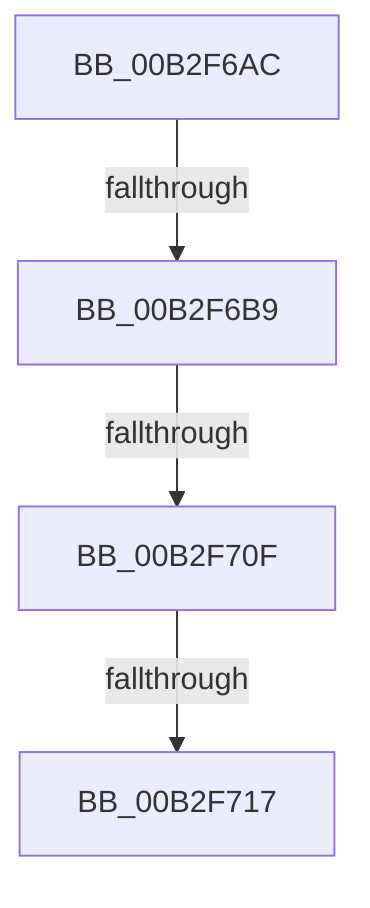

# sub_00B2F6AC

- RVA: `0x00B2F6AC`–`0x00B2F71C` (길이 `112` bytes)
- VA: `0x0000000140B2F6AC`
- 실행 섹션: `PAGE`
- PDB 이름 있음: `아니요`; PDB Function 태그: `아니요`
- unwind 정보 RVA: `0x000A15C0`
- 디코드: `23`개 명령, `112/112` bytes 표시
- 미해석 바이트: `0` (있으면 어셈블리에 `.byte`로 보존)

> 이 문서는 커널 이미지의 기계어와 PDB 기호를 분석해 생성했습니다. 4번과 5번은 함수 원형과 자료형을 바이너리 사용 방식에서 추정한 C 해석이며 원본 소스 복구 결과는 아닙니다.

## 1. Dependencies

- 직접 호출 지점: **1**; 고유 호출 대상: **1**
- 직접 호출자로 확인된 함수: **0**
- RIP 상대 이미지 참조: **1**

### Outgoing calls
- `0x00B2F6FF` → [PnpGetObjectProperty](../8E/PnpGetObjectProperty_function_008E2180.md) (function, `0x008E2180`)

### Direct callers
- 이 함수 시작 RVA로 연결되는 직접 call은 확인되지 않았습니다. 간접 호출은 완전히 역산할 수 없습니다.

### Static image references
- `0x00B2F6E0` → RVA `0x00027DD0` (`.rdata`; read)

## 2. Other-region calls and transfers

- 다른 실행 섹션으로 향하는 call: **0**
- call이 아닌 외부 분기/꼬리 이동: **4**
  - `0x00B2F6B3` → [_CmGetInstallerClassMappedPropertyFromComposite + 0xC4](../9D/_CmGetInstallerClassMappedPropertyFromComposite_function_009D398C.md) (`tail-transfer`)
  - `0x00B2F709` → [_CmGetInstallerClassMappedPropertyFromComposite + 0x177](../9D/_CmGetInstallerClassMappedPropertyFromComposite_function_009D398C.md) (`tail-transfer`)
  - `0x00B2F711` → [_CmGetInstallerClassMappedPropertyFromComposite + 0xC4](../9D/_CmGetInstallerClassMappedPropertyFromComposite_function_009D398C.md) (`tail-transfer`)
  - `0x00B2F717` → [_CmGetInstallerClassMappedPropertyFromComposite + 0x177](../9D/_CmGetInstallerClassMappedPropertyFromComposite_function_009D398C.md) (`tail-transfer`)

## 3. Assembly (complete function range)

```asm
00B2F6AC  BF 25 02 00 C0                  mov edi, 0xc0000225
00B2F6B1  3B C7                           cmp eax, edi
00B2F6B3  0F 85 97 43 EA FF               jne 0x1409d3a50
00B2F6B9  83 64 24 50 00                  and dword ptr [rsp + 0x50], 0
00B2F6BE  48 8D 84 24 B8 00 00 00         lea rax, [rsp + 0xb8]
00B2F6C6  48 8B 8C 24 A0 00 00 00         mov rcx, qword ptr [rsp + 0xa0]
00B2F6CE  4D 8B CC                        mov r9, r12
00B2F6D1  48 89 44 24 48                  mov qword ptr [rsp + 0x48], rax
00B2F6D6  41 B8 02 00 00 00               mov r8d, 2
00B2F6DC  89 6C 24 40                     mov dword ptr [rsp + 0x40], ebp
00B2F6E0  48 8D 05 E9 86 4F FF            lea rax, [rip - 0xb07917]
00B2F6E7  4C 89 74 24 38                  mov qword ptr [rsp + 0x38], r14
00B2F6EC  49 8B D5                        mov rdx, r13
00B2F6EF  4C 89 7C 24 30                  mov qword ptr [rsp + 0x30], r15
00B2F6F4  48 89 44 24 28                  mov qword ptr [rsp + 0x28], rax
00B2F6F9  48 83 64 24 20 00               and qword ptr [rsp + 0x20], 0
00B2F6FF  E8 7C 2A DB FF                  call 0x1408e2180
00B2F704  44 8B D0                        mov r10d, eax
00B2F707  85 C0                           test eax, eax
00B2F709  0F 84 F4 43 EA FF               je 0x1409d3b03
00B2F70F  3B C3                           cmp eax, ebx
00B2F711  0F 85 39 43 EA FF               jne 0x1409d3a50
00B2F717  E9 E7 43 EA FF                  jmp 0x1409d3b03
```

## 4. C-style interpretation (structured pseudocode)

```c
__int64 __fastcall sub_00B2F6AC(__int64 a1, __int64 a2, __int64 a3, __int64 a4, __int64 a5, __int64 a6, __int64 a7, __int64 a8, __int64 a9, unsigned int a10, __int64 a11, __int64 a12, __int64 a13, __int64 a14, __int64 a15, __int64 a16, __int64 a17, __int64 a18, __int64 a19, __int64 a20, __int64 a21, __int64 a22, __int64 a23)
{
    __int64 result;
    unsigned __int64 v_stack_p20;
    unsigned __int64 v_stack_p28;
    unsigned __int64 v_stack_p30;
    unsigned __int64 v_stack_p38;
    unsigned int v_stack_p40;
    unsigned __int64 v_stack_p48;

    v_stack_p48 = a23;
    v_stack_p40 = (unsigned int)(v_rbp);
    v_stack_p38 = v_r14;
    v_stack_p30 = v_r15;
    v_stack_p28 = v_rip - 11565335;
    result = PnpGetObjectProperty(a20, v_r13, 2, v_r12);
}
```

## 5. (Beta) C Style

```c
int64_t sub_00B2F6AC(int64_t Arg1, int64_t Arg2, int64_t Arg3, int64_t Arg4, uint64_t Arg5, uint64_t Arg6, uint64_t Arg7, uint64_t Arg8, uint64_t Arg9, uint32_t Arg10, uint64_t Arg11, uint64_t Arg12, uint64_t Arg13, uint64_t Arg14, uint64_t Arg15, uint64_t Arg16, uint64_t Arg17, uint64_t Arg18, uint64_t Arg19, int64_t Arg20, uint64_t Arg21, uint64_t Arg22, int64_t Arg23)
{
    int64_t result;
    uint64_t v_stack_p20;
    uint64_t v_stack_p28;
    uint64_t v_stack_p30;
    uint64_t v_stack_p38;
    uint32_t v_stack_p40;
    uint64_t v_stack_p48;

    v_stack_p48 = Arg23;
    v_stack_p40 = (uint32_t)(local_rbp);
    v_stack_p38 = local_r14;
    v_stack_p30 = local_r15;
    v_stack_p28 = v_rip - 11565335;
    result = PnpGetObjectProperty(Arg20, local_r13, 2, local_r12);
}
```

## 6. Execution-region graph

[열기: 2D/3D 그래프와 함수 탐색 컨트롤 패널](../../../control-panel.html?section=page&rva=0x00B2F6AC&view=graph)

- 2D 그래프는 위에서 아래로 흐르고, 3D 그래프는 빈 공간을 드래그해 회전합니다. Shift+드래그는 이동, 휠은 확대·축소, 함수 노드 선택은 대상 보고서 이동입니다.

### Static fallback


