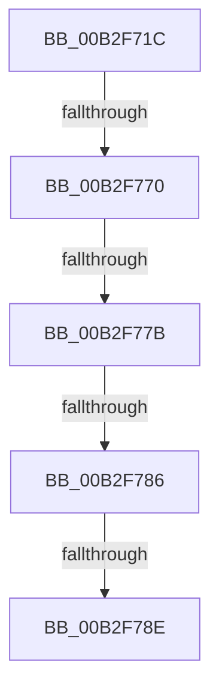

# sub_00B2F71C

- RVA: `0x00B2F71C`–`0x00B2F793` (길이 `119` bytes)
- VA: `0x0000000140B2F71C`
- 실행 섹션: `PAGE`
- PDB 이름 있음: `아니요`; PDB Function 태그: `아니요`
- unwind 정보 RVA: `0x000A15EC`
- 디코드: `22`개 명령, `119/119` bytes 표시
- 미해석 바이트: `0` (있으면 어셈블리에 `.byte`로 보존)

> 이 문서는 커널 이미지의 기계어와 PDB 기호를 분석해 생성했습니다. 4번과 5번은 함수 원형과 자료형을 바이너리 사용 방식에서 추정한 C 해석이며 원본 소스 복구 결과는 아닙니다.

## 1. Dependencies

- 직접 호출 지점: **1**; 고유 호출 대상: **1**
- 직접 호출자로 확인된 함수: **0**
- RIP 상대 이미지 참조: **0**

### Outgoing calls
- `0x00B2F760` → [CmGetInstallerClassCompoundFiltersWorker](../83/CmGetInstallerClassCompoundFiltersWorker_function_00830130.md) (function, `0x00830130`)

### Direct callers
- 이 함수 시작 RVA로 연결되는 직접 call은 확인되지 않았습니다. 간접 호출은 완전히 역산할 수 없습니다.

### Static image references
- 디코드된 RIP-relative 메모리 참조가 없습니다.

## 2. Other-region calls and transfers

- 다른 실행 섹션으로 향하는 call: **0**
- call이 아닌 외부 분기/꼬리 이동: **5**
  - `0x00B2F76A` → [_CmGetInstallerClassCompoundFilters + 0xE2](../9D/_CmGetInstallerClassCompoundFilters_function_009D3C84.md) (`tail-transfer`)
  - `0x00B2F775` → [_CmGetInstallerClassCompoundFilters + 0xE2](../9D/_CmGetInstallerClassCompoundFilters_function_009D3C84.md) (`tail-transfer`)
  - `0x00B2F780` → [_CmGetInstallerClassCompoundFilters + 0xE2](../9D/_CmGetInstallerClassCompoundFilters_function_009D3C84.md) (`tail-transfer`)
  - `0x00B2F788` → [_CmGetInstallerClassCompoundFilters + 0x11E](../9D/_CmGetInstallerClassCompoundFilters_function_009D3C84.md) (`tail-transfer`)
  - `0x00B2F78E` → [_CmGetInstallerClassCompoundFilters + 0x11C](../9D/_CmGetInstallerClassCompoundFilters_function_009D3C84.md) (`tail-transfer`)

## 3. Assembly (complete function range)

```asm
00B2F71C  48 8B 84 24 B8 00 00 00         mov rax, qword ptr [rsp + 0xb8]
00B2F724  49 8B D7                        mov rdx, r15
00B2F727  4C 8B 8C 24 A8 00 00 00         mov r9, qword ptr [rsp + 0xa8]
00B2F72F  48 8B CF                        mov rcx, rdi
00B2F732  4C 8B 84 24 A0 00 00 00         mov r8, qword ptr [rsp + 0xa0]
00B2F73A  4C 89 64 24 48                  mov qword ptr [rsp + 0x48], r12
00B2F73F  44 89 6C 24 40                  mov dword ptr [rsp + 0x40], r13d
00B2F744  48 89 44 24 38                  mov qword ptr [rsp + 0x38], rax
00B2F749  48 8B 84 24 B0 00 00 00         mov rax, qword ptr [rsp + 0xb0]
00B2F751  48 89 44 24 30                  mov qword ptr [rsp + 0x30], rax
00B2F756  4C 89 74 24 28                  mov qword ptr [rsp + 0x28], r14
00B2F75B  48 89 74 24 20                  mov qword ptr [rsp + 0x20], rsi
00B2F760  E8 CB 09 D0 FF                  call 0x140830130
00B2F765  3D 34 00 00 C0                  cmp eax, 0xc0000034
00B2F76A  0F 84 F6 45 EA FF               je 0x1409d3d66
00B2F770  3D 7C 01 00 C0                  cmp eax, 0xc000017c
00B2F775  0F 84 EB 45 EA FF               je 0x1409d3d66
00B2F77B  3D 25 02 00 C0                  cmp eax, 0xc0000225
00B2F780  0F 84 E0 45 EA FF               je 0x1409d3d66
00B2F786  85 C0                           test eax, eax
00B2F788  0F 89 14 46 EA FF               jns 0x1409d3da2
00B2F78E  E9 0D 46 EA FF                  jmp 0x1409d3da0
```

## 4. C-style interpretation (structured pseudocode)

```c
__int64 __fastcall sub_00B2F71C(__int64 a1, __int64 a2, __int64 a3, __int64 a4, __int64 a5, __int64 a6, __int64 a7, __int64 a8, __int64 a9, __int64 a10, __int64 a11, __int64 a12, __int64 a13, __int64 a14, __int64 a15, __int64 a16, __int64 a17, __int64 a18, __int64 a19, __int64 a20, __int64 a21, __int64 a22, __int64 a23)
{
    __int64 result;
    unsigned __int64 v_stack_p20;
    unsigned __int64 v_stack_p28;
    unsigned __int64 v_stack_p30;
    unsigned __int64 v_stack_p38;
    unsigned int v_stack_p40;
    unsigned __int64 v_stack_p48;

    v_stack_p48 = v_r12;
    v_stack_p40 = (unsigned int)(v_r13);
    v_stack_p38 = a23;
    v_stack_p30 = a22;
    v_stack_p28 = v_r14;
    v_stack_p20 = v_rsi;
    result = CmGetInstallerClassCompoundFiltersWorker(v_rdi, v_r15, a20, a21);
}
```

## 5. (Beta) C Style

```c
int64_t sub_00B2F71C(int64_t Arg1, int64_t Arg2, int64_t Arg3, int64_t Arg4, uint64_t Arg5, uint64_t Arg6, uint64_t Arg7, uint64_t Arg8, uint64_t Arg9, uint64_t Arg10, uint64_t Arg11, uint64_t Arg12, uint64_t Arg13, uint64_t Arg14, uint64_t Arg15, uint64_t Arg16, uint64_t Arg17, uint64_t Arg18, uint64_t Arg19, int64_t Arg20, int64_t Arg21, int64_t Arg22, int64_t Arg23)
{
    int64_t result;
    uint64_t v_stack_p20;
    uint64_t v_stack_p28;
    uint64_t v_stack_p30;
    uint64_t v_stack_p38;
    uint32_t v_stack_p40;
    uint64_t v_stack_p48;

    v_stack_p48 = local_r12;
    v_stack_p40 = (uint32_t)(local_r13);
    v_stack_p38 = Arg23;
    v_stack_p30 = Arg22;
    v_stack_p28 = local_r14;
    v_stack_p20 = local_rsi;
    result = CmGetInstallerClassCompoundFiltersWorker(local_rdi, local_r15, Arg20, Arg21);
}
```

## 6. Execution-region graph

[열기: 2D/3D 그래프와 함수 탐색 컨트롤 패널](../../../control-panel.html?section=page&rva=0x00B2F71C&view=graph)

- 2D 그래프는 위에서 아래로 흐르고, 3D 그래프는 빈 공간을 드래그해 회전합니다. Shift+드래그는 이동, 휠은 확대·축소, 함수 노드 선택은 대상 보고서 이동입니다.

### Static fallback


