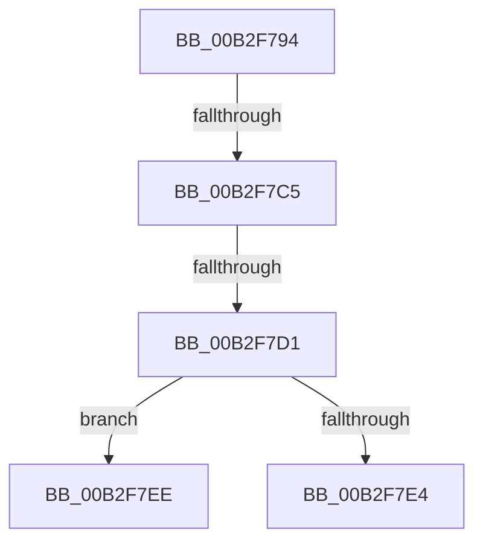

# sub_00B2F794

- RVA: `0x00B2F794`–`0x00B2F7FC` (길이 `104` bytes)
- VA: `0x0000000140B2F794`
- 실행 섹션: `PAGE`
- PDB 이름 있음: `아니요`; PDB Function 태그: `아니요`
- unwind 정보 RVA: `0x000A1618`
- 디코드: `26`개 명령, `104/104` bytes 표시
- 미해석 바이트: `0` (있으면 어셈블리에 `.byte`로 보존)

> 이 문서는 커널 이미지의 기계어와 PDB 기호를 분석해 생성했습니다. 4번과 5번은 함수 원형과 자료형을 바이너리 사용 방식에서 추정한 C 해석이며 원본 소스 복구 결과는 아닙니다.

## 1. Dependencies

- 직접 호출 지점: **1**; 고유 호출 대상: **1**
- 직접 호출자로 확인된 함수: **0**
- RIP 상대 이미지 참조: **0**

### Outgoing calls
- `0x00B2F7B6` → [CmGetInstallerClassRegProp](../99/CmGetInstallerClassRegProp_function_00994940.md) (function, `0x00994940`)

### Direct callers
- 이 함수 시작 RVA로 연결되는 직접 call은 확인되지 않았습니다. 간접 호출은 완전히 역산할 수 없습니다.

### Static image references
- 디코드된 RIP-relative 메모리 참조가 없습니다.

## 2. Other-region calls and transfers

- 다른 실행 섹션으로 향하는 call: **0**
- call이 아닌 외부 분기/꼬리 이동: **4**
  - `0x00B2F7BF` → [_CmGetInstallerClassMappedPropertyFromRegProp + 0xF5](../9D/_CmGetInstallerClassMappedPropertyFromRegProp_function_009D3E34.md) (`tail-transfer`)
  - `0x00B2F7CB` → [_CmGetInstallerClassMappedPropertyFromRegProp + 0xF0](../9D/_CmGetInstallerClassMappedPropertyFromRegProp_function_009D3E34.md) (`tail-transfer`)
  - `0x00B2F7E9` → [_CmGetInstallerClassMappedPropertyFromRegProp + 0xF5](../9D/_CmGetInstallerClassMappedPropertyFromRegProp_function_009D3E34.md) (`tail-transfer`)
  - `0x00B2F7F7` → [_CmGetInstallerClassMappedPropertyFromRegProp + 0xF5](../9D/_CmGetInstallerClassMappedPropertyFromRegProp_function_009D3E34.md) (`tail-transfer`)

## 3. Assembly (complete function range)

```asm
00B2F794  48 8D 45 60                     lea rax, [rbp + 0x60]
00B2F798  C7 45 60 04 00 00 00            mov dword ptr [rbp + 0x60], 4
00B2F79F  48 89 44 24 30                  mov qword ptr [rsp + 0x30], rax
00B2F7A4  48 8D 45 F4                     lea rax, [rbp - 0xc]
00B2F7A8  48 89 44 24 28                  mov qword ptr [rsp + 0x28], rax
00B2F7AD  48 8D 45 F0                     lea rax, [rbp - 0x10]
00B2F7B1  48 89 44 24 20                  mov qword ptr [rsp + 0x20], rax
00B2F7B6  E8 85 51 E6 FF                  call 0x140994940
00B2F7BB  8B D8                           mov ebx, eax
00B2F7BD  85 C0                           test eax, eax
00B2F7BF  0F 88 64 47 EA FF               js 0x1409d3f29
00B2F7C5  8B 47 10                        mov eax, dword ptr [rdi + 0x10]
00B2F7C8  39 45 F0                        cmp dword ptr [rbp - 0x10], eax
00B2F7CB  0F 85 53 47 EA FF               jne 0x1409d3f24
00B2F7D1  41 C7 07 01 00 00 00            mov dword ptr [r15], 1
00B2F7D8  8B 47 08                        mov eax, dword ptr [rdi + 8]
00B2F7DB  41 89 45 00                     mov dword ptr [r13], eax
00B2F7DF  45 3B 37                        cmp r14d, dword ptr [r15]
00B2F7E2  73 0A                           jae 0x140b2f7ee
00B2F7E4  BB 23 00 00 C0                  mov ebx, 0xc0000023
00B2F7E9  E9 3B 47 EA FF                  jmp 0x1409d3f29
00B2F7EE  8B 45 F4                        mov eax, dword ptr [rbp - 0xc]
00B2F7F1  F7 D8                           neg eax
00B2F7F3  1A C9                           sbb cl, cl
00B2F7F5  88 0E                           mov byte ptr [rsi], cl
00B2F7F7  E9 2D 47 EA FF                  jmp 0x1409d3f29
```

## 4. C-style interpretation (structured pseudocode)

```c
__int64 __fastcall sub_00B2F794(unsigned __int8 a1)
{
    __int64 result;
    unsigned __int64 v_stack_p20;
    unsigned __int64 v_stack_p28;
    unsigned __int64 v_stack_p30;

    *(unsigned int *)(v_rbp + 96) = 4;
    v_stack_p30 = v_rbp + 96;
    v_stack_p28 = v_rbp - 12;
    v_stack_p20 = v_rbp - 16;
    result = CmGetInstallerClassRegProp(a1, a2, a3, a4);
    *(unsigned int *)(v_r15) = 1;
    *(unsigned int *)(v_r13) = (unsigned int)((unsigned int)(*(unsigned int *)(v_rdi + 8)));
    if (((unsigned int)(v_r14)) >= (*(unsigned int *)(v_r15))) goto loc_00B2F7EE;
loc_00B2F7EE:
    result = (unsigned int)(-((unsigned int)(*(unsigned int *)(v_rbp - 12))));
    *(unsigned __int8 *)(v_rsi) = a1;
}
```

## 5. (Beta) C Style

```c
int64_t sub_00B2F794(uint8_t Arg1)
{
    int64_t result;
    uint64_t v_stack_p20;
    uint64_t v_stack_p28;
    uint64_t v_stack_p30;

    *(uint32_t *)(local_rbp + 0x60) = 4;
    v_stack_p30 = local_rbp + 96;
    v_stack_p28 = local_rbp - 12;
    v_stack_p20 = local_rbp - 16;
    result = CmGetInstallerClassRegProp(Arg1, a2, a3, a4);
    *(uint32_t *)(local_r15) = 1;
    *(uint32_t *)(local_r13) = (uint32_t)((uint32_t)(*(uint32_t *)(local_rdi + 0x8)));
    if (((uint32_t)(local_r14)) >= (*(uint32_t *)(local_r15))) goto loc_00B2F7EE;
loc_00B2F7EE:
    result = (uint32_t)(-((uint32_t)(*(uint32_t *)(local_rbp - 0xC))));
    *(uint8_t *)(local_rsi) = Arg1;
}
```

## 6. Execution-region graph

[열기: 2D/3D 그래프와 함수 탐색 컨트롤 패널](../../../control-panel.html?section=page&rva=0x00B2F794&view=graph)

- 2D 그래프는 위에서 아래로 흐르고, 3D 그래프는 빈 공간을 드래그해 회전합니다. Shift+드래그는 이동, 휠은 확대·축소, 함수 노드 선택은 대상 보고서 이동입니다.

### Static fallback


