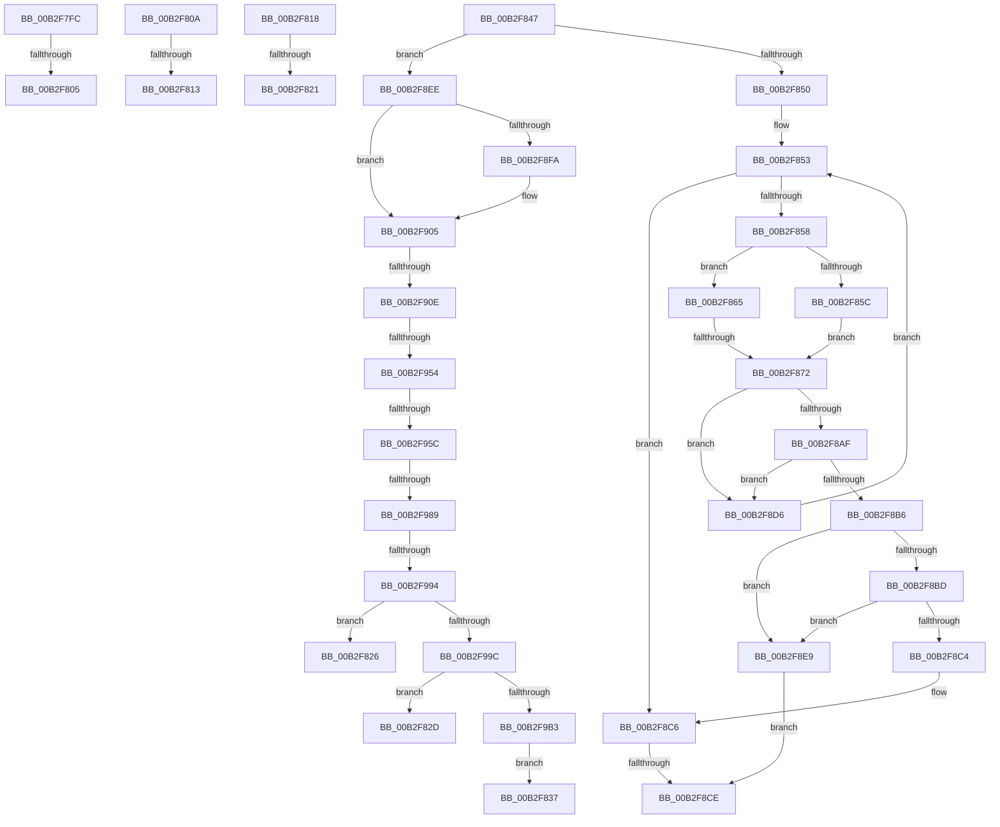

# sub_00B2F7FC

- RVA: `0x00B2F7FC`–`0x00B2F9B8` (길이 `444` bytes)
- VA: `0x0000000140B2F7FC`
- 실행 섹션: `PAGE`
- PDB 이름 있음: `아니요`; PDB Function 태그: `아니요`
- unwind 정보 RVA: `0x000A1650`
- 디코드: `110`개 명령, `444/444` bytes 표시
- 미해석 바이트: `0` (있으면 어셈블리에 `.byte`로 보존)

> 이 문서는 커널 이미지의 기계어와 PDB 기호를 분석해 생성했습니다. 4번과 5번은 함수 원형과 자료형을 바이너리 사용 방식에서 추정한 C 해석이며 원본 소스 복구 결과는 아닙니다.

## 1. Dependencies

- 직접 호출 지점: **3**; 고유 호출 대상: **3**
- 직접 호출자로 확인된 함수: **0**
- RIP 상대 이미지 참조: **3**

### Outgoing calls
- `0x00B2F8A0` → [PnpCtxRegQueryValueIndirect](../8E/PnpCtxRegQueryValueIndirect_function_008EE188.md) (function, `0x008EE188`)
- `0x00B2F942` → [_PnpOpenPropertiesKey](../99/_PnpOpenPropertiesKey_function_009938A0.md) (function, `0x009938A0`)
- `0x00B2F979` → [PnpCtxRegQueryValue](../99/PnpCtxRegQueryValue_function_009940FC.md) (function, `0x009940FC`)

### Direct callers
- 이 함수 시작 RVA로 연결되는 직접 call은 확인되지 않았습니다. 간접 호출은 완전히 역산할 수 없습니다.

### Static image references
- `0x00B2F85C` → RVA `0x00AFCAD0` (` ?? ::NNGAKEGL::`string'`; read)
- `0x00B2F8F1` → RVA `0x00027CC8` (`.rdata`; read)
- `0x00B2F8FE` → RVA `0x00027CD0` (`.rdata`; read)

## 2. Other-region calls and transfers

- 다른 실행 섹션으로 향하는 call: **0**
- call이 아닌 외부 분기/꼬리 이동: **17**
  - `0x00B2F7FF` → [_CmGetInstallerClassMappedPropertyFromRegValue + 0x203](../9D/_CmGetInstallerClassMappedPropertyFromRegValue_function_009D4058.md) (`tail-transfer`)
  - `0x00B2F805` → [_CmGetInstallerClassMappedPropertyFromRegValue + 0x117](../9D/_CmGetInstallerClassMappedPropertyFromRegValue_function_009D4058.md) (`tail-transfer`)
  - `0x00B2F80D` → [_CmGetInstallerClassMappedPropertyFromRegValue + 0x203](../9D/_CmGetInstallerClassMappedPropertyFromRegValue_function_009D4058.md) (`tail-transfer`)
  - `0x00B2F813` → [_CmGetInstallerClassMappedPropertyFromRegValue + 0x120](../9D/_CmGetInstallerClassMappedPropertyFromRegValue_function_009D4058.md) (`tail-transfer`)
  - `0x00B2F81B` → [_CmGetInstallerClassMappedPropertyFromRegValue + 0x13B](../9D/_CmGetInstallerClassMappedPropertyFromRegValue_function_009D4058.md) (`tail-transfer`)
  - `0x00B2F821` → [_CmGetInstallerClassMappedPropertyFromRegValue + 0x203](../9D/_CmGetInstallerClassMappedPropertyFromRegValue_function_009D4058.md) (`tail-transfer`)
  - `0x00B2F828` → [_CmGetInstallerClassMappedPropertyFromRegValue + 0x244](../9D/_CmGetInstallerClassMappedPropertyFromRegValue_function_009D4058.md) (`tail-transfer`)
  - `0x00B2F832` → [_CmGetInstallerClassMappedPropertyFromRegValue + 0x244](../9D/_CmGetInstallerClassMappedPropertyFromRegValue_function_009D4058.md) (`tail-transfer`)
  - `0x00B2F842` → [_CmGetInstallerClassMappedPropertyFromRegValue + 0x244](../9D/_CmGetInstallerClassMappedPropertyFromRegValue_function_009D4058.md) (`tail-transfer`)
  - `0x00B2F86C` → [_CmGetInstallerClassMappedPropertyFromRegValue + 0x23F](../9D/_CmGetInstallerClassMappedPropertyFromRegValue_function_009D4058.md) (`tail-transfer`)
  - `0x00B2F8C8` → [_CmGetInstallerClassMappedPropertyFromRegValue + 0x244](../9D/_CmGetInstallerClassMappedPropertyFromRegValue_function_009D4058.md) (`tail-transfer`)
  - `0x00B2F8D1` → [_CmGetInstallerClassMappedPropertyFromRegValue + 0x1B3](../9D/_CmGetInstallerClassMappedPropertyFromRegValue_function_009D4058.md) (`tail-transfer`)
  - `0x00B2F908` → [_CmGetInstallerClassMappedPropertyFromRegValue + 0x13B](../9D/_CmGetInstallerClassMappedPropertyFromRegValue_function_009D4058.md) (`tail-transfer`)
  - `0x00B2F94E` → [_CmGetInstallerClassMappedPropertyFromRegValue + 0x23F](../9D/_CmGetInstallerClassMappedPropertyFromRegValue_function_009D4058.md) (`tail-transfer`)
  - `0x00B2F956` → [_CmGetInstallerClassMappedPropertyFromRegValue + 0x244](../9D/_CmGetInstallerClassMappedPropertyFromRegValue_function_009D4058.md) (`tail-transfer`)
  - `0x00B2F983` → [_CmGetInstallerClassMappedPropertyFromRegValue + 0x23F](../9D/_CmGetInstallerClassMappedPropertyFromRegValue_function_009D4058.md) (`tail-transfer`)
  - `0x00B2F98E` → [_CmGetInstallerClassMappedPropertyFromRegValue + 0x23F](../9D/_CmGetInstallerClassMappedPropertyFromRegValue_function_009D4058.md) (`tail-transfer`)

## 3. Assembly (complete function range)

```asm
00B2F7FC  48 85 C0                        test rax, rax
00B2F7FF  0F 84 56 4A EA FF               je 0x1409d425b
00B2F805  E9 65 49 EA FF                  jmp 0x1409d416f
00B2F80A  48 85 C0                        test rax, rax
00B2F80D  0F 84 48 4A EA FF               je 0x1409d425b
00B2F813  E9 60 49 EA FF                  jmp 0x1409d4178
00B2F818  48 85 C0                        test rax, rax
00B2F81B  0F 85 72 49 EA FF               jne 0x1409d4193
00B2F821  E9 35 4A EA FF                  jmp 0x1409d425b
00B2F826  8B D8                           mov ebx, eax
00B2F828  E9 6F 4A EA FF                  jmp 0x1409d429c
00B2F82D  BB 23 00 00 C0                  mov ebx, 0xc0000023
00B2F832  E9 65 4A EA FF                  jmp 0x1409d429c
00B2F837  8B 45 AF                        mov eax, dword ptr [rbp - 0x51]
00B2F83A  F7 D8                           neg eax
00B2F83C  1A C9                           sbb cl, cl
00B2F83E  41 88 4D 00                     mov byte ptr [r13], cl
00B2F842  E9 55 4A EA FF                  jmp 0x1409d429c
00B2F847  48 85 C0                        test rax, rax
00B2F84A  0F 85 9E 00 00 00               jne 0x140b2f8ee
00B2F850  41 8B F9                        mov edi, r9d
00B2F853  83 FF 02                        cmp edi, 2
00B2F856  7D 6E                           jge 0x140b2f8c6
00B2F858  85 FF                           test edi, edi
00B2F85A  74 09                           je 0x140b2f865
00B2F85C  4C 8D 05 6D D2 FC FF            lea r8, [rip - 0x32d93]
00B2F863  EB 0D                           jmp 0x140b2f872
00B2F865  4C 8B 46 10                     mov r8, qword ptr [rsi + 0x10]
00B2F869  4D 85 C0                        test r8, r8
00B2F86C  0F 84 25 4A EA FF               je 0x1409d4297
00B2F872  48 8B 55 A7                     mov rdx, qword ptr [rbp - 0x59]
00B2F876  48 8D 45 97                     lea rax, [rbp - 0x69]
00B2F87A  48 8B 4D B7                     mov rcx, qword ptr [rbp - 0x49]
00B2F87E  4C 8D 4D 9F                     lea r9, [rbp - 0x61]
00B2F882  48 89 44 24 30                  mov qword ptr [rsp + 0x30], rax
00B2F887  4D 85 D2                        test r10, r10
00B2F88A  48 8D 45 9B                     lea rax, [rbp - 0x65]
00B2F88E  44 89 75 9B                     mov dword ptr [rbp - 0x65], r14d
00B2F892  48 89 44 24 28                  mov qword ptr [rsp + 0x28], rax
00B2F897  49 0F 45 D2                     cmovne rdx, r10
00B2F89B  4C 89 6C 24 20                  mov qword ptr [rsp + 0x20], r13
00B2F8A0  E8 E3 E8 DB FF                  call 0x1408ee188
00B2F8A5  44 8B F8                        mov r15d, eax
00B2F8A8  3D 34 00 00 C0                  cmp eax, 0xc0000034
00B2F8AD  74 27                           je 0x140b2f8d6
00B2F8AF  3D 7C 01 00 C0                  cmp eax, 0xc000017c
00B2F8B4  74 20                           je 0x140b2f8d6
00B2F8B6  45 33 C9                        xor r9d, r9d
00B2F8B9  85 C0                           test eax, eax
00B2F8BB  74 2C                           je 0x140b2f8e9
00B2F8BD  3D 23 00 00 C0                  cmp eax, 0xc0000023
00B2F8C2  74 25                           je 0x140b2f8e9
00B2F8C4  8B D8                           mov ebx, eax
00B2F8C6  85 DB                           test ebx, ebx
00B2F8C8  0F 88 CE 49 EA FF               js 0x1409d429c
00B2F8CE  45 85 FF                        test r15d, r15d
00B2F8D1  E9 35 49 EA FF                  jmp 0x1409d420b
00B2F8D6  4C 8B 55 CF                     mov r10, qword ptr [rbp - 0x31]
00B2F8DA  FF C7                           inc edi
00B2F8DC  45 33 C9                        xor r9d, r9d
00B2F8DF  BB 25 02 00 C0                  mov ebx, 0xc0000225
00B2F8E4  E9 6A FF FF FF                  jmp 0x140b2f853
00B2F8E9  41 8B D9                        mov ebx, r9d
00B2F8EC  EB E0                           jmp 0x140b2f8ce
00B2F8EE  48 8B 07                        mov rax, qword ptr [rdi]
00B2F8F1  48 2B 05 D0 83 4F FF            sub rax, qword ptr [rip - 0xb07c30]
00B2F8F8  75 0B                           jne 0x140b2f905
00B2F8FA  48 8B 47 08                     mov rax, qword ptr [rdi + 8]
00B2F8FE  48 2B 05 CB 83 4F FF            sub rax, qword ptr [rip - 0xb07c35]
00B2F905  48 85 C0                        test rax, rax
00B2F908  0F 85 85 48 EA FF               jne 0x1409d4193
00B2F90E  48 8B 55 A7                     mov rdx, qword ptr [rbp - 0x59]
00B2F912  48 8D 45 C7                     lea rax, [rbp - 0x39]
00B2F916  48 8B 4D B7                     mov rcx, qword ptr [rbp - 0x49]
00B2F91A  4D 85 D2                        test r10, r10
00B2F91D  48 8B 7E 10                     mov rdi, qword ptr [rsi + 0x10]
00B2F921  41 BF 01 00 00 00               mov r15d, 1
00B2F927  48 89 44 24 30                  mov qword ptr [rsp + 0x30], rax
00B2F92C  49 0F 45 D2                     cmovne rdx, r10
00B2F930  44 88 4C 24 20                  mov byte ptr [rsp + 0x20], r9b
00B2F935  45 33 C0                        xor r8d, r8d
00B2F938  45 8B CF                        mov r9d, r15d
00B2F93B  C7 45 9B 04 00 00 00            mov dword ptr [rbp - 0x65], 4
00B2F942  E8 59 3F E6 FF                  call 0x1409938a0
00B2F947  8B D8                           mov ebx, eax
00B2F949  3D 34 00 00 C0                  cmp eax, 0xc0000034
00B2F94E  0F 84 43 49 EA FF               je 0x1409d4297
00B2F954  85 C0                           test eax, eax
00B2F956  0F 88 40 49 EA FF               js 0x1409d429c
00B2F95C  48 8B 55 C7                     mov rdx, qword ptr [rbp - 0x39]
00B2F960  48 8D 45 9B                     lea rax, [rbp - 0x65]
00B2F964  48 89 44 24 28                  mov qword ptr [rsp + 0x28], rax
00B2F969  4C 8D 4D 9F                     lea r9, [rbp - 0x61]
00B2F96D  48 8D 45 AF                     lea rax, [rbp - 0x51]
00B2F971  4C 8B C7                        mov r8, rdi
00B2F974  48 89 44 24 20                  mov qword ptr [rsp + 0x20], rax
00B2F979  E8 7E 47 E6 FF                  call 0x1409940fc
00B2F97E  3D 34 00 00 C0                  cmp eax, 0xc0000034
00B2F983  0F 84 0E 49 EA FF               je 0x1409d4297
00B2F989  3D 7C 01 00 C0                  cmp eax, 0xc000017c
00B2F98E  0F 84 03 49 EA FF               je 0x1409d4297
00B2F994  85 C0                           test eax, eax
00B2F996  0F 88 8A FE FF FF               js 0x140b2f826
00B2F99C  48 8B 55 BF                     mov rdx, qword ptr [rbp - 0x41]
00B2F9A0  44 89 3A                        mov dword ptr [rdx], r15d
00B2F9A3  8B 46 08                        mov eax, dword ptr [rsi + 8]
00B2F9A6  41 89 04 24                     mov dword ptr [r12], eax
00B2F9AA  45 3B F7                        cmp r14d, r15d
00B2F9AD  0F 82 7A FE FF FF               jb 0x140b2f82d
00B2F9B3  E9 7F FE FF FF                  jmp 0x140b2f837
```

## 4. C-style interpretation (structured pseudocode)

```c
__int64 __fastcall sub_00B2F7FC(unsigned __int8 a1, __int64 a2, __int64 a3, int a4)
{
    unsigned __int64 v_stack_p20;
    unsigned __int64 v_stack_p28;
    unsigned __int64 v_stack_p30;
}
```

## 5. (Beta) C Style

```c
int64_t sub_00B2F7FC(uint8_t Arg1, int64_t Arg2, int64_t Arg3, int32_t Arg4)
{
    uint64_t v_stack_p20;
    uint64_t v_stack_p28;
    uint64_t v_stack_p30;
}
```

## 6. Execution-region graph

[열기: 2D/3D 그래프와 함수 탐색 컨트롤 패널](../../../control-panel.html?section=page&rva=0x00B2F7FC&view=graph)

- 2D 그래프는 위에서 아래로 흐르고, 3D 그래프는 빈 공간을 드래그해 회전합니다. Shift+드래그는 이동, 휠은 확대·축소, 함수 노드 선택은 대상 보고서 이동입니다.

### Static fallback


