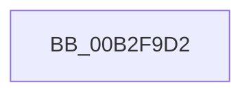

# sub_00B2F9D2

- RVA: `0x00B2F9D2`–`0x00B2FA42` (길이 `112` bytes)
- VA: `0x0000000140B2F9D2`
- 실행 섹션: `PAGE`
- PDB 이름 있음: `아니요`; PDB Function 태그: `아니요`
- unwind 정보 RVA: `0x000A2134`
- 디코드: `22`개 명령, `112/112` bytes 표시
- 미해석 바이트: `0` (있으면 어셈블리에 `.byte`로 보존)

> 이 문서는 커널 이미지의 기계어와 PDB 기호를 분석해 생성했습니다. 4번과 5번은 함수 원형과 자료형을 바이너리 사용 방식에서 추정한 C 해석이며 원본 소스 복구 결과는 아닙니다.

## 1. Dependencies

- 직접 호출 지점: **2**; 고유 호출 대상: **1**
- 직접 호출자로 확인된 함수: **0**
- RIP 상대 이미지 참조: **0**

### Outgoing calls
- `0x00B2FA01` → [EtwTraceWakeCounter](../88/EtwTraceWakeCounter_function_0088B73C.md) (function, `0x0088B73C`)
- `0x00B2FA37` → [EtwTraceWakeCounter](../88/EtwTraceWakeCounter_function_0088B73C.md) (function, `0x0088B73C`)

### Direct callers
- 이 함수 시작 RVA로 연결되는 직접 call은 확인되지 않았습니다. 간접 호출은 완전히 역산할 수 없습니다.

### Static image references
- 디코드된 RIP-relative 메모리 참조가 없습니다.

## 2. Other-region calls and transfers

- 다른 실행 섹션으로 향하는 call: **0**
- call이 아닌 외부 분기/꼬리 이동: **1**
  - `0x00B2FA3D` → [PspChargeJobWakeCounter + 0xF0](../9D/PspChargeJobWakeCounter_function_009D5D20.md) (`tail-transfer`)

## 3. Assembly (complete function range)

```asm
00B2F9D2  48 8B 84 24 E0 00 00 00         mov rax, qword ptr [rsp + 0xe0]
00B2F9DA  45 33 C9                        xor r9d, r9d
00B2F9DD  44 8B 84 24 C0 00 00 00         mov r8d, dword ptr [rsp + 0xc0]
00B2F9E5  33 D2                           xor edx, edx
00B2F9E7  48 89 44 24 30                  mov qword ptr [rsp + 0x30], rax
00B2F9EC  48 8B CB                        mov rcx, rbx
00B2F9EF  48 8B 84 24 D8 00 00 00         mov rax, qword ptr [rsp + 0xd8]
00B2F9F7  48 89 44 24 28                  mov qword ptr [rsp + 0x28], rax
00B2F9FC  4C 89 74 24 20                  mov qword ptr [rsp + 0x20], r14
00B2FA01  E8 36 BD D5 FF                  call 0x14088b73c
00B2FA06  48 8B 84 24 E0 00 00 00         mov rax, qword ptr [rsp + 0xe0]
00B2FA0E  45 33 C9                        xor r9d, r9d
00B2FA11  44 8B 84 24 C0 00 00 00         mov r8d, dword ptr [rsp + 0xc0]
00B2FA19  48 8B CB                        mov rcx, rbx
00B2FA1C  48 89 44 24 30                  mov qword ptr [rsp + 0x30], rax
00B2FA21  48 8B 84 24 D8 00 00 00         mov rax, qword ptr [rsp + 0xd8]
00B2FA29  48 89 44 24 28                  mov qword ptr [rsp + 0x28], rax
00B2FA2E  41 8D 51 01                     lea edx, [r9 + 1]
00B2FA32  4C 89 74 24 20                  mov qword ptr [rsp + 0x20], r14
00B2FA37  E8 00 BD D5 FF                  call 0x14088b73c
00B2FA3C  90                              nop
00B2FA3D  E9 CE 63 EA FF                  jmp 0x1409d5e10
```

## 4. C-style interpretation (structured pseudocode)

```c
__int64 __fastcall sub_00B2F9D2(__int64 a1, int a2, __int64 a3, int a4, __int64 a5, __int64 a6, __int64 a7, __int64 a8, __int64 a9, __int64 a10, __int64 a11, __int64 a12, __int64 a13, __int64 a14, __int64 a15, __int64 a16, __int64 a17, __int64 a18, __int64 a19, __int64 a20, __int64 a21, __int64 a22, __int64 a23, unsigned int a24, __int64 a25, __int64 a26, __int64 a27, __int64 a28)
{
    __int64 result;
    unsigned __int64 v_stack_p20;
    unsigned __int64 v_stack_p28;
    unsigned __int64 v_stack_p30;

    a4 = 0;
    a2 = 0;
    v_stack_p30 = a28;
    v_stack_p28 = a27;
    v_stack_p20 = v_r14;
    result = EtwTraceWakeCounter(v_rbx, a2, (unsigned int)(a24), a4);
    a4 = 0;
    v_stack_p30 = a28;
    v_stack_p28 = a27;
    v_stack_p20 = v_r14;
    result = EtwTraceWakeCounter(v_rbx, a4 + 1, (unsigned int)(a24), a4);
}
```

## 5. (Beta) C Style

```c
int64_t sub_00B2F9D2(int64_t Arg1, int32_t Arg2, int64_t Arg3, int32_t Arg4, uint64_t Arg5, uint64_t Arg6, uint64_t Arg7, uint64_t Arg8, uint64_t Arg9, uint64_t Arg10, uint64_t Arg11, uint64_t Arg12, uint64_t Arg13, uint64_t Arg14, uint64_t Arg15, uint64_t Arg16, uint64_t Arg17, uint64_t Arg18, uint64_t Arg19, uint64_t Arg20, uint64_t Arg21, uint64_t Arg22, uint64_t Arg23, uint32_t Arg24, uint64_t Arg25, uint64_t Arg26, int64_t Arg27, int64_t Arg28)
{
    int64_t result;
    uint64_t v_stack_p20;
    uint64_t v_stack_p28;
    uint64_t v_stack_p30;

    Arg4 = 0;
    Arg2 = 0;
    v_stack_p30 = Arg28;
    v_stack_p28 = Arg27;
    v_stack_p20 = local_r14;
    result = EtwTraceWakeCounter(local_rbx, Arg2, (uint32_t)(Arg24), Arg4);
    Arg4 = 0;
    v_stack_p30 = Arg28;
    v_stack_p28 = Arg27;
    v_stack_p20 = local_r14;
    result = EtwTraceWakeCounter(local_rbx, Arg4 + 1, (uint32_t)(Arg24), Arg4);
}
```

## 6. Execution-region graph

[열기: 2D/3D 그래프와 함수 탐색 컨트롤 패널](../../../control-panel.html?section=page&rva=0x00B2F9D2&view=graph)

- 2D 그래프는 위에서 아래로 흐르고, 3D 그래프는 빈 공간을 드래그해 회전합니다. Shift+드래그는 이동, 휠은 확대·축소, 함수 노드 선택은 대상 보고서 이동입니다.

### Static fallback


