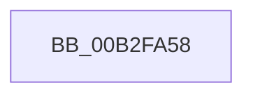

# sub_00B2FA58

- RVA: `0x00B2FA58`–`0x00B2FAB0` (길이 `88` bytes)
- VA: `0x0000000140B2FA58`
- 실행 섹션: `PAGE`
- PDB 이름 있음: `아니요`; PDB Function 태그: `아니요`
- unwind 정보 RVA: `0x000A2AFC`
- 디코드: `21`개 명령, `88/88` bytes 표시
- 미해석 바이트: `0` (있으면 어셈블리에 `.byte`로 보존)

> 이 문서는 커널 이미지의 기계어와 PDB 기호를 분석해 생성했습니다. 4번과 5번은 함수 원형과 자료형을 바이너리 사용 방식에서 추정한 C 해석이며 원본 소스 복구 결과는 아닙니다.

## 1. Dependencies

- 직접 호출 지점: **1**; 고유 호출 대상: **1**
- 직접 호출자로 확인된 함수: **0**
- RIP 상대 이미지 참조: **2**

### Outgoing calls
- `0x00B2FA7C` → [KiQueryUnbiasedInterruptTime](../../text/42/KiQueryUnbiasedInterruptTime_function_0042D180.md) (function, `0x0042D180`)

### Direct callers
- 이 함수 시작 RVA로 연결되는 직접 call은 확인되지 않았습니다. 간접 호출은 완전히 역산할 수 없습니다.

### Static image references
- `0x00B2FA72` → RVA `0x00EF01F8` (`.data`; write)
- `0x00B2FAA4` → RVA `0x00EF0200` (`.data`; write)

## 2. Other-region calls and transfers

- 다른 실행 섹션으로 향하는 call: **1**
  - `0x00B2FA7C` → [KiQueryUnbiasedInterruptTime](../../text/42/KiQueryUnbiasedInterruptTime_function_0042D180.md) (`PAGE` → `.text`)
- call이 아닌 외부 분기/꼬리 이동: **1**
  - `0x00B2FAAB` → [ObpProcessRemoveObjectQueue + 0x46](../9D/ObpProcessRemoveObjectQueue_function_009D7B40.md) (`tail-transfer`)

## 3. Assembly (complete function range)

```asm
00B2FA58  0F 31                           rdtsc
00B2FA5A  48 C1 E2 20                     shl rdx, 0x20
00B2FA5E  48 0B C2                        or rax, rdx
00B2FA61  48 C1 E8 04                     shr rax, 4
00B2FA65  69 C8 BF CB 7F 02               imul ecx, eax, 0x27fcbbf
00B2FA6B  48 81 F1 3F 0C 00 00            xor rcx, 0xc3f
00B2FA72  48 89 0D 7F 07 3C 00            mov qword ptr [rip + 0x3c077f], rcx
00B2FA79  41 8A CF                        mov cl, r15b
00B2FA7C  E8 FF D6 8F FF                  call 0x14042d180
00B2FA81  4C 8B D8                        mov r11, rax
00B2FA84  0F 31                           rdtsc
00B2FA86  48 C1 E2 20                     shl rdx, 0x20
00B2FA8A  48 0B C2                        or rax, rdx
00B2FA8D  33 D2                           xor edx, edx
00B2FA8F  48 C1 E8 04                     shr rax, 4
00B2FA93  48 69 C0 BF CB 7F 02            imul rax, rax, 0x27fcbbf
00B2FA9A  48 F7 F3                        div rbx
00B2FA9D  48 8D 04 3A                     lea rax, [rdx + rdi]
00B2FAA1  49 03 C3                        add rax, r11
00B2FAA4  48 89 05 55 07 3C 00            mov qword ptr [rip + 0x3c0755], rax
00B2FAAB  E9 D6 80 EA FF                  jmp 0x1409d7b86
```

## 4. C-style interpretation (structured pseudocode)

```c
__int64 __fastcall sub_00B2FA58(__int64 a1, __int64 a2)
{
    __int64 result;

    a2 = (a2) << (32);
    result = (result) | (a2);
    result = (result) >> (4);
    a1 = (unsigned int)((a1) * ((unsigned int)(result)));
    a1 = (a1) ^ (0xC3FULL);
    *(unsigned __int64 *)(v_rip + 3934079) = a1;
    result = KiQueryUnbiasedInterruptTime((unsigned __int8)(v_r15), a2, a3, a4);
    a2 = (a2) << (32);
    result = (result) | (a2);
    a2 = 0;
    result = (result) >> (4);
    result = (result) * (result);
    result = (a2 + v_rdi * 1) + (result);
    *(unsigned __int64 *)(v_rip + 3934037) = result;
}
```

## 5. (Beta) C Style

```c
int64_t sub_00B2FA58(int64_t Arg1, int64_t Arg2)
{
    int64_t result;

    Arg2 = (Arg2) << (32);
    result = (result) | (Arg2);
    result = (result) >> (4);
    Arg1 = (uint32_t)((Arg1) * ((uint32_t)(result)));
    Arg1 = (Arg1) ^ (0xC3FULL);
    *(uint64_t *)(v_rip + 0x3C077F) = Arg1;
    result = KiQueryUnbiasedInterruptTime((uint8_t)(local_r15), Arg2, a3, a4);
    Arg2 = (Arg2) << (32);
    result = (result) | (Arg2);
    Arg2 = 0;
    result = (result) >> (4);
    result = (result) * (result);
    result = (Arg2 + local_rdi * 1) + (result);
    *(uint64_t *)(v_rip + 0x3C0755) = result;
}
```

## 6. Execution-region graph

[열기: 2D/3D 그래프와 함수 탐색 컨트롤 패널](../../../control-panel.html?section=page&rva=0x00B2FA58&view=graph)

- 2D 그래프는 위에서 아래로 흐르고, 3D 그래프는 빈 공간을 드래그해 회전합니다. Shift+드래그는 이동, 휠은 확대·축소, 함수 노드 선택은 대상 보고서 이동입니다.

### Static fallback


