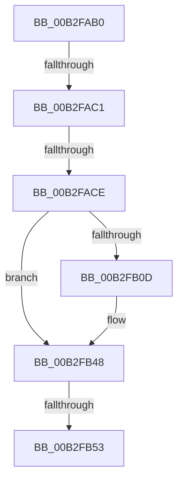

# sub_00B2FAB0

- RVA: `0x00B2FAB0`–`0x00B2FB61` (길이 `177` bytes)
- VA: `0x0000000140B2FAB0`
- 실행 섹션: `PAGE`
- PDB 이름 있음: `아니요`; PDB Function 태그: `아니요`
- unwind 정보 RVA: `0x000A2ECC`
- 디코드: `35`개 명령, `177/177` bytes 표시
- 미해석 바이트: `0` (있으면 어셈블리에 `.byte`로 보존)

> 이 문서는 커널 이미지의 기계어와 PDB 기호를 분석해 생성했습니다. 4번과 5번은 함수 원형과 자료형을 바이너리 사용 방식에서 추정한 C 해석이며 원본 소스 복구 결과는 아닙니다.

## 1. Dependencies

- 직접 호출 지점: **3**; 고유 호출 대상: **3**
- 직접 호출자로 확인된 함수: **0**
- RIP 상대 이미지 참조: **0**

### Outgoing calls
- `0x00B2FAFB` → [IopIncrementCompletionContextUsageCountAndReadData](../../text/44/IopIncrementCompletionContextUsageCountAndReadData_function_00443C60.md) (function, `0x00443C60`)
- `0x00B2FB31` → [IoSetIoCompletionEx](../../text/24/IoSetIoCompletionEx_function_0024FA80.md) (function, `0x0024FA80`)
- `0x00B2FB56` → [IopDecrementCompletionContextUsageCount](../../text/45/IopDecrementCompletionContextUsageCount_function_00452678.md) (function, `0x00452678`)

### Direct callers
- 이 함수 시작 RVA로 연결되는 직접 call은 확인되지 않았습니다. 간접 호출은 완전히 역산할 수 없습니다.

### Static image references
- 디코드된 RIP-relative 메모리 참조가 없습니다.

## 2. Other-region calls and transfers

- 다른 실행 섹션으로 향하는 call: **3**
  - `0x00B2FAFB` → [IopIncrementCompletionContextUsageCountAndReadData](../../text/44/IopIncrementCompletionContextUsageCountAndReadData_function_00443C60.md) (`PAGE` → `.text`)
  - `0x00B2FB31` → [IoSetIoCompletionEx](../../text/24/IoSetIoCompletionEx_function_0024FA80.md) (`PAGE` → `.text`)
  - `0x00B2FB56` → [IopDecrementCompletionContextUsageCount](../../text/45/IopDecrementCompletionContextUsageCount_function_00452678.md) (`PAGE` → `.text`)
- call이 아닌 외부 분기/꼬리 이동: **4**
  - `0x00B2FABB` → [NtLockFile + 0x31F](../9D/NtLockFile_function_009D86D0.md) (`tail-transfer`)
  - `0x00B2FAC8` → [NtLockFile + 0x31F](../9D/NtLockFile_function_009D86D0.md) (`tail-transfer`)
  - `0x00B2FB4D` → [NtLockFile + 0x31F](../9D/NtLockFile_function_009D86D0.md) (`tail-transfer`)
  - `0x00B2FB5C` → [NtLockFile + 0x31F](../9D/NtLockFile_function_009D86D0.md) (`tail-transfer`)

## 3. Assembly (complete function range)

```asm
00B2FAB0  48 8B BC 24 08 01 00 00         mov rdi, qword ptr [rsp + 0x108]
00B2FAB8  48 85 FF                        test rdi, rdi
00B2FABB  0F 84 2E 8F EA FF               je 0x1409d89ef
00B2FAC1  F7 43 50 00 00 00 02            test dword ptr [rbx + 0x50], 0x2000000
00B2FAC8  0F 85 21 8F EA FF               jne 0x1409d89ef
00B2FACE  4C 89 BC 24 A0 00 00 00         mov qword ptr [rsp + 0xa0], r15
00B2FAD6  4C 89 BC 24 80 00 00 00         mov qword ptr [rsp + 0x80], r15
00B2FADE  C6 44 24 50 00                  mov byte ptr [rsp + 0x50], 0
00B2FAE3  4C 8D 8C 24 80 00 00 00         lea r9, [rsp + 0x80]
00B2FAEB  4C 8D 84 24 A0 00 00 00         lea r8, [rsp + 0xa0]
00B2FAF3  48 8D 54 24 50                  lea rdx, [rsp + 0x50]
00B2FAF8  48 8B CB                        mov rcx, rbx
00B2FAFB  E8 60 41 91 FF                  call 0x140443c60
00B2FB00  48 8B 8C 24 A0 00 00 00         mov rcx, qword ptr [rsp + 0xa0]
00B2FB08  48 85 C9                        test rcx, rcx
00B2FB0B  74 3B                           je 0x140b2fb48
00B2FB0D  4C 89 7C 24 30                  mov qword ptr [rsp + 0x30], r15
00B2FB12  C6 44 24 28 01                  mov byte ptr [rsp + 0x28], 1
00B2FB17  48 8B 44 24 68                  mov rax, qword ptr [rsp + 0x68]
00B2FB1C  48 89 44 24 20                  mov qword ptr [rsp + 0x20], rax
00B2FB21  44 8B 4C 24 60                  mov r9d, dword ptr [rsp + 0x60]
00B2FB26  4C 8B C7                        mov r8, rdi
00B2FB29  48 8B 94 24 80 00 00 00         mov rdx, qword ptr [rsp + 0x80]
00B2FB31  E8 4A FF 71 FF                  call 0x14024fa80
00B2FB36  8B 54 24 60                     mov edx, dword ptr [rsp + 0x60]
00B2FB3A  B9 9A 00 00 C0                  mov ecx, 0xc000009a
00B2FB3F  85 C0                           test eax, eax
00B2FB41  0F 48 D1                        cmovs edx, ecx
00B2FB44  89 54 24 60                     mov dword ptr [rsp + 0x60], edx
00B2FB48  80 7C 24 50 00                  cmp byte ptr [rsp + 0x50], 0
00B2FB4D  0F 84 9C 8E EA FF               je 0x1409d89ef
00B2FB53  48 8B CB                        mov rcx, rbx
00B2FB56  E8 1D 2B 92 FF                  call 0x140452678
00B2FB5B  90                              nop
00B2FB5C  E9 8E 8E EA FF                  jmp 0x1409d89ef
```

## 4. C-style interpretation (structured pseudocode)

```c
__int64 __fastcall sub_00B2FAB0(__int64 a1, __int64 a2, __int64 a3, __int64 a4, __int64 a5, __int64 a6, __int64 a7, __int64 a8, __int64 a9, unsigned __int8 a10, __int64 a11, unsigned int a12, __int64 a13, __int64 a14, __int64 a15, __int64 a16, __int64 a17, __int64 a18, __int64 a19, __int64 a20, __int64 a21, __int64 a22, __int64 a23, __int64 a24, __int64 a25, __int64 a26, __int64 a27, __int64 a28, __int64 a29, __int64 a30, __int64 a31, __int64 a32, __int64 a33)
{
    __int64 result;
    unsigned __int64 v_stack_p20;
    unsigned __int8 v_stack_p28;
    unsigned __int64 v_stack_p30;
    unsigned __int8 v_stack_p50;
    unsigned int v_stack_p60;
    unsigned __int64 v_stack_p80;
    unsigned __int64 v_stack_pA0;

    v_stack_pA0 = v_r15;
    v_stack_p80 = v_r15;
    v_stack_p50 = 0;
    result = IopIncrementCompletionContextUsageCountAndReadData(v_rbx, a10, a20, a16);
    if (a20 != 0) {
        v_stack_p30 = v_r15;
        v_stack_p28 = 1;
        result = a13;
        v_stack_p20 = result;
        a4 = a12;
        a3 = a33;
        a2 = a16;
        result = IoSetIoCompletionEx(a20, a2, a3, a4);
        a2 = a12;
        a1 = 0xC000009AULL;
        if (sign_flag) { a2 = (unsigned int)(a1); }
        v_stack_p60 = (unsigned int)(a2);
    }
    result = IopDecrementCompletionContextUsageCount(v_rbx, a2, a3, a4);
}
```

## 5. (Beta) C Style

```c
int64_t sub_00B2FAB0(int64_t Arg1, int64_t Arg2, int64_t Arg3, int64_t Arg4, uint64_t Arg5, uint64_t Arg6, uint64_t Arg7, uint64_t Arg8, uint64_t Arg9, uint8_t Arg10, uint64_t Arg11, uint32_t Arg12, int64_t Arg13, uint64_t Arg14, uint64_t Arg15, int64_t Arg16, uint64_t Arg17, uint64_t Arg18, uint64_t Arg19, int64_t Arg20, uint64_t Arg21, uint64_t Arg22, uint64_t Arg23, uint64_t Arg24, uint64_t Arg25, uint64_t Arg26, uint64_t Arg27, uint64_t Arg28, uint64_t Arg29, uint64_t Arg30, uint64_t Arg31, uint64_t Arg32, int64_t Arg33)
{
    int64_t result;
    uint64_t v_stack_p20;
    uint8_t v_stack_p28;
    uint64_t v_stack_p30;
    uint8_t v_stack_p50;
    uint32_t v_stack_p60;
    uint64_t v_stack_p80;
    uint64_t v_stack_pA0;

    v_stack_pA0 = local_r15;
    v_stack_p80 = local_r15;
    v_stack_p50 = 0;
    result = IopIncrementCompletionContextUsageCountAndReadData(local_rbx, Arg10, Arg20, Arg16);
    if (Arg20 != 0) {
        v_stack_p30 = local_r15;
        v_stack_p28 = 1;
        result = Arg13;
        v_stack_p20 = result;
        Arg4 = Arg12;
        Arg3 = Arg33;
        Arg2 = Arg16;
        result = IoSetIoCompletionEx(Arg20, Arg2, Arg3, Arg4);
        Arg2 = Arg12;
        Arg1 = 0xC000009AULL;
        if (sign_flag) { Arg2 = (uint32_t)(Arg1); }
        v_stack_p60 = (uint32_t)(Arg2);
    }
    result = IopDecrementCompletionContextUsageCount(local_rbx, Arg2, Arg3, Arg4);
}
```

## 6. Execution-region graph

[열기: 2D/3D 그래프와 함수 탐색 컨트롤 패널](../../../control-panel.html?section=page&rva=0x00B2FAB0&view=graph)

- 2D 그래프는 위에서 아래로 흐르고, 3D 그래프는 빈 공간을 드래그해 회전합니다. Shift+드래그는 이동, 휠은 확대·축소, 함수 노드 선택은 대상 보고서 이동입니다.

### Static fallback


