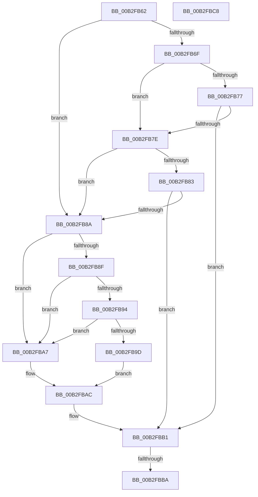

# sub_00B2FB62

- RVA: `0x00B2FB62`–`0x00B2FBCF` (길이 `109` bytes)
- VA: `0x0000000140B2FB62`
- 실행 섹션: `PAGE`
- PDB 이름 있음: `아니요`; PDB Function 태그: `아니요`
- unwind 정보 RVA: `0x000A2F1C`
- 디코드: `33`개 명령, `109/109` bytes 표시
- 미해석 바이트: `0` (있으면 어셈블리에 `.byte`로 보존)

> 이 문서는 커널 이미지의 기계어와 PDB 기호를 분석해 생성했습니다. 4번과 5번은 함수 원형과 자료형을 바이너리 사용 방식에서 추정한 C 해석이며 원본 소스 복구 결과는 아닙니다.

## 1. Dependencies

- 직접 호출 지점: **2**; 고유 호출 대상: **2**
- 직접 호출자로 확인된 함수: **0**
- RIP 상대 이미지 참조: **0**

### Outgoing calls
- `0x00B2FBA0` → [guard_dispatch_icall](../../text/6B/guard_dispatch_icall_function_006BAAD0.md) (function, `0x006BAAD0`)
- `0x00B2FBBD` → [ObfDereferenceObject](../../text/2F/ObfDereferenceObject_function_002F9350.md) (function, `0x002F9350`)

### Direct callers
- 이 함수 시작 RVA로 연결되는 직접 call은 확인되지 않았습니다. 간접 호출은 완전히 역산할 수 없습니다.

### Static image references
- 디코드된 RIP-relative 메모리 참조가 없습니다.

## 2. Other-region calls and transfers

- 다른 실행 섹션으로 향하는 call: **2**
  - `0x00B2FBA0` → [guard_dispatch_icall](../../text/6B/guard_dispatch_icall_function_006BAAD0.md) (`PAGE` → `.text`)
  - `0x00B2FBBD` → [ObfDereferenceObject](../../text/2F/ObfDereferenceObject_function_002F9350.md) (`PAGE` → `.text`)
- call이 아닌 외부 분기/꼬리 이동: **3**
  - `0x00B2FBB4` → [FsRtlAcquireFileExclusiveCommon + 0x149](../9D/FsRtlAcquireFileExclusiveCommon_function_009D8E50.md) (`tail-transfer`)
  - `0x00B2FBC3` → [FsRtlAcquireFileExclusiveCommon + 0x149](../9D/FsRtlAcquireFileExclusiveCommon_function_009D8E50.md) (`tail-transfer`)
  - `0x00B2FBCA` → [FsRtlAcquireFileExclusiveCommon + 0x155](../9D/FsRtlAcquireFileExclusiveCommon_function_009D8E50.md) (`tail-transfer`)

## 3. Assembly (complete function range)

```asm
00B2FB62  48 8B 54 24 48                  mov rdx, qword ptr [rsp + 0x48]
00B2FB67  40 32 F6                        xor sil, sil
00B2FB6A  4D 85 F6                        test r14, r14
00B2FB6D  74 1B                           je 0x140b2fb8a
00B2FB6F  41 8B 06                        mov eax, dword ptr [r14]
00B2FB72  83 F8 10                        cmp eax, 0x10
00B2FB75  72 07                           jb 0x140b2fb7e
00B2FB77  49 83 7E 08 00                  cmp qword ptr [r14 + 8], 0
00B2FB7C  75 33                           jne 0x140b2fbb1
00B2FB7E  83 F8 18                        cmp eax, 0x18
00B2FB81  72 07                           jb 0x140b2fb8a
00B2FB83  49 83 7E 10 00                  cmp qword ptr [r14 + 0x10], 0
00B2FB88  75 27                           jne 0x140b2fbb1
00B2FB8A  48 85 D2                        test rdx, rdx
00B2FB8D  74 18                           je 0x140b2fba7
00B2FB8F  83 3A 60                        cmp dword ptr [rdx], 0x60
00B2FB92  72 13                           jb 0x140b2fba7
00B2FB94  48 8B 42 58                     mov rax, qword ptr [rdx + 0x58]
00B2FB98  48 85 C0                        test rax, rax
00B2FB9B  74 0A                           je 0x140b2fba7
00B2FB9D  48 8B CD                        mov rcx, rbp
00B2FBA0  E8 2B AF B8 FF                  call 0x1406baad0
00B2FBA5  EB 05                           jmp 0x140b2fbac
00B2FBA7  BB 10 00 00 C0                  mov ebx, 0xc0000010
00B2FBAC  83 4C 24 30 01                  or dword ptr [rsp + 0x30], 1
00B2FBB1  40 84 F6                        test sil, sil
00B2FBB4  0F 84 DF 93 EA FF               je 0x1409d8f99
00B2FBBA  49 8B CF                        mov rcx, r15
00B2FBBD  E8 8E 97 7C FF                  call 0x1402f9350
00B2FBC2  90                              nop
00B2FBC3  E9 D1 93 EA FF                  jmp 0x1409d8f99
00B2FBC8  33 DB                           xor ebx, ebx
00B2FBCA  E9 D6 93 EA FF                  jmp 0x1409d8fa5
```

## 4. C-style interpretation (structured pseudocode)

```c
__int64 __fastcall sub_00B2FB62(__int64 a1, __int64 a2, __int64 a3, __int64 a4, __int64 a5, unsigned int a6, __int64 a7, __int64 a8, __int64 a9)
{
    __int64 result;
    __int64 v_rsi;

    v_rsi = 0;
    if (v_r14 == 0) goto loc_00B2FB8A;
    if (((unsigned int)((unsigned int)(*(unsigned int *)(v_r14)))) < 16) goto loc_00B2FB7E;
    if ((*(unsigned __int64 *)(v_r14 + 8)) != 0) goto loc_00B2FBB1;
loc_00B2FB7E:
    if (((unsigned int)((unsigned int)(*(unsigned int *)(v_r14)))) < 24) goto loc_00B2FB8A;
    if ((*(unsigned __int64 *)(v_r14 + 16)) != 0) goto loc_00B2FBB1;
loc_00B2FB8A:
    if (a9 == 0) goto loc_00B2FBA7;
    if ((*(unsigned int *)(a9)) < 96) goto loc_00B2FBA7;
    if (*(unsigned __int64 *)(a9 + 88) == 0) goto loc_00B2FBA7;
    result = guard_dispatch_icall(v_rbp, a9, a3, a4);
    goto loc_00B2FBAC;
loc_00B2FBA7:
loc_00B2FBAC:
loc_00B2FBB1:
    result = ObfDereferenceObject(v_r15, a9, a3, a4);
}
```

## 5. (Beta) C Style

```c
int64_t sub_00B2FB62(int64_t Arg1, int64_t Arg2, int64_t Arg3, int64_t Arg4, uint64_t Arg5, uint32_t Arg6, uint64_t Arg7, uint64_t Arg8, int64_t Arg9)
{
    int64_t result;
    int64_t local_rsi;

    local_rsi = 0;
    if (local_r14 == 0) goto loc_00B2FB8A;
    if (((uint32_t)((uint32_t)(*(uint32_t *)(local_r14)))) < 16) goto loc_00B2FB7E;
    if ((*(uint64_t *)(local_r14 + 0x8)) != 0) goto loc_00B2FBB1;
loc_00B2FB7E:
    if (((uint32_t)((uint32_t)(*(uint32_t *)(local_r14)))) < 24) goto loc_00B2FB8A;
    if ((*(uint64_t *)(local_r14 + 0x10)) != 0) goto loc_00B2FBB1;
loc_00B2FB8A:
    if (Arg9 == 0) goto loc_00B2FBA7;
    if ((*(uint32_t *)(Arg9)) < 96) goto loc_00B2FBA7;
    if (*(uint64_t *)(Arg9 + 0x58) == 0) goto loc_00B2FBA7;
    result = guard_dispatch_icall(local_rbp, Arg9, Arg3, Arg4);
    goto loc_00B2FBAC;
loc_00B2FBA7:
loc_00B2FBAC:
loc_00B2FBB1:
    result = ObfDereferenceObject(local_r15, Arg9, Arg3, Arg4);
}
```

## 6. Execution-region graph

[열기: 2D/3D 그래프와 함수 탐색 컨트롤 패널](../../../control-panel.html?section=page&rva=0x00B2FB62&view=graph)

- 2D 그래프는 위에서 아래로 흐르고, 3D 그래프는 빈 공간을 드래그해 회전합니다. Shift+드래그는 이동, 휠은 확대·축소, 함수 노드 선택은 대상 보고서 이동입니다.

### Static fallback


