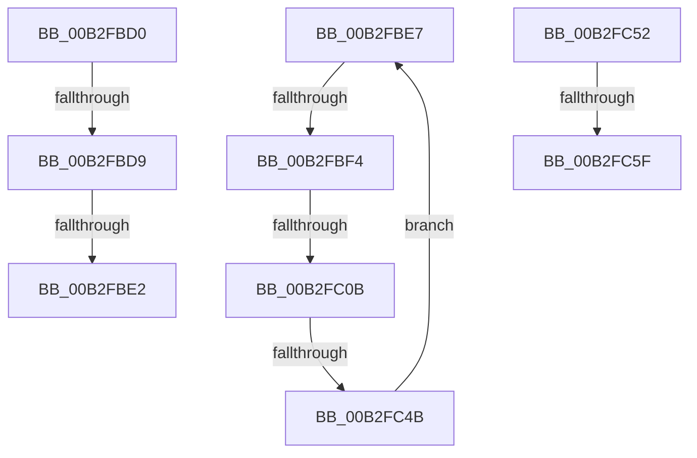

# sub_00B2FBD0

- RVA: `0x00B2FBD0`–`0x00B2FC67` (길이 `151` bytes)
- VA: `0x0000000140B2FBD0`
- 실행 섹션: `PAGE`
- PDB 이름 있음: `아니요`; PDB Function 태그: `아니요`
- unwind 정보 RVA: `0x000A31DC`
- 디코드: `34`개 명령, `151/151` bytes 표시
- 미해석 바이트: `0` (있으면 어셈블리에 `.byte`로 보존)

> 이 문서는 커널 이미지의 기계어와 PDB 기호를 분석해 생성했습니다. 4번과 5번은 함수 원형과 자료형을 바이너리 사용 방식에서 추정한 C 해석이며 원본 소스 복구 결과는 아닙니다.

## 1. Dependencies

- 직접 호출 지점: **2**; 고유 호출 대상: **2**
- 직접 호출자로 확인된 함수: **0**
- RIP 상대 이미지 참조: **0**

### Outgoing calls
- `0x00B2FC20` → [FsRtlDissectDbcs](../71/FsRtlDissectDbcs_function_007163E0.md) (function, `0x007163E0`)
- `0x00B2FC3E` → [FsRtlIsFatDbcsLegal](../9D/FsRtlIsFatDbcsLegal_function_009DA3C0.md) (function, `0x009DA3C0`)

### Direct callers
- 이 함수 시작 RVA로 연결되는 직접 call은 확인되지 않았습니다. 간접 호출은 완전히 역산할 수 없습니다.

### Static image references
- 디코드된 RIP-relative 메모리 참조가 없습니다.

## 2. Other-region calls and transfers

- 다른 실행 섹션으로 향하는 call: **0**
- call이 아닌 외부 분기/꼬리 이동: **8**
  - `0x00B2FBD3` → [FsRtlIsFatDbcsLegal + 0x3B](../9D/FsRtlIsFatDbcsLegal_function_009DA3C0.md) (`tail-transfer`)
  - `0x00B2FBDC` → [FsRtlIsFatDbcsLegal + 0x194](../9D/FsRtlIsFatDbcsLegal_function_009DA3C0.md) (`tail-transfer`)
  - `0x00B2FBE2` → [FsRtlIsFatDbcsLegal + 0x3B](../9D/FsRtlIsFatDbcsLegal_function_009DA3C0.md) (`tail-transfer`)
  - `0x00B2FBEE` → [FsRtlIsFatDbcsLegal + 0x194](../9D/FsRtlIsFatDbcsLegal_function_009DA3C0.md) (`tail-transfer`)
  - `0x00B2FC05` → [FsRtlIsFatDbcsLegal + 0xA1](../9D/FsRtlIsFatDbcsLegal_function_009DA3C0.md) (`tail-transfer`)
  - `0x00B2FC45` → [FsRtlIsFatDbcsLegal + 0xA1](../9D/FsRtlIsFatDbcsLegal_function_009DA3C0.md) (`tail-transfer`)
  - `0x00B2FC59` → [FsRtlIsFatDbcsLegal + 0xA1](../9D/FsRtlIsFatDbcsLegal_function_009DA3C0.md) (`tail-transfer`)
  - `0x00B2FC62` → [FsRtlIsFatDbcsLegal + 0xD0](../9D/FsRtlIsFatDbcsLegal_function_009DA3C0.md) (`tail-transfer`)

## 3. Assembly (complete function range)

```asm
00B2FBD0  80 FA 22                        cmp dl, 0x22
00B2FBD3  0F 85 22 A8 EA FF               jne 0x1409da3fb
00B2FBD9  38 50 01                        cmp byte ptr [rax + 1], dl
00B2FBDC  0F 84 72 A9 EA FF               je 0x1409da554
00B2FBE2  E9 14 A8 EA FF                  jmp 0x1409da3fb
00B2FBE7  66 0F 7E C8                     movd eax, xmm1
00B2FBEB  66 85 C0                        test ax, ax
00B2FBEE  0F 84 60 A9 EA FF               je 0x1409da554
00B2FBF4  66 0F 6F C1                     movdqa xmm0, xmm1
00B2FBF8  66 0F 73 D8 08                  psrldq xmm0, 8
00B2FBFD  66 48 0F 7E C0                  movq rax, xmm0
00B2FC02  80 38 5C                        cmp byte ptr [rax], 0x5c
00B2FC05  0F 84 56 A8 EA FF               je 0x1409da461
00B2FC0B  4C 8D 44 24 30                  lea r8, [rsp + 0x30]
00B2FC10  66 0F 7F 4C 24 40               movdqa xmmword ptr [rsp + 0x40], xmm1
00B2FC16  48 8D 54 24 20                  lea rdx, [rsp + 0x20]
00B2FC1B  48 8D 4C 24 40                  lea rcx, [rsp + 0x40]
00B2FC20  E8 BB 67 BE FF                  call 0x1407163e0
00B2FC25  0F 28 44 24 20                  movaps xmm0, xmmword ptr [rsp + 0x20]
00B2FC2A  48 8D 4C 24 40                  lea rcx, [rsp + 0x40]
00B2FC2F  45 33 C9                        xor r9d, r9d
00B2FC32  66 0F 7F 44 24 40               movdqa xmmword ptr [rsp + 0x40], xmm0
00B2FC38  45 33 C0                        xor r8d, r8d
00B2FC3B  40 8A D5                        mov dl, bpl
00B2FC3E  E8 7D A7 EA FF                  call 0x1409da3c0
00B2FC43  84 C0                           test al, al
00B2FC45  0F 84 16 A8 EA FF               je 0x1409da461
00B2FC4B  0F 28 4C 24 30                  movaps xmm1, xmmword ptr [rsp + 0x30]
00B2FC50  EB 95                           jmp 0x140b2fbe7
00B2FC52  41 8D 41 FF                     lea eax, [r9 - 1]
00B2FC56  44 3B C0                        cmp r8d, eax
00B2FC59  0F 84 02 A8 EA FF               je 0x1409da461
00B2FC5F  45 03 C7                        add r8d, r15d
00B2FC62  E9 29 A8 EA FF                  jmp 0x1409da490
```

## 4. C-style interpretation (structured pseudocode)

```c
__int64 __fastcall sub_00B2FBD0(__int64 a1, unsigned __int8 a2, __int64 a3, int a4)
{
    unsigned __int64 v_stack_p20;
    unsigned __int64 v_stack_p30;
    unsigned __int64 v_stack_p40;
}
```

## 5. (Beta) C Style

```c
int64_t sub_00B2FBD0(int64_t Arg1, uint8_t Arg2, int64_t Arg3, int32_t Arg4)
{
    uint64_t v_stack_p20;
    uint64_t v_stack_p30;
    uint64_t v_stack_p40;
}
```

## 6. Execution-region graph

[열기: 2D/3D 그래프와 함수 탐색 컨트롤 패널](../../../control-panel.html?section=page&rva=0x00B2FBD0&view=graph)

- 2D 그래프는 위에서 아래로 흐르고, 3D 그래프는 빈 공간을 드래그해 회전합니다. Shift+드래그는 이동, 휠은 확대·축소, 함수 노드 선택은 대상 보고서 이동입니다.

### Static fallback


