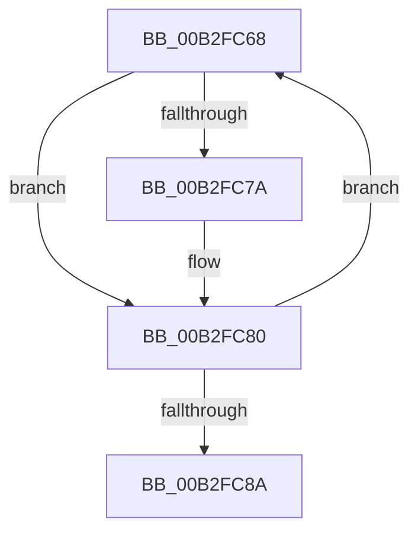

# sub_00B2FC68

- RVA: `0x00B2FC68`–`0x00B2FC8F` (길이 `39` bytes)
- VA: `0x0000000140B2FC68`
- 실행 섹션: `PAGE`
- PDB 이름 있음: `아니요`; PDB Function 태그: `아니요`
- unwind 정보 RVA: `0x000A3448`
- 디코드: `11`개 명령, `39/39` bytes 표시
- 미해석 바이트: `0` (있으면 어셈블리에 `.byte`로 보존)

> 이 문서는 커널 이미지의 기계어와 PDB 기호를 분석해 생성했습니다. 4번과 5번은 함수 원형과 자료형을 바이너리 사용 방식에서 추정한 C 해석이며 원본 소스 복구 결과는 아닙니다.

## 1. Dependencies

- 직접 호출 지점: **1**; 고유 호출 대상: **1**
- 직접 호출자로 확인된 함수: **0**
- RIP 상대 이미지 참조: **0**

### Outgoing calls
- `0x00B2FC71` → [ObReferenceObjectSafe](../../text/41/ObReferenceObjectSafe_function_0041DAE0.md) (function, `0x0041DAE0`)

### Direct callers
- 이 함수 시작 RVA로 연결되는 직접 call은 확인되지 않았습니다. 간접 호출은 완전히 역산할 수 없습니다.

### Static image references
- 디코드된 RIP-relative 메모리 참조가 없습니다.

## 2. Other-region calls and transfers

- 다른 실행 섹션으로 향하는 call: **1**
  - `0x00B2FC71` → [ObReferenceObjectSafe](../../text/41/ObReferenceObjectSafe_function_0041DAE0.md) (`PAGE` → `.text`)
- call이 아닌 외부 분기/꼬리 이동: **1**
  - `0x00B2FC8A` → [ObpCreateTypeArray + 0x2D](../9D/ObpCreateTypeArray_function_009DB4B4.md) (`tail-transfer`)

## 3. Assembly (complete function range)

```asm
00B2FC68  48 8D 4F 50                     lea rcx, [rdi + 0x50]
00B2FC6C  48 89 7C EE 08                  mov qword ptr [rsi + rbp*8 + 8], rdi
00B2FC71  E8 6A DE 8E FF                  call 0x14041dae0
00B2FC76  84 C0                           test al, al
00B2FC78  75 06                           jne 0x140b2fc80
00B2FC7A  48 83 64 EE 08 00               and qword ptr [rsi + rbp*8 + 8], 0
00B2FC80  48 8B 3F                        mov rdi, qword ptr [rdi]
00B2FC83  FF C5                           inc ebp
00B2FC85  48 3B FB                        cmp rdi, rbx
00B2FC88  75 DE                           jne 0x140b2fc68
00B2FC8A  E9 52 B8 EA FF                  jmp 0x1409db4e1
```

## 4. C-style interpretation (structured pseudocode)

```c
__int64 __fastcall sub_00B2FC68(void)
{
    __int64 result;
    __int64 v_rbp;

    *(unsigned __int64 *)(v_rsi + v_rbp * 8 + 8) = v_rdi;
    result = ObReferenceObjectSafe(v_rdi + 80, a2, a3, a4);
    if ((unsigned __int8)(result) == 0) {
    }
    v_rbp = (unsigned int)((v_rbp) + 1);
    if ((*(unsigned __int64 *)(v_rdi)) != v_rbx) goto loc_00B2FC68;
}
```

## 5. (Beta) C Style

```c
void sub_00B2FC68(void)
{
    int64_t result;
    int64_t local_rbp;

    *(uint64_t *)(local_rsi + local_rbp * 8 + 0x8) = local_rdi;
    result = ObReferenceObjectSafe(local_rdi + 80, a2, a3, a4);
    if ((uint8_t)(result) == 0) {
    }
    local_rbp = (uint32_t)((local_rbp) + 1);
    if ((*(uint64_t *)(local_rdi)) != local_rbx) goto loc_00B2FC68;
}
```

## 6. Execution-region graph

[열기: 2D/3D 그래프와 함수 탐색 컨트롤 패널](../../../control-panel.html?section=page&rva=0x00B2FC68&view=graph)

- 2D 그래프는 위에서 아래로 흐르고, 3D 그래프는 빈 공간을 드래그해 회전합니다. Shift+드래그는 이동, 휠은 확대·축소, 함수 노드 선택은 대상 보고서 이동입니다.

### Static fallback


