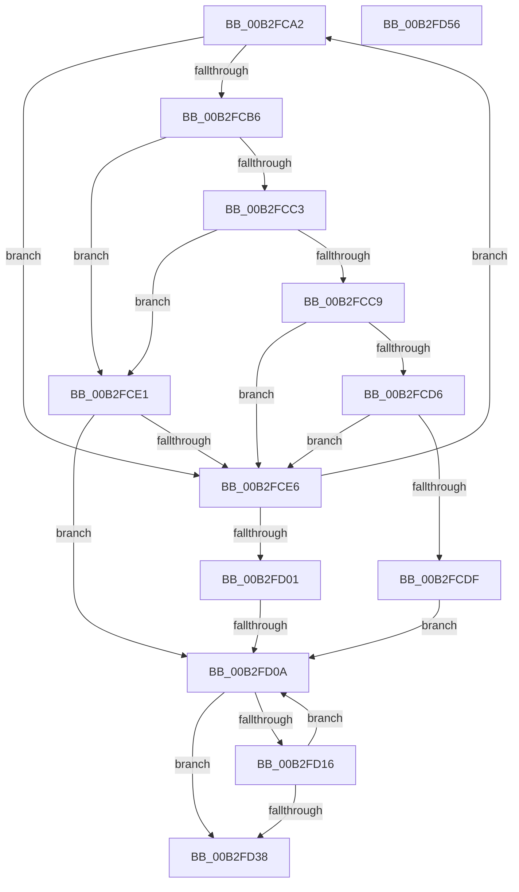

# sub_00B2FCA2

- RVA: `0x00B2FCA2`–`0x00B2FD7B` (길이 `217` bytes)
- VA: `0x0000000140B2FCA2`
- 실행 섹션: `PAGE`
- PDB 이름 있음: `아니요`; PDB Function 태그: `아니요`
- unwind 정보 RVA: `0x000A3644`
- 디코드: `60`개 명령, `217/217` bytes 표시
- 미해석 바이트: `0` (있으면 어셈블리에 `.byte`로 보존)

> 이 문서는 커널 이미지의 기계어와 PDB 기호를 분석해 생성했습니다. 4번과 5번은 함수 원형과 자료형을 바이너리 사용 방식에서 추정한 C 해석이며 원본 소스 복구 결과는 아닙니다.

## 1. Dependencies

- 직접 호출 지점: **1**; 고유 호출 대상: **1**
- 직접 호출자로 확인된 함수: **0**
- RIP 상대 이미지 참조: **0**

### Outgoing calls
- `0x00B2FD5C` → [memcpy](../../text/6C/memcpy_function_006C6840.md) (function, `0x006C6840`)

### Direct callers
- 이 함수 시작 RVA로 연결되는 직접 call은 확인되지 않았습니다. 간접 호출은 완전히 역산할 수 없습니다.

### Static image references
- 디코드된 RIP-relative 메모리 참조가 없습니다.

## 2. Other-region calls and transfers

- 다른 실행 섹션으로 향하는 call: **1**
  - `0x00B2FD5C` → [memcpy](../../text/6C/memcpy_function_006C6840.md) (`PAGE` → `.text`)
- call이 아닌 외부 분기/꼬리 이동: **3**
  - `0x00B2FD04` → [IopReplaceSymlinkPath + 0x1A9](../9D/IopReplaceSymlinkPath_function_009DBE80.md) (`tail-transfer`)
  - `0x00B2FD51` → [IopReplaceSymlinkPath + 0x8C](../9D/IopReplaceSymlinkPath_function_009DBE80.md) (`tail-transfer`)
  - `0x00B2FD76` → [IopReplaceSymlinkPath + 0xCA](../9D/IopReplaceSymlinkPath_function_009DBE80.md) (`tail-transfer`)

## 3. Assembly (complete function range)

```asm
00B2FCA2  4C 8B 5D 60                     mov r11, qword ptr [rbp + 0x60]
00B2FCA6  44 0F B7 D2                     movzx r10d, dx
00B2FCAA  47 0F B7 34 53                  movzx r14d, word ptr [r11 + r10*2]
00B2FCAF  66 41 83 FE 5C                  cmp r14w, 0x5c
00B2FCB4  75 30                           jne 0x140b2fce6
00B2FCB6  66 FF C9                        dec cx
00B2FCB9  0F B7 C1                        movzx eax, cx
00B2FCBC  66 41 83 FF 3B                  cmp r15w, 0x3b
00B2FCC1  74 1E                           je 0x140b2fce1
00B2FCC3  66 41 3B C8                     cmp cx, r8w
00B2FCC7  75 18                           jne 0x140b2fce1
00B2FCC9  66 41 D1 E9                     shr r9w, 1
00B2FCCD  8D 42 01                        lea eax, [rdx + 1]
00B2FCD0  66 41 3B C1                     cmp ax, r9w
00B2FCD4  73 10                           jae 0x140b2fce6
00B2FCD6  66 43 83 7C 53 02 3B            cmp word ptr [r11 + r10*2 + 2], 0x3b
00B2FCDD  74 07                           je 0x140b2fce6
00B2FCDF  EB 29                           jmp 0x140b2fd0a
00B2FCE1  66 85 C0                        test ax, ax
00B2FCE4  74 24                           je 0x140b2fd0a
00B2FCE6  66 44 89 37                     mov word ptr [rdi], r14w
00B2FCEA  66 FF C2                        inc dx
00B2FCED  44 0F B7 4D 58                  movzx r9d, word ptr [rbp + 0x58]
00B2FCF2  49 03 F8                        add rdi, r8
00B2FCF5  41 0F B7 C1                     movzx eax, r9w
00B2FCF9  66 D1 E8                        shr ax, 1
00B2FCFC  66 3B D0                        cmp dx, ax
00B2FCFF  72 A1                           jb 0x140b2fca2
00B2FD01  66 85 C9                        test cx, cx
00B2FD04  0F 85 1F C3 EA FF               jne 0x1409dc029
00B2FD0A  0F B7 45 58                     movzx eax, word ptr [rbp + 0x58]
00B2FD0E  66 D1 E8                        shr ax, 1
00B2FD11  66 3B D0                        cmp dx, ax
00B2FD14  73 22                           jae 0x140b2fd38
00B2FD16  48 8B 45 60                     mov rax, qword ptr [rbp + 0x60]
00B2FD1A  0F B7 CA                        movzx ecx, dx
00B2FD1D  66 FF C2                        inc dx
00B2FD20  0F B7 0C 48                     movzx ecx, word ptr [rax + rcx*2]
00B2FD24  66 89 0F                        mov word ptr [rdi], cx
00B2FD27  49 03 F8                        add rdi, r8
00B2FD2A  48 8B 45 60                     mov rax, qword ptr [rbp + 0x60]
00B2FD2E  0F B7 CA                        movzx ecx, dx
00B2FD31  66 83 3C 48 5C                  cmp word ptr [rax + rcx*2], 0x5c
00B2FD36  75 D2                           jne 0x140b2fd0a
00B2FD38  44 0F B7 B4 24 88 00 00 00      movzx r14d, word ptr [rsp + 0x88]
00B2FD41  0F B7 C2                        movzx eax, dx
00B2FD44  66 03 D2                        add dx, dx
00B2FD47  03 C3                           add eax, ebx
00B2FD49  66 44 03 F2                     add r14w, dx
00B2FD4D  4D 8D 3C 44                     lea r15, [r12 + rax*2]
00B2FD51  E9 B6 C1 EA FF                  jmp 0x1409dbf0c
00B2FD56  4C 8B C3                        mov r8, rbx
00B2FD59  48 8B CF                        mov rcx, rdi
00B2FD5C  E8 DF 6A B9 FF                  call 0x1406c6840
00B2FD61  48 D1 EB                        shr rbx, 1
00B2FD64  66 41 03 F5                     add si, r13w
00B2FD68  66 89 B4 24 80 00 00 00         mov word ptr [rsp + 0x80], si
00B2FD70  48 8D 3C 5F                     lea rdi, [rdi + rbx*2]
00B2FD74  33 DB                           xor ebx, ebx
00B2FD76  E9 CF C1 EA FF                  jmp 0x1409dbf4a
```

## 4. C-style interpretation (structured pseudocode)

```c
__int64 __fastcall sub_00B2FCA2(unsigned __int16 a1, __int64 a2, __int64 a3, unsigned __int16 a4, __int64 a5, __int64 a6, __int64 a7, __int64 a8, __int64 a9, __int64 a10, __int64 a11, __int64 a12, __int64 a13, __int64 a14, __int64 a15, __int64 a16, unsigned __int16 a17)
{
    __int64 result;
    __int64 v_r14;
    __int64 v_rdi;
    unsigned __int16 v_stack_p80;

    if (((unsigned __int16)(*(unsigned __int16 *)(*(unsigned __int64 *)(v_rbp + 96) + (unsigned __int16)(a2) * 2))) != 92) goto loc_00B2FCE6;
    a1 = (unsigned __int16)((a1) - 1);
    if (((unsigned __int16)(v_r15)) == 59) goto loc_00B2FCE1;
    if (a1 != ((unsigned __int16)(a3))) goto loc_00B2FCE1;
    a4 = (unsigned __int16)((a4) >> (1));
    if (((unsigned __int16)(a2 + 1)) >= a4) goto loc_00B2FCE6;
    if ((*(unsigned __int16 *)(*(unsigned __int64 *)(v_rbp + 96) + (unsigned __int16)(a2) * 2 + 2)) == 59) goto loc_00B2FCE6;
    goto loc_00B2FD0A;
loc_00B2FCE1:
    if ((unsigned __int16)(a2 + 1) == 0) goto loc_00B2FD0A;
loc_00B2FCE6:
    *(unsigned __int16 *)(v_rdi) = (unsigned __int16)(*(unsigned __int16 *)(*(unsigned __int64 *)(v_rbp + 96) + (unsigned __int16)(a2) * 2));
    a2 = (unsigned __int16)((a2) + 1);
    v_rdi = (v_rdi) + (a3);
    result = (unsigned __int16)(((unsigned __int16)(*(unsigned __int16 *)(v_rbp + 88))) >> (1));
    if (((unsigned __int16)(a2)) < ((unsigned __int16)(result))) goto loc_00B2FCA2;
loc_00B2FD0A:
    result = (unsigned __int16)((*(unsigned __int16 *)(v_rbp + 88)) >> (1));
    if (((unsigned __int16)(a2)) >= ((unsigned __int16)(result))) goto loc_00B2FD38;
    a2 = (unsigned __int16)((a2) + 1);
    *(unsigned __int16 *)(v_rdi) = (unsigned __int16)(*(unsigned __int16 *)(*(unsigned __int64 *)(v_rbp + 96) + (unsigned __int16)(a2) * 2));
    v_rdi = (v_rdi) + (a3);
    if ((*(unsigned __int16 *)(*(unsigned __int64 *)(v_rbp + 96) + (unsigned __int16)(a2) * 2)) != 92) goto loc_00B2FD0A;
loc_00B2FD38:
    a2 = (unsigned __int16)((a2) + ((unsigned __int16)(a2)));
    result = (unsigned int)(((unsigned __int16)(a2)) + ((unsigned int)(v_rbx)));
    v_r14 = (unsigned __int16)((a17) + ((unsigned __int16)(a2)));
}
```

## 5. (Beta) C Style

```c
int64_t sub_00B2FCA2(uint16_t Arg1, int64_t Arg2, int64_t Arg3, uint16_t Arg4, uint64_t Arg5, uint64_t Arg6, uint64_t Arg7, uint64_t Arg8, uint64_t Arg9, uint64_t Arg10, uint64_t Arg11, uint64_t Arg12, uint64_t Arg13, uint64_t Arg14, uint64_t Arg15, uint64_t Arg16, uint16_t Arg17)
{
    int64_t result;
    int64_t local_r14;
    int64_t local_rdi;
    uint16_t v_stack_p80;

    if (((uint16_t)(*(uint16_t *)(*(uint64_t *)(local_rbp + 0x60) + (uint16_t)(Arg2) * 2))) != 92) goto loc_00B2FCE6;
    Arg1 = (uint16_t)((Arg1) - 1);
    if (((uint16_t)(local_r15)) == 59) goto loc_00B2FCE1;
    if (Arg1 != ((uint16_t)(Arg3))) goto loc_00B2FCE1;
    Arg4 = (uint16_t)((Arg4) >> (1));
    if (((uint16_t)(Arg2 + 1)) >= Arg4) goto loc_00B2FCE6;
    if ((*(uint16_t *)(*(uint64_t *)(local_rbp + 0x60) + (uint16_t)(Arg2) * 2 + 0x2)) == 59) goto loc_00B2FCE6;
    goto loc_00B2FD0A;
loc_00B2FCE1:
    if ((uint16_t)(Arg2 + 1) == 0) goto loc_00B2FD0A;
loc_00B2FCE6:
    *(uint16_t *)(local_rdi) = (uint16_t)(*(uint16_t *)(*(uint64_t *)(local_rbp + 0x60) + (uint16_t)(Arg2) * 2));
    Arg2 = (uint16_t)((Arg2) + 1);
    local_rdi = (local_rdi) + (Arg3);
    result = (uint16_t)(((uint16_t)(*(uint16_t *)(local_rbp + 0x58))) >> (1));
    if (((uint16_t)(Arg2)) < ((uint16_t)(result))) goto loc_00B2FCA2;
loc_00B2FD0A:
    result = (uint16_t)((*(uint16_t *)(local_rbp + 0x58)) >> (1));
    if (((uint16_t)(Arg2)) >= ((uint16_t)(result))) goto loc_00B2FD38;
    Arg2 = (uint16_t)((Arg2) + 1);
    *(uint16_t *)(local_rdi) = (uint16_t)(*(uint16_t *)(*(uint64_t *)(local_rbp + 0x60) + (uint16_t)(Arg2) * 2));
    local_rdi = (local_rdi) + (Arg3);
    if ((*(uint16_t *)(*(uint64_t *)(local_rbp + 0x60) + (uint16_t)(Arg2) * 2)) != 92) goto loc_00B2FD0A;
loc_00B2FD38:
    Arg2 = (uint16_t)((Arg2) + ((uint16_t)(Arg2)));
    result = (uint32_t)(((uint16_t)(Arg2)) + ((uint32_t)(local_rbx)));
    local_r14 = (uint16_t)((Arg17) + ((uint16_t)(Arg2)));
}
```

## 6. Execution-region graph

[열기: 2D/3D 그래프와 함수 탐색 컨트롤 패널](../../../control-panel.html?section=page&rva=0x00B2FCA2&view=graph)

- 2D 그래프는 위에서 아래로 흐르고, 3D 그래프는 빈 공간을 드래그해 회전합니다. Shift+드래그는 이동, 휠은 확대·축소, 함수 노드 선택은 대상 보고서 이동입니다.

### Static fallback


