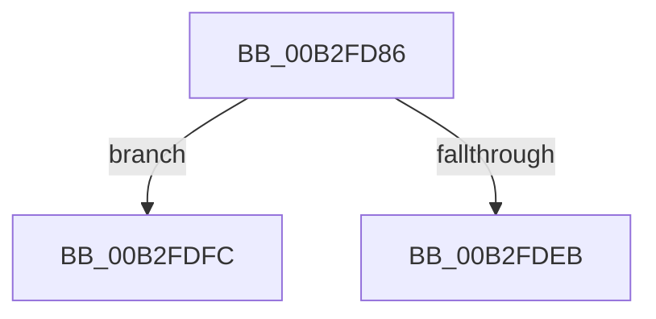

# sub_00B2FD86

- RVA: `0x00B2FD86`–`0x00B2FE0B` (길이 `133` bytes)
- VA: `0x0000000140B2FD86`
- 실행 섹션: `PAGE`
- PDB 이름 있음: `아니요`; PDB Function 태그: `아니요`
- unwind 정보 RVA: `0x000A3A4C`
- 디코드: `35`개 명령, `133/133` bytes 표시
- 미해석 바이트: `0` (있으면 어셈블리에 `.byte`로 보존)

> 이 문서는 커널 이미지의 기계어와 PDB 기호를 분석해 생성했습니다. 4번과 5번은 함수 원형과 자료형을 바이너리 사용 방식에서 추정한 C 해석이며 원본 소스 복구 결과는 아닙니다.

## 1. Dependencies

- 직접 호출 지점: **5**; 고유 호출 대상: **5**
- 직접 호출자로 확인된 함수: **0**
- RIP 상대 이미지 참조: **0**

### Outgoing calls
- `0x00B2FD94` → [KeReleaseMutex](../../text/39/KeReleaseMutex_function_00396810.md) (function, `0x00396810`)
- `0x00B2FDC7` → [WmipDeliverWnodeToDS](../AA/WmipDeliverWnodeToDS_function_00AAE460.md) (function, `0x00AAE460`)
- `0x00B2FDDD` → [KeWaitForSingleObject](../../text/20/KeWaitForSingleObject_function_0020E6B0.md) (function, `0x0020E6B0`)
- `0x00B2FDF1` → [WmipDoDisableRequest](../9E/WmipDoDisableRequest_function_009E3730.md) (function, `0x009E3730`)
- `0x00B2FE00` → [WmipReleaseCollectionEnabled](../AD/WmipReleaseCollectionEnabled_function_00AD6750.md) (function, `0x00AD6750`)

### Direct callers
- 이 함수 시작 RVA로 연결되는 직접 call은 확인되지 않았습니다. 간접 호출은 완전히 역산할 수 없습니다.

### Static image references
- 디코드된 RIP-relative 메모리 참조가 없습니다.

## 2. Other-region calls and transfers

- 다른 실행 섹션으로 향하는 call: **2**
  - `0x00B2FD94` → [KeReleaseMutex](../../text/39/KeReleaseMutex_function_00396810.md) (`PAGE` → `.text`)
  - `0x00B2FDDD` → [KeWaitForSingleObject](../../text/20/KeWaitForSingleObject_function_0020E6B0.md) (`PAGE` → `.text`)
- call이 아닌 외부 분기/꼬리 이동: **2**
  - `0x00B2FDF7` → [WmipDisableCollectionForRemovedGuid + 0x77](../9D/WmipDisableCollectionForRemovedGuid_function_009DE88C.md) (`tail-transfer`)
  - `0x00B2FE06` → [WmipDisableCollectionForRemovedGuid + 0x77](../9D/WmipDisableCollectionForRemovedGuid_function_009DE88C.md) (`tail-transfer`)

## 3. Assembly (complete function range)

```asm
00B2FD86  83 4B 10 04                     or dword ptr [rbx + 0x10], 4
00B2FD8A  33 D2                           xor edx, edx
00B2FD8C  0F BA 77 10 0E                  btr dword ptr [rdi + 0x10], 0xe
00B2FD91  49 8B CF                        mov rcx, r15
00B2FD94  E8 77 6A 86 FF                  call 0x140396810
00B2FD99  48 8B 57 40                     mov rdx, qword ptr [rdi + 0x40]
00B2FD9D  4C 8D 45 C0                     lea r8, [rbp - 0x40]
00B2FDA1  0F 57 C0                        xorps xmm0, xmm0
00B2FDA4  41 B9 30 00 00 00               mov r9d, 0x30
00B2FDAA  0F 11 45 C0                     movups xmmword ptr [rbp - 0x40], xmm0
00B2FDAE  B1 07                           mov cl, 7
00B2FDB0  C7 45 C0 30 00 00 00            mov dword ptr [rbp - 0x40], 0x30
00B2FDB7  0F 11 45 D0                     movups xmmword ptr [rbp - 0x30], xmm0
00B2FDBB  0F 11 45 E0                     movups xmmword ptr [rbp - 0x20], xmm0
00B2FDBF  0F 10 06                        movups xmm0, xmmword ptr [rsi]
00B2FDC2  F3 0F 7F 45 D8                  movdqu xmmword ptr [rbp - 0x28], xmm0
00B2FDC7  E8 94 E6 F7 FF                  call 0x140aae460
00B2FDCC  48 83 64 24 20 00               and qword ptr [rsp + 0x20], 0
00B2FDD2  45 33 C9                        xor r9d, r9d
00B2FDD5  45 33 C0                        xor r8d, r8d
00B2FDD8  33 D2                           xor edx, edx
00B2FDDA  49 8B CF                        mov rcx, r15
00B2FDDD  E8 CE E8 6D FF                  call 0x14020e6b0
00B2FDE2  83 7B 5C 00                     cmp dword ptr [rbx + 0x5c], 0
00B2FDE6  48 8B CB                        mov rcx, rbx
00B2FDE9  75 11                           jne 0x140b2fdfc
00B2FDEB  33 D2                           xor edx, edx
00B2FDED  44 8D 42 04                     lea r8d, [rdx + 4]
00B2FDF1  E8 3A 39 EB FF                  call 0x1409e3730
00B2FDF6  90                              nop
00B2FDF7  E9 07 EB EA FF                  jmp 0x1409de903
00B2FDFC  83 63 10 FB                     and dword ptr [rbx + 0x10], 0xfffffffb
00B2FE00  E8 4B 69 FA FF                  call 0x140ad6750
00B2FE05  90                              nop
00B2FE06  E9 F8 EA EA FF                  jmp 0x1409de903
```

## 4. C-style interpretation (structured pseudocode)

```c
__int64 __fastcall sub_00B2FD86(__int64 a1, int a2)
{
    __int64 result;
    unsigned __int64 v_stack_p20;

    a2 = 0;
    result = KeReleaseMutex(v_r15, a2, a3, a4);
    *(unsigned __int64 *)(v_rbp - 64) = v_xmm0;
    *(unsigned int *)(v_rbp - 64) = 48;
    *(unsigned __int64 *)(v_rbp - 48) = v_xmm0;
    *(unsigned __int64 *)(v_rbp - 32) = v_xmm0;
    *(unsigned __int64 *)(v_rbp - 40) = v_xmm0;
    result = WmipDeliverWnodeToDS(7, *(unsigned __int64 *)(v_rdi + 64), v_rbp - 64, 48);
    a4 = 0;
    a3 = 0;
    a2 = 0;
    result = KeWaitForSingleObject(v_r15, a2, a3, a4);
    if ((*(unsigned int *)(v_rbx + 92)) != 0) goto loc_00B2FDFC;
    a2 = 0;
    result = WmipDoDisableRequest(v_rbx, a2, a2 + 4, a4);
loc_00B2FDFC:
    result = WmipReleaseCollectionEnabled(v_rbx, a2, a2 + 4, a4);
}
```

## 5. (Beta) C Style

```c
int64_t sub_00B2FD86(int64_t Arg1, int32_t Arg2)
{
    int64_t result;
    uint64_t v_stack_p20;

    Arg2 = 0;
    result = KeReleaseMutex(local_r15, Arg2, a3, a4);
    *(uint64_t *)(local_rbp - 0x40) = v_xmm0;
    *(uint32_t *)(local_rbp - 0x40) = 48;
    *(uint64_t *)(local_rbp - 0x30) = v_xmm0;
    *(uint64_t *)(local_rbp - 0x20) = v_xmm0;
    *(uint64_t *)(local_rbp - 0x28) = v_xmm0;
    result = WmipDeliverWnodeToDS(7, *(uint64_t *)(local_rdi + 0x40), local_rbp - 64, 48);
    a4 = 0;
    a3 = 0;
    Arg2 = 0;
    result = KeWaitForSingleObject(local_r15, Arg2, a3, a4);
    if ((*(uint32_t *)(local_rbx + 0x5C)) != 0) goto loc_00B2FDFC;
    Arg2 = 0;
    result = WmipDoDisableRequest(local_rbx, Arg2, Arg2 + 4, a4);
loc_00B2FDFC:
    result = WmipReleaseCollectionEnabled(local_rbx, Arg2, Arg2 + 4, a4);
}
```

## 6. Execution-region graph

[열기: 2D/3D 그래프와 함수 탐색 컨트롤 패널](../../../control-panel.html?section=page&rva=0x00B2FD86&view=graph)

- 2D 그래프는 위에서 아래로 흐르고, 3D 그래프는 빈 공간을 드래그해 회전합니다. Shift+드래그는 이동, 휠은 확대·축소, 함수 노드 선택은 대상 보고서 이동입니다.

### Static fallback


