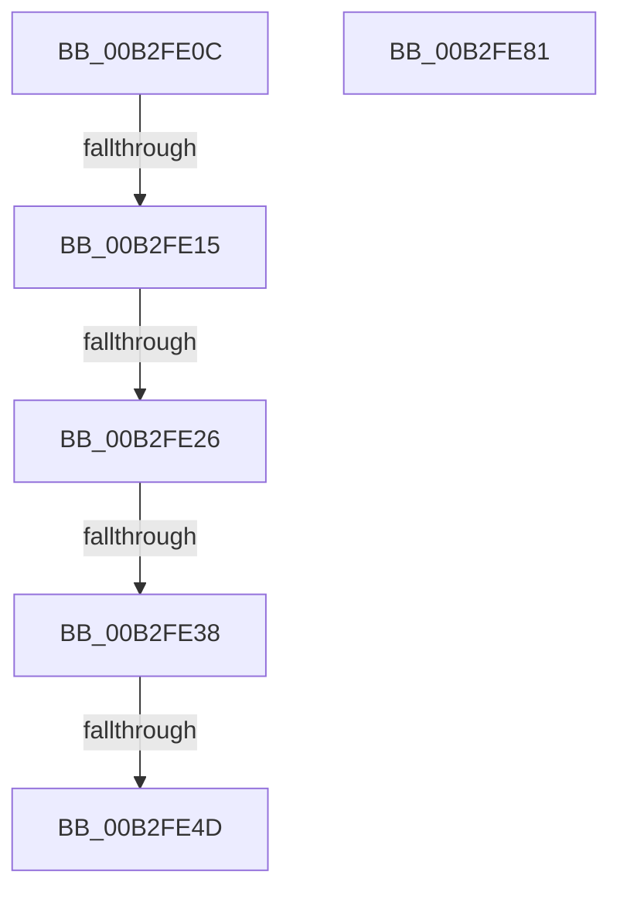

# sub_00B2FE0C

- RVA: `0x00B2FE0C`–`0x00B2FEB2` (길이 `166` bytes)
- VA: `0x0000000140B2FE0C`
- 실행 섹션: `PAGE`
- PDB 이름 있음: `아니요`; PDB Function 태그: `아니요`
- unwind 정보 RVA: `0x000A3ABC`
- 디코드: `40`개 명령, `166/166` bytes 표시
- 미해석 바이트: `0` (있으면 어셈블리에 `.byte`로 보존)

> 이 문서는 커널 이미지의 기계어와 PDB 기호를 분석해 생성했습니다. 4번과 5번은 함수 원형과 자료형을 바이너리 사용 방식에서 추정한 C 해석이며 원본 소스 복구 결과는 아닙니다.

## 1. Dependencies

- 직접 호출 지점: **2**; 고유 호출 대상: **2**
- 직접 호출자로 확인된 함수: **0**
- RIP 상대 이미지 참조: **0**

### Outgoing calls
- `0x00B2FE76` → [WmipQuerySingleMultiple](../7B/WmipQuerySingleMultiple_function_007B36F0.md) (function, `0x007B36F0`)
- `0x00B2FEA5` → [WmipQuerySetExecuteSI](../9E/WmipQuerySetExecuteSI_function_009E0574.md) (function, `0x009E0574`)

### Direct callers
- 이 함수 시작 RVA로 연결되는 직접 call은 확인되지 않았습니다. 간접 호출은 완전히 역산할 수 없습니다.

### Static image references
- 디코드된 RIP-relative 메모리 참조가 없습니다.

## 2. Other-region calls and transfers

- 다른 실행 섹션으로 향하는 call: **0**
- call이 아닌 외부 분기/꼬리 이동: **6**
  - `0x00B2FE0F` → [WmipIoControl + 0x435](../9D/WmipIoControl_function_009DEBD0.md) (`tail-transfer`)
  - `0x00B2FE20` → [WmipIoControl + 0x435](../9D/WmipIoControl_function_009DEBD0.md) (`tail-transfer`)
  - `0x00B2FE32` → [WmipIoControl + 0x435](../9D/WmipIoControl_function_009DEBD0.md) (`tail-transfer`)
  - `0x00B2FE47` → [WmipIoControl + 0x435](../9D/WmipIoControl_function_009DEBD0.md) (`tail-transfer`)
  - `0x00B2FE7C` → [WmipIoControl + 0x101](../9D/WmipIoControl_function_009DEBD0.md) (`tail-transfer`)
  - `0x00B2FEAD` → [WmipIoControl + 0x105](../9D/WmipIoControl_function_009DEBD0.md) (`tail-transfer`)

## 3. Assembly (complete function range)

```asm
00B2FE0C  83 FE 38                        cmp esi, 0x38
00B2FE0F  0F 82 F0 F1 EA FF               jb 0x1409df005
00B2FE15  4A 8D 14 37                     lea rdx, [rdi + r14]
00B2FE19  48 8D 47 04                     lea rax, [rdi + 4]
00B2FE1D  48 3B C2                        cmp rax, rdx
00B2FE20  0F 87 DF F1 EA FF               ja 0x1409df005
00B2FE26  44 8B 07                        mov r8d, dword ptr [rdi]
00B2FE29  41 8D 40 FF                     lea eax, [r8 - 1]
00B2FE2D  3D FE 0F 00 00                  cmp eax, 0xffe
00B2FE32  0F 87 CD F1 EA FF               ja 0x1409df005
00B2FE38  48 8D 04 40                     lea rax, [rax + rax*2]
00B2FE3C  48 8D 40 04                     lea rax, [rax + 4]
00B2FE40  48 8D 04 C7                     lea rax, [rdi + rax*8]
00B2FE44  48 3B C2                        cmp rax, rdx
00B2FE47  0F 87 B8 F1 EA FF               ja 0x1409df005
00B2FE4D  48 8D 44 24 50                  lea rax, [rsp + 0x50]
00B2FE52  44 8B CE                        mov r9d, esi
00B2FE55  48 89 44 24 40                  mov qword ptr [rsp + 0x40], rax
00B2FE5A  B2 01                           mov dl, 1
00B2FE5C  4C 89 7C 24 38                  mov qword ptr [rsp + 0x38], r15
00B2FE61  49 8B CD                        mov rcx, r13
00B2FE64  4C 89 7C 24 30                  mov qword ptr [rsp + 0x30], r15
00B2FE69  44 89 44 24 28                  mov dword ptr [rsp + 0x28], r8d
00B2FE6E  4C 8B C7                        mov r8, rdi
00B2FE71  48 89 7C 24 20                  mov qword ptr [rsp + 0x20], rdi
00B2FE76  E8 75 38 C8 FF                  call 0x1407b36f0
00B2FE7B  90                              nop
00B2FE7C  E9 50 EE EA FF                  jmp 0x1409decd1
00B2FE81  41 B1 02                        mov r9b, 2
00B2FE84  48 8D 44 24 50                  lea rax, [rsp + 0x50]
00B2FE89  44 89 74 24 50                  mov dword ptr [rsp + 0x50], r14d
00B2FE8E  48 89 44 24 30                  mov qword ptr [rsp + 0x30], rax
00B2FE93  41 B0 01                        mov r8b, 1
00B2FE96  44 89 74 24 28                  mov dword ptr [rsp + 0x28], r14d
00B2FE9B  49 8B D5                        mov rdx, r13
00B2FE9E  33 C9                           xor ecx, ecx
00B2FEA0  48 89 7C 24 20                  mov qword ptr [rsp + 0x20], rdi
00B2FEA5  E8 CA 06 EB FF                  call 0x1409e0574
00B2FEAA  41 8B F7                        mov esi, r15d
00B2FEAD  E9 23 EE EA FF                  jmp 0x1409decd5
```

## 4. C-style interpretation (structured pseudocode)

```c
__int64 __fastcall sub_00B2FE0C(__int64 a1, __int64 a2, __int64 a3, __int64 a4, __int64 a5, __int64 a6, __int64 a7, __int64 a8, __int64 a9, __int64 a10)
{
    __int64 result;
    unsigned __int64 v_stack_p20;
    unsigned int v_stack_p28;
    unsigned __int64 v_stack_p30;
    unsigned __int64 v_stack_p38;
    unsigned __int64 v_stack_p40;
    unsigned __int64 v_stack_p50;

    v_stack_p40 = a10;
    v_stack_p38 = v_r15;
    v_stack_p30 = v_r15;
    v_stack_p28 = (unsigned int)((unsigned int)(*(unsigned int *)(v_rdi)));
    v_stack_p20 = v_rdi;
    result = WmipQuerySingleMultiple(v_r13, 1, v_rdi, (unsigned int)((unsigned int)(v_rsi)));
}
```

## 5. (Beta) C Style

```c
int64_t sub_00B2FE0C(int64_t Arg1, int64_t Arg2, int64_t Arg3, int64_t Arg4, uint64_t Arg5, uint64_t Arg6, uint64_t Arg7, uint64_t Arg8, uint64_t Arg9, int64_t Arg10)
{
    int64_t result;
    uint64_t v_stack_p20;
    uint32_t v_stack_p28;
    uint64_t v_stack_p30;
    uint64_t v_stack_p38;
    uint64_t v_stack_p40;
    uint64_t v_stack_p50;

    v_stack_p40 = Arg10;
    v_stack_p38 = local_r15;
    v_stack_p30 = local_r15;
    v_stack_p28 = (uint32_t)((uint32_t)(*(uint32_t *)(local_rdi)));
    v_stack_p20 = local_rdi;
    result = WmipQuerySingleMultiple(local_r13, 1, local_rdi, (uint32_t)((uint32_t)(local_rsi)));
}
```

## 6. Execution-region graph

[열기: 2D/3D 그래프와 함수 탐색 컨트롤 패널](../../../control-panel.html?section=page&rva=0x00B2FE0C&view=graph)

- 2D 그래프는 위에서 아래로 흐르고, 3D 그래프는 빈 공간을 드래그해 회전합니다. Shift+드래그는 이동, 휠은 확대·축소, 함수 노드 선택은 대상 보고서 이동입니다.

### Static fallback


