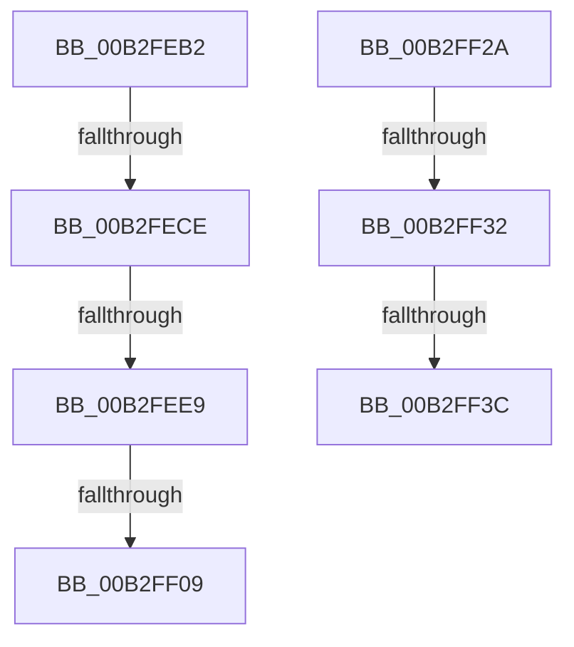

# sub_00B2FEB2

- RVA: `0x00B2FEB2`–`0x00B2FF45` (길이 `147` bytes)
- VA: `0x0000000140B2FEB2`
- 실행 섹션: `PAGE`
- PDB 이름 있음: `아니요`; PDB Function 태그: `아니요`
- unwind 정보 RVA: `0x000A3B54`
- 디코드: `38`개 명령, `147/147` bytes 표시
- 미해석 바이트: `0` (있으면 어셈블리에 `.byte`로 보존)

> 이 문서는 커널 이미지의 기계어와 PDB 기호를 분석해 생성했습니다. 4번과 5번은 함수 원형과 자료형을 바이너리 사용 방식에서 추정한 C 해석이며 원본 소스 복구 결과는 아닙니다.

## 1. Dependencies

- 직접 호출 지점: **5**; 고유 호출 대상: **5**
- 직접 호출자로 확인된 함수: **0**
- RIP 상대 이미지 참조: **0**

### Outgoing calls
- `0x00B2FEC1` → [WmipAlign](../../text/47/WmipAlign_function_00472274.md) (function, `0x00472274`)
- `0x00B2FED1` → [WmipStaticInstanceNameSize](../9E/WmipStaticInstanceNameSize_function_009E1330.md) (function, `0x009E1330`)
- `0x00B2FEF8` → [ExAllocatePool2](../../poolcode/B8/ExAllocatePool2_function_00B820F0.md) (function, `0x00B820F0`)
- `0x00B2FF12` → [memcpy](../../text/6C/memcpy_function_006C6840.md) (function, `0x006C6840`)
- `0x00B2FF1F` → [WmipInsertStaticNames](../9E/WmipInsertStaticNames_function_009E1064.md) (function, `0x009E1064`)

### Direct callers
- 이 함수 시작 RVA로 연결되는 직접 call은 확인되지 않았습니다. 간접 호출은 완전히 역산할 수 없습니다.

### Static image references
- 디코드된 RIP-relative 메모리 참조가 없습니다.

## 2. Other-region calls and transfers

- 다른 실행 섹션으로 향하는 call: **3**
  - `0x00B2FEC1` → [WmipAlign](../../text/47/WmipAlign_function_00472274.md) (`PAGE` → `.text`)
  - `0x00B2FEF8` → [ExAllocatePool2](../../poolcode/B8/ExAllocatePool2_function_00B820F0.md) (`PAGE` → `POOLCODE`)
  - `0x00B2FF12` → [memcpy](../../text/6C/memcpy_function_006C6840.md) (`PAGE` → `.text`)
- call이 아닌 외부 분기/꼬리 이동: **7**
  - `0x00B2FEC8` → [WmipIncludeStaticNames + 0x254](../9D/WmipIncludeStaticNames_function_009DF754.md) (`tail-transfer`)
  - `0x00B2FEE3` → [WmipIncludeStaticNames + 0x254](../9D/WmipIncludeStaticNames_function_009DF754.md) (`tail-transfer`)
  - `0x00B2FF03` → [WmipIncludeStaticNames + 0x254](../9D/WmipIncludeStaticNames_function_009DF754.md) (`tail-transfer`)
  - `0x00B2FF25` → [WmipIncludeStaticNames + 0x1D0](../9D/WmipIncludeStaticNames_function_009DF754.md) (`tail-transfer`)
  - `0x00B2FF2C` → [WmipIncludeStaticNames + 0x1E4](../9D/WmipIncludeStaticNames_function_009DF754.md) (`tail-transfer`)
  - `0x00B2FF36` → [WmipIncludeStaticNames + 0x1E4](../9D/WmipIncludeStaticNames_function_009DF754.md) (`tail-transfer`)
  - `0x00B2FF40` → [WmipIncludeStaticNames + 0x1E4](../9D/WmipIncludeStaticNames_function_009DF754.md) (`tail-transfer`)

## 3. Assembly (complete function range)

```asm
00B2FEB2  48 8D 54 24 30                  lea rdx, [rsp + 0x30]
00B2FEB7  44 89 6C 24 30                  mov dword ptr [rsp + 0x30], r13d
00B2FEBC  B9 04 00 00 00                  mov ecx, 4
00B2FEC1  E8 AE 23 94 FF                  call 0x140472274
00B2FEC6  84 C0                           test al, al
00B2FEC8  0F 84 DA FA EA FF               je 0x1409df9a8
00B2FECE  48 8B CD                        mov rcx, rbp
00B2FED1  E8 5A 14 EB FF                  call 0x1409e1330
00B2FED6  8B 7C 24 30                     mov edi, dword ptr [rsp + 0x30]
00B2FEDA  8B C8                           mov ecx, eax
00B2FEDC  83 C8 FF                        or eax, 0xffffffff
00B2FEDF  2B C7                           sub eax, edi
00B2FEE1  3B C8                           cmp ecx, eax
00B2FEE3  0F 87 BF FA EA FF               ja 0x1409df9a8
00B2FEE9  03 F9                           add edi, ecx
00B2FEEB  41 B8 57 6D 69 70               mov r8d, 0x70696d57
00B2FEF1  8B D7                           mov edx, edi
00B2FEF3  B9 00 01 00 00                  mov ecx, 0x100
00B2FEF8  E8 F3 21 05 00                  call 0x140b820f0
00B2FEFD  48 8B F0                        mov rsi, rax
00B2FF00  48 85 C0                        test rax, rax
00B2FF03  0F 84 9F FA EA FF               je 0x1409df9a8
00B2FF09  44 8B 03                        mov r8d, dword ptr [rbx]
00B2FF0C  48 8B D3                        mov rdx, rbx
00B2FF0F  48 8B C8                        mov rcx, rax
00B2FF12  E8 29 69 B9 FF                  call 0x1406c6840
00B2FF17  4C 8B C5                        mov r8, rbp
00B2FF1A  8B D7                           mov edx, edi
00B2FF1C  48 8B CE                        mov rcx, rsi
00B2FF1F  E8 40 11 EB FF                  call 0x1409e1064
00B2FF24  90                              nop
00B2FF25  E9 FA F9 EA FF                  jmp 0x1409df924
00B2FF2A  A8 06                           test al, 6
00B2FF2C  0F 84 06 FA EA FF               je 0x1409df938
00B2FF32  41 83 FD 34                     cmp r13d, 0x34
00B2FF36  0F 82 FC F9 EA FF               jb 0x1409df938
00B2FF3C  44 89 7B 30                     mov dword ptr [rbx + 0x30], r15d
00B2FF40  E9 F3 F9 EA FF                  jmp 0x1409df938
```

## 4. C-style interpretation (structured pseudocode)

```c
__int64 __fastcall sub_00B2FEB2(__int64 a1, __int64 a2, __int64 a3, __int64 a4, __int64 a5, unsigned int a6)
{
    __int64 result;
    __int64 v_rdi;
    unsigned int v_stack_p30;

    v_stack_p30 = (unsigned int)(v_r13);
    result = WmipAlign(4, a6, a3, a4);
    result = WmipStaticInstanceNameSize(v_rbp, a6, a3, a4);
    result = (unsigned int)((result) | (0xFFFFFFFFULL));
    result = (unsigned int)((result) - ((unsigned int)((unsigned int)(a6))));
    v_rdi = (unsigned int)(((unsigned int)(a6)) + ((unsigned int)((unsigned int)((unsigned int)(result)))));
    result = ExAllocatePool2(256, (unsigned int)((unsigned int)(v_rdi)), (unsigned int)(0x70696D57ULL), a4);
    result = memcpy(result, v_rbx, (unsigned int)(*(unsigned int *)(v_rbx)), a4);
    result = WmipInsertStaticNames(result, (unsigned int)((unsigned int)(v_rdi)), v_rbp, a4);
}
```

## 5. (Beta) C Style

```c
int64_t sub_00B2FEB2(int64_t Arg1, int64_t Arg2, int64_t Arg3, int64_t Arg4, uint64_t Arg5, uint32_t Arg6)
{
    int64_t result;
    int64_t local_rdi;
    uint32_t v_stack_p30;

    v_stack_p30 = (uint32_t)(local_r13);
    result = WmipAlign(4, Arg6, Arg3, Arg4);
    result = WmipStaticInstanceNameSize(local_rbp, Arg6, Arg3, Arg4);
    result = (uint32_t)((result) | (0xFFFFFFFFULL));
    result = (uint32_t)((result) - ((uint32_t)((uint32_t)(Arg6))));
    local_rdi = (uint32_t)(((uint32_t)(Arg6)) + ((uint32_t)((uint32_t)((uint32_t)(result)))));
    result = ExAllocatePool2(256, (uint32_t)((uint32_t)(local_rdi)), (uint32_t)(0x70696D57ULL), Arg4);
    result = memcpy(result, local_rbx, (uint32_t)(*(uint32_t *)(local_rbx)), Arg4);
    result = WmipInsertStaticNames(result, (uint32_t)((uint32_t)(local_rdi)), local_rbp, Arg4);
}
```

## 6. Execution-region graph

[열기: 2D/3D 그래프와 함수 탐색 컨트롤 패널](../../../control-panel.html?section=page&rva=0x00B2FEB2&view=graph)

- 2D 그래프는 위에서 아래로 흐르고, 3D 그래프는 빈 공간을 드래그해 회전합니다. Shift+드래그는 이동, 휠은 확대·축소, 함수 노드 선택은 대상 보고서 이동입니다.

### Static fallback


