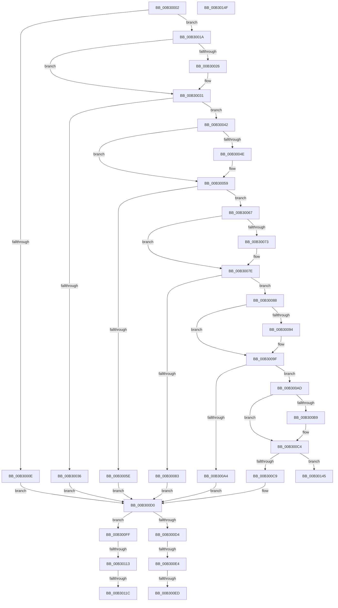

# sub_00B30002

- RVA: `0x00B30002`–`0x00B30161` (길이 `351` bytes)
- VA: `0x0000000140B30002`
- 실행 섹션: `PAGE`
- PDB 이름 있음: `아니요`; PDB Function 태그: `아니요`
- unwind 정보 RVA: `0x000A3D18`
- 디코드: `83`개 명령, `351/351` bytes 표시
- 미해석 바이트: `0` (있으면 어셈블리에 `.byte`로 보존)

> 이 문서는 커널 이미지의 기계어와 PDB 기호를 분석해 생성했습니다. 4번과 5번은 함수 원형과 자료형을 바이너리 사용 방식에서 추정한 C 해석이며 원본 소스 복구 결과는 아닙니다.

## 1. Dependencies

- 직접 호출 지점: **2**; 고유 호출 대상: **2**
- 직접 호출자로 확인된 함수: **0**
- RIP 상대 이미지 참조: **18**

### Outgoing calls
- `0x00B300F4` → [KeCancelTimer](../../text/23/KeCancelTimer_function_002327E0.md) (function, `0x002327E0`)
- `0x00B3013A` → [KiSetTimerEx](../../text/23/KiSetTimerEx_function_00232CB0.md) (function, `0x00232CB0`)

### Direct callers
- 이 함수 시작 RVA로 연결되는 직접 call은 확인되지 않았습니다. 간접 호출은 완전히 역산할 수 없습니다.

### Static image references
- `0x00B30002` → RVA `0x00E678D4` (`.data`; read)
- `0x00B3000E` → RVA `0x00E678D0` (`.data`; read)
- `0x00B3001A` → RVA `0x00024CC8` (`.rdata`; read)
- `0x00B30026` → RVA `0x00024CD0` (`.rdata`; read)
- `0x00B30036` → RVA `0x00E678CC` (`.data`; read)
- `0x00B30042` → RVA `0x00024A88` (`.rdata`; read)
- `0x00B3004E` → RVA `0x00024A90` (`.rdata`; read)
- `0x00B3005E` → RVA `0x00E678D8` (`.data`; read)
- `0x00B30067` → RVA `0x00024C88` (`.rdata`; read)
- `0x00B30073` → RVA `0x00024C90` (`.rdata`; read)
- `0x00B30088` → RVA `0x00024B08` (`.rdata`; read)
- `0x00B30094` → RVA `0x00024B10` (`.rdata`; read)
- `0x00B300A4` → RVA `0x00E678C8` (`.data`; read)
- `0x00B300AD` → RVA `0x00024CA8` (`.rdata`; read)
- `0x00B300B9` → RVA `0x00024CB0` (`.rdata`; read)
- `0x00B300C9` → RVA `0x00E678C4` (`.data`; read)
- `0x00B300ED` → RVA `0x00F08FC0` (`.data`; read)
- `0x00B3011C` → RVA `0x00F08F80` (`.data`; read)

## 2. Other-region calls and transfers

- 다른 실행 섹션으로 향하는 call: **2**
  - `0x00B300F4` → [KeCancelTimer](../../text/23/KeCancelTimer_function_002327E0.md) (`PAGE` → `.text`)
  - `0x00B3013A` → [KiSetTimerEx](../../text/23/KiSetTimerEx_function_00232CB0.md) (`PAGE` → `.text`)
- call이 아닌 외부 분기/꼬리 이동: **8**
  - `0x00B300DE` → [PpmWmiDispatch + 0x3D](../9E/PpmWmiDispatch_function_009E13A0.md) (`tail-transfer`)
  - `0x00B300E7` → [PpmWmiDispatch + 0x3D](../9E/PpmWmiDispatch_function_009E13A0.md) (`tail-transfer`)
  - `0x00B300FA` → [PpmWmiDispatch + 0x3D](../9E/PpmWmiDispatch_function_009E13A0.md) (`tail-transfer`)
  - `0x00B3010D` → [PpmWmiDispatch + 0x3D](../9E/PpmWmiDispatch_function_009E13A0.md) (`tail-transfer`)
  - `0x00B30116` → [PpmWmiDispatch + 0x3D](../9E/PpmWmiDispatch_function_009E13A0.md) (`tail-transfer`)
  - `0x00B30140` → [PpmWmiDispatch + 0x3D](../9E/PpmWmiDispatch_function_009E13A0.md) (`tail-transfer`)
  - `0x00B3014A` → [PpmWmiDispatch + 0x3F](../9E/PpmWmiDispatch_function_009E13A0.md) (`tail-transfer`)
  - `0x00B3015C` → [PpmWmiDispatch + 0x3F](../9E/PpmWmiDispatch_function_009E13A0.md) (`tail-transfer`)

## 3. Assembly (complete function range)

```asm
00B30002  4C 8D 05 CB 78 33 00            lea r8, [rip + 0x3378cb]
00B30009  48 85 C9                        test rcx, rcx
00B3000C  75 0C                           jne 0x140b3001a
00B3000E  48 8D 0D BB 78 33 00            lea rcx, [rip + 0x3378bb]
00B30015  E9 B6 00 00 00                  jmp 0x140b300d0
00B3001A  48 8B 0D A7 4C 4F FF            mov rcx, qword ptr [rip - 0xb0b359]
00B30021  48 2B C8                        sub rcx, rax
00B30024  75 0B                           jne 0x140b30031
00B30026  48 8B 0D A3 4C 4F FF            mov rcx, qword ptr [rip - 0xb0b35d]
00B3002D  48 2B 4A 08                     sub rcx, qword ptr [rdx + 8]
00B30031  48 85 C9                        test rcx, rcx
00B30034  75 0C                           jne 0x140b30042
00B30036  48 8D 0D 8F 78 33 00            lea rcx, [rip + 0x33788f]
00B3003D  E9 8E 00 00 00                  jmp 0x140b300d0
00B30042  48 8B 0D 3F 4A 4F FF            mov rcx, qword ptr [rip - 0xb0b5c1]
00B30049  48 2B C8                        sub rcx, rax
00B3004C  75 0B                           jne 0x140b30059
00B3004E  48 8B 0D 3B 4A 4F FF            mov rcx, qword ptr [rip - 0xb0b5c5]
00B30055  48 2B 4A 08                     sub rcx, qword ptr [rdx + 8]
00B30059  48 85 C9                        test rcx, rcx
00B3005C  75 09                           jne 0x140b30067
00B3005E  48 8D 0D 73 78 33 00            lea rcx, [rip + 0x337873]
00B30065  EB 69                           jmp 0x140b300d0
00B30067  48 8B 0D 1A 4C 4F FF            mov rcx, qword ptr [rip - 0xb0b3e6]
00B3006E  48 2B C8                        sub rcx, rax
00B30071  75 0B                           jne 0x140b3007e
00B30073  48 8B 0D 16 4C 4F FF            mov rcx, qword ptr [rip - 0xb0b3ea]
00B3007A  48 2B 4A 08                     sub rcx, qword ptr [rdx + 8]
00B3007E  48 85 C9                        test rcx, rcx
00B30081  75 05                           jne 0x140b30088
00B30083  49 8B C8                        mov rcx, r8
00B30086  EB 48                           jmp 0x140b300d0
00B30088  48 8B 0D 79 4A 4F FF            mov rcx, qword ptr [rip - 0xb0b587]
00B3008F  48 2B C8                        sub rcx, rax
00B30092  75 0B                           jne 0x140b3009f
00B30094  48 8B 0D 75 4A 4F FF            mov rcx, qword ptr [rip - 0xb0b58b]
00B3009B  48 2B 4A 08                     sub rcx, qword ptr [rdx + 8]
00B3009F  48 85 C9                        test rcx, rcx
00B300A2  75 09                           jne 0x140b300ad
00B300A4  48 8D 0D 1D 78 33 00            lea rcx, [rip + 0x33781d]
00B300AB  EB 23                           jmp 0x140b300d0
00B300AD  48 8B 0D F4 4B 4F FF            mov rcx, qword ptr [rip - 0xb0b40c]
00B300B4  48 2B C8                        sub rcx, rax
00B300B7  75 0B                           jne 0x140b300c4
00B300B9  48 8B 0D F0 4B 4F FF            mov rcx, qword ptr [rip - 0xb0b410]
00B300C0  48 2B 4A 08                     sub rcx, qword ptr [rdx + 8]
00B300C4  48 85 C9                        test rcx, rcx
00B300C7  75 7C                           jne 0x140b30145
00B300C9  48 8D 0D F4 77 33 00            lea rcx, [rip + 0x3377f4]
00B300D0  84 DB                           test bl, bl
00B300D2  75 2B                           jne 0x140b300ff
00B300D4  83 C8 FF                        or eax, 0xffffffff
00B300D7  F0 0F C1 01                     lock xadd dword ptr [rcx], eax
00B300DB  83 F8 01                        cmp eax, 1
00B300DE  0F 85 F9 12 EB FF               jne 0x1409e13dd
00B300E4  49 3B C8                        cmp rcx, r8
00B300E7  0F 85 F0 12 EB FF               jne 0x1409e13dd
00B300ED  48 8D 0D CC 8E 3D 00            lea rcx, [rip + 0x3d8ecc]
00B300F4  E8 E7 26 70 FF                  call 0x1402327e0
00B300F9  90                              nop
00B300FA  E9 DE 12 EB FF                  jmp 0x1409e13dd
00B300FF  B8 01 00 00 00                  mov eax, 1
00B30104  F0 0F C1 01                     lock xadd dword ptr [rcx], eax
00B30108  FF C0                           inc eax
00B3010A  83 F8 01                        cmp eax, 1
00B3010D  0F 85 CA 12 EB FF               jne 0x1409e13dd
00B30113  49 3B C8                        cmp rcx, r8
00B30116  0F 85 C1 12 EB FF               jne 0x1409e13dd
00B3011C  48 8D 05 5D 8E 3D 00            lea rax, [rip + 0x3d8e5d]
00B30123  45 33 C9                        xor r9d, r9d
00B30126  33 D2                           xor edx, edx
00B30128  48 89 44 24 20                  mov qword ptr [rsp + 0x20], rax
00B3012D  41 B8 10 27 00 00               mov r8d, 0x2710
00B30133  48 8D 0D 86 8E 3D 00            lea rcx, [rip + 0x3d8e86]
00B3013A  E8 71 2B 70 FF                  call 0x140232cb0
00B3013F  90                              nop
00B30140  E9 98 12 EB FF                  jmp 0x1409e13dd
00B30145  B8 95 02 00 C0                  mov eax, 0xc0000295
00B3014A  E9 90 12 EB FF                  jmp 0x1409e13df
00B3014F  48 8B 44 24 68                  mov rax, qword ptr [rsp + 0x68]
00B30154  83 20 00                        and dword ptr [rax], 0
00B30157  B8 10 00 00 C0                  mov eax, 0xc0000010
00B3015C  E9 7E 12 EB FF                  jmp 0x1409e13df
```

## 4. C-style interpretation (structured pseudocode)

```c
__int64 __fastcall sub_00B30002(__int64 a1, __int64 a2, __int64 a3, int a4)
{
    __int64 result;
    unsigned __int64 v_stack_p20;
    unsigned __int64 v_stack_p68;

    if (a1 != 0) goto loc_00B3001A;
    goto loc_00B300D0;
loc_00B3001A:
    a1 = (*(unsigned __int64 *)(v_rip - 11580249)) - (result);
    if (!(condition_is_not_equal)) {
        a1 = *(unsigned __int64 *)(v_rip - 11580253);
        a1 = (a1) - (*(unsigned __int64 *)(a2 + 8));
    }
    if (a1 != 0) goto loc_00B30042;
    goto loc_00B300D0;
loc_00B30042:
    a1 = (*(unsigned __int64 *)(v_rip - 11580865)) - (result);
    if (!(condition_is_not_equal)) {
        a1 = *(unsigned __int64 *)(v_rip - 11580869);
        a1 = (a1) - (*(unsigned __int64 *)(a2 + 8));
    }
    if (a1 != 0) goto loc_00B30067;
    goto loc_00B300D0;
loc_00B30067:
    a1 = (*(unsigned __int64 *)(v_rip - 11580390)) - (result);
    if (!(condition_is_not_equal)) {
        a1 = *(unsigned __int64 *)(v_rip - 11580394);
        a1 = (a1) - (*(unsigned __int64 *)(a2 + 8));
    }
    if (a1 != 0) goto loc_00B30088;
    goto loc_00B300D0;
loc_00B30088:
    a1 = (*(unsigned __int64 *)(v_rip - 11580807)) - (result);
    if (!(condition_is_not_equal)) {
        a1 = *(unsigned __int64 *)(v_rip - 11580811);
        a1 = (a1) - (*(unsigned __int64 *)(a2 + 8));
    }
    if (a1 != 0) goto loc_00B300AD;
    goto loc_00B300D0;
loc_00B300AD:
    a1 = (*(unsigned __int64 *)(v_rip - 11580428)) - (result);
    if (!(condition_is_not_equal)) {
        a1 = *(unsigned __int64 *)(v_rip - 11580432);
        a1 = (a1) - (*(unsigned __int64 *)(a2 + 8));
    }
    if (a1 != 0) goto loc_00B30145;
loc_00B300D0:
    if ((unsigned __int8)(v_rbx) != 0) goto loc_00B300FF;
    result = (unsigned int)((result) | (0xFFFFFFFFULL));
    result = KeCancelTimer(v_rip + 4034252, a2, v_rip + 3373259, a4);
loc_00B300FF:
    result = (unsigned int)((1) + 1);
    a4 = 0;
    a2 = 0;
    v_stack_p20 = v_rip + 4034141;
    result = KiSetTimerEx(v_rip + 4034182, a2, (unsigned int)(0x2710ULL), a4);
loc_00B30145:
}
```

## 5. (Beta) C Style

```c
int64_t sub_00B30002(int64_t Arg1, void *Arg2, int64_t Arg3, int32_t Arg4)
{
    uint8_t *arg2 = (uint8_t *)Arg2;

    int64_t result;
    uint64_t v_stack_p20;
    uint64_t v_stack_p68;

    if (Arg1 != 0) goto loc_00B3001A;
    goto loc_00B300D0;
loc_00B3001A:
    Arg1 = (*(uint64_t *)(v_rip - 0xB0B359)) - (result);
    if (!(condition_is_not_equal)) {
        Arg1 = *(uint64_t *)(v_rip - 0xB0B35D);
        Arg1 = (Arg1) - (*(uint64_t *)(arg2 + 0x8));
    }
    if (Arg1 != 0) goto loc_00B30042;
    goto loc_00B300D0;
loc_00B30042:
    Arg1 = (*(uint64_t *)(v_rip - 0xB0B5C1)) - (result);
    if (!(condition_is_not_equal)) {
        Arg1 = *(uint64_t *)(v_rip - 0xB0B5C5);
        Arg1 = (Arg1) - (*(uint64_t *)(arg2 + 0x8));
    }
    if (Arg1 != 0) goto loc_00B30067;
    goto loc_00B300D0;
loc_00B30067:
    Arg1 = (*(uint64_t *)(v_rip - 0xB0B3E6)) - (result);
    if (!(condition_is_not_equal)) {
        Arg1 = *(uint64_t *)(v_rip - 0xB0B3EA);
        Arg1 = (Arg1) - (*(uint64_t *)(arg2 + 0x8));
    }
    if (Arg1 != 0) goto loc_00B30088;
    goto loc_00B300D0;
loc_00B30088:
    Arg1 = (*(uint64_t *)(v_rip - 0xB0B587)) - (result);
    if (!(condition_is_not_equal)) {
        Arg1 = *(uint64_t *)(v_rip - 0xB0B58B);
        Arg1 = (Arg1) - (*(uint64_t *)(arg2 + 0x8));
    }
    if (Arg1 != 0) goto loc_00B300AD;
    goto loc_00B300D0;
loc_00B300AD:
    Arg1 = (*(uint64_t *)(v_rip - 0xB0B40C)) - (result);
    if (!(condition_is_not_equal)) {
        Arg1 = *(uint64_t *)(v_rip - 0xB0B410);
        Arg1 = (Arg1) - (*(uint64_t *)(arg2 + 0x8));
    }
    if (Arg1 != 0) goto loc_00B30145;
loc_00B300D0:
    if ((uint8_t)(local_rbx) != 0) goto loc_00B300FF;
    result = (uint32_t)((result) | (0xFFFFFFFFULL));
    result = KeCancelTimer(v_rip + 4034252, Arg2, v_rip + 3373259, Arg4);
loc_00B300FF:
    result = (uint32_t)((1) + 1);
    Arg4 = 0;
    Arg2 = 0;
    v_stack_p20 = v_rip + 4034141;
    result = KiSetTimerEx(v_rip + 4034182, Arg2, (uint32_t)(0x2710ULL), Arg4);
loc_00B30145:
}
```

### 관측된 메모리 오프셋

구조체 형식이 확인되지 않은 접근은 인자 기준의 오프셋으로만 기록했습니다.

| 기준 인자 | 오프셋 표현 | 폭 (bit) | 접근 |
|---|---:|---:|---|
| `Arg2` | `+ 0x8` | `64` | `R` |

## 6. Execution-region graph

[열기: 2D/3D 그래프와 함수 탐색 컨트롤 패널](../../../control-panel.html?section=page&rva=0x00B30002&view=graph)

- 2D 그래프는 위에서 아래로 흐르고, 3D 그래프는 빈 공간을 드래그해 회전합니다. Shift+드래그는 이동, 휠은 확대·축소, 함수 노드 선택은 대상 보고서 이동입니다.

### Static fallback


