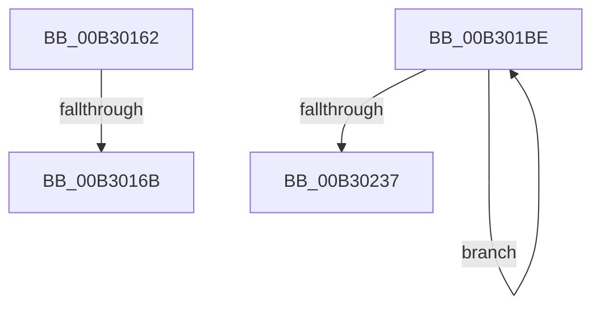

# sub_00B30162

- RVA: `0x00B30162`–`0x00B3023C` (길이 `218` bytes)
- VA: `0x0000000140B30162`
- 실행 섹션: `PAGE`
- PDB 이름 있음: `아니요`; PDB Function 태그: `아니요`
- unwind 정보 RVA: `0x000A3D48`
- 디코드: `46`개 명령, `218/218` bytes 표시
- 미해석 바이트: `0` (있으면 어셈블리에 `.byte`로 보존)

> 이 문서는 커널 이미지의 기계어와 PDB 기호를 분석해 생성했습니다. 4번과 5번은 함수 원형과 자료형을 바이너리 사용 방식에서 추정한 C 해석이며 원본 소스 복구 결과는 아닙니다.

## 1. Dependencies

- 직접 호출 지점: **0**; 고유 호출 대상: **0**
- 직접 호출자로 확인된 함수: **0**
- RIP 상대 이미지 참조: **2**

### Outgoing calls
- 직접 디코드된 call 명령이 없습니다.

### Direct callers
- 이 함수 시작 RVA로 연결되는 직접 call은 확인되지 않았습니다. 간접 호출은 완전히 역산할 수 없습니다.

### Static image references
- `0x00B3018E` → RVA `0x00E08380` (`.data`; read)
- `0x00B30195` → RVA `0x00F0CE0C` (`.data`; read)

## 2. Other-region calls and transfers

- 다른 실행 섹션으로 향하는 call: **0**
- call이 아닌 외부 분기/꼬리 이동: **3**
  - `0x00B30165` → [PpmWmiGetAllData + 0x1C6](../9E/PpmWmiGetAllData_function_009E1470.md) (`tail-transfer`)
  - `0x00B301B9` → [PpmWmiGetAllData + 0x116](../9E/PpmWmiGetAllData_function_009E1470.md) (`tail-transfer`)
  - `0x00B30237` → [PpmWmiGetAllData + 0x116](../9E/PpmWmiGetAllData_function_009E1470.md) (`tail-transfer`)

## 3. Assembly (complete function range)

```asm
00B30162  4D 85 F6                        test r14, r14
00B30165  0F 84 CB 14 EB FF               je 0x1409e1636
00B3016B  44 89 1B                        mov dword ptr [rbx], r11d
00B3016E  41 8B 86 C0 01 00 00            mov eax, dword ptr [r14 + 0x1c0]
00B30175  89 43 04                        mov dword ptr [rbx + 4], eax
00B30178  4C 89 5B 08                     mov qword ptr [rbx + 8], r11
00B3017C  4C 89 5B 10                     mov qword ptr [rbx + 0x10], r11
00B30180  C6 43 1C 64                     mov byte ptr [rbx + 0x1c], 0x64
00B30184  41 8A 86 E9 01 00 00            mov al, byte ptr [r14 + 0x1e9]
00B3018B  88 43 1D                        mov byte ptr [rbx + 0x1d], al
00B3018E  48 8B 15 EB 81 2D 00            mov rdx, qword ptr [rip + 0x2d81eb]
00B30195  48 63 05 70 CC 3D 00            movsxd rax, dword ptr [rip + 0x3dcc70]
00B3019C  48 69 C8 E8 01 00 00            imul rcx, rax, 0x1e8
00B301A3  8B 44 11 4C                     mov eax, dword ptr [rcx + rdx + 0x4c]
00B301A7  89 43 20                        mov dword ptr [rbx + 0x20], eax
00B301AA  49 8B 46 20                     mov rax, qword ptr [r14 + 0x20]
00B301AE  48 89 43 28                     mov qword ptr [rbx + 0x28], rax
00B301B2  C7 43 40 01 00 00 00            mov dword ptr [rbx + 0x40], 1
00B301B9  E9 C8 13 EB FF                  jmp 0x1409e1586
00B301BE  49 8B 0F                        mov rcx, qword ptr [r15]
00B301C1  4D 8D 80 58 01 00 00            lea r8, [r8 + 0x158]
00B301C8  B8 CD CC CC CC                  mov eax, 0xcccccccd
00B301CD  41 F7 A4 08 E0 03 00 00         mul dword ptr [r8 + rcx + 0x3e0]
00B301D5  C1 EA 03                        shr edx, 3
00B301D8  89 53 F8                        mov dword ptr [rbx - 8], edx
00B301DB  49 8B 07                        mov rax, qword ptr [r15]
00B301DE  41 8B 8C 00 E8 03 00 00         mov ecx, dword ptr [r8 + rax + 0x3e8]
00B301E6  89 4B FC                        mov dword ptr [rbx - 4], ecx
00B301E9  41 8B 81 C4 02 00 00            mov eax, dword ptr [r9 + 0x2c4]
00B301F0  89 03                           mov dword ptr [rbx], eax
00B301F2  48 8D 5B 20                     lea rbx, [rbx + 0x20]
00B301F6  41 8A 81 C8 02 00 00            mov al, byte ptr [r9 + 0x2c8]
00B301FD  88 43 E4                        mov byte ptr [rbx - 0x1c], al
00B30200  41 8A 81 C9 02 00 00            mov al, byte ptr [r9 + 0x2c9]
00B30207  88 43 E5                        mov byte ptr [rbx - 0x1b], al
00B3020A  49 8B 07                        mov rax, qword ptr [r15]
00B3020D  41 8A 8C 00 18 04 00 00         mov cl, byte ptr [r8 + rax + 0x418]
00B30215  88 4B E6                        mov byte ptr [rbx - 0x1a], cl
00B30218  49 8B 07                        mov rax, qword ptr [r15]
00B3021B  41 8B 8C 00 EC 03 00 00         mov ecx, dword ptr [r8 + rax + 0x3ec]
00B30223  89 4B E8                        mov dword ptr [rbx - 0x18], ecx
00B30226  44 89 5B EC                     mov dword ptr [rbx - 0x14], r11d
00B3022A  C7 43 F0 01 00 00 00            mov dword ptr [rbx - 0x10], 1
00B30231  49 83 EA 01                     sub r10, 1
00B30235  75 87                           jne 0x140b301be
00B30237  E9 4A 13 EB FF                  jmp 0x1409e1586
```

## 4. C-style interpretation (structured pseudocode)

```c
__int64 __fastcall sub_00B30162(__int64 a1, __int64 a2, __int64 a3, __int64 a4)
{
    *(unsigned int *)(v_rbx) = (unsigned int)(v_r11);
    *(unsigned int *)(v_rbx + 4) = (unsigned int)((unsigned int)(*(unsigned int *)(v_r14 + 448)));
    *(unsigned __int64 *)(v_rbx + 8) = v_r11;
    *(unsigned __int64 *)(v_rbx + 16) = v_r11;
    *(unsigned __int8 *)(v_rbx + 28) = 100;
    *(unsigned __int8 *)(v_rbx + 29) = (unsigned __int8)(*(unsigned __int8 *)(v_r14 + 489));
    a1 = (a1) * ((int)(*(unsigned int *)(v_rip + 4050032)));
    *(unsigned int *)(v_rbx + 32) = (unsigned int)((unsigned int)(*(unsigned int *)(a1 + *(unsigned __int64 *)(v_rip + 2982379) * 1 + 76)));
    *(unsigned __int64 *)(v_rbx + 40) = *(unsigned __int64 *)(v_r14 + 32);
    *(unsigned int *)(v_rbx + 64) = 1;
}
```

## 5. (Beta) C Style

```c
int64_t sub_00B30162(void *Arg1, int64_t Arg2, int64_t Arg3, int64_t Arg4)
{
    uint8_t *arg1 = (uint8_t *)Arg1;

    *(uint32_t *)(local_rbx) = (uint32_t)(local_r11);
    *(uint32_t *)(local_rbx + 0x4) = (uint32_t)((uint32_t)(*(uint32_t *)(local_r14 + 0x1C0)));
    *(uint64_t *)(local_rbx + 0x8) = local_r11;
    *(uint64_t *)(local_rbx + 0x10) = local_r11;
    *(uint8_t *)(local_rbx + 0x1C) = 100;
    *(uint8_t *)(local_rbx + 0x1D) = (uint8_t)(*(uint8_t *)(local_r14 + 0x1E9));
    Arg1 = (Arg1) * ((int32_t)(*(uint32_t *)(v_rip + 0x3DCC70)));
    *(uint32_t *)(local_rbx + 0x20) = (uint32_t)((uint32_t)(*(uint32_t *)(arg1 + *(uint64_t *)(v_rip + 0x2D81EB) * 1 + 0x4C)));
    *(uint64_t *)(local_rbx + 0x28) = *(uint64_t *)(local_r14 + 0x20);
    *(uint32_t *)(local_rbx + 0x40) = 1;
}
```

### 관측된 메모리 오프셋

구조체 형식이 확인되지 않은 접근은 인자 기준의 오프셋으로만 기록했습니다.

| 기준 인자 | 오프셋 표현 | 폭 (bit) | 접근 |
|---|---:|---:|---|
| `Arg1` | `+ 0x4C + rdx*1` | `32` | `R` |

## 6. Execution-region graph

[열기: 2D/3D 그래프와 함수 탐색 컨트롤 패널](../../../control-panel.html?section=page&rva=0x00B30162&view=graph)

- 2D 그래프는 위에서 아래로 흐르고, 3D 그래프는 빈 공간을 드래그해 회전합니다. Shift+드래그는 이동, 휠은 확대·축소, 함수 노드 선택은 대상 보고서 이동입니다.

### Static fallback


