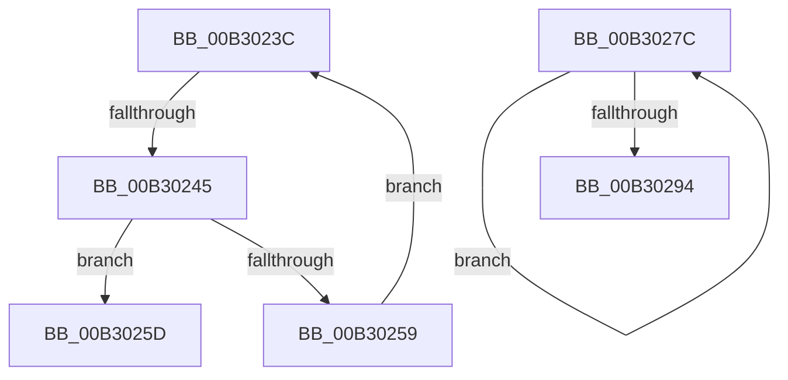

# sub_00B3023C

- RVA: `0x00B3023C`–`0x00B3029D` (길이 `97` bytes)
- VA: `0x0000000140B3023C`
- 실행 섹션: `PAGE`
- PDB 이름 있음: `아니요`; PDB Function 태그: `아니요`
- unwind 정보 RVA: `0x000A3D7C`
- 디코드: `27`개 명령, `97/97` bytes 표시
- 미해석 바이트: `0` (있으면 어셈블리에 `.byte`로 보존)

> 이 문서는 커널 이미지의 기계어와 PDB 기호를 분석해 생성했습니다. 4번과 5번은 함수 원형과 자료형을 바이너리 사용 방식에서 추정한 C 해석이며 원본 소스 복구 결과는 아닙니다.

## 1. Dependencies

- 직접 호출 지점: **2**; 고유 호출 대상: **2**
- 직접 호출자로 확인된 함수: **0**
- RIP 상대 이미지 참조: **1**

### Outgoing calls
- `0x00B3024E` → [wcsicmp](../../text/50/wcsicmp_function_00500080.md) (function, `0x00500080`)
- `0x00B30286` → [WmipUnreferenceEntry](../9E/WmipUnreferenceEntry_function_009E0CC8.md) (function, `0x009E0CC8`)

### Direct callers
- 이 함수 시작 RVA로 연결되는 직접 call은 확인되지 않았습니다. 간접 호출은 완전히 역산할 수 없습니다.

### Static image references
- `0x00B3027F` → RVA `0x00E03608` (`.data`; read)

## 2. Other-region calls and transfers

- 다른 실행 섹션으로 향하는 call: **1**
  - `0x00B3024E` → [wcsicmp](../../text/50/wcsicmp_function_00500080.md) (`PAGE` → `.text`)
- call이 아닌 외부 분기/꼬리 이동: **3**
  - `0x00B3023F` → [WmipPrepareWnodeSI + 0x188](../9E/WmipPrepareWnodeSI_function_009E1740.md) (`tail-transfer`)
  - `0x00B30277` → [WmipPrepareWnodeSI + 0x188](../9E/WmipPrepareWnodeSI_function_009E1740.md) (`tail-transfer`)
  - `0x00B30298` → [WmipPrepareWnodeSI + 0x2AC](../9E/WmipPrepareWnodeSI_function_009E1740.md) (`tail-transfer`)

## 3. Assembly (complete function range)

```asm
00B3023C  3B 5E 48                        cmp ebx, dword ptr [rsi + 0x48]
00B3023F  0F 83 83 16 EB FF               jae 0x1409e18c8
00B30245  8B CB                           mov ecx, ebx
00B30247  49 8B D4                        mov rdx, r12
00B3024A  48 8B 0C CF                     mov rcx, qword ptr [rdi + rcx*8]
00B3024E  E8 2D FE 9C FF                  call 0x140500080
00B30253  33 C9                           xor ecx, ecx
00B30255  85 C0                           test eax, eax
00B30257  74 04                           je 0x140b3025d
00B30259  FF C3                           inc ebx
00B3025B  EB DF                           jmp 0x140b3023c
00B3025D  41 0F BA 6F 2C 07               bts dword ptr [r15 + 0x2c], 7
00B30263  41 B5 01                        mov r13b, 1
00B30266  8B 46 50                        mov eax, dword ptr [rsi + 0x50]
00B30269  41 89 47 04                     mov dword ptr [r15 + 4], eax
00B3026D  48 8B 45 CF                     mov rax, qword ptr [rbp - 0x31]
00B30271  41 89 5F 34                     mov dword ptr [r15 + 0x34], ebx
00B30275  88 08                           mov byte ptr [rax], cl
00B30277  E9 4C 16 EB FF                  jmp 0x1409e18c8
00B3027C  48 8B 16                        mov rdx, qword ptr [rsi]
00B3027F  48 8D 0D 82 33 2D 00            lea rcx, [rip + 0x2d3382]
00B30286  E8 3D 0A EB FF                  call 0x1409e0cc8
00B3028B  48 8D 76 08                     lea rsi, [rsi + 8]
00B3028F  49 2B FD                        sub rdi, r13
00B30292  75 E8                           jne 0x140b3027c
00B30294  4C 8B 6D B7                     mov r13, qword ptr [rbp - 0x49]
00B30298  E9 4F 17 EB FF                  jmp 0x1409e19ec
```

## 4. C-style interpretation (structured pseudocode)

```c
__int64 __fastcall sub_00B3023C(void)
{
    __int64 result;
    __int64 v_rbx;

    result = wcsicmp(*(unsigned __int64 *)(v_rdi + (unsigned int)((unsigned int)(v_rbx)) * 8), v_r12, a3, a4);
    a1 = 0;
    if ((unsigned int)(result) == 0) goto loc_00B3025D;
    v_rbx = (unsigned int)((v_rbx) + 1);
    goto loc_00B3023C;
loc_00B3025D:
    *(unsigned int *)(v_r15 + 4) = (unsigned int)((unsigned int)(*(unsigned int *)(v_rsi + 80)));
    *(unsigned int *)(v_r15 + 52) = (unsigned int)(v_rbx);
    *(unsigned __int8 *)(*(unsigned __int64 *)(v_rbp - 49)) = 0;
}
```

## 5. (Beta) C Style

```c
void sub_00B3023C(void)
{
    int64_t result;
    int64_t local_rbx;

    result = wcsicmp(*(uint64_t *)(local_rdi + (uint32_t)((uint32_t)(local_rbx)) * 8), local_r12, a3, a4);
    a1 = 0;
    if ((uint32_t)(result) == 0) goto loc_00B3025D;
    local_rbx = (uint32_t)((local_rbx) + 1);
    goto loc_00B3023C;
loc_00B3025D:
    *(uint32_t *)(local_r15 + 0x4) = (uint32_t)((uint32_t)(*(uint32_t *)(local_rsi + 0x50)));
    *(uint32_t *)(local_r15 + 0x34) = (uint32_t)(local_rbx);
    *(uint8_t *)(*(uint64_t *)(local_rbp - 0x31)) = 0;
}
```

## 6. Execution-region graph

[열기: 2D/3D 그래프와 함수 탐색 컨트롤 패널](../../../control-panel.html?section=page&rva=0x00B3023C&view=graph)

- 2D 그래프는 위에서 아래로 흐르고, 3D 그래프는 빈 공간을 드래그해 회전합니다. Shift+드래그는 이동, 휠은 확대·축소, 함수 노드 선택은 대상 보고서 이동입니다.

### Static fallback


