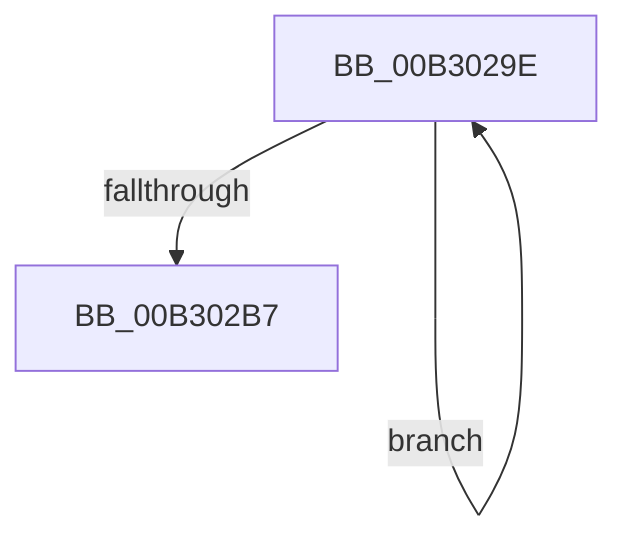

# sub_00B3029E

- RVA: `0x00B3029E`–`0x00B302D7` (길이 `57` bytes)
- VA: `0x0000000140B3029E`
- 실행 섹션: `PAGE`
- PDB 이름 있음: `아니요`; PDB Function 태그: `아니요`
- unwind 정보 RVA: `0x000A3DA8`
- 디코드: `13`개 명령, `57/57` bytes 표시
- 미해석 바이트: `0` (있으면 어셈블리에 `.byte`로 보존)

> 이 문서는 커널 이미지의 기계어와 PDB 기호를 분석해 생성했습니다. 4번과 5번은 함수 원형과 자료형을 바이너리 사용 방식에서 추정한 C 해석이며 원본 소스 복구 결과는 아닙니다.

## 1. Dependencies

- 직접 호출 지점: **2**; 고유 호출 대상: **1**
- 직접 호출자로 확인된 함수: **0**
- RIP 상대 이미지 참조: **1**

### Outgoing calls
- `0x00B302A8` → [WmipUnreferenceEntry](../9E/WmipUnreferenceEntry_function_009E0CC8.md) (function, `0x009E0CC8`)
- `0x00B302C1` → [WmipUnreferenceEntry](../9E/WmipUnreferenceEntry_function_009E0CC8.md) (function, `0x009E0CC8`)

### Direct callers
- 이 함수 시작 RVA로 연결되는 직접 call은 확인되지 않았습니다. 간접 호출은 완전히 역산할 수 없습니다.

### Static image references
- `0x00B302A1` → RVA `0x00E03608` (`.data`; read)

## 2. Other-region calls and transfers

- 다른 실행 섹션으로 향하는 call: **0**
- call이 아닌 외부 분기/꼬리 이동: **1**
  - `0x00B302D2` → [WmipPrepareForWnodeAD + 0x16E](../9E/WmipPrepareForWnodeAD_function_009E1A48.md) (`tail-transfer`)

## 3. Assembly (complete function range)

```asm
00B3029E  48 8B 16                        mov rdx, qword ptr [rsi]
00B302A1  48 8D 0D 60 33 2D 00            lea rcx, [rip + 0x2d3360]
00B302A8  E8 1B 0A EB FF                  call 0x1409e0cc8
00B302AD  48 8D 76 08                     lea rsi, [rsi + 8]
00B302B1  49 83 EE 01                     sub r14, 1
00B302B5  75 E7                           jne 0x140b3029e
00B302B7  48 8B D7                        mov rdx, rdi
00B302BA  48 8D 0D 47 33 2D 00            lea rcx, [rip + 0x2d3347]
00B302C1  E8 02 0A EB FF                  call 0x1409e0cc8
00B302C6  4C 8B 74 24 30                  mov r14, qword ptr [rsp + 0x30]
00B302CB  33 F6                           xor esi, esi
00B302CD  BB 9A 00 00 C0                  mov ebx, 0xc000009a
00B302D2  E9 DF 18 EB FF                  jmp 0x1409e1bb6
```

## 4. C-style interpretation (structured pseudocode)

```c
__int64 __fastcall sub_00B3029E(__int64 a1, __int64 a2, __int64 a3, __int64 a4, __int64 a5, __int64 a6)
{
    __int64 result;
    __int64 v_r14;
    __int64 v_rsi;

    result = WmipUnreferenceEntry(v_rip + 2962272, *(unsigned __int64 *)(v_rsi), a3, a4);
    v_r14 = (v_r14) - (1);
    if (condition_is_not_equal) goto loc_00B3029E;
    result = WmipUnreferenceEntry(v_rip + 2962247, v_rdi, a3, a4);
    v_rsi = 0;
}
```

## 5. (Beta) C Style

```c
int64_t sub_00B3029E(int64_t Arg1, int64_t Arg2, int64_t Arg3, int64_t Arg4, uint64_t Arg5, int64_t Arg6)
{
    int64_t result;
    int64_t local_r14;
    int64_t local_rsi;

    result = WmipUnreferenceEntry(v_rip + 2962272, *(uint64_t *)(local_rsi), Arg3, Arg4);
    local_r14 = (local_r14) - (1);
    if (condition_is_not_equal) goto loc_00B3029E;
    result = WmipUnreferenceEntry(v_rip + 2962247, local_rdi, Arg3, Arg4);
    local_rsi = 0;
}
```

## 6. Execution-region graph

[열기: 2D/3D 그래프와 함수 탐색 컨트롤 패널](../../../control-panel.html?section=page&rva=0x00B3029E&view=graph)

- 2D 그래프는 위에서 아래로 흐르고, 3D 그래프는 빈 공간을 드래그해 회전합니다. Shift+드래그는 이동, 휠은 확대·축소, 함수 노드 선택은 대상 보고서 이동입니다.

### Static fallback


