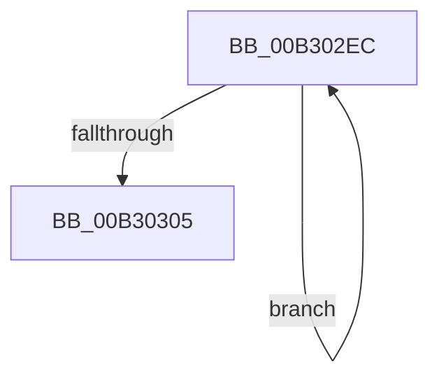

# sub_00B302EC

- RVA: `0x00B302EC`–`0x00B30320` (길이 `52` bytes)
- VA: `0x0000000140B302EC`
- 실행 섹션: `PAGE`
- PDB 이름 있음: `아니요`; PDB Function 태그: `아니요`
- unwind 정보 RVA: `0x000A3DE4`
- 디코드: `12`개 명령, `52/52` bytes 표시
- 미해석 바이트: `0` (있으면 어셈블리에 `.byte`로 보존)

> 이 문서는 커널 이미지의 기계어와 PDB 기호를 분석해 생성했습니다. 4번과 5번은 함수 원형과 자료형을 바이너리 사용 방식에서 추정한 C 해석이며 원본 소스 복구 결과는 아닙니다.

## 1. Dependencies

- 직접 호출 지점: **2**; 고유 호출 대상: **1**
- 직접 호출자로 확인된 함수: **0**
- RIP 상대 이미지 참조: **1**

### Outgoing calls
- `0x00B302F6` → [WmipUnreferenceEntry](../9E/WmipUnreferenceEntry_function_009E0CC8.md) (function, `0x009E0CC8`)
- `0x00B3030F` → [WmipUnreferenceEntry](../9E/WmipUnreferenceEntry_function_009E0CC8.md) (function, `0x009E0CC8`)

### Direct callers
- 이 함수 시작 RVA로 연결되는 직접 call은 확인되지 않았습니다. 간접 호출은 완전히 역산할 수 없습니다.

### Static image references
- `0x00B302EF` → RVA `0x00E03608` (`.data`; read)

## 2. Other-region calls and transfers

- 다른 실행 섹션으로 향하는 call: **0**
- call이 아닌 외부 분기/꼬리 이동: **1**
  - `0x00B3031B` → [WmipAddProviderIdToPIList + 0xBB](../9E/WmipAddProviderIdToPIList_function_009E1C3C.md) (`tail-transfer`)

## 3. Assembly (complete function range)

```asm
00B302EC  48 8B 13                        mov rdx, qword ptr [rbx]
00B302EF  48 8D 0D 12 33 2D 00            lea rcx, [rip + 0x2d3312]
00B302F6  E8 CD 09 EB FF                  call 0x1409e0cc8
00B302FB  48 8D 5B 08                     lea rbx, [rbx + 8]
00B302FF  49 83 EE 01                     sub r14, 1
00B30303  75 E7                           jne 0x140b302ec
00B30305  49 8B D5                        mov rdx, r13
00B30308  48 8D 0D F9 32 2D 00            lea rcx, [rip + 0x2d32f9]
00B3030F  E8 B4 09 EB FF                  call 0x1409e0cc8
00B30314  33 F6                           xor esi, esi
00B30316  BB 9A 00 00 C0                  mov ebx, 0xc000009a
00B3031B  E9 D7 19 EB FF                  jmp 0x1409e1cf7
```

## 4. C-style interpretation (structured pseudocode)

```c
__int64 __fastcall sub_00B302EC(void)
{
    __int64 result;
    __int64 v_r14;
    __int64 v_rsi;

    result = WmipUnreferenceEntry(v_rip + 2962194, *(unsigned __int64 *)(v_rbx), a3, a4);
    v_r14 = (v_r14) - (1);
    if (condition_is_not_equal) goto loc_00B302EC;
    result = WmipUnreferenceEntry(v_rip + 2962169, v_r13, a3, a4);
    v_rsi = 0;
}
```

## 5. (Beta) C Style

```c
void sub_00B302EC(void)
{
    int64_t result;
    int64_t local_r14;
    int64_t local_rsi;

    result = WmipUnreferenceEntry(v_rip + 2962194, *(uint64_t *)(local_rbx), a3, a4);
    local_r14 = (local_r14) - (1);
    if (condition_is_not_equal) goto loc_00B302EC;
    result = WmipUnreferenceEntry(v_rip + 2962169, local_r13, a3, a4);
    local_rsi = 0;
}
```

## 6. Execution-region graph

[열기: 2D/3D 그래프와 함수 탐색 컨트롤 패널](../../../control-panel.html?section=page&rva=0x00B302EC&view=graph)

- 2D 그래프는 위에서 아래로 흐르고, 3D 그래프는 빈 공간을 드래그해 회전합니다. Shift+드래그는 이동, 휠은 확대·축소, 함수 노드 선택은 대상 보고서 이동입니다.

### Static fallback


