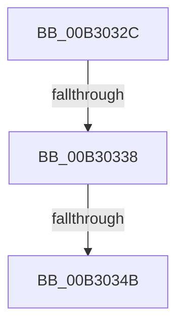

# sub_00B3032C

- RVA: `0x00B3032C`–`0x00B3040F` (길이 `227` bytes)
- VA: `0x0000000140B3032C`
- 실행 섹션: `PAGE`
- PDB 이름 있음: `아니요`; PDB Function 태그: `아니요`
- unwind 정보 RVA: `0x000A3F20`
- 디코드: `51`개 명령, `227/227` bytes 표시
- 미해석 바이트: `0` (있으면 어셈블리에 `.byte`로 보존)

> 이 문서는 커널 이미지의 기계어와 PDB 기호를 분석해 생성했습니다. 4번과 5번은 함수 원형과 자료형을 바이너리 사용 방식에서 추정한 C 해석이며 원본 소스 복구 결과는 아닙니다.

## 1. Dependencies

- 직접 호출 지점: **4**; 고유 호출 대상: **3**
- 직접 호출자로 확인된 함수: **0**
- RIP 상대 이미지 참조: **2**

### Outgoing calls
- `0x00B3034E` → [ObfReferenceObject](../../text/20/ObfReferenceObject_function_0020FA20.md) (function, `0x0020FA20`)
- `0x00B3037D` → [memset](../../text/6C/memset_function_006C6C40.md) (function, `0x006C6C40`)
- `0x00B303BE` → [memcpy](../../text/6C/memcpy_function_006C6840.md) (function, `0x006C6840`)
- `0x00B30404` → [memcpy](../../text/6C/memcpy_function_006C6840.md) (function, `0x006C6840`)

### Direct callers
- 이 함수 시작 RVA로 연결되는 직접 call은 확인되지 않았습니다. 간접 호출은 완전히 역산할 수 없습니다.

### Static image references
- `0x00B303A2` → RVA `0x000145D8` (`.rdata`; read)
- `0x00B303E3` → RVA `0x000145C8` (`.rdata`; read)

## 2. Other-region calls and transfers

- 다른 실행 섹션으로 향하는 call: **4**
  - `0x00B3034E` → [ObfReferenceObject](../../text/20/ObfReferenceObject_function_0020FA20.md) (`PAGE` → `.text`)
  - `0x00B3037D` → [memset](../../text/6C/memset_function_006C6C40.md) (`PAGE` → `.text`)
  - `0x00B303BE` → [memcpy](../../text/6C/memcpy_function_006C6840.md) (`PAGE` → `.text`)
  - `0x00B30404` → [memcpy](../../text/6C/memcpy_function_006C6840.md) (`PAGE` → `.text`)
- call이 아닌 외부 분기/꼬리 이동: **3**
  - `0x00B30332` → [WmipTranslatePDOInstanceNames + 0x30A](../9E/WmipTranslatePDOInstanceNames_function_009E2F0C.md) (`tail-transfer`)
  - `0x00B30345` → [WmipTranslatePDOInstanceNames + 0x30F](../9E/WmipTranslatePDOInstanceNames_function_009E2F0C.md) (`tail-transfer`)
  - `0x00B3040A` → [WmipTranslatePDOInstanceNames + 0x30F](../9E/WmipTranslatePDOInstanceNames_function_009E2F0C.md) (`tail-transfer`)

## 3. Assembly (complete function range)

```asm
00B3032C  44 2B E9                        sub r13d, ecx
00B3032F  41 3B DD                        cmp ebx, r13d
00B30332  0F 87 DE 2E EB FF               ja 0x1409e3216
00B30338  48 8B 84 24 B8 00 00 00         mov rax, qword ptr [rsp + 0xb8]
00B30340  48 83 78 18 00                  cmp qword ptr [rax + 0x18], 0
00B30345  0F 85 D0 2E EB FF               jne 0x1409e321b
00B3034B  48 8B CD                        mov rcx, rbp
00B3034E  E8 CD F6 6D FF                  call 0x14020fa20
00B30353  48 8B 84 24 B8 00 00 00         mov rax, qword ptr [rsp + 0xb8]
00B3035B  33 D2                           xor edx, edx
00B3035D  44 8B 6C 24 24                  mov r13d, dword ptr [rsp + 0x24]
00B30362  49 8B CE                        mov rcx, r14
00B30365  48 89 68 18                     mov qword ptr [rax + 0x18], rbp
00B30369  44 89 68 34                     mov dword ptr [rax + 0x34], r13d
00B3036D  41 8B C6                        mov eax, r14d
00B30370  2B C6                           sub eax, esi
00B30372  89 46 04                        mov dword ptr [rsi + 4], eax
00B30375  BE 58 00 00 00                  mov esi, 0x58
00B3037A  44 8B C6                        mov r8d, esi
00B3037D  E8 BE 68 B9 FF                  call 0x1406c6c40
00B30382  41 89 1E                        mov dword ptr [r14], ebx
00B30385  8D 4E AA                        lea ecx, [rsi - 0x56]
00B30388  41 89 4E 10                     mov dword ptr [r14 + 0x10], ecx
00B3038C  8D 04 39                        lea eax, [rcx + rdi]
00B3038F  41 C7 46 28 28 00 00 00         mov dword ptr [r14 + 0x28], 0x28
00B30397  49 8D 5E 5A                     lea rbx, [r14 + 0x5a]
00B3039B  45 89 6E 2C                     mov dword ptr [r14 + 0x2c], r13d
00B3039F  4C 8B C7                        mov r8, rdi
00B303A2  0F 10 05 2F 42 4E FF            movups xmm0, xmmword ptr [rip - 0xb1bdd1]
00B303A9  41 89 76 30                     mov dword ptr [r14 + 0x30], esi
00B303AD  49 8B D4                        mov rdx, r12
00B303B0  48 8B CB                        mov rcx, rbx
00B303B3  F3 41 0F 7F 46 18               movdqu xmmword ptr [r14 + 0x18], xmm0
00B303B9  66 41 89 46 58                  mov word ptr [r14 + 0x58], ax
00B303BE  E8 7D 64 B9 FF                  call 0x1406c6840
00B303C3  66 C7 04 1F 5F 00               mov word ptr [rdi + rbx], 0x5f
00B303C9  8D 47 5C                        lea eax, [rdi + 0x5c]
00B303CC  41 C7 46 48 04 00 00 00         mov dword ptr [r14 + 0x48], 4
00B303D4  48 8D 4F 04                     lea rcx, [rdi + 4]
00B303D8  41 C7 46 4C 01 00 00 00         mov dword ptr [r14 + 0x4c], 1
00B303E0  48 03 CB                        add rcx, rbx
00B303E3  0F 10 05 DE 41 4E FF            movups xmm0, xmmword ptr [rip - 0xb1be22]
00B303EA  41 89 46 50                     mov dword ptr [r14 + 0x50], eax
00B303EE  4C 8B C7                        mov r8, rdi
00B303F1  0F B7 44 24 40                  movzx eax, word ptr [rsp + 0x40]
00B303F6  49 8B D4                        mov rdx, r12
00B303F9  F3 41 0F 7F 46 38               movdqu xmmword ptr [r14 + 0x38], xmm0
00B303FF  66 89 44 1F 02                  mov word ptr [rdi + rbx + 2], ax
00B30404  E8 37 64 B9 FF                  call 0x1406c6840
00B30409  90                              nop
00B3040A  E9 0C 2E EB FF                  jmp 0x1409e321b
```

## 4. C-style interpretation (structured pseudocode)

```c
__int64 __fastcall sub_00B3032C(int a1, int a2, __int64 a3, __int64 a4, __int64 a5, __int64 a6, __int64 a7, unsigned __int16 a8, __int64 a9, __int64 a10, __int64 a11, __int64 a12, __int64 a13, __int64 a14, __int64 a15, __int64 a16, __int64 a17, __int64 a18, __int64 a19, __int64 a20, __int64 a21, __int64 a22, __int64 a23)
{
    __int64 result;
    __int64 v_r13;
    unsigned int v_stack_p24;

    v_r13 = (unsigned int)((v_r13) - (a1));
    result = ObfReferenceObject(v_rbp, a2, a3, a4);
    a2 = 0;
    *(unsigned __int64 *)(a23 + 24) = v_rbp;
    *(unsigned int *)(a23 + 52) = (unsigned int)((unsigned int)(v_stack_p24));
    result = (unsigned int)(((unsigned int)((unsigned int)(v_r14))) - ((unsigned int)(v_rsi)));
    *(unsigned int *)(v_rsi + 4) = (unsigned int)(result);
    result = memset(v_r14, a2, 88, a4);
    *(unsigned int *)(v_r14) = (unsigned int)(v_rbx);
    *(unsigned int *)(v_r14 + 16) = (unsigned int)(88 - 86);
    *(unsigned int *)(v_r14 + 40) = 40;
    *(unsigned int *)(v_r14 + 44) = (unsigned int)((unsigned int)(v_stack_p24));
    *(unsigned int *)(v_r14 + 48) = 88;
    *(unsigned __int64 *)(v_r14 + 24) = v_xmm0;
    *(unsigned __int16 *)(v_r14 + 88) = (unsigned __int16)(88 - 86 + v_rdi * 1);
    result = memcpy(v_r14 + 90, v_r12, v_rdi, a4);
    *(unsigned __int16 *)(v_rdi + v_r14 + 90 * 1) = 95;
    *(unsigned int *)(v_r14 + 72) = 4;
    *(unsigned int *)(v_r14 + 76) = 1;
    a1 = (v_rdi + 4) + (v_r14 + 90);
    *(unsigned int *)(v_r14 + 80) = (unsigned int)(v_rdi + 92);
    *(unsigned __int64 *)(v_r14 + 56) = v_xmm0;
    *(unsigned __int16 *)(v_rdi + v_r14 + 90 * 1 + 2) = a8;
    result = memcpy(a1, v_r12, v_rdi, a4);
}
```

## 5. (Beta) C Style

```c
int64_t sub_00B3032C(int32_t Arg1, int32_t Arg2, int64_t Arg3, int64_t Arg4, uint64_t Arg5, uint64_t Arg6, uint64_t Arg7, uint16_t Arg8, uint64_t Arg9, uint64_t Arg10, uint64_t Arg11, uint64_t Arg12, uint64_t Arg13, uint64_t Arg14, uint64_t Arg15, uint64_t Arg16, uint64_t Arg17, uint64_t Arg18, uint64_t Arg19, uint64_t Arg20, uint64_t Arg21, uint64_t Arg22, void *Arg23)
{
    uint8_t *arg23 = (uint8_t *)Arg23;

    int64_t result;
    int64_t local_r13;
    uint32_t v_stack_p24;

    local_r13 = (uint32_t)((local_r13) - (Arg1));
    result = ObfReferenceObject(local_rbp, Arg2, Arg3, Arg4);
    Arg2 = 0;
    *(uint64_t *)(arg23 + 0x18) = local_rbp;
    *(uint32_t *)(arg23 + 0x34) = (uint32_t)((uint32_t)(v_stack_p24));
    result = (uint32_t)(((uint32_t)((uint32_t)(local_r14))) - ((uint32_t)(local_rsi)));
    *(uint32_t *)(local_rsi + 0x4) = (uint32_t)(result);
    result = memset(local_r14, Arg2, 88, Arg4);
    *(uint32_t *)(local_r14) = (uint32_t)(local_rbx);
    *(uint32_t *)(local_r14 + 0x10) = (uint32_t)(88 - 86);
    *(uint32_t *)(local_r14 + 0x28) = 40;
    *(uint32_t *)(local_r14 + 0x2C) = (uint32_t)((uint32_t)(v_stack_p24));
    *(uint32_t *)(local_r14 + 0x30) = 88;
    *(uint64_t *)(local_r14 + 0x18) = v_xmm0;
    *(uint16_t *)(local_r14 + 0x58) = (uint16_t)(88 - 86 + local_rdi * 1);
    result = memcpy(local_r14 + 90, local_r12, local_rdi, Arg4);
    *(uint16_t *)(local_rdi + local_r14 + 0x5A * 1) = 95;
    *(uint32_t *)(local_r14 + 0x48) = 4;
    *(uint32_t *)(local_r14 + 0x4C) = 1;
    Arg1 = (local_rdi + 4) + (local_r14 + 90);
    *(uint32_t *)(local_r14 + 0x50) = (uint32_t)(local_rdi + 92);
    *(uint64_t *)(local_r14 + 0x38) = v_xmm0;
    *(uint16_t *)(local_rdi + local_r14 + 0x5A * 1 + 0x2) = Arg8;
    result = memcpy(Arg1, local_r12, local_rdi, Arg4);
}
```

### 관측된 메모리 오프셋

구조체 형식이 확인되지 않은 접근은 인자 기준의 오프셋으로만 기록했습니다.

| 기준 인자 | 오프셋 표현 | 폭 (bit) | 접근 |
|---|---:|---:|---|
| `Arg23` | `+ 0x18` | `64` | `R` |
| `Arg23` | `+ 0x18` | `64` | `W` |
| `Arg23` | `+ 0x34` | `32` | `W` |

## 6. Execution-region graph

[열기: 2D/3D 그래프와 함수 탐색 컨트롤 패널](../../../control-panel.html?section=page&rva=0x00B3032C&view=graph)

- 2D 그래프는 위에서 아래로 흐르고, 3D 그래프는 빈 공간을 드래그해 회전합니다. Shift+드래그는 이동, 휠은 확대·축소, 함수 노드 선택은 대상 보고서 이동입니다.

### Static fallback


