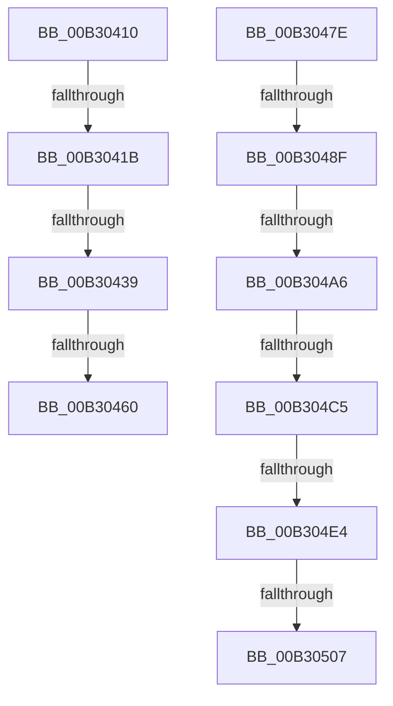

# sub_00B30410

- RVA: `0x00B30410`–`0x00B3051A` (길이 `266` bytes)
- VA: `0x0000000140B30410`
- 실행 섹션: `PAGE`
- PDB 이름 있음: `아니요`; PDB Function 태그: `아니요`
- unwind 정보 RVA: `0x000A3F30`
- 디코드: `65`개 명령, `266/266` bytes 표시
- 미해석 바이트: `0` (있으면 어셈블리에 `.byte`로 보존)

> 이 문서는 커널 이미지의 기계어와 PDB 기호를 분석해 생성했습니다. 4번과 5번은 함수 원형과 자료형을 바이너리 사용 방식에서 추정한 C 해석이며 원본 소스 복구 결과는 아닙니다.

## 1. Dependencies

- 직접 호출 지점: **3**; 고유 호출 대상: **2**
- 직접 호출자로 확인된 함수: **0**
- RIP 상대 이미지 참조: **0**

### Outgoing calls
- `0x00B3042B` → [ExAllocatePool2](../../poolcode/B8/ExAllocatePool2_function_00B820F0.md) (function, `0x00B820F0`)
- `0x00B304B4` → [ExAllocatePool2](../../poolcode/B8/ExAllocatePool2_function_00B820F0.md) (function, `0x00B820F0`)
- `0x00B304CE` → [KeInitializeEvent](../../text/40/KeInitializeEvent_function_0040DD10.md) (function, `0x0040DD10`)

### Direct callers
- 이 함수 시작 RVA로 연결되는 직접 call은 확인되지 않았습니다. 간접 호출은 완전히 역산할 수 없습니다.

### Static image references
- 디코드된 RIP-relative 메모리 참조가 없습니다.

## 2. Other-region calls and transfers

- 다른 실행 섹션으로 향하는 call: **3**
  - `0x00B3042B` → [ExAllocatePool2](../../poolcode/B8/ExAllocatePool2_function_00B820F0.md) (`PAGE` → `POOLCODE`)
  - `0x00B304B4` → [ExAllocatePool2](../../poolcode/B8/ExAllocatePool2_function_00B820F0.md) (`PAGE` → `POOLCODE`)
  - `0x00B304CE` → [KeInitializeEvent](../../text/40/KeInitializeEvent_function_0040DD10.md) (`PAGE` → `.text`)
- call이 아닌 외부 분기/꼬리 이동: **10**
  - `0x00B30415` → [WmipQueueLegacyEtwWork + 0x2E](../9E/WmipQueueLegacyEtwWork_function_009E33DC.md) (`tail-transfer`)
  - `0x00B30433` → [WmipQueueLegacyEtwWork + 0x2E](../9E/WmipQueueLegacyEtwWork_function_009E33DC.md) (`tail-transfer`)
  - `0x00B3045A` → [WmipQueueLegacyEtwWork + 0x4E](../9E/WmipQueueLegacyEtwWork_function_009E33DC.md) (`tail-transfer`)
  - `0x00B30479` → [WmipQueueLegacyEtwWork + 0x2E](../9E/WmipQueueLegacyEtwWork_function_009E33DC.md) (`tail-transfer`)
  - `0x00B30489` → [WmipQueueLegacyEtwWork + 0x4E](../9E/WmipQueueLegacyEtwWork_function_009E33DC.md) (`tail-transfer`)
  - `0x00B304A0` → [WmipQueueLegacyEtwWork + 0x82](../9E/WmipQueueLegacyEtwWork_function_009E33DC.md) (`tail-transfer`)
  - `0x00B304BF` → [WmipQueueLegacyEtwWork + 0x82](../9E/WmipQueueLegacyEtwWork_function_009E33DC.md) (`tail-transfer`)
  - `0x00B304DE` → [WmipQueueLegacyEtwWork + 0x4E](../9E/WmipQueueLegacyEtwWork_function_009E33DC.md) (`tail-transfer`)
  - `0x00B30501` → [WmipQueueLegacyEtwWork + 0x4E](../9E/WmipQueueLegacyEtwWork_function_009E33DC.md) (`tail-transfer`)
  - `0x00B30515` → [WmipQueueLegacyEtwWork + 0x82](../9E/WmipQueueLegacyEtwWork_function_009E33DC.md) (`tail-transfer`)

## 3. Assembly (complete function range)

```asm
00B30410  8B 43 10                        mov eax, dword ptr [rbx + 0x10]
00B30413  A8 10                           test al, 0x10
00B30415  0F 85 EF 2F EB FF               jne 0x1409e340a
00B3041B  BA 38 00 00 00                  mov edx, 0x38
00B30420  B9 00 01 00 00                  mov ecx, 0x100
00B30425  41 B8 57 6D 69 70               mov r8d, 0x70696d57
00B3042B  E8 C0 1C 05 00                  call 0x140b820f0
00B30430  48 85 C0                        test rax, rax
00B30433  0F 84 D1 2F EB FF               je 0x1409e340a
00B30439  48 89 58 10                     mov qword ptr [rax + 0x10], rbx
00B3043D  48 8D 48 18                     lea rcx, [rax + 0x18]
00B30441  48 89 49 08                     mov qword ptr [rcx + 8], rcx
00B30445  48 89 09                        mov qword ptr [rcx], rcx
00B30448  48 8D 48 28                     lea rcx, [rax + 0x28]
00B3044C  48 89 49 08                     mov qword ptr [rcx + 8], rcx
00B30450  48 89 09                        mov qword ptr [rcx], rcx
00B30453  48 8B 4E 08                     mov rcx, qword ptr [rsi + 8]
00B30457  48 39 31                        cmp qword ptr [rcx], rsi
00B3045A  0F 85 CA 2F EB FF               jne 0x1409e342a
00B30460  48 89 30                        mov qword ptr [rax], rsi
00B30463  48 89 48 08                     mov qword ptr [rax + 8], rcx
00B30467  48 89 01                        mov qword ptr [rcx], rax
00B3046A  48 89 46 08                     mov qword ptr [rsi + 8], rax
00B3046E  83 4B 10 10                     or dword ptr [rbx + 0x10], 0x10
00B30472  48 89 83 80 00 00 00            mov qword ptr [rbx + 0x80], rax
00B30479  E9 8C 2F EB FF                  jmp 0x1409e340a
00B3047E  48 8D 45 18                     lea rax, [rbp + 0x18]
00B30482  48 8B 48 08                     mov rcx, qword ptr [rax + 8]
00B30486  48 39 01                        cmp qword ptr [rcx], rax
00B30489  0F 85 9B 2F EB FF               jne 0x1409e342a
00B3048F  48 89 07                        mov qword ptr [rdi], rax
00B30492  48 89 4F 08                     mov qword ptr [rdi + 8], rcx
00B30496  48 89 39                        mov qword ptr [rcx], rdi
00B30499  48 89 78 08                     mov qword ptr [rax + 8], rdi
00B3049D  48 85 F6                        test rsi, rsi
00B304A0  0F 84 B8 2F EB FF               je 0x1409e345e
00B304A6  BA 38 00 00 00                  mov edx, 0x38
00B304AB  41 B8 57 6D 69 70               mov r8d, 0x70696d57
00B304B1  8D 4A 08                        lea ecx, [rdx + 8]
00B304B4  E8 37 1C 05 00                  call 0x140b820f0
00B304B9  48 8B D8                        mov rbx, rax
00B304BC  48 85 C0                        test rax, rax
00B304BF  0F 84 99 2F EB FF               je 0x1409e345e
00B304C5  48 8D 48 20                     lea rcx, [rax + 0x20]
00B304C9  45 33 C0                        xor r8d, r8d
00B304CC  33 D2                           xor edx, edx
00B304CE  E8 3D D8 8D FF                  call 0x14040dd10
00B304D3  48 8B 46 18                     mov rax, qword ptr [rsi + 0x18]
00B304D7  48 83 C6 10                     add rsi, 0x10
00B304DB  48 39 30                        cmp qword ptr [rax], rsi
00B304DE  0F 85 46 2F EB FF               jne 0x1409e342a
00B304E4  48 89 43 08                     mov qword ptr [rbx + 8], rax
00B304E8  48 89 33                        mov qword ptr [rbx], rsi
00B304EB  48 89 18                        mov qword ptr [rax], rbx
00B304EE  48 8D 45 28                     lea rax, [rbp + 0x28]
00B304F2  48 89 5E 08                     mov qword ptr [rsi + 8], rbx
00B304F6  48 83 C3 10                     add rbx, 0x10
00B304FA  48 8B 48 08                     mov rcx, qword ptr [rax + 8]
00B304FE  48 39 01                        cmp qword ptr [rcx], rax
00B30501  0F 85 23 2F EB FF               jne 0x1409e342a
00B30507  48 89 03                        mov qword ptr [rbx], rax
00B3050A  48 89 4B 08                     mov qword ptr [rbx + 8], rcx
00B3050E  48 89 19                        mov qword ptr [rcx], rbx
00B30511  48 89 58 08                     mov qword ptr [rax + 8], rbx
00B30515  E9 44 2F EB FF                  jmp 0x1409e345e
```

## 4. C-style interpretation (structured pseudocode)

```c
__int64 __fastcall sub_00B30410(void)
{
    __int64 result;

    result = ExAllocatePool2(256, 56, (unsigned int)(0x70696D57ULL), a4);
    *(unsigned __int64 *)(result + 16) = v_rbx;
    *(unsigned __int64 *)(result + 24 + 8) = result + 24;
    *(unsigned __int64 *)(result + 24) = result + 24;
    *(unsigned __int64 *)(result + 40 + 8) = result + 40;
    *(unsigned __int64 *)(result + 40) = result + 40;
    *(unsigned __int64 *)(result) = v_rsi;
    *(unsigned __int64 *)(result + 8) = *(unsigned __int64 *)(v_rsi + 8);
    *(unsigned __int64 *)(*(unsigned __int64 *)(v_rsi + 8)) = result;
    *(unsigned __int64 *)(v_rsi + 8) = result;
    *(unsigned __int64 *)(v_rbx + 128) = result;
}
```

## 5. (Beta) C Style

```c
void sub_00B30410(void)
{
    int64_t result;

    result = ExAllocatePool2(256, 56, (uint32_t)(0x70696D57ULL), a4);
    *(uint64_t *)(result + 0x10) = local_rbx;
    *(uint64_t *)(result + 0x18 + 0x8) = result + 24;
    *(uint64_t *)(result + 0x18) = result + 24;
    *(uint64_t *)(result + 0x28 + 0x8) = result + 40;
    *(uint64_t *)(result + 0x28) = result + 40;
    *(uint64_t *)(result) = local_rsi;
    *(uint64_t *)(result + 0x8) = *(uint64_t *)(local_rsi + 0x8);
    *(uint64_t *)(*(uint64_t *)(local_rsi + 0x8)) = result;
    *(uint64_t *)(local_rsi + 0x8) = result;
    *(uint64_t *)(local_rbx + 0x80) = result;
}
```

## 6. Execution-region graph

[열기: 2D/3D 그래프와 함수 탐색 컨트롤 패널](../../../control-panel.html?section=page&rva=0x00B30410&view=graph)

- 2D 그래프는 위에서 아래로 흐르고, 3D 그래프는 빈 공간을 드래그해 회전합니다. Shift+드래그는 이동, 휠은 확대·축소, 함수 노드 선택은 대상 보고서 이동입니다.

### Static fallback


