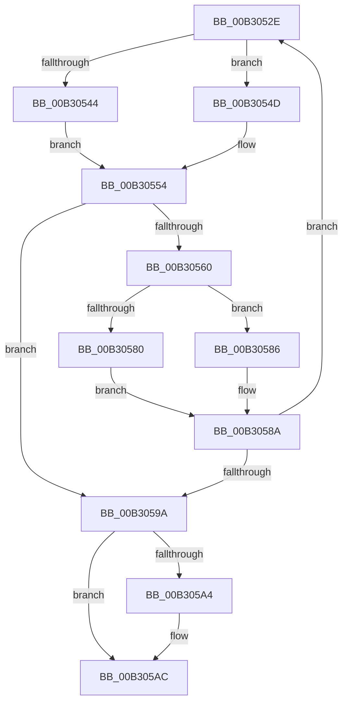

# sub_00B3052E

- RVA: `0x00B3052E`–`0x00B305C1` (길이 `147` bytes)
- VA: `0x0000000140B3052E`
- 실행 섹션: `PAGE`
- PDB 이름 있음: `아니요`; PDB Function 태그: `아니요`
- unwind 정보 RVA: `0x000A3F90`
- 디코드: `45`개 명령, `147/147` bytes 표시
- 미해석 바이트: `0` (있으면 어셈블리에 `.byte`로 보존)

> 이 문서는 커널 이미지의 기계어와 PDB 기호를 분석해 생성했습니다. 4번과 5번은 함수 원형과 자료형을 바이너리 사용 방식에서 추정한 C 해석이며 원본 소스 복구 결과는 아닙니다.

## 1. Dependencies

- 직접 호출 지점: **4**; 고유 호출 대상: **3**
- 직접 호출자로 확인된 함수: **0**
- RIP 상대 이미지 참조: **1**

### Outgoing calls
- `0x00B30537` → [WmipSendEnableDisableRequest](../9E/WmipSendEnableDisableRequest_function_009E3800.md) (function, `0x009E3800`)
- `0x00B30573` → [WmipSendEnableDisableRequest](../9E/WmipSendEnableDisableRequest_function_009E3800.md) (function, `0x009E3800`)
- `0x00B305A7` → [WmipReleaseCollectionEnabled](../AD/WmipReleaseCollectionEnabled_function_00AD6750.md) (function, `0x00AD6750`)
- `0x00B305B6` → [WmipUnreferenceEntry](../9E/WmipUnreferenceEntry_function_009E0CC8.md) (function, `0x009E0CC8`)

### Direct callers
- 이 함수 시작 RVA로 연결되는 직접 call은 확인되지 않았습니다. 간접 호출은 완전히 역산할 수 없습니다.

### Static image references
- `0x00B305AF` → RVA `0x00E03628` (`.data`; read)

## 2. Other-region calls and transfers

- 다른 실행 섹션으로 향하는 call: **0**
- call이 아닌 외부 분기/꼬리 이동: **1**
  - `0x00B305BC` → [WmipSendEnableRequest + 0x40](../9E/WmipSendEnableRequest_function_009E367C.md) (`tail-transfer`)

## 3. Assembly (complete function range)

```asm
00B3052E  44 8A C6                        mov r8b, sil
00B30531  48 8B D3                        mov rdx, rbx
00B30534  40 8A CD                        mov cl, bpl
00B30537  E8 C4 32 EB FF                  call 0x1409e3800
00B3053C  44 8B E0                        mov r12d, eax
00B3053F  40 84 F6                        test sil, sil
00B30542  74 09                           je 0x140b3054d
00B30544  4C 8D 73 58                     lea r14, [rbx + 0x58]
00B30548  41 8B 06                        mov eax, dword ptr [r14]
00B3054B  EB 07                           jmp 0x140b30554
00B3054D  4C 8D 7B 5C                     lea r15, [rbx + 0x5c]
00B30551  41 8B 07                        mov eax, dword ptr [r15]
00B30554  4C 89 7C 24 60                  mov qword ptr [rsp + 0x60], r15
00B30559  4D 8B EE                        mov r13, r14
00B3055C  85 C0                           test eax, eax
00B3055E  75 3A                           jne 0x140b3059a
00B30560  40 8A C6                        mov al, sil
00B30563  44 8A C6                        mov r8b, sil
00B30566  F6 D8                           neg al
00B30568  48 8B D3                        mov rdx, rbx
00B3056B  1A C9                           sbb cl, cl
00B3056D  80 E1 FE                        and cl, 0xfe
00B30570  80 C1 07                        add cl, 7
00B30573  E8 88 32 EB FF                  call 0x1409e3800
00B30578  44 8B E0                        mov r12d, eax
00B3057B  40 84 F6                        test sil, sil
00B3057E  74 06                           je 0x140b30586
00B30580  4C 8D 7B 5C                     lea r15, [rbx + 0x5c]
00B30584  EB 04                           jmp 0x140b3058a
00B30586  4C 8D 73 58                     lea r14, [rbx + 0x58]
00B3058A  40 84 F6                        test sil, sil
00B3058D  4C 0F 44 6C 24 60               cmove r13, qword ptr [rsp + 0x60]
00B30593  41 83 7D 00 00                  cmp dword ptr [r13], 0
00B30598  77 94                           ja 0x140b3052e
00B3059A  F7 D7                           not edi
00B3059C  21 7B 10                        and dword ptr [rbx + 0x10], edi
00B3059F  40 84 F6                        test sil, sil
00B305A2  75 08                           jne 0x140b305ac
00B305A4  48 8B CB                        mov rcx, rbx
00B305A7  E8 A4 61 FA FF                  call 0x140ad6750
00B305AC  48 8B D3                        mov rdx, rbx
00B305AF  48 8D 0D 72 30 2D 00            lea rcx, [rip + 0x2d3072]
00B305B6  E8 0D 07 EB FF                  call 0x1409e0cc8
00B305BB  90                              nop
00B305BC  E9 FB 30 EB FF                  jmp 0x1409e36bc
```

## 4. C-style interpretation (structured pseudocode)

```c
__int64 __fastcall sub_00B3052E(__int64 a1, __int64 a2, __int64 a3, __int64 a4, __int64 a5, __int64 a6, __int64 a7, __int64 a8, __int64 a9, __int64 a10, __int64 a11, __int64 a12)
{
    __int64 result;
    __int64 v_r13;
    __int64 v_rdi;
    unsigned __int64 v_stack_p60;

    result = WmipSendEnableDisableRequest((unsigned __int8)(v_rbp), v_rbx, (unsigned __int8)(v_rsi), a4);
    if ((unsigned __int8)(v_rsi) == 0) goto loc_00B3054D;
    goto loc_00B30554;
loc_00B3054D:
loc_00B30554:
    v_stack_p60 = v_rbx + 92;
    if ((unsigned int)((unsigned int)(*(unsigned int *)(v_rbx + 92))) != 0) goto loc_00B3059A;
    result = (unsigned __int8)(-((unsigned __int8)(v_rsi)));
    a1 = (unsigned __int8)(((unsigned __int8)(v_rbp)) & (254));
    a1 = (unsigned __int8)((a1) + (7));
    result = WmipSendEnableDisableRequest(a1, v_rbx, (unsigned __int8)(v_rsi), a4);
    if ((unsigned __int8)(v_rsi) == 0) goto loc_00B30586;
    goto loc_00B3058A;
loc_00B30586:
loc_00B3058A:
    v_r13 = v_rbx + 88;
    if ((unsigned __int8)(v_rsi) == 0) { v_r13 = a12; }
    if ((*(unsigned int *)(v_r13)) > 0) goto loc_00B3052E;
loc_00B3059A:
    v_rdi = (unsigned int)(~(v_rdi));
    if ((unsigned __int8)(v_rsi) == 0) {
        a1 = v_rbx;
        result = WmipReleaseCollectionEnabled(a1, v_rbx, (unsigned __int8)(v_rsi), a4);
    }
    result = WmipUnreferenceEntry(v_rip + 2961522, v_rbx, (unsigned __int8)(v_rsi), a4);
}
```

## 5. (Beta) C Style

```c
int64_t sub_00B3052E(int64_t Arg1, int64_t Arg2, int64_t Arg3, int64_t Arg4, uint64_t Arg5, uint64_t Arg6, uint64_t Arg7, uint64_t Arg8, uint64_t Arg9, uint64_t Arg10, uint64_t Arg11, int64_t Arg12)
{
    int64_t result;
    int64_t local_r13;
    int64_t local_rdi;
    uint64_t v_stack_p60;

    result = WmipSendEnableDisableRequest((uint8_t)(local_rbp), local_rbx, (uint8_t)(local_rsi), Arg4);
    if ((uint8_t)(local_rsi) == 0) goto loc_00B3054D;
    goto loc_00B30554;
loc_00B3054D:
loc_00B30554:
    v_stack_p60 = local_rbx + 92;
    if ((uint32_t)((uint32_t)(*(uint32_t *)(local_rbx + 0x5C))) != 0) goto loc_00B3059A;
    result = (uint8_t)(-((uint8_t)(local_rsi)));
    Arg1 = (uint8_t)(((uint8_t)(local_rbp)) & (254));
    Arg1 = (uint8_t)((Arg1) + (7));
    result = WmipSendEnableDisableRequest(Arg1, local_rbx, (uint8_t)(local_rsi), Arg4);
    if ((uint8_t)(local_rsi) == 0) goto loc_00B30586;
    goto loc_00B3058A;
loc_00B30586:
loc_00B3058A:
    local_r13 = local_rbx + 88;
    if ((uint8_t)(local_rsi) == 0) { local_r13 = Arg12; }
    if ((*(uint32_t *)(local_r13)) > 0) goto loc_00B3052E;
loc_00B3059A:
    local_rdi = (uint32_t)(~(local_rdi));
    if ((uint8_t)(local_rsi) == 0) {
        Arg1 = local_rbx;
        result = WmipReleaseCollectionEnabled(Arg1, local_rbx, (uint8_t)(local_rsi), Arg4);
    }
    result = WmipUnreferenceEntry(v_rip + 2961522, local_rbx, (uint8_t)(local_rsi), Arg4);
}
```

## 6. Execution-region graph

[열기: 2D/3D 그래프와 함수 탐색 컨트롤 패널](../../../control-panel.html?section=page&rva=0x00B3052E&view=graph)

- 2D 그래프는 위에서 아래로 흐르고, 3D 그래프는 빈 공간을 드래그해 회전합니다. Shift+드래그는 이동, 휠은 확대·축소, 함수 노드 선택은 대상 보고서 이동입니다.

### Static fallback


