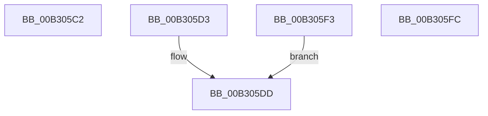

# sub_00B305C2

- RVA: `0x00B305C2`–`0x00B30604` (길이 `66` bytes)
- VA: `0x0000000140B305C2`
- 실행 섹션: `PAGE`
- PDB 이름 있음: `아니요`; PDB Function 태그: `아니요`
- unwind 정보 RVA: `0x000A4008`
- 디코드: `16`개 명령, `66/66` bytes 표시
- 미해석 바이트: `0` (있으면 어셈블리에 `.byte`로 보존)

> 이 문서는 커널 이미지의 기계어와 PDB 기호를 분석해 생성했습니다. 4번과 5번은 함수 원형과 자료형을 바이너리 사용 방식에서 추정한 C 해석이며 원본 소스 복구 결과는 아닙니다.

## 1. Dependencies

- 직접 호출 지점: **1**; 고유 호출 대상: **1**
- 직접 호출자로 확인된 함수: **0**
- RIP 상대 이미지 참조: **0**

### Outgoing calls
- `0x00B305E6` → [EtwpCheckLoggerAccessAndDoRundown](../9E/EtwpCheckLoggerAccessAndDoRundown_function_009E3EFC.md) (function, `0x009E3EFC`)

### Direct callers
- 이 함수 시작 RVA로 연결되는 직접 call은 확인되지 않았습니다. 간접 호출은 완전히 역산할 수 없습니다.

### Static image references
- 디코드된 RIP-relative 메모리 참조가 없습니다.

## 2. Other-region calls and transfers

- 다른 실행 섹션으로 향하는 call: **0**
- call이 아닌 외부 분기/꼬리 이동: **3**
  - `0x00B305CE` → [EtwpEnableDisableSpecialGuids + 0xAC](../9E/EtwpEnableDisableSpecialGuids_function_009E3A88.md) (`tail-transfer`)
  - `0x00B305EE` → [EtwpEnableDisableSpecialGuids + 0xFF](../9E/EtwpEnableDisableSpecialGuids_function_009E3A88.md) (`tail-transfer`)
  - `0x00B305FF` → [EtwpEnableDisableSpecialGuids + 0xFF](../9E/EtwpEnableDisableSpecialGuids_function_009E3A88.md) (`tail-transfer`)

## 3. Assembly (complete function range)

```asm
00B305C2  41 8B 54 C0 08                  mov edx, dword ptr [r8 + rax*8 + 8]
00B305C7  49 8B 0C C0                     mov rcx, qword ptr [r8 + rax*8]
00B305CB  C1 EA 02                        shr edx, 2
00B305CE  E9 61 35 EB FF                  jmp 0x1409e3b34
00B305D3  0F B6 93 98 11 00 00            movzx edx, byte ptr [rbx + 0x1198]
00B305DA  41 8A CA                        mov cl, r10b
00B305DD  44 8A C9                        mov r9b, cl
00B305E0  45 8B C7                        mov r8d, r15d
00B305E3  48 8B CB                        mov rcx, rbx
00B305E6  E8 11 39 EB FF                  call 0x1409e3efc
00B305EB  44 8B D8                        mov r11d, eax
00B305EE  E9 94 35 EB FF                  jmp 0x1409e3b87
00B305F3  0F B6 93 98 11 00 00            movzx edx, byte ptr [rbx + 0x1198]
00B305FA  EB E1                           jmp 0x140b305dd
00B305FC  44 8B D9                        mov r11d, ecx
00B305FF  E9 83 35 EB FF                  jmp 0x1409e3b87
```

## 4. C-style interpretation (structured pseudocode)

```c
__int64 __fastcall sub_00B305C2(__int64 a1, __int64 a2, __int64 a3)
{
    a2 = (unsigned int)(((unsigned int)(*(unsigned int *)(a3 + result * 8 + 8))) >> (2));
}
```

## 5. (Beta) C Style

```c
int64_t sub_00B305C2(int64_t Arg1, int64_t Arg2, void *Arg3)
{
    uint8_t *arg3 = (uint8_t *)Arg3;

    Arg2 = (uint32_t)(((uint32_t)(*(uint32_t *)(arg3 + result * 8 + 0x8))) >> (2));
}
```

### 관측된 메모리 오프셋

구조체 형식이 확인되지 않은 접근은 인자 기준의 오프셋으로만 기록했습니다.

| 기준 인자 | 오프셋 표현 | 폭 (bit) | 접근 |
|---|---:|---:|---|
| `Arg3` | `+ 0x0 + rax*8` | `64` | `R` |
| `Arg3` | `+ 0x8 + rax*8` | `32` | `R` |

## 6. Execution-region graph

[열기: 2D/3D 그래프와 함수 탐색 컨트롤 패널](../../../control-panel.html?section=page&rva=0x00B305C2&view=graph)

- 2D 그래프는 위에서 아래로 흐르고, 3D 그래프는 빈 공간을 드래그해 회전합니다. Shift+드래그는 이동, 휠은 확대·축소, 함수 노드 선택은 대상 보고서 이동입니다.

### Static fallback


