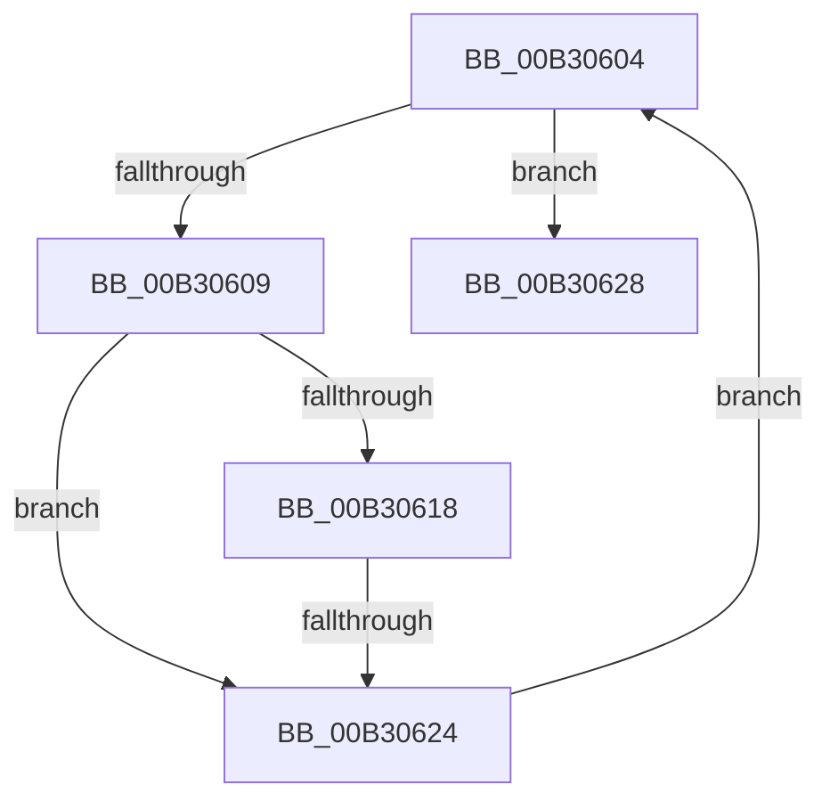

# sub_00B30604

- RVA: `0x00B30604`–`0x00B3066D` (길이 `105` bytes)
- VA: `0x0000000140B30604`
- 실행 섹션: `PAGE`
- PDB 이름 있음: `아니요`; PDB Function 태그: `아니요`
- unwind 정보 RVA: `0x000A4054`
- 디코드: `29`개 명령, `105/105` bytes 표시
- 미해석 바이트: `0` (있으면 어셈블리에 `.byte`로 보존)

> 이 문서는 커널 이미지의 기계어와 PDB 기호를 분석해 생성했습니다. 4번과 5번은 함수 원형과 자료형을 바이너리 사용 방식에서 추정한 C 해석이며 원본 소스 복구 결과는 아닙니다.

## 1. Dependencies

- 직접 호출 지점: **2**; 고유 호출 대상: **2**
- 직접 호출자로 확인된 함수: **0**
- RIP 상대 이미지 참조: **0**

### Outgoing calls
- `0x00B30633` → [memcpy](../../text/6C/memcpy_function_006C6840.md) (function, `0x006C6840`)
- `0x00B30662` → [EtwpLogKernelTraceRundown](../9E/EtwpLogKernelTraceRundown_function_009E400C.md) (function, `0x009E400C`)

### Direct callers
- 이 함수 시작 RVA로 연결되는 직접 call은 확인되지 않았습니다. 간접 호출은 완전히 역산할 수 없습니다.

### Static image references
- 디코드된 RIP-relative 메모리 참조가 없습니다.

## 2. Other-region calls and transfers

- 다른 실행 섹션으로 향하는 call: **1**
  - `0x00B30633` → [memcpy](../../text/6C/memcpy_function_006C6840.md) (`PAGE` → `.text`)
- call이 아닌 외부 분기/꼬리 이동: **2**
  - `0x00B3061E` → [EtwpCheckGuidAccessAndDoRundown + 0xBA](../9E/EtwpCheckGuidAccessAndDoRundown_function_009E3E18.md) (`tail-transfer`)
  - `0x00B30668` → [EtwpCheckGuidAccessAndDoRundown + 0x93](../9E/EtwpCheckGuidAccessAndDoRundown_function_009E3E18.md) (`tail-transfer`)

## 3. Assembly (complete function range)

```asm
00B30604  41 3B CE                        cmp ecx, r14d
00B30607  73 1F                           jae 0x140b30628
00B30609  8B C1                           mov eax, ecx
00B3060B  48 03 C0                        add rax, rax
00B3060E  81 7C C7 0C 04 00 00 80         cmp dword ptr [rdi + rax*8 + 0xc], 0x80000004
00B30616  75 0C                           jne 0x140b30624
00B30618  8B 44 C7 08                     mov eax, dword ptr [rdi + rax*8 + 8]
00B3061C  A8 03                           test al, 3
00B3061E  0F 85 AE 38 EB FF               jne 0x1409e3ed2
00B30624  FF C1                           inc ecx
00B30626  EB DC                           jmp 0x140b30604
00B30628  4C 8B C2                        mov r8, rdx
00B3062B  48 8D 4C 24 30                  lea rcx, [rsp + 0x30]
00B30630  48 8B 17                        mov rdx, qword ptr [rdi]
00B30633  E8 08 62 B9 FF                  call 0x1406c6840
00B30638  41 83 FE 01                     cmp r14d, 1
00B3063C  41 8D 4E FF                     lea ecx, [r14 - 1]
00B30640  48 8D 47 10                     lea rax, [rdi + 0x10]
00B30644  45 8A CF                        mov r9b, r15b
00B30647  41 0F 46 CD                     cmovbe ecx, r13d
00B3064B  4C 8D 44 24 30                  lea r8, [rsp + 0x30]
00B30650  89 4C 24 28                     mov dword ptr [rsp + 0x28], ecx
00B30654  49 0F 46 C5                     cmovbe rax, r13
00B30658  48 8B CE                        mov rcx, rsi
00B3065B  48 89 44 24 20                  mov qword ptr [rsp + 0x20], rax
00B30660  8B D5                           mov edx, ebp
00B30662  E8 A5 39 EB FF                  call 0x1409e400c
00B30667  90                              nop
00B30668  E9 3E 38 EB FF                  jmp 0x1409e3eab
```

## 4. C-style interpretation (structured pseudocode)

```c
__int64 __fastcall sub_00B30604(int a1, __int64 a2, __int64 a3, __int64 a4, __int64 a5, __int64 a6)
{
    __int64 result;
    unsigned __int64 v_stack_p20;
    unsigned int v_stack_p28;

    if (a1 >= ((unsigned int)(v_r14))) goto loc_00B30628;
    result = ((unsigned int)(a1)) + ((unsigned int)(a1));
    if ((*(unsigned int *)(v_rdi + result * 8 + 12)) != 0x80000004ULL) goto loc_00B30624;
loc_00B30624:
    a1 = (unsigned int)((a1) + 1);
    goto loc_00B30604;
loc_00B30628:
    result = memcpy(a6, *(unsigned __int64 *)(v_rdi), a2, a4);
    a1 = v_r14 - 1;
    if (((unsigned int)(v_r14)) <= 1) { a1 = (unsigned int)(v_r13); }
    v_stack_p28 = a1;
    result = v_rdi + 16;
    if (((unsigned int)(v_r14)) <= 1) { result = v_r13; }
    v_stack_p20 = result;
    result = EtwpLogKernelTraceRundown(v_rsi, (unsigned int)((unsigned int)(v_rbp)), a6, (unsigned __int8)(v_r15));
}
```

## 5. (Beta) C Style

```c
int64_t sub_00B30604(int32_t Arg1, int64_t Arg2, int64_t Arg3, int64_t Arg4, uint64_t Arg5, int64_t Arg6)
{
    int64_t result;
    uint64_t v_stack_p20;
    uint32_t v_stack_p28;

    if (Arg1 >= ((uint32_t)(local_r14))) goto loc_00B30628;
    result = ((uint32_t)(Arg1)) + ((uint32_t)(Arg1));
    if ((*(uint32_t *)(local_rdi + result * 8 + 0xC)) != 0x80000004ULL) goto loc_00B30624;
loc_00B30624:
    Arg1 = (uint32_t)((Arg1) + 1);
    goto loc_00B30604;
loc_00B30628:
    result = memcpy(Arg6, *(uint64_t *)(local_rdi), Arg2, Arg4);
    Arg1 = local_r14 - 1;
    if (((uint32_t)(local_r14)) <= 1) { Arg1 = (uint32_t)(local_r13); }
    v_stack_p28 = Arg1;
    result = local_rdi + 16;
    if (((uint32_t)(local_r14)) <= 1) { result = local_r13; }
    v_stack_p20 = result;
    result = EtwpLogKernelTraceRundown(local_rsi, (uint32_t)((uint32_t)(local_rbp)), Arg6, (uint8_t)(local_r15));
}
```

## 6. Execution-region graph

[열기: 2D/3D 그래프와 함수 탐색 컨트롤 패널](../../../control-panel.html?section=page&rva=0x00B30604&view=graph)

- 2D 그래프는 위에서 아래로 흐르고, 3D 그래프는 빈 공간을 드래그해 회전합니다. Shift+드래그는 이동, 휠은 확대·축소, 함수 노드 선택은 대상 보고서 이동입니다.

### Static fallback


