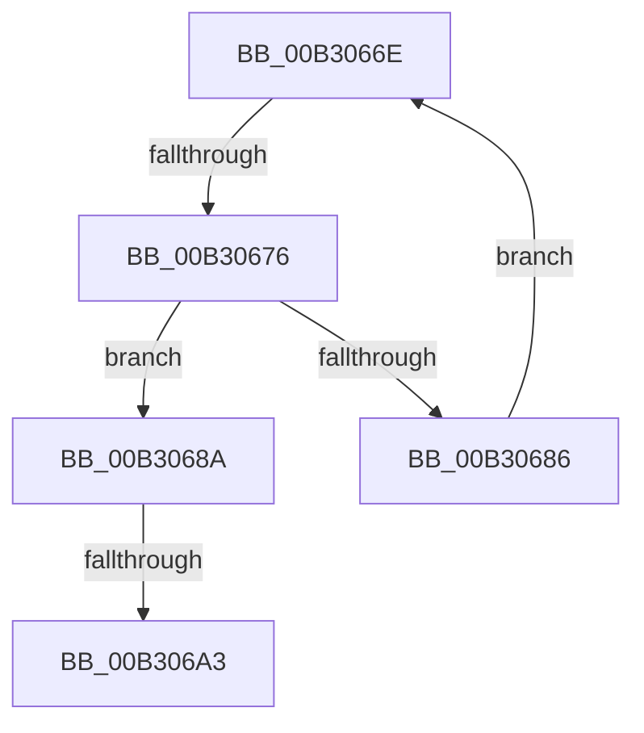

# sub_00B3066E

- RVA: `0x00B3066E`–`0x00B306B6` (길이 `72` bytes)
- VA: `0x0000000140B3066E`
- 실행 섹션: `PAGE`
- PDB 이름 있음: `아니요`; PDB Function 태그: `아니요`
- unwind 정보 RVA: `0x000A40D0`
- 디코드: `20`개 명령, `72/72` bytes 표시
- 미해석 바이트: `0` (있으면 어셈블리에 `.byte`로 보존)

> 이 문서는 커널 이미지의 기계어와 PDB 기호를 분석해 생성했습니다. 4번과 5번은 함수 원형과 자료형을 바이너리 사용 방식에서 추정한 C 해석이며 원본 소스 복구 결과는 아닙니다.

## 1. Dependencies

- 직접 호출 지점: **2**; 고유 호출 대상: **2**
- 직접 호출자로 확인된 함수: **0**
- RIP 상대 이미지 참조: **0**

### Outgoing calls
- `0x00B30693` → [PsLookupProcessByProcessId](../8A/PsLookupProcessByProcessId_function_008A2AA0.md) (function, `0x008A2AA0`)
- `0x00B306AB` → [EtwpProcessEnumCallback](../8A/EtwpProcessEnumCallback_function_008A5F40.md) (function, `0x008A5F40`)

### Direct callers
- 이 함수 시작 RVA로 연결되는 직접 call은 확인되지 않았습니다. 간접 호출은 완전히 역산할 수 없습니다.

### Static image references
- 디코드된 RIP-relative 메모리 참조가 없습니다.

## 2. Other-region calls and transfers

- 다른 실행 섹션으로 향하는 call: **0**
- call이 아닌 외부 분기/꼬리 이동: **3**
  - `0x00B30670` → [EtwpProcessThreadImageRundown + 0x99](../9E/EtwpProcessThreadImageRundown_function_009E4568.md) (`tail-transfer`)
  - `0x00B3069D` → [EtwpProcessThreadImageRundown + 0xB9](../9E/EtwpProcessThreadImageRundown_function_009E4568.md) (`tail-transfer`)
  - `0x00B306B1` → [EtwpProcessThreadImageRundown + 0xB9](../9E/EtwpProcessThreadImageRundown_function_009E4568.md) (`tail-transfer`)

## 3. Assembly (complete function range)

```asm
00B3066E  3B CA                           cmp ecx, edx
00B30670  0F 83 8B 3F EB FF               jae 0x1409e4601
00B30676  8B C1                           mov eax, ecx
00B30678  48 03 C0                        add rax, rax
00B3067B  41 81 7C C6 0C 04 00 00 80      cmp dword ptr [r14 + rax*8 + 0xc], 0x80000004
00B30684  74 04                           je 0x140b3068a
00B30686  FF C1                           inc ecx
00B30688  EB E4                           jmp 0x140b3066e
00B3068A  49 8B 06                        mov rax, qword ptr [r14]
00B3068D  48 8D 55 20                     lea rdx, [rbp + 0x20]
00B30691  8B 08                           mov ecx, dword ptr [rax]
00B30693  E8 08 24 D7 FF                  call 0x1408a2aa0
00B30698  44 8B F8                        mov r15d, eax
00B3069B  85 C0                           test eax, eax
00B3069D  0F 88 7E 3F EB FF               js 0x1409e4621
00B306A3  48 8B 4D 20                     mov rcx, qword ptr [rbp + 0x20]
00B306A7  48 8D 55 B0                     lea rdx, [rbp - 0x50]
00B306AB  E8 90 58 D7 FF                  call 0x1408a5f40
00B306B0  90                              nop
00B306B1  E9 6B 3F EB FF                  jmp 0x1409e4621
```

## 4. C-style interpretation (structured pseudocode)

```c
__int64 __fastcall sub_00B3066E(int a1, int a2)
{
    __int64 result;

    result = ((unsigned int)(a1)) + ((unsigned int)(a1));
    if ((*(unsigned int *)(v_r14 + result * 8 + 12)) == 0x80000004ULL) goto loc_00B3068A;
    a1 = (unsigned int)((a1) + 1);
    goto loc_00B3066E;
loc_00B3068A:
    result = PsLookupProcessByProcessId((unsigned int)(*(unsigned int *)(*(unsigned __int64 *)(v_r14))), v_rbp + 32, a3, a4);
    result = EtwpProcessEnumCallback(*(unsigned __int64 *)(v_rbp + 32), v_rbp - 80, a3, a4);
}
```

## 5. (Beta) C Style

```c
int64_t sub_00B3066E(int32_t Arg1, int32_t Arg2)
{
    int64_t result;

    result = ((uint32_t)(Arg1)) + ((uint32_t)(Arg1));
    if ((*(uint32_t *)(local_r14 + result * 8 + 0xC)) == 0x80000004ULL) goto loc_00B3068A;
    Arg1 = (uint32_t)((Arg1) + 1);
    goto loc_00B3066E;
loc_00B3068A:
    result = PsLookupProcessByProcessId((uint32_t)(*(uint32_t *)(*(uint64_t *)(local_r14))), local_rbp + 32, a3, a4);
    result = EtwpProcessEnumCallback(*(uint64_t *)(local_rbp + 0x20), local_rbp - 80, a3, a4);
}
```

## 6. Execution-region graph

[열기: 2D/3D 그래프와 함수 탐색 컨트롤 패널](../../../control-panel.html?section=page&rva=0x00B3066E&view=graph)

- 2D 그래프는 위에서 아래로 흐르고, 3D 그래프는 빈 공간을 드래그해 회전합니다. Shift+드래그는 이동, 휠은 확대·축소, 함수 노드 선택은 대상 보고서 이동입니다.

### Static fallback


