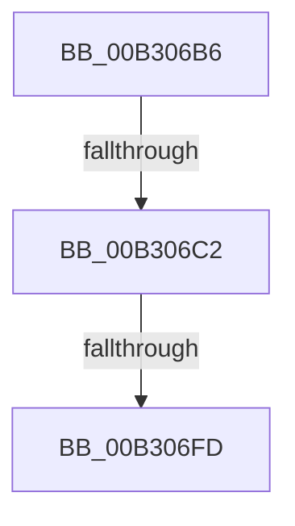

# sub_00B306B6

- RVA: `0x00B306B6`–`0x00B3070F` (길이 `89` bytes)
- VA: `0x0000000140B306B6`
- 실행 섹션: `PAGE`
- PDB 이름 있음: `아니요`; PDB Function 태그: `아니요`
- unwind 정보 RVA: `0x000A4740`
- 디코드: `20`개 명령, `89/89` bytes 표시
- 미해석 바이트: `0` (있으면 어셈블리에 `.byte`로 보존)

> 이 문서는 커널 이미지의 기계어와 PDB 기호를 분석해 생성했습니다. 4번과 5번은 함수 원형과 자료형을 바이너리 사용 방식에서 추정한 C 해석이며 원본 소스 복구 결과는 아닙니다.

## 1. Dependencies

- 직접 호출 지점: **1**; 고유 호출 대상: **1**
- 직접 호출자로 확인된 함수: **0**
- RIP 상대 이미지 참조: **0**

### Outgoing calls
- `0x00B306EF` → [memcpy](../../text/6C/memcpy_function_006C6840.md) (function, `0x006C6840`)

### Direct callers
- 이 함수 시작 RVA로 연결되는 직접 call은 확인되지 않았습니다. 간접 호출은 완전히 역산할 수 없습니다.

### Static image references
- 디코드된 RIP-relative 메모리 참조가 없습니다.

## 2. Other-region calls and transfers

- 다른 실행 섹션으로 향하는 call: **1**
  - `0x00B306EF` → [memcpy](../../text/6C/memcpy_function_006C6840.md) (`PAGE` → `.text`)
- call이 아닌 외부 분기/꼬리 이동: **3**
  - `0x00B306BC` → [PspCaptureUserProcessParameters + 0x567](../9E/PspCaptureUserProcessParameters_function_009E63C0.md) (`tail-transfer`)
  - `0x00B306F7` → [PspCaptureUserProcessParameters + 0x567](../9E/PspCaptureUserProcessParameters_function_009E63C0.md) (`tail-transfer`)
  - `0x00B3070A` → [PspCaptureUserProcessParameters + 0x567](../9E/PspCaptureUserProcessParameters_function_009E63C0.md) (`tail-transfer`)

## 3. Assembly (complete function range)

```asm
00B306B6  41 8B 47 04                     mov eax, dword ptr [r15 + 4]
00B306BA  A8 01                           test al, 1
00B306BC  0F 84 65 62 EB FF               je 0x1409e6927
00B306C2  48 83 C6 03                     add rsi, 3
00B306C6  48 83 E6 FC                     and rsi, 0xfffffffffffffffc
00B306CA  48 89 74 24 20                  mov qword ptr [rsp + 0x20], rsi
00B306CF  48 89 B7 30 04 00 00            mov qword ptr [rdi + 0x430], rsi
00B306D6  41 8B 47 30                     mov eax, dword ptr [r15 + 0x30]
00B306DA  89 87 38 04 00 00               mov dword ptr [rdi + 0x438], eax
00B306E0  45 8B 47 30                     mov r8d, dword ptr [r15 + 0x30]
00B306E4  49 C1 E0 03                     shl r8, 3
00B306E8  49 8B 57 28                     mov rdx, qword ptr [r15 + 0x28]
00B306EC  48 8B CE                        mov rcx, rsi
00B306EF  E8 4C 61 B9 FF                  call 0x1406c6840
00B306F4  48 85 F6                        test rsi, rsi
00B306F7  0F 84 2A 62 EB FF               je 0x1409e6927
00B306FD  41 8B 47 30                     mov eax, dword ptr [r15 + 0x30]
00B30701  48 8D 34 C6                     lea rsi, [rsi + rax*8]
00B30705  48 89 74 24 20                  mov qword ptr [rsp + 0x20], rsi
00B3070A  E9 18 62 EB FF                  jmp 0x1409e6927
```

## 4. C-style interpretation (structured pseudocode)

```c
__int64 __fastcall sub_00B306B6(void)
{
    __int64 result;
    __int64 v_rsi;
    unsigned __int64 v_stack_p20;

    v_rsi = (v_rsi) + (3);
    v_rsi = (v_rsi) & (-4);
    v_stack_p20 = v_rsi;
    *(unsigned __int64 *)(v_rdi + 1072) = v_rsi;
    *(unsigned int *)(v_rdi + 1080) = (unsigned int)((unsigned int)(*(unsigned int *)(v_r15 + 48)));
    a3 = ((unsigned int)(*(unsigned int *)(v_r15 + 48))) << (3);
    result = memcpy(v_rsi, *(unsigned __int64 *)(v_r15 + 40), a3, a4);
    v_stack_p20 = v_rsi + (unsigned int)(*(unsigned int *)(v_r15 + 48)) * 8;
}
```

## 5. (Beta) C Style

```c
void sub_00B306B6(void)
{
    int64_t result;
    int64_t local_rsi;
    uint64_t v_stack_p20;

    local_rsi = (local_rsi) + (3);
    local_rsi = (local_rsi) & (-4);
    v_stack_p20 = local_rsi;
    *(uint64_t *)(local_rdi + 0x430) = local_rsi;
    *(uint32_t *)(local_rdi + 0x438) = (uint32_t)((uint32_t)(*(uint32_t *)(local_r15 + 0x30)));
    a3 = ((uint32_t)(*(uint32_t *)(local_r15 + 0x30))) << (3);
    result = memcpy(local_rsi, *(uint64_t *)(local_r15 + 0x28), a3, a4);
    v_stack_p20 = local_rsi + (uint32_t)(*(uint32_t *)(local_r15 + 0x30)) * 8;
}
```

## 6. Execution-region graph

[열기: 2D/3D 그래프와 함수 탐색 컨트롤 패널](../../../control-panel.html?section=page&rva=0x00B306B6&view=graph)

- 2D 그래프는 위에서 아래로 흐르고, 3D 그래프는 빈 공간을 드래그해 회전합니다. Shift+드래그는 이동, 휠은 확대·축소, 함수 노드 선택은 대상 보고서 이동입니다.

### Static fallback


