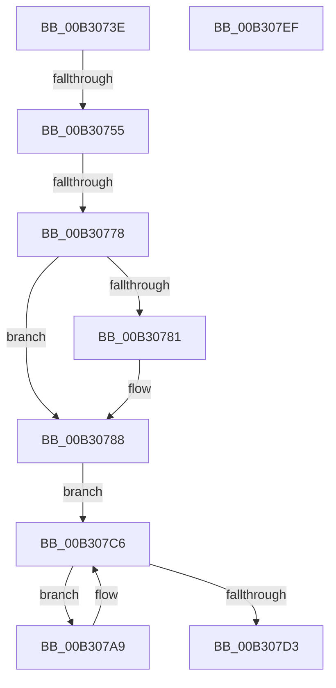

# sub_00B3073E

- RVA: `0x00B3073E`–`0x00B307F0` (길이 `178` bytes)
- VA: `0x0000000140B3073E`
- 실행 섹션: `PAGE`
- PDB 이름 있음: `아니요`; PDB Function 태그: `아니요`
- unwind 정보 RVA: `0x000A4CC8`
- 디코드: `50`개 명령, `178/178` bytes 표시
- 미해석 바이트: `0` (있으면 어셈블리에 `.byte`로 보존)

> 이 문서는 커널 이미지의 기계어와 PDB 기호를 분석해 생성했습니다. 4번과 5번은 함수 원형과 자료형을 바이너리 사용 방식에서 추정한 C 해석이며 원본 소스 복구 결과는 아닙니다.

## 1. Dependencies

- 직접 호출 지점: **8**; 고유 호출 대상: **7**
- 직접 호출자로 확인된 함수: **0**
- RIP 상대 이미지 참조: **1**

### Outgoing calls
- `0x00B30746` → [CmpGlobalLockKeyForWrite](../A7/CmpGlobalLockKeyForWrite_function_00A7CD88.md) (function, `0x00A7CD88`)
- `0x00B30761` → [CmpLockSiloKeyLockTrackerExclusive](../8F/CmpLockSiloKeyLockTrackerExclusive_function_008F9EF8.md) (function, `0x008F9EF8`)
- `0x00B30769` → [CmpPerformSiloKeyLockTrackerEnabledCheck](../70/CmpPerformSiloKeyLockTrackerEnabledCheck_function_00704AAC.md) (function, `0x00704AAC`)
- `0x00B30796` → [CmpUnlockSiloKeyLockTracker](../9E/CmpUnlockSiloKeyLockTracker_function_009E8050.md) (function, `0x009E8050`)
- `0x00B3079E` → [CmpUnlockKcb](../../pagecmrc/BC/CmpUnlockKcb_function_00BC92C0.md) (function, `0x00BC92C0`)
- `0x00B307AC` → [CmpLockKcbExclusive](../86/CmpLockKcbExclusive_function_00861EB0.md) (function, `0x00861EB0`)
- `0x00B307BD` → [CmpUnlockKcb](../../pagecmrc/BC/CmpUnlockKcb_function_00BC92C0.md) (function, `0x00BC92C0`)
- `0x00B307D5` → [CmpUnlockRegistry](../../pagecmrc/BC/CmpUnlockRegistry_function_00BC9A84.md) (function, `0x00BC9A84`)

### Direct callers
- 이 함수 시작 RVA로 연결되는 직접 call은 확인되지 않았습니다. 간접 호출은 완전히 역산할 수 없습니다.

### Static image references
- `0x00B307C6` → RVA `0x00FD9A90` (`PAGEDATA`; read)

## 2. Other-region calls and transfers

- 다른 실행 섹션으로 향하는 call: **3**
  - `0x00B3079E` → [CmpUnlockKcb](../../pagecmrc/BC/CmpUnlockKcb_function_00BC92C0.md) (`PAGE` → `PAGECMRC`)
  - `0x00B307BD` → [CmpUnlockKcb](../../pagecmrc/BC/CmpUnlockKcb_function_00BC92C0.md) (`PAGE` → `PAGECMRC`)
  - `0x00B307D5` → [CmpUnlockRegistry](../../pagecmrc/BC/CmpUnlockRegistry_function_00BC9A84.md) (`PAGE` → `PAGECMRC`)
- call이 아닌 외부 분기/꼬리 이동: **2**
  - `0x00B3074F` → [CmLockKeyForWrite + 0x111](../9E/CmLockKeyForWrite_function_009E7EE8.md) (`tail-transfer`)
  - `0x00B30772` → [CmLockKeyForWrite + 0xD8](../9E/CmLockKeyForWrite_function_009E7EE8.md) (`tail-transfer`)

## 3. Assembly (complete function range)

```asm
00B3073E  48 8D 54 24 48                  lea rdx, [rsp + 0x48]
00B30743  48 8B CD                        mov rcx, rbp
00B30746  E8 3D C6 F4 FF                  call 0x140a7cd88
00B3074B  8B D8                           mov ebx, eax
00B3074D  85 C0                           test eax, eax
00B3074F  0F 88 A4 78 EB FF               js 0x1409e7ff9
00B30755  48 8B 44 24 48                  mov rax, qword ptr [rsp + 0x48]
00B3075A  48 8B CF                        mov rcx, rdi
00B3075D  48 89 46 18                     mov qword ptr [rsi + 0x18], rax
00B30761  E8 92 97 DC FF                  call 0x1408f9ef8
00B30766  48 8B CF                        mov rcx, rdi
00B30769  E8 3E 43 BD FF                  call 0x140704aac
00B3076E  8B D8                           mov ebx, eax
00B30770  85 C0                           test eax, eax
00B30772  0F 88 48 78 EB FF               js 0x1409e7fc0
00B30778  49 8B 46 08                     mov rax, qword ptr [r14 + 8]
00B3077C  4C 39 30                        cmp qword ptr [rax], r14
00B3077F  74 07                           je 0x140b30788
00B30781  B9 03 00 00 00                  mov ecx, 3
00B30786  CD 29                           int 0x29
00B30788  4C 89 36                        mov qword ptr [rsi], r14
00B3078B  48 89 46 08                     mov qword ptr [rsi + 8], rax
00B3078F  48 89 30                        mov qword ptr [rax], rsi
00B30792  49 89 76 08                     mov qword ptr [r14 + 8], rsi
00B30796  E8 B5 78 EB FF                  call 0x1409e8050
00B3079B  48 8B CD                        mov rcx, rbp
00B3079E  E8 1D 8B 09 00                  call 0x140bc92c0
00B307A3  48 8B 5D 48                     mov rbx, qword ptr [rbp + 0x48]
00B307A7  EB 1D                           jmp 0x140b307c6
00B307A9  48 8B CB                        mov rcx, rbx
00B307AC  E8 FF 16 D3 FF                  call 0x140861eb0
00B307B1  B8 00 01 00 00                  mov eax, 0x100
00B307B6  48 8B CB                        mov rcx, rbx
00B307B9  66 09 43 08                     or word ptr [rbx + 8], ax
00B307BD  E8 FE 8A 09 00                  call 0x140bc92c0
00B307C2  48 8B 5B 48                     mov rbx, qword ptr [rbx + 0x48]
00B307C6  48 8B 05 C3 92 4A 00            mov rax, qword ptr [rip + 0x4a92c3]
00B307CD  48 39 43 20                     cmp qword ptr [rbx + 0x20], rax
00B307D1  75 D6                           jne 0x140b307a9
00B307D3  33 DB                           xor ebx, ebx
00B307D5  E8 AA 92 09 00                  call 0x140bc9a84
00B307DA  48 8B 6C 24 58                  mov rbp, qword ptr [rsp + 0x58]
00B307DF  8B C3                           mov eax, ebx
00B307E1  48 8B 5C 24 40                  mov rbx, qword ptr [rsp + 0x40]
00B307E6  48 83 C4 20                     add rsp, 0x20
00B307EA  41 5E                           pop r14
00B307EC  5F                              pop rdi
00B307ED  5E                              pop rsi
00B307EE  C3                              ret
00B307EF  CC                              int3
```

## 4. C-style interpretation (structured pseudocode)

```c
__int64 __fastcall sub_00B3073E(__int64 a1, __int64 a2, __int64 a3, __int64 a4, __int64 a5, __int64 a6, __int64 a7, __int64 a8, __int64 a9, __int64 a10, __int64 a11)
{
    __int64 result;
    __int64 v_rbx;
    __int64 v_rsp;

    result = CmpGlobalLockKeyForWrite(v_rbp, a9, a3, a4);
    *(unsigned __int64 *)(v_rsi + 24) = a9;
    result = CmpLockSiloKeyLockTrackerExclusive(v_rdi, a9, a3, a4);
    result = CmpPerformSiloKeyLockTrackerEnabledCheck(v_rdi, a9, a3, a4);
    if ((*(unsigned __int64 *)(*(unsigned __int64 *)(v_r14 + 8))) != v_r14) {
        a1 = 3;
    }
    *(unsigned __int64 *)(v_rsi) = v_r14;
    *(unsigned __int64 *)(v_rsi + 8) = *(unsigned __int64 *)(v_r14 + 8);
    *(unsigned __int64 *)(*(unsigned __int64 *)(v_r14 + 8)) = v_rsi;
    *(unsigned __int64 *)(v_r14 + 8) = v_rsi;
    result = CmpUnlockSiloKeyLockTracker(a1, a9, a3, a4);
    result = CmpUnlockKcb(v_rbp, a9, a3, a4);
    goto loc_00B307C6;
loc_00B307A9:
    result = CmpLockKcbExclusive(*(unsigned __int64 *)(v_rbp + 72), a9, a3, a4);
    result = CmpUnlockKcb(*(unsigned __int64 *)(v_rbp + 72), a9, a3, a4);
loc_00B307C6:
    if ((*(unsigned __int64 *)(*(unsigned __int64 *)(*(unsigned __int64 *)(v_rbp + 72) + 72) + 32)) != (*(unsigned __int64 *)(v_rip + 4887235))) goto loc_00B307A9;
    v_rbx = 0;
    result = CmpUnlockRegistry(*(unsigned __int64 *)(v_rbp + 72), a9, a3, a4);
    v_rsp = (v_rsp) + (32);
    return 0;
}
```

## 5. (Beta) C Style

```c
int64_t sub_00B3073E(int64_t Arg1, int64_t Arg2, int64_t Arg3, int64_t Arg4, uint64_t Arg5, uint64_t Arg6, uint64_t Arg7, int64_t Arg8, int64_t Arg9, uint64_t Arg10, int64_t Arg11)
{
    int64_t result;
    int64_t local_rbx;
    int64_t local_rsp;

    result = CmpGlobalLockKeyForWrite(local_rbp, Arg9, Arg3, Arg4);
    *(uint64_t *)(local_rsi + 0x18) = Arg9;
    result = CmpLockSiloKeyLockTrackerExclusive(local_rdi, Arg9, Arg3, Arg4);
    result = CmpPerformSiloKeyLockTrackerEnabledCheck(local_rdi, Arg9, Arg3, Arg4);
    if ((*(uint64_t *)(*(uint64_t *)(local_r14 + 0x8))) != local_r14) {
        Arg1 = 3;
    }
    *(uint64_t *)(local_rsi) = local_r14;
    *(uint64_t *)(local_rsi + 0x8) = *(uint64_t *)(local_r14 + 0x8);
    *(uint64_t *)(*(uint64_t *)(local_r14 + 0x8)) = local_rsi;
    *(uint64_t *)(local_r14 + 0x8) = local_rsi;
    result = CmpUnlockSiloKeyLockTracker(Arg1, Arg9, Arg3, Arg4);
    result = CmpUnlockKcb(local_rbp, Arg9, Arg3, Arg4);
    goto loc_00B307C6;
loc_00B307A9:
    result = CmpLockKcbExclusive(*(uint64_t *)(local_rbp + 0x48), Arg9, Arg3, Arg4);
    result = CmpUnlockKcb(*(uint64_t *)(local_rbp + 0x48), Arg9, Arg3, Arg4);
loc_00B307C6:
    if ((*(uint64_t *)(*(uint64_t *)(*(uint64_t *)(local_rbp + 0x48) + 0x48) + 0x20)) != (*(uint64_t *)(v_rip + 0x4A92C3))) goto loc_00B307A9;
    local_rbx = 0;
    result = CmpUnlockRegistry(*(uint64_t *)(local_rbp + 0x48), Arg9, Arg3, Arg4);
    local_rsp = (local_rsp) + (32);
    return 0;
}
```

## 6. Execution-region graph

[열기: 2D/3D 그래프와 함수 탐색 컨트롤 패널](../../../control-panel.html?section=page&rva=0x00B3073E&view=graph)

- 2D 그래프는 위에서 아래로 흐르고, 3D 그래프는 빈 공간을 드래그해 회전합니다. Shift+드래그는 이동, 휠은 확대·축소, 함수 노드 선택은 대상 보고서 이동입니다.

### Static fallback


