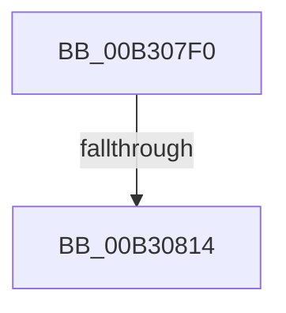

# sub_00B307F0

- RVA: `0x00B307F0`–`0x00B3081E` (길이 `46` bytes)
- VA: `0x0000000140B307F0`
- 실행 섹션: `PAGE`
- PDB 이름 있음: `아니요`; PDB Function 태그: `아니요`
- unwind 정보 RVA: `0x000A4D0C`
- 디코드: `10`개 명령, `46/46` bytes 표시
- 미해석 바이트: `0` (있으면 어셈블리에 `.byte`로 보존)

> 이 문서는 커널 이미지의 기계어와 PDB 기호를 분석해 생성했습니다. 4번과 5번은 함수 원형과 자료형을 바이너리 사용 방식에서 추정한 C 해석이며 원본 소스 복구 결과는 아닙니다.

## 1. Dependencies

- 직접 호출 지점: **2**; 고유 호출 대상: **2**
- 직접 호출자로 확인된 함수: **0**
- RIP 상대 이미지 참조: **0**

### Outgoing calls
- `0x00B307FF` → [PspLockJobShared](../91/PspLockJobShared_function_0091A490.md) (function, `0x0091A490`)
- `0x00B30807` → [PspJobHasChildren](../70/PspJobHasChildren_function_007051E4.md) (function, `0x007051E4`)

### Direct callers
- 이 함수 시작 RVA로 연결되는 직접 call은 확인되지 않았습니다. 간접 호출은 완전히 역산할 수 없습니다.

### Static image references
- 디코드된 RIP-relative 메모리 참조가 없습니다.

## 2. Other-region calls and transfers

- 다른 실행 섹션으로 향하는 call: **0**
- call이 아닌 외부 분기/꼬리 이동: **2**
  - `0x00B3080E` → [PsInsertPermanentSiloContextEx + 0x56](../9E/PsInsertPermanentSiloContextEx_function_009E8224.md) (`tail-transfer`)
  - `0x00B30819` → [PsInsertPermanentSiloContextEx + 0x69](../9E/PsInsertPermanentSiloContextEx_function_009E8224.md) (`tail-transfer`)

## 3. Assembly (complete function range)

```asm
00B307F0  65 48 8B 3C 25 88 01 00 00      mov rdi, qword ptr gs:[0x188]
00B307F9  48 8B CB                        mov rcx, rbx
00B307FC  48 8B D7                        mov rdx, rdi
00B307FF  E8 8C 9C DE FF                  call 0x14091a490
00B30804  48 8B CB                        mov rcx, rbx
00B30807  E8 D8 49 BD FF                  call 0x1407051e4
00B3080C  84 C0                           test al, al
00B3080E  0F 84 66 7A EB FF               je 0x1409e827a
00B30814  BE 0F 05 00 C0                  mov esi, 0xc000050f
00B30819  E9 6F 7A EB FF                  jmp 0x1409e828d
```

## 4. C-style interpretation (structured pseudocode)

```c
__int64 __fastcall sub_00B307F0(void)
{
    __int64 result;

    result = PspLockJobShared(v_rbx, *(unsigned __int64 *)(gs_base + (0 + 392)), a3, a4);
    result = PspJobHasChildren(v_rbx, *(unsigned __int64 *)(gs_base + (0 + 392)), a3, a4);
}
```

## 5. (Beta) C Style

```c
void sub_00B307F0(void)
{
    int64_t result;

    result = PspLockJobShared(local_rbx, *(uint64_t *)(gs_base + (0 + 0x188)), a3, a4);
    result = PspJobHasChildren(local_rbx, *(uint64_t *)(gs_base + (0 + 0x188)), a3, a4);
}
```

## 6. Execution-region graph

[열기: 2D/3D 그래프와 함수 탐색 컨트롤 패널](../../../control-panel.html?section=page&rva=0x00B307F0&view=graph)

- 2D 그래프는 위에서 아래로 흐르고, 3D 그래프는 빈 공간을 드래그해 회전합니다. Shift+드래그는 이동, 휠은 확대·축소, 함수 노드 선택은 대상 보고서 이동입니다.

### Static fallback


