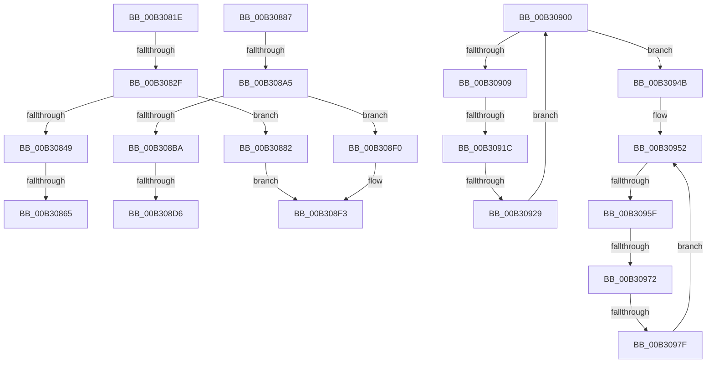

# sub_00B3081E

- RVA: `0x00B3081E`–`0x00B30993` (길이 `373` bytes)
- VA: `0x0000000140B3081E`
- 실행 섹션: `PAGE`
- PDB 이름 있음: `아니요`; PDB Function 태그: `아니요`
- unwind 정보 RVA: `0x000A5494`
- 디코드: `98`개 명령, `373/373` bytes 표시
- 미해석 바이트: `0` (있으면 어셈블리에 `.byte`로 보존)

> 이 문서는 커널 이미지의 기계어와 PDB 기호를 분석해 생성했습니다. 4번과 5번은 함수 원형과 자료형을 바이너리 사용 방식에서 추정한 C 해석이며 원본 소스 복구 결과는 아닙니다.

## 1. Dependencies

- 직접 호출 지점: **8**; 고유 호출 대상: **2**
- 직접 호출자로 확인된 함수: **0**
- RIP 상대 이미지 참조: **0**

### Outgoing calls
- `0x00B3081E` → [ExAllocatePool2](../../poolcode/B8/ExAllocatePool2_function_00B820F0.md) (function, `0x00B820F0`)
- `0x00B3083F` → [ExAllocatePool2](../../poolcode/B8/ExAllocatePool2_function_00B820F0.md) (function, `0x00B820F0`)
- `0x00B30894` → [ExAllocatePool2](../../poolcode/B8/ExAllocatePool2_function_00B820F0.md) (function, `0x00B820F0`)
- `0x00B308B0` → [ExAllocatePool2](../../poolcode/B8/ExAllocatePool2_function_00B820F0.md) (function, `0x00B820F0`)
- `0x00B308F5` → [ExFreePoolWithTag](../../poolcode/B8/ExFreePoolWithTag_function_00B82870.md) (function, `0x00B82870`)
- `0x00B30936` → [ExFreePoolWithTag](../../poolcode/B8/ExFreePoolWithTag_function_00B82870.md) (function, `0x00B82870`)
- `0x00B30940` → [ExFreePoolWithTag](../../poolcode/B8/ExFreePoolWithTag_function_00B82870.md) (function, `0x00B82870`)
- `0x00B30988` → [ExFreePoolWithTag](../../poolcode/B8/ExFreePoolWithTag_function_00B82870.md) (function, `0x00B82870`)

### Direct callers
- 이 함수 시작 RVA로 연결되는 직접 call은 확인되지 않았습니다. 간접 호출은 완전히 역산할 수 없습니다.

### Static image references
- 디코드된 RIP-relative 메모리 참조가 없습니다.

## 2. Other-region calls and transfers

- 다른 실행 섹션으로 향하는 call: **8**
  - `0x00B3081E` → [ExAllocatePool2](../../poolcode/B8/ExAllocatePool2_function_00B820F0.md) (`PAGE` → `POOLCODE`)
  - `0x00B3083F` → [ExAllocatePool2](../../poolcode/B8/ExAllocatePool2_function_00B820F0.md) (`PAGE` → `POOLCODE`)
  - `0x00B30894` → [ExAllocatePool2](../../poolcode/B8/ExAllocatePool2_function_00B820F0.md) (`PAGE` → `POOLCODE`)
  - `0x00B308B0` → [ExAllocatePool2](../../poolcode/B8/ExAllocatePool2_function_00B820F0.md) (`PAGE` → `POOLCODE`)
  - `0x00B308F5` → [ExFreePoolWithTag](../../poolcode/B8/ExFreePoolWithTag_function_00B82870.md) (`PAGE` → `POOLCODE`)
  - `0x00B30936` → [ExFreePoolWithTag](../../poolcode/B8/ExFreePoolWithTag_function_00B82870.md) (`PAGE` → `POOLCODE`)
  - `0x00B30940` → [ExFreePoolWithTag](../../poolcode/B8/ExFreePoolWithTag_function_00B82870.md) (`PAGE` → `POOLCODE`)
  - `0x00B30988` → [ExFreePoolWithTag](../../poolcode/B8/ExFreePoolWithTag_function_00B82870.md) (`PAGE` → `POOLCODE`)
- call이 아닌 외부 분기/꼬리 이동: **12**
  - `0x00B30829` → [EtwpUpdateDisallowedGuids + 0x1A5](../9E/EtwpUpdateDisallowedGuids_function_009EA8FC.md) (`tail-transfer`)
  - `0x00B3085F` → [EtwpUpdateDisallowedGuids + 0x285](../9E/EtwpUpdateDisallowedGuids_function_009EA8FC.md) (`tail-transfer`)
  - `0x00B3087D` → [EtwpUpdateDisallowedGuids + 0x17C](../9E/EtwpUpdateDisallowedGuids_function_009EA8FC.md) (`tail-transfer`)
  - `0x00B3089F` → [EtwpUpdateDisallowedGuids + 0x1A5](../9E/EtwpUpdateDisallowedGuids_function_009EA8FC.md) (`tail-transfer`)
  - `0x00B308D0` → [EtwpUpdateDisallowedGuids + 0x285](../9E/EtwpUpdateDisallowedGuids_function_009EA8FC.md) (`tail-transfer`)
  - `0x00B308EB` → [EtwpUpdateDisallowedGuids + 0x1C7](../9E/EtwpUpdateDisallowedGuids_function_009EA8FC.md) (`tail-transfer`)
  - `0x00B308FB` → [EtwpUpdateDisallowedGuids + 0x1A5](../9E/EtwpUpdateDisallowedGuids_function_009EA8FC.md) (`tail-transfer`)
  - `0x00B30916` → [EtwpUpdateDisallowedGuids + 0x285](../9E/EtwpUpdateDisallowedGuids_function_009EA8FC.md) (`tail-transfer`)
  - `0x00B30923` → [EtwpUpdateDisallowedGuids + 0x285](../9E/EtwpUpdateDisallowedGuids_function_009EA8FC.md) (`tail-transfer`)
  - `0x00B30959` → [EtwpUpdateDisallowedGuids + 0x2A9](../9E/EtwpUpdateDisallowedGuids_function_009EA8FC.md) (`tail-transfer`)
  - `0x00B3096C` → [EtwpUpdateDisallowedGuids + 0x285](../9E/EtwpUpdateDisallowedGuids_function_009EA8FC.md) (`tail-transfer`)
  - `0x00B30979` → [EtwpUpdateDisallowedGuids + 0x285](../9E/EtwpUpdateDisallowedGuids_function_009EA8FC.md) (`tail-transfer`)

## 3. Assembly (complete function range)

```asm
00B3081E  E8 CD 18 05 00                  call 0x140b820f0
00B30823  4C 8B F0                        mov r14, rax
00B30826  48 85 C0                        test rax, rax
00B30829  0F 84 72 A2 EB FF               je 0x1409eaaa1
00B3082F  BA 10 00 00 00                  mov edx, 0x10
00B30834  B9 00 01 00 00                  mov ecx, 0x100
00B30839  41 B8 45 74 77 74               mov r8d, 0x74777445
00B3083F  E8 AC 18 05 00                  call 0x140b820f0
00B30844  48 85 C0                        test rax, rax
00B30847  74 39                           je 0x140b30882
00B30849  0F 10 06                        movups xmm0, xmmword ptr [rsi]
00B3084C  48 8D 4D E0                     lea rcx, [rbp - 0x20]
00B30850  F3 0F 7F 00                     movdqu xmmword ptr [rax], xmm0
00B30854  49 89 46 10                     mov qword ptr [r14 + 0x10], rax
00B30858  48 8B 45 E8                     mov rax, qword ptr [rbp - 0x18]
00B3085C  48 39 08                        cmp qword ptr [rax], rcx
00B3085F  0F 85 1C A3 EB FF               jne 0x1409eab81
00B30865  49 89 46 08                     mov qword ptr [r14 + 8], rax
00B30869  48 8D 4D E0                     lea rcx, [rbp - 0x20]
00B3086D  49 89 0E                        mov qword ptr [r14], rcx
00B30870  4C 89 30                        mov qword ptr [rax], r14
00B30873  4C 89 75 E8                     mov qword ptr [rbp - 0x18], r14
00B30877  41 BE 10 00 00 00               mov r14d, 0x10
00B3087D  E9 F6 A1 EB FF                  jmp 0x1409eaa78
00B30882  49 8B CE                        mov rcx, r14
00B30885  EB 6C                           jmp 0x140b308f3
00B30887  45 8B C4                        mov r8d, r12d
00B3088A  BA 18 00 00 00                  mov edx, 0x18
00B3088F  B9 00 01 00 00                  mov ecx, 0x100
00B30894  E8 57 18 05 00                  call 0x140b820f0
00B30899  48 8B F8                        mov rdi, rax
00B3089C  48 85 C0                        test rax, rax
00B3089F  0F 84 FC A1 EB FF               je 0x1409eaaa1
00B308A5  45 8B C4                        mov r8d, r12d
00B308A8  49 8B D6                        mov rdx, r14
00B308AB  B9 00 01 00 00                  mov ecx, 0x100
00B308B0  E8 3B 18 05 00                  call 0x140b820f0
00B308B5  48 85 C0                        test rax, rax
00B308B8  74 36                           je 0x140b308f0
00B308BA  0F 10 06                        movups xmm0, xmmword ptr [rsi]
00B308BD  48 8D 4D E0                     lea rcx, [rbp - 0x20]
00B308C1  F3 0F 7F 00                     movdqu xmmword ptr [rax], xmm0
00B308C5  48 89 47 10                     mov qword ptr [rdi + 0x10], rax
00B308C9  48 8B 45 E8                     mov rax, qword ptr [rbp - 0x18]
00B308CD  48 39 08                        cmp qword ptr [rax], rcx
00B308D0  0F 85 AB A2 EB FF               jne 0x1409eab81
00B308D6  48 89 47 08                     mov qword ptr [rdi + 8], rax
00B308DA  48 8D 4D E0                     lea rcx, [rbp - 0x20]
00B308DE  48 89 0F                        mov qword ptr [rdi], rcx
00B308E1  49 03 F6                        add rsi, r14
00B308E4  48 89 38                        mov qword ptr [rax], rdi
00B308E7  48 89 7D E8                     mov qword ptr [rbp - 0x18], rdi
00B308EB  E9 D3 A1 EB FF                  jmp 0x1409eaac3
00B308F0  48 8B CF                        mov rcx, rdi
00B308F3  33 D2                           xor edx, edx
00B308F5  E8 76 1F 05 00                  call 0x140b82870
00B308FA  90                              nop
00B308FB  E9 A1 A1 EB FF                  jmp 0x1409eaaa1
00B30900  48 8D 4D E0                     lea rcx, [rbp - 0x20]
00B30904  48 3B C1                        cmp rax, rcx
00B30907  74 42                           je 0x140b3094b
00B30909  48 8B 06                        mov rax, qword ptr [rsi]
00B3090C  48 8B FE                        mov rdi, rsi
00B3090F  48 8B F0                        mov rsi, rax
00B30912  48 39 78 08                     cmp qword ptr [rax + 8], rdi
00B30916  0F 85 65 A2 EB FF               jne 0x1409eab81
00B3091C  48 8B 4F 08                     mov rcx, qword ptr [rdi + 8]
00B30920  48 39 39                        cmp qword ptr [rcx], rdi
00B30923  0F 85 58 A2 EB FF               jne 0x1409eab81
00B30929  48 89 01                        mov qword ptr [rcx], rax
00B3092C  33 D2                           xor edx, edx
00B3092E  48 89 48 08                     mov qword ptr [rax + 8], rcx
00B30932  48 8B 4F 10                     mov rcx, qword ptr [rdi + 0x10]
00B30936  E8 35 1F 05 00                  call 0x140b82870
00B3093B  33 D2                           xor edx, edx
00B3093D  48 8B CF                        mov rcx, rdi
00B30940  E8 2B 1F 05 00                  call 0x140b82870
00B30945  48 8B 45 E0                     mov rax, qword ptr [rbp - 0x20]
00B30949  EB B5                           jmp 0x140b30900
00B3094B  48 8B 45 F0                     mov rax, qword ptr [rbp - 0x10]
00B3094F  48 8B F8                        mov rdi, rax
00B30952  48 8D 4D F0                     lea rcx, [rbp - 0x10]
00B30956  48 3B C1                        cmp rax, rcx
00B30959  0F 84 46 A2 EB FF               je 0x1409eaba5
00B3095F  48 8B 07                        mov rax, qword ptr [rdi]
00B30962  48 8B CF                        mov rcx, rdi
00B30965  48 8B F8                        mov rdi, rax
00B30968  48 39 48 08                     cmp qword ptr [rax + 8], rcx
00B3096C  0F 85 0F A2 EB FF               jne 0x1409eab81
00B30972  48 8B 51 08                     mov rdx, qword ptr [rcx + 8]
00B30976  48 39 0A                        cmp qword ptr [rdx], rcx
00B30979  0F 85 02 A2 EB FF               jne 0x1409eab81
00B3097F  48 89 02                        mov qword ptr [rdx], rax
00B30982  48 89 50 08                     mov qword ptr [rax + 8], rdx
00B30986  33 D2                           xor edx, edx
00B30988  E8 E3 1E 05 00                  call 0x140b82870
00B3098D  48 8B 45 F0                     mov rax, qword ptr [rbp - 0x10]
00B30991  EB BF                           jmp 0x140b30952
```

## 4. C-style interpretation (structured pseudocode)

```c
__int64 __fastcall sub_00B3081E(void)
{
    __int64 result;

    result = ExAllocatePool2(a1, a2, a3, a4);
    result = ExAllocatePool2(256, 16, (unsigned int)(0x74777445ULL), a4);
    if (result == 0) goto loc_00B30882;
    *(unsigned __int64 *)(result) = v_xmm0;
    *(unsigned __int64 *)(result + 16) = result;
    *(unsigned __int64 *)(result + 8) = *(unsigned __int64 *)(v_rbp - 24);
    *(unsigned __int64 *)(result) = v_rbp - 32;
    *(unsigned __int64 *)(*(unsigned __int64 *)(v_rbp - 24)) = result;
    *(unsigned __int64 *)(v_rbp - 24) = result;
loc_00B30882:
    goto loc_00B308F3;
loc_00B308F3:
    a2 = 0;
    result = ExFreePoolWithTag(16, a2, (unsigned int)(0x74777445ULL), a4);
}
```

## 5. (Beta) C Style

```c
void sub_00B3081E(void)
{
    int64_t result;

    result = ExAllocatePool2(a1, a2, a3, a4);
    result = ExAllocatePool2(256, 16, (uint32_t)(0x74777445ULL), a4);
    if (result == 0) goto loc_00B30882;
    *(uint64_t *)(result) = v_xmm0;
    *(uint64_t *)(result + 0x10) = result;
    *(uint64_t *)(result + 0x8) = *(uint64_t *)(local_rbp - 0x18);
    *(uint64_t *)(result) = local_rbp - 32;
    *(uint64_t *)(*(uint64_t *)(local_rbp - 0x18)) = result;
    *(uint64_t *)(local_rbp - 0x18) = result;
loc_00B30882:
    goto loc_00B308F3;
loc_00B308F3:
    a2 = 0;
    result = ExFreePoolWithTag(16, a2, (uint32_t)(0x74777445ULL), a4);
}
```

## 6. Execution-region graph

[열기: 2D/3D 그래프와 함수 탐색 컨트롤 패널](../../../control-panel.html?section=page&rva=0x00B3081E&view=graph)

- 2D 그래프는 위에서 아래로 흐르고, 3D 그래프는 빈 공간을 드래그해 회전합니다. Shift+드래그는 이동, 휠은 확대·축소, 함수 노드 선택은 대상 보고서 이동입니다.

### Static fallback


