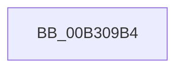

# sub_00B309B4

- RVA: `0x00B309B4`–`0x00B309F4` (길이 `64` bytes)
- VA: `0x0000000140B309B4`
- 실행 섹션: `PAGE`
- PDB 이름 있음: `아니요`; PDB Function 태그: `아니요`
- unwind 정보 RVA: `0x000A54F0`
- 디코드: `13`개 명령, `64/64` bytes 표시
- 미해석 바이트: `0` (있으면 어셈블리에 `.byte`로 보존)

> 이 문서는 커널 이미지의 기계어와 PDB 기호를 분석해 생성했습니다. 4번과 5번은 함수 원형과 자료형을 바이너리 사용 방식에서 추정한 C 해석이며 원본 소스 복구 결과는 아닙니다.

## 1. Dependencies

- 직접 호출 지점: **1**; 고유 호출 대상: **1**
- 직접 호출자로 확인된 함수: **0**
- RIP 상대 이미지 참조: **0**

### Outgoing calls
- `0x00B309E9` → [EtwpCopySchematizedFilters](../8C/EtwpCopySchematizedFilters_function_008C380C.md) (function, `0x008C380C`)

### Direct callers
- 이 함수 시작 RVA로 연결되는 직접 call은 확인되지 않았습니다. 간접 호출은 완전히 역산할 수 없습니다.

### Static image references
- 디코드된 RIP-relative 메모리 참조가 없습니다.

## 2. Other-region calls and transfers

- 다른 실행 섹션으로 향하는 call: **0**
- call이 아닌 외부 분기/꼬리 이동: **1**
  - `0x00B309EF` → [EtwpBuildNotificationPacket + 0xA7](../9E/EtwpBuildNotificationPacket_function_009EB13C.md) (`tail-transfer`)

## 3. Assembly (complete function range)

```asm
00B309B4  44 89 68 74                     mov dword ptr [rax + 0x74], r13d
00B309B8  48 8D 88 88 00 00 00            lea rcx, [rax + 0x88]
00B309BF  44 89 68 08                     mov dword ptr [rax + 8], r13d
00B309C3  45 0F B7 C4                     movzx r8d, r12w
00B309C7  44 89 78 04                     mov dword ptr [rax + 4], r15d
00B309CB  48 8B D5                        mov rdx, rbp
00B309CE  C7 80 84 00 00 00 00 00 00 80   mov dword ptr [rax + 0x84], 0x80000000
00B309D8  89 B0 80 00 00 00               mov dword ptr [rax + 0x80], esi
00B309DE  48 C7 40 78 88 00 00 00         mov qword ptr [rax + 0x78], 0x88
00B309E6  49 89 06                        mov qword ptr [r14], rax
00B309E9  E8 1E 2E D9 FF                  call 0x1408c380c
00B309EE  90                              nop
00B309EF  E9 EF A7 EB FF                  jmp 0x1409eb1e3
```

## 4. C-style interpretation (structured pseudocode)

```c
__int64 __fastcall sub_00B309B4(void)
{
    __int64 result;

    *(unsigned int *)(result + 116) = (unsigned int)(v_r13);
    *(unsigned int *)(result + 8) = (unsigned int)(v_r13);
    *(unsigned int *)(result + 4) = (unsigned int)(v_r15);
    *(unsigned int *)(result + 132) = 0x80000000ULL;
    *(unsigned int *)(result + 128) = (unsigned int)(v_rsi);
    *(unsigned __int64 *)(result + 120) = 136;
    *(unsigned __int64 *)(v_r14) = result;
    result = EtwpCopySchematizedFilters(result + 136, v_rbp, (unsigned __int16)(v_r12), a4);
}
```

## 5. (Beta) C Style

```c
void sub_00B309B4(void)
{
    int64_t result;

    *(uint32_t *)(result + 0x74) = (uint32_t)(local_r13);
    *(uint32_t *)(result + 0x8) = (uint32_t)(local_r13);
    *(uint32_t *)(result + 0x4) = (uint32_t)(local_r15);
    *(uint32_t *)(result + 0x84) = 0x80000000ULL;
    *(uint32_t *)(result + 0x80) = (uint32_t)(local_rsi);
    *(uint64_t *)(result + 0x78) = 136;
    *(uint64_t *)(local_r14) = result;
    result = EtwpCopySchematizedFilters(result + 136, local_rbp, (uint16_t)(local_r12), a4);
}
```

## 6. Execution-region graph

[열기: 2D/3D 그래프와 함수 탐색 컨트롤 패널](../../../control-panel.html?section=page&rva=0x00B309B4&view=graph)

- 2D 그래프는 위에서 아래로 흐르고, 3D 그래프는 빈 공간을 드래그해 회전합니다. Shift+드래그는 이동, 휠은 확대·축소, 함수 노드 선택은 대상 보고서 이동입니다.

### Static fallback


