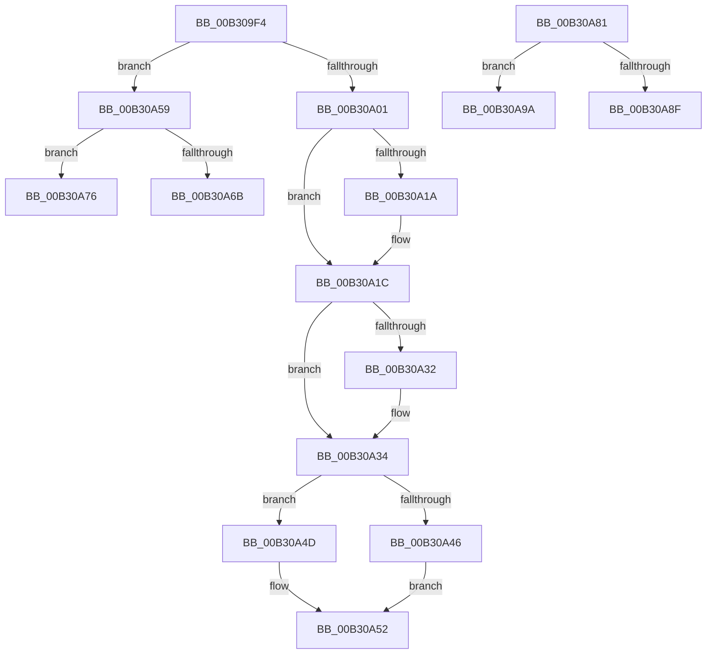

# sub_00B309F4

- RVA: `0x00B309F4`–`0x00B30AA5` (길이 `177` bytes)
- VA: `0x0000000140B309F4`
- 실행 섹션: `PAGE`
- PDB 이름 있음: `아니요`; PDB Function 태그: `아니요`
- unwind 정보 RVA: `0x000A55DC`
- 디코드: `48`개 명령, `177/177` bytes 표시
- 미해석 바이트: `0` (있으면 어셈블리에 `.byte`로 보존)

> 이 문서는 커널 이미지의 기계어와 PDB 기호를 분석해 생성했습니다. 4번과 5번은 함수 원형과 자료형을 바이너리 사용 방식에서 추정한 C 해석이며 원본 소스 복구 결과는 아닙니다.

## 1. Dependencies

- 직접 호출 지점: **7**; 고유 호출 대상: **3**
- 직접 호출자로 확인된 함수: **0**
- RIP 상대 이미지 참조: **0**

### Outgoing calls
- `0x00B309F4` → [HvpGetCellPaged](../85/HvpGetCellPaged_function_00854CB0.md) (function, `0x00854CB0`)
- `0x00B30A46` → [HvpReleaseCellFlat](../85/HvpReleaseCellFlat_function_0085CC20.md) (function, `0x0085CC20`)
- `0x00B30A4D` → [HvpReleaseCellPaged](../85/HvpReleaseCellPaged_function_00855F40.md) (function, `0x00855F40`)
- `0x00B30A6B` → [HvpReleaseCellFlat](../85/HvpReleaseCellFlat_function_0085CC20.md) (function, `0x0085CC20`)
- `0x00B30A76` → [HvpReleaseCellPaged](../85/HvpReleaseCellPaged_function_00855F40.md) (function, `0x00855F40`)
- `0x00B30A8F` → [HvpReleaseCellFlat](../85/HvpReleaseCellFlat_function_0085CC20.md) (function, `0x0085CC20`)
- `0x00B30A9A` → [HvpReleaseCellPaged](../85/HvpReleaseCellPaged_function_00855F40.md) (function, `0x00855F40`)

### Direct callers
- 이 함수 시작 RVA로 연결되는 직접 call은 확인되지 않았습니다. 간접 호출은 완전히 역산할 수 없습니다.

### Static image references
- 디코드된 RIP-relative 메모리 참조가 없습니다.

## 2. Other-region calls and transfers

- 다른 실행 섹션으로 향하는 call: **0**
- call이 아닌 외부 분기/꼬리 이동: **5**
  - `0x00B30A54` → [CmGetVisibleMaxValueNameLenAndDataLen + 0xD6](../9E/CmGetVisibleMaxValueNameLenAndDataLen_function_009EB750.md) (`tail-transfer`)
  - `0x00B30A71` → [CmGetVisibleMaxValueNameLenAndDataLen + 0xC8](../9E/CmGetVisibleMaxValueNameLenAndDataLen_function_009EB750.md) (`tail-transfer`)
  - `0x00B30A7C` → [CmGetVisibleMaxValueNameLenAndDataLen + 0xC8](../9E/CmGetVisibleMaxValueNameLenAndDataLen_function_009EB750.md) (`tail-transfer`)
  - `0x00B30A95` → [CmGetVisibleMaxValueNameLenAndDataLen + 0x5D](../9E/CmGetVisibleMaxValueNameLenAndDataLen_function_009EB750.md) (`tail-transfer`)
  - `0x00B30AA0` → [CmGetVisibleMaxValueNameLenAndDataLen + 0x5D](../9E/CmGetVisibleMaxValueNameLenAndDataLen_function_009EB750.md) (`tail-transfer`)

## 3. Assembly (complete function range)

```asm
00B309F4  E8 B7 42 D2 FF                  call 0x140854cb0
00B309F9  4C 8B C0                        mov r8, rax
00B309FC  48 85 C0                        test rax, rax
00B309FF  74 58                           je 0x140b30a59
00B30A01  0F B7 50 02                     movzx edx, word ptr [rax + 2]
00B30A05  0F B7 CA                        movzx ecx, dx
00B30A08  66 03 C9                        add cx, cx
00B30A0B  F6 40 10 01                     test byte ptr [rax + 0x10], 1
00B30A0F  66 0F 44 CA                     cmove cx, dx
00B30A13  0F B7 C1                        movzx eax, cx
00B30A16  39 06                           cmp dword ptr [rsi], eax
00B30A18  73 02                           jae 0x140b30a1c
00B30A1A  89 06                           mov dword ptr [rsi], eax
00B30A1C  41 8B 40 04                     mov eax, dword ptr [r8 + 4]
00B30A20  3D 00 00 00 80                  cmp eax, 0x80000000
00B30A25  8D 88 00 00 00 80               lea ecx, [rax - 0x80000000]
00B30A2B  0F 42 C8                        cmovb ecx, eax
00B30A2E  39 0F                           cmp dword ptr [rdi], ecx
00B30A30  73 02                           jae 0x140b30a34
00B30A32  89 0F                           mov dword ptr [rdi], ecx
00B30A34  48 8B 4B 20                     mov rcx, qword ptr [rbx + 0x20]
00B30A38  48 8D 54 24 58                  lea rdx, [rsp + 0x58]
00B30A3D  F6 81 8C 00 00 00 01            test byte ptr [rcx + 0x8c], 1
00B30A44  74 07                           je 0x140b30a4d
00B30A46  E8 D5 C1 D2 FF                  call 0x14085cc20
00B30A4B  EB 05                           jmp 0x140b30a52
00B30A4D  E8 EE 54 D2 FF                  call 0x140855f40
00B30A52  FF C5                           inc ebp
00B30A54  E9 CD AD EB FF                  jmp 0x1409eb826
00B30A59  48 8B 4B 20                     mov rcx, qword ptr [rbx + 0x20]
00B30A5D  48 8D 54 24 48                  lea rdx, [rsp + 0x48]
00B30A62  F6 81 8C 00 00 00 01            test byte ptr [rcx + 0x8c], 1
00B30A69  74 0B                           je 0x140b30a76
00B30A6B  E8 B0 C1 D2 FF                  call 0x14085cc20
00B30A70  90                              nop
00B30A71  E9 A2 AD EB FF                  jmp 0x1409eb818
00B30A76  E8 C5 54 D2 FF                  call 0x140855f40
00B30A7B  90                              nop
00B30A7C  E9 97 AD EB FF                  jmp 0x1409eb818
00B30A81  F6 81 8C 00 00 00 01            test byte ptr [rcx + 0x8c], 1
00B30A88  48 8D 54 24 48                  lea rdx, [rsp + 0x48]
00B30A8D  74 0B                           je 0x140b30a9a
00B30A8F  E8 8C C1 D2 FF                  call 0x14085cc20
00B30A94  90                              nop
00B30A95  E9 13 AD EB FF                  jmp 0x1409eb7ad
00B30A9A  E8 A1 54 D2 FF                  call 0x140855f40
00B30A9F  90                              nop
00B30AA0  E9 08 AD EB FF                  jmp 0x1409eb7ad
```

## 4. C-style interpretation (structured pseudocode)

```c
__int64 __fastcall sub_00B309F4(__int64 a1, __int64 a2, __int64 a3, __int64 a4, __int64 a5, __int64 a6, __int64 a7, __int64 a8, __int64 a9, __int64 a10, __int64 a11)
{
    __int64 result;
    __int64 v_rbp;
    unsigned __int64 v_stack_p48;

    result = HvpGetCellPaged(a1, a2, a3, a4);
    if (result == 0) goto loc_00B30A59;
    a1 = (unsigned __int16)(((unsigned __int16)(*(unsigned __int16 *)(result + 2))) + ((unsigned __int16)((unsigned __int16)(*(unsigned __int16 *)(result + 2)))));
    if (((*(unsigned __int8 *)(result + 16)) & (1)) == 0) { a1 = (unsigned __int16)(*(unsigned __int16 *)(result + 2)); }
    if ((*(unsigned int *)(v_rsi)) < ((unsigned int)((unsigned __int16)(a1)))) {
        *(unsigned int *)(v_rsi) = (unsigned int)((unsigned __int16)(a1));
    }
    a1 = (unsigned int)(*(unsigned int *)(result + 4)) - 2147483648;
    if (((unsigned int)((unsigned int)(*(unsigned int *)(result + 4)))) < 0x80000000ULL) { a1 = (unsigned int)((unsigned int)(*(unsigned int *)(result + 4))); }
    if ((*(unsigned int *)(v_rdi)) < ((unsigned int)(a1))) {
        *(unsigned int *)(v_rdi) = (unsigned int)(a1);
    }
    if (((*(unsigned __int8 *)(*(unsigned __int64 *)(v_rbx + 32) + 140)) & (1)) == 0) goto loc_00B30A4D;
    result = HvpReleaseCellFlat(*(unsigned __int64 *)(v_rbx + 32), a11, result, a4);
    goto loc_00B30A52;
loc_00B30A4D:
    result = HvpReleaseCellPaged(*(unsigned __int64 *)(v_rbx + 32), a11, result, a4);
loc_00B30A52:
    v_rbp = (unsigned int)((v_rbp) + 1);
loc_00B30A59:
    if (((*(unsigned __int8 *)(*(unsigned __int64 *)(v_rbx + 32) + 140)) & (1)) == 0) goto loc_00B30A76;
    result = HvpReleaseCellFlat(*(unsigned __int64 *)(v_rbx + 32), a9, result, a4);
loc_00B30A76:
    result = HvpReleaseCellPaged(*(unsigned __int64 *)(v_rbx + 32), a9, result, a4);
}
```

## 5. (Beta) C Style

```c
int64_t sub_00B309F4(int64_t Arg1, int64_t Arg2, int64_t Arg3, int64_t Arg4, uint64_t Arg5, uint64_t Arg6, uint64_t Arg7, uint64_t Arg8, int64_t Arg9, uint64_t Arg10, int64_t Arg11)
{
    int64_t result;
    int64_t local_rbp;
    uint64_t v_stack_p48;

    result = HvpGetCellPaged(Arg1, Arg2, Arg3, Arg4);
    if (result == 0) goto loc_00B30A59;
    Arg1 = (uint16_t)(((uint16_t)(*(uint16_t *)(result + 0x2))) + ((uint16_t)((uint16_t)(*(uint16_t *)(result + 0x2)))));
    if (((*(uint8_t *)(result + 0x10)) & (1)) == 0) { Arg1 = (uint16_t)(*(uint16_t *)(result + 0x2)); }
    if ((*(uint32_t *)(local_rsi)) < ((uint32_t)((uint16_t)(Arg1)))) {
        *(uint32_t *)(local_rsi) = (uint32_t)((uint16_t)(Arg1));
    }
    Arg1 = (uint32_t)(*(uint32_t *)(result + 0x4)) - 2147483648;
    if (((uint32_t)((uint32_t)(*(uint32_t *)(result + 0x4)))) < 0x80000000ULL) { Arg1 = (uint32_t)((uint32_t)(*(uint32_t *)(result + 0x4))); }
    if ((*(uint32_t *)(local_rdi)) < ((uint32_t)(Arg1))) {
        *(uint32_t *)(local_rdi) = (uint32_t)(Arg1);
    }
    if (((*(uint8_t *)(*(uint64_t *)(local_rbx + 0x20) + 0x8C)) & (1)) == 0) goto loc_00B30A4D;
    result = HvpReleaseCellFlat(*(uint64_t *)(local_rbx + 0x20), Arg11, result, Arg4);
    goto loc_00B30A52;
loc_00B30A4D:
    result = HvpReleaseCellPaged(*(uint64_t *)(local_rbx + 0x20), Arg11, result, Arg4);
loc_00B30A52:
    local_rbp = (uint32_t)((local_rbp) + 1);
loc_00B30A59:
    if (((*(uint8_t *)(*(uint64_t *)(local_rbx + 0x20) + 0x8C)) & (1)) == 0) goto loc_00B30A76;
    result = HvpReleaseCellFlat(*(uint64_t *)(local_rbx + 0x20), Arg9, result, Arg4);
loc_00B30A76:
    result = HvpReleaseCellPaged(*(uint64_t *)(local_rbx + 0x20), Arg9, result, Arg4);
}
```

## 6. Execution-region graph

[열기: 2D/3D 그래프와 함수 탐색 컨트롤 패널](../../../control-panel.html?section=page&rva=0x00B309F4&view=graph)

- 2D 그래프는 위에서 아래로 흐르고, 3D 그래프는 빈 공간을 드래그해 회전합니다. Shift+드래그는 이동, 휠은 확대·축소, 함수 노드 선택은 대상 보고서 이동입니다.

### Static fallback


