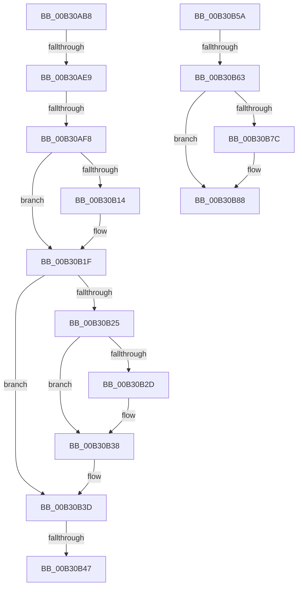

# sub_00B30AB8

- RVA: `0x00B30AB8`–`0x00B30B8F` (길이 `215` bytes)
- VA: `0x0000000140B30AB8`
- 실행 섹션: `PAGE`
- PDB 이름 있음: `아니요`; PDB Function 태그: `아니요`
- unwind 정보 RVA: `0x000A5B34`
- 디코드: `47`개 명령, `215/215` bytes 표시
- 미해석 바이트: `0` (있으면 어셈블리에 `.byte`로 보존)

> 이 문서는 커널 이미지의 기계어와 PDB 기호를 분석해 생성했습니다. 4번과 5번은 함수 원형과 자료형을 바이너리 사용 방식에서 추정한 C 해석이며 원본 소스 복구 결과는 아닙니다.

## 1. Dependencies

- 직접 호출 지점: **5**; 고유 호출 대상: **4**
- 직접 호출자로 확인된 함수: **0**
- RIP 상대 이미지 참조: **7**

### Outgoing calls
- `0x00B30AC0` → [ZwClose](../../text/6A/ZwClose_function_006AD2B0.md) (function, `0x006AD2B0`)
- `0x00B30ADA` → [KeWaitForSingleObject](../../text/20/KeWaitForSingleObject_function_0020E6B0.md) (function, `0x0020E6B0`)
- `0x00B30B19` → [MUIBugCheck](../../text/65/MUIBugCheck_function_0065CE80.md) (function, `0x0065CE80`)
- `0x00B30B32` → [MUIBugCheck](../../text/65/MUIBugCheck_function_0065CE80.md) (function, `0x0065CE80`)
- `0x00B30B38` → [MigrateOOBELanguageToInstallationLanguage](../../text/65/MigrateOOBELanguageToInstallationLanguage_function_0065CEA8.md) (function, `0x0065CEA8`)

### Direct callers
- 이 함수 시작 RVA로 연결되는 직접 call은 확인되지 않았습니다. 간접 호출은 완전히 역산할 수 없습니다.

### Static image references
- `0x00B30AFD` → RVA `0x00EEEFD8` (`.data`; write)
- `0x00B30B08` → RVA `0x00EEEFE0` (`.data`; write)
- `0x00B30B25` → RVA `0x00FD9BB8` (`PAGEDATA`; read)
- `0x00B30B47` → RVA `0x00FD9A60` (`PAGEDATA`; read)
- `0x00B30B4E` → RVA `0x00FD9A70` (`PAGEDATA`; write)
- `0x00B30B63` → RVA `0x00FC5008` (`ALMOSTRO`; read)
- `0x00B30B70` → RVA `0x00EEEFD8` (`.data`; read)

## 2. Other-region calls and transfers

- 다른 실행 섹션으로 향하는 call: **5**
  - `0x00B30AC0` → [ZwClose](../../text/6A/ZwClose_function_006AD2B0.md) (`PAGE` → `.text`)
  - `0x00B30ADA` → [KeWaitForSingleObject](../../text/20/KeWaitForSingleObject_function_0020E6B0.md) (`PAGE` → `.text`)
  - `0x00B30B19` → [MUIBugCheck](../../text/65/MUIBugCheck_function_0065CE80.md) (`PAGE` → `.text`)
  - `0x00B30B32` → [MUIBugCheck](../../text/65/MUIBugCheck_function_0065CE80.md) (`PAGE` → `.text`)
  - `0x00B30B38` → [MigrateOOBELanguageToInstallationLanguage](../../text/65/MigrateOOBELanguageToInstallationLanguage_function_0065CEA8.md) (`PAGE` → `.text`)
- call이 아닌 외부 분기/꼬리 이동: **6**
  - `0x00B30AE3` → [NtGetMUIRegistryInfo + 0x2EB](../9E/NtGetMUIRegistryInfo_function_009EC780.md) (`tail-transfer`)
  - `0x00B30AF2` → [NtGetMUIRegistryInfo + 0x2F3](../9E/NtGetMUIRegistryInfo_function_009EC780.md) (`tail-transfer`)
  - `0x00B30B41` → [NtGetMUIRegistryInfo + 0x2EB](../9E/NtGetMUIRegistryInfo_function_009EC780.md) (`tail-transfer`)
  - `0x00B30B55` → [NtGetMUIRegistryInfo + 0x2EB](../9E/NtGetMUIRegistryInfo_function_009EC780.md) (`tail-transfer`)
  - `0x00B30B5D` → [NtGetMUIRegistryInfo + 0xB5](../9E/NtGetMUIRegistryInfo_function_009EC780.md) (`tail-transfer`)
  - `0x00B30B8A` → [NtGetMUIRegistryInfo + 0x1A8](../9E/NtGetMUIRegistryInfo_function_009EC780.md) (`tail-transfer`)

## 3. Assembly (complete function range)

```asm
00B30AB8  48 8B 8C 24 88 00 00 00         mov rcx, qword ptr [rsp + 0x88]
00B30AC0  E8 EB C7 B7 FF                  call 0x1406ad2b0
00B30AC5  48 89 7C 24 20                  mov qword ptr [rsp + 0x20], rdi
00B30ACA  45 33 C9                        xor r9d, r9d
00B30ACD  45 33 C0                        xor r8d, r8d
00B30AD0  33 D2                           xor edx, edx
00B30AD2  48 8D 8C 24 90 00 00 00         lea rcx, [rsp + 0x90]
00B30ADA  E8 D1 DB 6D FF                  call 0x14020e6b0
00B30ADF  8B F0                           mov esi, eax
00B30AE1  85 C0                           test eax, eax
00B30AE3  0F 88 82 BF EB FF               js 0x1409eca6b
00B30AE9  8B B4 24 80 00 00 00            mov esi, dword ptr [rsp + 0x80]
00B30AF0  85 F6                           test esi, esi
00B30AF2  0F 88 7B BF EB FF               js 0x1409eca73
00B30AF8  48 8B 44 24 60                  mov rax, qword ptr [rsp + 0x60]
00B30AFD  48 89 05 D4 E4 3B 00            mov qword ptr [rip + 0x3be4d4], rax
00B30B04  8B 44 24 68                     mov eax, dword ptr [rsp + 0x68]
00B30B08  89 05 D2 E4 3B 00               mov dword ptr [rip + 0x3be4d2], eax
00B30B0E  39 7C 24 6C                     cmp dword ptr [rsp + 0x6c], edi
00B30B12  75 0B                           jne 0x140b30b1f
00B30B14  B9 02 80 00 00                  mov ecx, 0x8002
00B30B19  E8 62 C3 B2 FF                  call 0x14065ce80
00B30B1E  CC                              int3
00B30B1F  39 7C 24 74                     cmp dword ptr [rsp + 0x74], edi
00B30B23  75 18                           jne 0x140b30b3d
00B30B25  39 3D 8D 90 4A 00               cmp dword ptr [rip + 0x4a908d], edi
00B30B2B  74 0B                           je 0x140b30b38
00B30B2D  B9 01 80 00 00                  mov ecx, 0x8001
00B30B32  E8 49 C3 B2 FF                  call 0x14065ce80
00B30B37  CC                              int3
00B30B38  E8 6B C3 B2 FF                  call 0x14065cea8
00B30B3D  39 7C 24 7C                     cmp dword ptr [rsp + 0x7c], edi
00B30B41  0F 85 24 BF EB FF               jne 0x1409eca6b
00B30B47  0F B7 05 12 8F 4A 00            movzx eax, word ptr [rip + 0x4a8f12]
00B30B4E  66 89 05 1B 8F 4A 00            mov word ptr [rip + 0x4a8f1b], ax
00B30B55  E9 11 BF EB FF                  jmp 0x1409eca6b
00B30B5A  F6 C3 08                        test bl, 8
00B30B5D  0F 84 D2 BC EB FF               je 0x1409ec835
00B30B63  48 8B 05 9E 44 49 00            mov rax, qword ptr [rip + 0x49449e]
00B30B6A  FF 80 A4 03 00 00               inc dword ptr [rax + 0x3a4]
00B30B70  48 8B 0D 61 E4 3B 00            mov rcx, qword ptr [rip + 0x3be461]
00B30B77  48 85 C9                        test rcx, rcx
00B30B7A  74 0C                           je 0x140b30b88
00B30B7C  A1 A4 03 00 00 80 F7 FF FF      movabs eax, dword ptr [0xfffff780000003a4]
00B30B85  89 41 0C                        mov dword ptr [rcx + 0xc], eax
00B30B88  8B F7                           mov esi, edi
00B30B8A  E9 99 BD EB FF                  jmp 0x1409ec928
```

## 4. C-style interpretation (structured pseudocode)

```c
__int64 __fastcall sub_00B30AB8(__int64 a1, int a2, int a3, int a4, __int64 a5, __int64 a6, __int64 a7, __int64 a8, __int64 a9, __int64 a10, __int64 a11, __int64 a12, unsigned int a13, __int64 a14, __int64 a15, unsigned int a16, __int64 a17, __int64 a18)
{
    __int64 result;
    unsigned __int64 v_stack_p20;
    unsigned int v_stack_p6C;
    unsigned int v_stack_p74;
    unsigned int v_stack_p7C;

    result = ZwClose(a17, a2, a3, a4);
    v_stack_p20 = v_rdi;
    a4 = 0;
    a3 = 0;
    a2 = 0;
    result = KeWaitForSingleObject(a18, a2, a3, a4);
    *(unsigned __int64 *)(v_rip + 3925204) = a12;
    *(unsigned int *)(v_rip + 3925202) = (unsigned int)((unsigned int)(a13));
    result = (unsigned int)(a13);
    if (v_stack_p6C == ((unsigned int)(v_rdi))) {
        a1 = 0x8002ULL;
        result = MUIBugCheck(a1, a2, a3, a4);
    }
    if (v_stack_p74 != ((unsigned int)(v_rdi))) goto loc_00B30B3D;
    if ((*(unsigned int *)(v_rip + 4886669)) != ((unsigned int)(v_rdi))) {
        a1 = 0x8001ULL;
        result = MUIBugCheck(a1, a2, a3, a4);
    }
    result = MigrateOOBELanguageToInstallationLanguage(a1, a2, a3, a4);
loc_00B30B3D:
    *(unsigned __int16 *)(v_rip + 4886299) = (unsigned __int16)(*(unsigned __int16 *)(v_rip + 4886290));
}
```

## 5. (Beta) C Style

```c
int64_t sub_00B30AB8(int64_t Arg1, int32_t Arg2, int32_t Arg3, int32_t Arg4, uint64_t Arg5, uint64_t Arg6, uint64_t Arg7, uint64_t Arg8, uint64_t Arg9, uint64_t Arg10, uint64_t Arg11, int64_t Arg12, uint32_t Arg13, uint64_t Arg14, uint64_t Arg15, uint32_t Arg16, int64_t Arg17, int64_t Arg18)
{
    int64_t result;
    uint64_t v_stack_p20;
    uint32_t v_stack_p6C;
    uint32_t v_stack_p74;
    uint32_t v_stack_p7C;

    result = ZwClose(Arg17, Arg2, Arg3, Arg4);
    v_stack_p20 = local_rdi;
    Arg4 = 0;
    Arg3 = 0;
    Arg2 = 0;
    result = KeWaitForSingleObject(Arg18, Arg2, Arg3, Arg4);
    *(uint64_t *)(v_rip + 0x3BE4D4) = Arg12;
    *(uint32_t *)(v_rip + 0x3BE4D2) = (uint32_t)((uint32_t)(Arg13));
    result = (uint32_t)(Arg13);
    if (v_stack_p6C == ((uint32_t)(local_rdi))) {
        Arg1 = 0x8002ULL;
        result = MUIBugCheck(Arg1, Arg2, Arg3, Arg4);
    }
    if (v_stack_p74 != ((uint32_t)(local_rdi))) goto loc_00B30B3D;
    if ((*(uint32_t *)(v_rip + 0x4A908D)) != ((uint32_t)(local_rdi))) {
        Arg1 = 0x8001ULL;
        result = MUIBugCheck(Arg1, Arg2, Arg3, Arg4);
    }
    result = MigrateOOBELanguageToInstallationLanguage(Arg1, Arg2, Arg3, Arg4);
loc_00B30B3D:
    *(uint16_t *)(v_rip + 0x4A8F1B) = (uint16_t)(*(uint16_t *)(v_rip + 0x4A8F12));
}
```

## 6. Execution-region graph

[열기: 2D/3D 그래프와 함수 탐색 컨트롤 패널](../../../control-panel.html?section=page&rva=0x00B30AB8&view=graph)

- 2D 그래프는 위에서 아래로 흐르고, 3D 그래프는 빈 공간을 드래그해 회전합니다. Shift+드래그는 이동, 휠은 확대·축소, 함수 노드 선택은 대상 보고서 이동입니다.

### Static fallback


