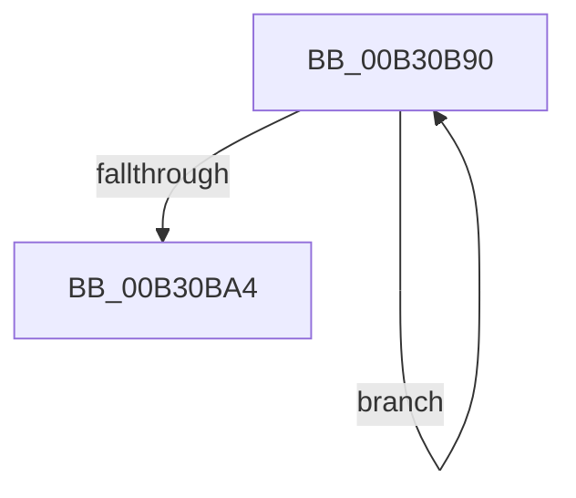

# sub_00B30B90

- RVA: `0x00B30B90`–`0x00B30BA9` (길이 `25` bytes)
- VA: `0x0000000140B30B90`
- 실행 섹션: `PAGE`
- PDB 이름 있음: `아니요`; PDB Function 태그: `아니요`
- unwind 정보 RVA: `0x000A5B94`
- 디코드: `6`개 명령, `25/25` bytes 표시
- 미해석 바이트: `0` (있으면 어셈블리에 `.byte`로 보존)

> 이 문서는 커널 이미지의 기계어와 PDB 기호를 분석해 생성했습니다. 4번과 5번은 함수 원형과 자료형을 바이너리 사용 방식에서 추정한 C 해석이며 원본 소스 복구 결과는 아닙니다.

## 1. Dependencies

- 직접 호출 지점: **0**; 고유 호출 대상: **0**
- 직접 호출자로 확인된 함수: **0**
- RIP 상대 이미지 참조: **0**

### Outgoing calls
- 직접 디코드된 call 명령이 없습니다.

### Direct callers
- 이 함수 시작 RVA로 연결되는 직접 call은 확인되지 않았습니다. 간접 호출은 완전히 역산할 수 없습니다.

### Static image references
- 디코드된 RIP-relative 메모리 참조가 없습니다.

## 2. Other-region calls and transfers

- 다른 실행 섹션으로 향하는 call: **0**
- call이 아닌 외부 분기/꼬리 이동: **1**
  - `0x00B30BA4` → [ExpCreateWorkerThread + 0xCC](../9E/ExpCreateWorkerThread_function_009ECEFC.md) (`tail-transfer`)

## 3. Assembly (complete function range)

```asm
00B30B90  8B C8                           mov ecx, eax
00B30B92  81 E1 FF 3F 00 00               and ecx, 0x3fff
00B30B98  FF C9                           dec ecx
00B30B9A  F0 0F B1 8B C8 02 00 00         lock cmpxchg dword ptr [rbx + 0x2c8], ecx
00B30BA2  75 EC                           jne 0x140b30b90
00B30BA4  E9 1F C4 EB FF                  jmp 0x1409ecfc8
```

## 4. C-style interpretation (structured pseudocode)

```c
void __fastcall sub_00B30B90(void)
{
    a1 = (unsigned int)(((unsigned int)((unsigned int)(result))) & (0x3FFFULL));
    a1 = (unsigned int)((a1) - 1);
    if (condition_is_not_equal) goto loc_00B30B90;
}
```

## 5. (Beta) C Style

```c
void sub_00B30B90(void)
{
    a1 = (uint32_t)(((uint32_t)((uint32_t)(result))) & (0x3FFFULL));
    a1 = (uint32_t)((a1) - 1);
    if (condition_is_not_equal) goto loc_00B30B90;
}
```

## 6. Execution-region graph

[열기: 2D/3D 그래프와 함수 탐색 컨트롤 패널](../../../control-panel.html?section=page&rva=0x00B30B90&view=graph)

- 2D 그래프는 위에서 아래로 흐르고, 3D 그래프는 빈 공간을 드래그해 회전합니다. Shift+드래그는 이동, 휠은 확대·축소, 함수 노드 선택은 대상 보고서 이동입니다.

### Static fallback


