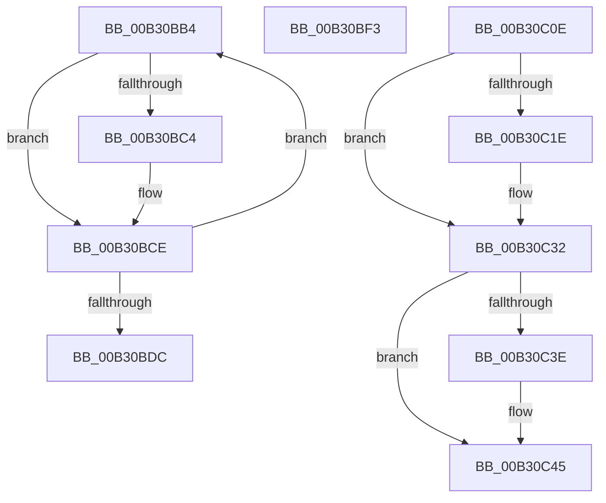

# sub_00B30BB4

- RVA: `0x00B30BB4`–`0x00B30C59` (길이 `165` bytes)
- VA: `0x0000000140B30BB4`
- 실행 섹션: `PAGE`
- PDB 이름 있음: `아니요`; PDB Function 태그: `아니요`
- unwind 정보 RVA: `0x000A5CC0`
- 디코드: `39`개 명령, `165/165` bytes 표시
- 미해석 바이트: `0` (있으면 어셈블리에 `.byte`로 보존)

> 이 문서는 커널 이미지의 기계어와 PDB 기호를 분석해 생성했습니다. 4번과 5번은 함수 원형과 자료형을 바이너리 사용 방식에서 추정한 C 해석이며 원본 소스 복구 결과는 아닙니다.

## 1. Dependencies

- 직접 호출 지점: **7**; 고유 호출 대상: **3**
- 직접 호출자로 확인된 함수: **0**
- RIP 상대 이미지 참조: **0**

### Outgoing calls
- `0x00B30BC9` → [ObfDereferenceObjectWithTag](../../text/2F/ObfDereferenceObjectWithTag_function_002F78E0.md) (function, `0x002F78E0`)
- `0x00B30BE8` → [ExFreePoolWithTag](../../poolcode/B8/ExFreePoolWithTag_function_00B82870.md) (function, `0x00B82870`)
- `0x00B30BF5` → [ExFreePoolWithTag](../../poolcode/B8/ExFreePoolWithTag_function_00B82870.md) (function, `0x00B82870`)
- `0x00B30C03` → [ExFreePoolWithTag](../../poolcode/B8/ExFreePoolWithTag_function_00B82870.md) (function, `0x00B82870`)
- `0x00B30C2D` → [SeReleaseLuidAndAttributesArray](../9C/SeReleaseLuidAndAttributesArray_function_009C7C40.md) (function, `0x009C7C40`)
- `0x00B30C40` → [ExFreePoolWithTag](../../poolcode/B8/ExFreePoolWithTag_function_00B82870.md) (function, `0x00B82870`)
- `0x00B30C4E` → [ExFreePoolWithTag](../../poolcode/B8/ExFreePoolWithTag_function_00B82870.md) (function, `0x00B82870`)

### Direct callers
- 이 함수 시작 RVA로 연결되는 직접 call은 확인되지 않았습니다. 간접 호출은 완전히 역산할 수 없습니다.

### Static image references
- 디코드된 RIP-relative 메모리 참조가 없습니다.

## 2. Other-region calls and transfers

- 다른 실행 섹션으로 향하는 call: **6**
  - `0x00B30BC9` → [ObfDereferenceObjectWithTag](../../text/2F/ObfDereferenceObjectWithTag_function_002F78E0.md) (`PAGE` → `.text`)
  - `0x00B30BE8` → [ExFreePoolWithTag](../../poolcode/B8/ExFreePoolWithTag_function_00B82870.md) (`PAGE` → `POOLCODE`)
  - `0x00B30BF5` → [ExFreePoolWithTag](../../poolcode/B8/ExFreePoolWithTag_function_00B82870.md) (`PAGE` → `POOLCODE`)
  - `0x00B30C03` → [ExFreePoolWithTag](../../poolcode/B8/ExFreePoolWithTag_function_00B82870.md) (`PAGE` → `POOLCODE`)
  - `0x00B30C40` → [ExFreePoolWithTag](../../poolcode/B8/ExFreePoolWithTag_function_00B82870.md) (`PAGE` → `POOLCODE`)
  - `0x00B30C4E` → [ExFreePoolWithTag](../../poolcode/B8/ExFreePoolWithTag_function_00B82870.md) (`PAGE` → `POOLCODE`)
- call이 아닌 외부 분기/꼬리 이동: **3**
  - `0x00B30BEE` → [PspDeleteCreateProcessContext + 0xB5](../9E/PspDeleteCreateProcessContext_function_009EF4C4.md) (`tail-transfer`)
  - `0x00B30C09` → [PspDeleteCreateProcessContext + 0xE5](../9E/PspDeleteCreateProcessContext_function_009EF4C4.md) (`tail-transfer`)
  - `0x00B30C54` → [PspDeleteCreateProcessContext + 0x10E](../9E/PspDeleteCreateProcessContext_function_009EF4C4.md) (`tail-transfer`)

## 3. Assembly (complete function range)

```asm
00B30BB4  48 8B 83 70 01 00 00            mov rax, qword ptr [rbx + 0x170]
00B30BBB  48 8B 0C F8                     mov rcx, qword ptr [rax + rdi*8]
00B30BBF  48 85 C9                        test rcx, rcx
00B30BC2  74 0A                           je 0x140b30bce
00B30BC4  BA 50 73 4A 6C                  mov edx, 0x6c4a7350
00B30BC9  E8 12 6D 7C FF                  call 0x1402f78e0
00B30BCE  8B 83 7C 01 00 00               mov eax, dword ptr [rbx + 0x17c]
00B30BD4  48 FF C7                        inc rdi
00B30BD7  48 3B F8                        cmp rdi, rax
00B30BDA  72 D8                           jb 0x140b30bb4
00B30BDC  48 8B 8B 70 01 00 00            mov rcx, qword ptr [rbx + 0x170]
00B30BE3  BA 50 73 4A 6C                  mov edx, 0x6c4a7350
00B30BE8  E8 83 1C 05 00                  call 0x140b82870
00B30BED  90                              nop
00B30BEE  E9 86 E9 EB FF                  jmp 0x1409ef579
00B30BF3  33 D2                           xor edx, edx
00B30BF5  E8 76 1C 05 00                  call 0x140b82870
00B30BFA  48 8B 8B 98 01 00 00            mov rcx, qword ptr [rbx + 0x198]
00B30C01  33 D2                           xor edx, edx
00B30C03  E8 68 1C 05 00                  call 0x140b82870
00B30C08  90                              nop
00B30C09  E9 9B E9 EB FF                  jmp 0x1409ef5a9
00B30C0E  48 8B 83 F8 01 00 00            mov rax, qword ptr [rbx + 0x1f8]
00B30C15  48 8B 48 18                     mov rcx, qword ptr [rax + 0x18]
00B30C19  48 85 C9                        test rcx, rcx
00B30C1C  74 14                           je 0x140b30c32
00B30C1E  65 48 8B 14 25 88 01 00 00      mov rdx, qword ptr gs:[0x188]
00B30C27  8A 92 32 02 00 00               mov dl, byte ptr [rdx + 0x232]
00B30C2D  E8 0E 70 E9 FF                  call 0x1409c7c40
00B30C32  48 8B 8B 00 02 00 00            mov rcx, qword ptr [rbx + 0x200]
00B30C39  48 85 C9                        test rcx, rcx
00B30C3C  74 07                           je 0x140b30c45
00B30C3E  33 D2                           xor edx, edx
00B30C40  E8 2B 1C 05 00                  call 0x140b82870
00B30C45  48 8B 8B F8 01 00 00            mov rcx, qword ptr [rbx + 0x1f8]
00B30C4C  33 D2                           xor edx, edx
00B30C4E  E8 1D 1C 05 00                  call 0x140b82870
00B30C53  90                              nop
00B30C54  E9 79 E9 EB FF                  jmp 0x1409ef5d2
```

## 4. C-style interpretation (structured pseudocode)

```c
__int64 __fastcall sub_00B30BB4(void)
{
    __int64 result;
    __int64 v_rdi;

    result = *(unsigned __int64 *)(v_rbx + 368);
    if (*(unsigned __int64 *)(*(unsigned __int64 *)(v_rbx + 368) + v_rdi * 8) != 0) {
        a2 = 0x6C4A7350ULL;
        result = ObfDereferenceObjectWithTag(*(unsigned __int64 *)(*(unsigned __int64 *)(v_rbx + 368) + v_rdi * 8), a2, a3, a4);
    }
    v_rdi = (v_rdi) + 1;
    if (v_rdi < ((unsigned int)(*(unsigned int *)(v_rbx + 380)))) goto loc_00B30BB4;
    result = ExFreePoolWithTag(*(unsigned __int64 *)(v_rbx + 368), (unsigned int)(0x6C4A7350ULL), a3, a4);
}
```

## 5. (Beta) C Style

```c
void sub_00B30BB4(void)
{
    int64_t result;
    int64_t local_rdi;

    result = *(uint64_t *)(local_rbx + 0x170);
    if (*(uint64_t *)(*(uint64_t *)(local_rbx + 0x170) + local_rdi * 8) != 0) {
        a2 = 0x6C4A7350ULL;
        result = ObfDereferenceObjectWithTag(*(uint64_t *)(*(uint64_t *)(local_rbx + 0x170) + local_rdi * 8), a2, a3, a4);
    }
    local_rdi = (local_rdi) + 1;
    if (local_rdi < ((uint32_t)(*(uint32_t *)(local_rbx + 0x17C)))) goto loc_00B30BB4;
    result = ExFreePoolWithTag(*(uint64_t *)(local_rbx + 0x170), (uint32_t)(0x6C4A7350ULL), a3, a4);
}
```

## 6. Execution-region graph

[열기: 2D/3D 그래프와 함수 탐색 컨트롤 패널](../../../control-panel.html?section=page&rva=0x00B30BB4&view=graph)

- 2D 그래프는 위에서 아래로 흐르고, 3D 그래프는 빈 공간을 드래그해 회전합니다. Shift+드래그는 이동, 휠은 확대·축소, 함수 노드 선택은 대상 보고서 이동입니다.

### Static fallback


