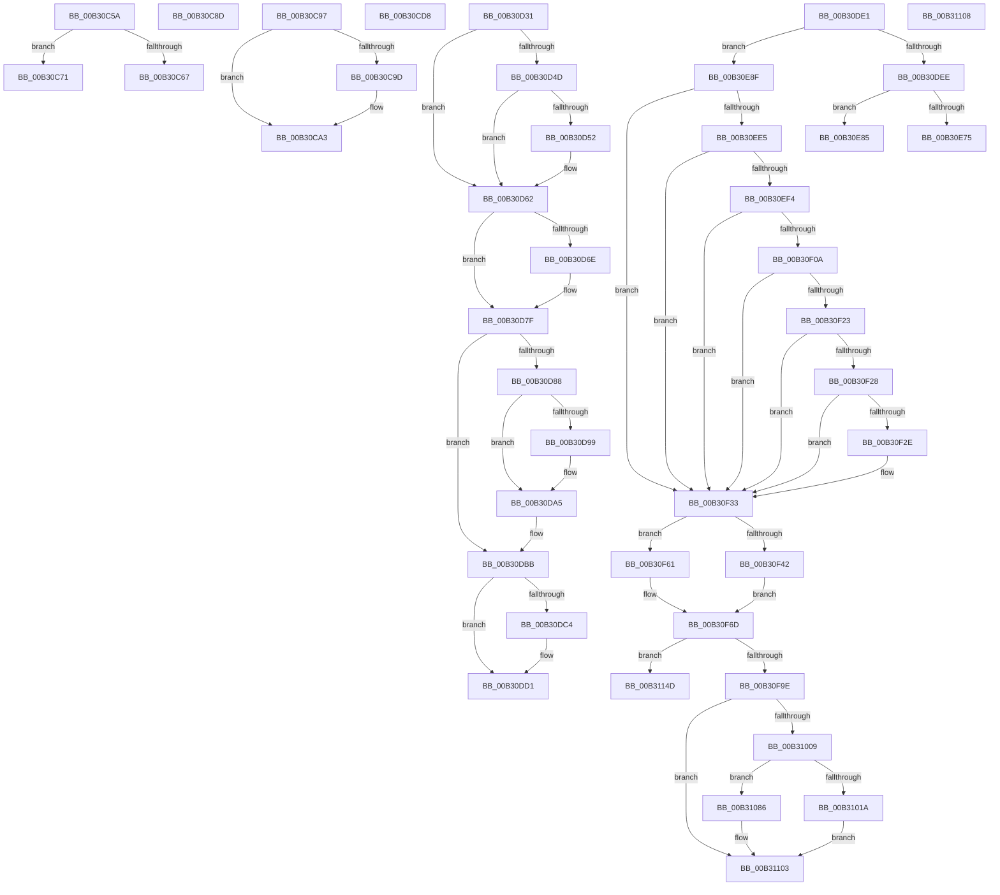

# sub_00B30C5A

- RVA: `0x00B30C5A`–`0x00B3115D` (길이 `1,283` bytes)
- VA: `0x0000000140B30C5A`
- 실행 섹션: `PAGE`
- PDB 이름 있음: `아니요`; PDB Function 태그: `아니요`
- unwind 정보 RVA: `0x000A5D28`
- 디코드: `242`개 명령, `1,283/1,283` bytes 표시
- 미해석 바이트: `0` (있으면 어셈블리에 `.byte`로 보존)

> 이 문서는 커널 이미지의 기계어와 PDB 기호를 분석해 생성했습니다. 4번과 5번은 함수 원형과 자료형을 바이너리 사용 방식에서 추정한 C 해석이며 원본 소스 복구 결과는 아닙니다.

## 1. Dependencies

- 직접 호출 지점: **14**; 고유 호출 대상: **13**
- 직접 호출자로 확인된 함수: **0**
- RIP 상대 이미지 참조: **0**

### Outgoing calls
- `0x00B30C9D` → [ExRaiseDatatypeMisalignment](../89/ExRaiseDatatypeMisalignment_function_00899FD0.md) (function, `0x00899FD0`)
- `0x00B30D34` → [KeAbPostRelease](../../text/2E/KeAbPostRelease_function_002E1600.md) (function, `0x002E1600`)
- `0x00B30D5D` → [PspDeleteUserStack](../A7/PspDeleteUserStack_function_00A78D18.md) (function, `0x00A78D18`)
- `0x00B30D73` → [ExFreePoolWithTag](../../poolcode/B8/ExFreePoolWithTag_function_00B82870.md) (function, `0x00B82870`)
- `0x00B30DA0` → [ExfTryToWakePushLock](../../text/26/ExfTryToWakePushLock_function_00265DD0.md) (function, `0x00265DD0`)
- `0x00B30DAC` → [KeAbPostRelease](../../text/2E/KeAbPostRelease_function_002E1600.md) (function, `0x002E1600`)
- `0x00B30DCC` → [ObfDereferenceObjectWithTag](../../text/2F/ObfDereferenceObjectWithTag_function_002F78E0.md) (function, `0x002F78E0`)
- `0x00B30DD4` → [ObfDereferenceObject](../../text/2F/ObfDereferenceObject_function_002F9350.md) (function, `0x002F9350`)
- `0x00B30E4A` → [RtlGetExtendedContextLength](../../text/3D/RtlGetExtendedContextLength_function_003D7190.md) (function, `0x003D7190`)
- `0x00B30E5F` → [ExAllocatePool2](../../poolcode/B8/ExAllocatePool2_function_00B820F0.md) (function, `0x00B820F0`)
- `0x00B30EAF` → [PsQueryThreadStartAddress](../../text/3F/PsQueryThreadStartAddress_function_003FCF00.md) (function, `0x003FCF00`)
- `0x00B30F19` → [RtlLocateExtendedFeature](../../text/3D/RtlLocateExtendedFeature_function_003D72A0.md) (function, `0x003D72A0`)
- `0x00B30F7A` → [KiStackAttachProcess](../../text/21/KiStackAttachProcess_function_00216820.md) (function, `0x00216820`)
- `0x00B30F90` → [MmSecureVirtualMemory](../9F/MmSecureVirtualMemory_function_009F55F0.md) (function, `0x009F55F0`)

### Direct callers
- 이 함수 시작 RVA로 연결되는 직접 call은 확인되지 않았습니다. 간접 호출은 완전히 역산할 수 없습니다.

### Static image references
- 디코드된 RIP-relative 메모리 참조가 없습니다.

## 2. Other-region calls and transfers

- 다른 실행 섹션으로 향하는 call: **11**
  - `0x00B30D34` → [KeAbPostRelease](../../text/2E/KeAbPostRelease_function_002E1600.md) (`PAGE` → `.text`)
  - `0x00B30D73` → [ExFreePoolWithTag](../../poolcode/B8/ExFreePoolWithTag_function_00B82870.md) (`PAGE` → `POOLCODE`)
  - `0x00B30DA0` → [ExfTryToWakePushLock](../../text/26/ExfTryToWakePushLock_function_00265DD0.md) (`PAGE` → `.text`)
  - `0x00B30DAC` → [KeAbPostRelease](../../text/2E/KeAbPostRelease_function_002E1600.md) (`PAGE` → `.text`)
  - `0x00B30DCC` → [ObfDereferenceObjectWithTag](../../text/2F/ObfDereferenceObjectWithTag_function_002F78E0.md) (`PAGE` → `.text`)
  - `0x00B30DD4` → [ObfDereferenceObject](../../text/2F/ObfDereferenceObject_function_002F9350.md) (`PAGE` → `.text`)
  - `0x00B30E4A` → [RtlGetExtendedContextLength](../../text/3D/RtlGetExtendedContextLength_function_003D7190.md) (`PAGE` → `.text`)
  - `0x00B30E5F` → [ExAllocatePool2](../../poolcode/B8/ExAllocatePool2_function_00B820F0.md) (`PAGE` → `POOLCODE`)
  - `0x00B30EAF` → [PsQueryThreadStartAddress](../../text/3F/PsQueryThreadStartAddress_function_003FCF00.md) (`PAGE` → `.text`)
  - `0x00B30F19` → [RtlLocateExtendedFeature](../../text/3D/RtlLocateExtendedFeature_function_003D72A0.md) (`PAGE` → `.text`)
  - `0x00B30F7A` → [KiStackAttachProcess](../../text/21/KiStackAttachProcess_function_00216820.md) (`PAGE` → `.text`)
- call이 아닌 외부 분기/꼬리 이동: **11**
  - `0x00B30C6C` → [PspAllocateThread + 0x72C](../9E/PspAllocateThread_function_009EF72C.md) (`tail-transfer`)
  - `0x00B30C88` → [PspAllocateThread + 0x1B6](../9E/PspAllocateThread_function_009EF72C.md) (`tail-transfer`)
  - `0x00B30C92` → [PspAllocateThread + 0x872](../9E/PspAllocateThread_function_009EF72C.md) (`tail-transfer`)
  - `0x00B30CD3` → [PspAllocateThread + 0x21B](../9E/PspAllocateThread_function_009EF72C.md) (`tail-transfer`)
  - `0x00B30D2C` → [PspAllocateThread + 0x21B](../9E/PspAllocateThread_function_009EF72C.md) (`tail-transfer`)
  - `0x00B30DDC` → [PspAllocateThread + 0x72C](../9E/PspAllocateThread_function_009EF72C.md) (`tail-transfer`)
  - `0x00B30E80` → [PspAllocateThread + 0xBD6](../9E/PspAllocateThread_function_009EF72C.md) (`tail-transfer`)
  - `0x00B30E8A` → [PspAllocateThread + 0x679](../9E/PspAllocateThread_function_009EF72C.md) (`tail-transfer`)
  - `0x00B31103` → [PspAllocateThread + 0x82C](../9E/PspAllocateThread_function_009EF72C.md) (`tail-transfer`)
  - `0x00B31148` → [PspAllocateThread + 0x82C](../9E/PspAllocateThread_function_009EF72C.md) (`tail-transfer`)
  - `0x00B31158` → [PspAllocateThread + 0x82C](../9E/PspAllocateThread_function_009EF72C.md) (`tail-transfer`)

## 3. Assembly (complete function range)

```asm
00B30C5A  41 F7 87 FC 05 00 00 00 10 00 00  test dword ptr [r15 + 0x5fc], 0x1000
00B30C65  74 0A                           je 0x140b30c71
00B30C67  B8 BB 00 00 C0                  mov eax, 0xc00000bb
00B30C6C  E9 E7 F1 EB FF                  jmp 0x1409efe58
00B30C71  4C 0B A3 E0 01 00 00            or r12, qword ptr [rbx + 0x1e0]
00B30C78  4C 89 A4 24 88 00 00 00         mov qword ptr [rsp + 0x88], r12
00B30C80  4C 89 A4 24 A0 00 00 00         mov qword ptr [rsp + 0xa0], r12
00B30C88  E9 55 EC EB FF                  jmp 0x1409ef8e2
00B30C8D  BB 30 00 00 C0                  mov ebx, 0xc0000030
00B30C92  E9 07 F3 EB FF                  jmp 0x1409eff9e
00B30C97  41 F6 C1 03                     test r9b, 3
00B30C9B  74 06                           je 0x140b30ca3
00B30C9D  E8 2E 93 D6 FF                  call 0x140899fd0
00B30CA2  CC                              int3
00B30CA3  48 B8 00 00 FF FF FF 7F 00 00   movabs rax, 0x7fffffff0000
00B30CAD  4C 3B C8                        cmp r9, rax
00B30CB0  49 0F 42 C1                     cmovb rax, r9
00B30CB4  90                              nop
00B30CB5  8A 00                           mov al, byte ptr [rax]
00B30CB7  41 8B 41 18                     mov eax, dword ptr [r9 + 0x18]
00B30CBB  25 F2 1D 00 00                  and eax, 0x1df2
00B30CC0  41 89 83 80 01 00 00            mov dword ptr [r11 + 0x180], eax
00B30CC7  8B 5C 24 54                     mov ebx, dword ptr [rsp + 0x54]
00B30CCB  48 8B B4 24 80 00 00 00         mov rsi, qword ptr [rsp + 0x80]
00B30CD3  E9 6F EC EB FF                  jmp 0x1409ef947
00B30CD8  8B D8                           mov ebx, eax
00B30CDA  33 FF                           xor edi, edi
00B30CDC  48 8B 84 24 C0 00 00 00         mov rax, qword ptr [rsp + 0xc0]
00B30CE4  48 89 44 24 60                  mov qword ptr [rsp + 0x60], rax
00B30CE9  48 8B 84 24 A0 00 00 00         mov rax, qword ptr [rsp + 0xa0]
00B30CF1  48 89 84 24 88 00 00 00         mov qword ptr [rsp + 0x88], rax
00B30CF9  8A 44 24 58                     mov al, byte ptr [rsp + 0x58]
00B30CFD  88 44 24 50                     mov byte ptr [rsp + 0x50], al
00B30D01  4C 8B BC 24 D8 00 00 00         mov r15, qword ptr [rsp + 0xd8]
00B30D09  48 8B B4 24 B8 00 00 00         mov rsi, qword ptr [rsp + 0xb8]
00B30D11  4C 8B AC 24 E0 00 00 00         mov r13, qword ptr [rsp + 0xe0]
00B30D19  49 8B CD                        mov rcx, r13
00B30D1C  48 89 8C 24 D0 00 00 00         mov qword ptr [rsp + 0xd0], rcx
00B30D24  48 89 8C 24 98 00 00 00         mov qword ptr [rsp + 0x98], rcx
00B30D2C  E9 16 EC EB FF                  jmp 0x1409ef947
00B30D31  49 8B CC                        mov rcx, r12
00B30D34  E8 C7 08 7B FF                  call 0x1402e1600
00B30D39  44 8B 74 24 54                  mov r14d, dword ptr [rsp + 0x54]
00B30D3E  48 8B 74 24 68                  mov rsi, qword ptr [rsp + 0x68]
00B30D43  48 8B 44 24 70                  mov rax, qword ptr [rsp + 0x70]
00B30D48  48 85 C0                        test rax, rax
00B30D4B  74 15                           je 0x140b30d62
00B30D4D  40 38 38                        cmp byte ptr [rax], dil
00B30D50  74 10                           je 0x140b30d62
00B30D52  4C 8B C8                        mov r9, rax
00B30D55  4C 8B 44 24 60                  mov r8, qword ptr [rsp + 0x60]
00B30D5A  49 8B CF                        mov rcx, r15
00B30D5D  E8 B6 7F F4 FF                  call 0x140a78d18
00B30D62  48 8B 8E A8 06 00 00            mov rcx, qword ptr [rsi + 0x6a8]
00B30D69  48 85 C9                        test rcx, rcx
00B30D6C  74 11                           je 0x140b30d7f
00B30D6E  BA 50 73 53 63                  mov edx, 0x63537350
00B30D73  E8 F8 1A 05 00                  call 0x140b82870
00B30D78  48 89 BE A8 06 00 00            mov qword ptr [rsi + 0x6a8], rdi
00B30D7F  48 39 BE 10 05 00 00            cmp qword ptr [rsi + 0x510], rdi
00B30D86  74 33                           je 0x140b30dbb
00B30D88  F0 48 0F C1 9E 90 05 00 00      lock xadd qword ptr [rsi + 0x590], rbx
00B30D91  80 E3 06                        and bl, 6
00B30D94  80 FB 02                        cmp bl, 2
00B30D97  75 0C                           jne 0x140b30da5
00B30D99  48 8D 8E 90 05 00 00            lea rcx, [rsi + 0x590]
00B30DA0  E8 2B 50 73 FF                  call 0x140265dd0
00B30DA5  48 8D 8E 90 05 00 00            lea rcx, [rsi + 0x590]
00B30DAC  E8 4F 08 7B FF                  call 0x1402e1600
00B30DB1  44 8B 74 24 54                  mov r14d, dword ptr [rsp + 0x54]
00B30DB6  48 8B 74 24 68                  mov rsi, qword ptr [rsp + 0x68]
00B30DBB  48 39 BE 20 02 00 00            cmp qword ptr [rsi + 0x220], rdi
00B30DC2  75 0D                           jne 0x140b30dd1
00B30DC4  BA 50 73 43 72                  mov edx, 0x72437350
00B30DC9  49 8B CF                        mov rcx, r15
00B30DCC  E8 0F 6B 7C FF                  call 0x1402f78e0
00B30DD1  48 8B CE                        mov rcx, rsi
00B30DD4  E8 77 85 7C FF                  call 0x1402f9350
00B30DD9  41 8B C6                        mov eax, r14d
00B30DDC  E9 77 F0 EB FF                  jmp 0x1409efe58
00B30DE1  49 39 BF 40 06 00 00            cmp qword ptr [r15 + 0x640], rdi
00B30DE8  0F 84 A1 00 00 00               je 0x140b30e8f
00B30DEE  49 8B 85 F8 00 00 00            mov rax, qword ptr [r13 + 0xf8]
00B30DF5  48 89 86 E0 04 00 00            mov qword ptr [rsi + 0x4e0], rax
00B30DFC  48 89 86 60 05 00 00            mov qword ptr [rsi + 0x560], rax
00B30E03  48 8B 8C 24 E8 00 00 00         mov rcx, qword ptr [rsp + 0xe8]
00B30E0B  48 8B 41 08                     mov rax, qword ptr [rcx + 8]
00B30E0F  48 89 86 78 06 00 00            mov qword ptr [rsi + 0x678], rax
00B30E16  48 8B 41 10                     mov rax, qword ptr [rcx + 0x10]
00B30E1A  48 89 86 80 06 00 00            mov qword ptr [rsi + 0x680], rax
00B30E21  F0 0F BA 2E 1A                  lock bts dword ptr [rsi], 0x1a
00B30E26  49 BC D8 03 00 00 80 F7 FF FF   movabs r12, 0xfffff780000003d8
00B30E30  49 8B 04 24                     mov rax, qword ptr [r12]
00B30E34  48 F7 D8                        neg rax
00B30E37  1B C9                           sbb ecx, ecx
00B30E39  41 23 CA                        and ecx, r10d
00B30E3C  81 C1 1F 00 10 00               add ecx, 0x10001f
00B30E42  48 8D 94 24 90 00 00 00         lea rdx, [rsp + 0x90]
00B30E4A  E8 41 63 8A FF                  call 0x1403d7190
00B30E4F  8B 94 24 90 00 00 00            mov edx, dword ptr [rsp + 0x90]
00B30E56  41 B8 50 73 53 63               mov r8d, 0x63537350
00B30E5C  48 8B CB                        mov rcx, rbx
00B30E5F  E8 8C 12 05 00                  call 0x140b820f0
00B30E64  48 8B 74 24 68                  mov rsi, qword ptr [rsp + 0x68]
00B30E69  48 89 86 A8 06 00 00            mov qword ptr [rsi + 0x6a8], rax
00B30E70  48 85 C0                        test rax, rax
00B30E73  75 10                           jne 0x140b30e85
00B30E75  41 BE 9A 00 00 C0               mov r14d, 0xc000009a
00B30E7B  44 89 74 24 54                  mov dword ptr [rsp + 0x54], r14d
00B30E80  E9 7D F4 EB FF                  jmp 0x1409f0302
00B30E85  48 8B 5C 24 78                  mov rbx, qword ptr [rsp + 0x78]
00B30E8A  E9 16 EF EB FF                  jmp 0x1409efda5
00B30E8F  48 8B 84 24 B0 00 00 00         mov rax, qword ptr [rsp + 0xb0]
00B30E97  48 8B 98 F0 00 00 00            mov rbx, qword ptr [rax + 0xf0]
00B30E9E  48 89 5C 24 78                  mov qword ptr [rsp + 0x78], rbx
00B30EA3  41 BC 01 00 00 00               mov r12d, 1
00B30EA9  41 8B D4                        mov edx, r12d
00B30EAC  48 8B C8                        mov rcx, rax
00B30EAF  E8 4C C0 8C FF                  call 0x1403fcf00
00B30EB4  48 89 86 E0 04 00 00            mov qword ptr [rsi + 0x4e0], rax
00B30EBB  48 8B 84 24 B0 00 00 00         mov rax, qword ptr [rsp + 0xb0]
00B30EC3  48 8B 80 60 05 00 00            mov rax, qword ptr [rax + 0x560]
00B30ECA  48 89 86 60 05 00 00            mov qword ptr [rsi + 0x560], rax
00B30ED1  83 8E A4 05 00 00 10            or dword ptr [rsi + 0x5a4], 0x10
00B30ED8  41 F7 87 54 07 00 00 00 40 00 00  test dword ptr [r15 + 0x754], 0x4000
00B30EE3  74 4E                           je 0x140b30f33
00B30EE5  41 8B 45 30                     mov eax, dword ptr [r13 + 0x30]
00B30EE9  B9 40 00 10 00                  mov ecx, 0x100040
00B30EEE  23 C1                           and eax, ecx
00B30EF0  3B C1                           cmp eax, ecx
00B30EF2  75 3F                           jne 0x140b30f33
00B30EF4  49 63 85 E0 04 00 00            movsxd rax, dword ptr [r13 + 0x4e0]
00B30EFB  42 8B 84 28 D0 04 00 00         mov eax, dword ptr [rax + r13 + 0x4d0]
00B30F03  48 0F BA E0 0B                  bt rax, 0xb
00B30F08  73 29                           jae 0x140b30f33
00B30F0A  49 8D 8D D0 04 00 00            lea rcx, [r13 + 0x4d0]
00B30F11  45 33 C0                        xor r8d, r8d
00B30F14  41 8D 54 24 0A                  lea edx, [r12 + 0xa]
00B30F19  E8 82 63 8A FF                  call 0x1403d72a0
00B30F1E  48 85 C0                        test rax, rax
00B30F21  74 10                           je 0x140b30f33
00B30F23  44 84 20                        test byte ptr [rax], r12b
00B30F26  74 0B                           je 0x140b30f33
00B30F28  48 39 78 08                     cmp qword ptr [rax + 8], rdi
00B30F2C  74 05                           je 0x140b30f33
00B30F2E  0F BA 6E 74 14                  bts dword ptr [rsi + 0x74], 0x14
00B30F33  41 BC 64 86 00 00               mov r12d, 0x8664
00B30F39  49 39 BF 10 03 00 00            cmp qword ptr [r15 + 0x310], rdi
00B30F40  74 1F                           je 0x140b30f61
00B30F42  B8 78 38 00 00                  mov eax, 0x3878
00B30F47  B9 38 30 00 00                  mov ecx, 0x3038
00B30F4C  66 45 39 A7 EC 06 00 00         cmp word ptr [r15 + 0x6ec], r12w
00B30F54  0F 45 C1                        cmovne eax, ecx
00B30F57  48 89 84 24 B0 00 00 00         mov qword ptr [rsp + 0xb0], rax
00B30F5F  EB 0C                           jmp 0x140b30f6d
00B30F61  48 C7 84 24 B0 00 00 00 78 18 00 00  mov qword ptr [rsp + 0xb0], 0x1878
00B30F6D  4C 8D 84 24 A8 01 00 00         lea r8, [rsp + 0x1a8]
00B30F75  33 D2                           xor edx, edx
00B30F77  49 8B CF                        mov rcx, r15
00B30F7A  E8 A1 58 6E FF                  call 0x140216820
00B30F7F  41 B8 04 00 00 00               mov r8d, 4
00B30F85  48 8B 94 24 B0 00 00 00         mov rdx, qword ptr [rsp + 0xb0]
00B30F8D  48 8B CB                        mov rcx, rbx
00B30F90  E8 5B 46 EC FF                  call 0x1409f55f0
00B30F95  48 85 C0                        test rax, rax
00B30F98  0F 84 AF 01 00 00               je 0x140b3114d
00B30F9E  0F 10 86 08 05 00 00            movups xmm0, xmmword ptr [rsi + 0x508]
00B30FA5  F3 0F 7F 43 40                  movdqu xmmword ptr [rbx + 0x40], xmm0
00B30FAA  0F 10 8E 08 05 00 00            movups xmm1, xmmword ptr [rsi + 0x508]
00B30FB1  F3 0F 7F 8B D8 07 00 00         movdqu xmmword ptr [rbx + 0x7d8], xmm1
00B30FB9  89 BB 9C 17 00 00               mov dword ptr [rbx + 0x179c], edi
00B30FBF  89 BB E8 17 00 00               mov dword ptr [rbx + 0x17e8], edi
00B30FC5  BA 2C 06 00 00                  mov edx, 0x62c
00B30FCA  8B C2                           mov eax, edx
00B30FCC  66 23 83 EE 17 00 00            and ax, word ptr [rbx + 0x17ee]
00B30FD3  66 89 83 EE 17 00 00            mov word ptr [rbx + 0x17ee], ax
00B30FDA  44 0F B7 44 24 58               movzx r8d, word ptr [rsp + 0x58]
00B30FE0  66 41 0B C0                     or ax, r8w
00B30FE4  41 B9 40 00 00 00               mov r9d, 0x40
00B30FEA  66 41 0B C1                     or ax, r9w
00B30FEE  66 89 83 EE 17 00 00            mov word ptr [rbx + 0x17ee], ax
00B30FF5  48 89 BB 50 18 00 00            mov qword ptr [rbx + 0x1850], rdi
00B30FFC  49 39 BF 10 03 00 00            cmp qword ptr [r15 + 0x310], rdi
00B31003  0F 84 FA 00 00 00               je 0x140b31103
00B31009  48 8D 8B 00 20 00 00            lea rcx, [rbx + 0x2000]
00B31010  66 45 39 A7 EC 06 00 00         cmp word ptr [r15 + 0x6ec], r12w
00B31018  75 6C                           jne 0x140b31086
00B3101A  48 89 8C 24 90 01 00 00         mov qword ptr [rsp + 0x190], rcx
00B31022  48 8B 86 08 05 00 00            mov rax, qword ptr [rsi + 0x508]
00B31029  48 89 41 40                     mov qword ptr [rcx + 0x40], rax
00B3102D  48 8B 86 10 05 00 00            mov rax, qword ptr [rsi + 0x510]
00B31034  48 89 41 48                     mov qword ptr [rcx + 0x48], rax
00B31038  48 8B 86 08 05 00 00            mov rax, qword ptr [rsi + 0x508]
00B3103F  48 89 81 D8 07 00 00            mov qword ptr [rcx + 0x7d8], rax
00B31046  48 8B 86 10 05 00 00            mov rax, qword ptr [rsi + 0x510]
00B3104D  48 89 81 E0 07 00 00            mov qword ptr [rcx + 0x7e0], rax
00B31054  89 B9 9C 17 00 00               mov dword ptr [rcx + 0x179c], edi
00B3105A  89 B9 E8 17 00 00               mov dword ptr [rcx + 0x17e8], edi
00B31060  48 89 B9 50 18 00 00            mov qword ptr [rcx + 0x1850], rdi
00B31067  66 23 91 EE 17 00 00            and dx, word ptr [rcx + 0x17ee]
00B3106E  66 89 91 EE 17 00 00            mov word ptr [rcx + 0x17ee], dx
00B31075  66 41 0B D0                     or dx, r8w
00B31079  66 41 0B D1                     or dx, r9w
00B3107D  66 89 91 EE 17 00 00            mov word ptr [rcx + 0x17ee], dx
00B31084  EB 7D                           jmp 0x140b31103
00B31086  48 89 8C 24 98 01 00 00         mov qword ptr [rsp + 0x198], rcx
00B3108E  8B 86 08 05 00 00               mov eax, dword ptr [rsi + 0x508]
00B31094  89 84 24 70 01 00 00            mov dword ptr [rsp + 0x170], eax
00B3109B  89 41 20                        mov dword ptr [rcx + 0x20], eax
00B3109E  8B 86 10 05 00 00               mov eax, dword ptr [rsi + 0x510]
00B310A4  89 84 24 74 01 00 00            mov dword ptr [rsp + 0x174], eax
00B310AB  89 41 24                        mov dword ptr [rcx + 0x24], eax
00B310AE  8B 86 08 05 00 00               mov eax, dword ptr [rsi + 0x508]
00B310B4  89 84 24 78 01 00 00            mov dword ptr [rsp + 0x178], eax
00B310BB  89 81 B4 06 00 00               mov dword ptr [rcx + 0x6b4], eax
00B310C1  8B 86 10 05 00 00               mov eax, dword ptr [rsi + 0x510]
00B310C7  89 84 24 7C 01 00 00            mov dword ptr [rsp + 0x17c], eax
00B310CE  89 81 B8 06 00 00               mov dword ptr [rcx + 0x6b8], eax
00B310D4  89 B9 9C 0F 00 00               mov dword ptr [rcx + 0xf9c], edi
00B310DA  89 B9 C4 0F 00 00               mov dword ptr [rcx + 0xfc4], edi
00B310E0  89 B9 18 10 00 00               mov dword ptr [rcx + 0x1018], edi
00B310E6  66 23 91 CA 0F 00 00            and dx, word ptr [rcx + 0xfca]
00B310ED  66 89 91 CA 0F 00 00            mov word ptr [rcx + 0xfca], dx
00B310F4  66 41 0B D0                     or dx, r8w
00B310F8  66 41 0B D1                     or dx, r9w
00B310FC  66 89 91 CA 0F 00 00            mov word ptr [rcx + 0xfca], dx
00B31103  E9 50 EE EB FF                  jmp 0x1409eff58
00B31108  44 8B F0                        mov r14d, eax
00B3110B  89 44 24 54                     mov dword ptr [rsp + 0x54], eax
00B3110F  33 FF                           xor edi, edi
00B31111  48 8B 84 24 C0 00 00 00         mov rax, qword ptr [rsp + 0xc0]
00B31119  48 89 44 24 60                  mov qword ptr [rsp + 0x60], rax
00B3111E  48 8B 84 24 A0 00 00 00         mov rax, qword ptr [rsp + 0xa0]
00B31126  48 89 84 24 88 00 00 00         mov qword ptr [rsp + 0x88], rax
00B3112E  48 8B 5C 24 78                  mov rbx, qword ptr [rsp + 0x78]
00B31133  48 8B 74 24 68                  mov rsi, qword ptr [rsp + 0x68]
00B31138  4C 8B BC 24 D8 00 00 00         mov r15, qword ptr [rsp + 0xd8]
00B31140  4C 8B AC 24 E0 00 00 00         mov r13, qword ptr [rsp + 0xe0]
00B31148  E9 0B EE EB FF                  jmp 0x1409eff58
00B3114D  41 BE 41 01 00 C0               mov r14d, 0xc0000141
00B31153  44 89 74 24 54                  mov dword ptr [rsp + 0x54], r14d
00B31158  E9 FB ED EB FF                  jmp 0x1409eff58
```

## 4. C-style interpretation (structured pseudocode)

```c
__int64 __fastcall sub_00B30C5A(__int64 a1, __int64 a2, __int64 a3, __int64 a4)
{
    __int64 v_r12;
    unsigned int v_stack_p170;
    unsigned int v_stack_p174;
    unsigned int v_stack_p178;
    unsigned int v_stack_p17C;
    unsigned __int64 v_stack_p190;
    unsigned __int64 v_stack_p198;
    unsigned __int64 v_stack_p1A8;
    unsigned __int8 v_stack_p50;
    unsigned int v_stack_p54;
    unsigned __int8 v_stack_p58;
    unsigned __int64 v_stack_p60;
    unsigned __int64 v_stack_p68;
    unsigned __int64 v_stack_p70;
    unsigned __int64 v_stack_p78;
    unsigned __int64 v_stack_p80;
    unsigned __int64 v_stack_p88;
    unsigned __int64 v_stack_p90;
    unsigned __int64 v_stack_p98;
    unsigned __int64 v_stack_pA0;
    unsigned __int64 v_stack_pB0;
    unsigned __int64 v_stack_pB8;
    unsigned __int64 v_stack_pC0;
    unsigned __int64 v_stack_pD0;
    unsigned __int64 v_stack_pD8;
    unsigned __int64 v_stack_pE0;
    unsigned __int64 v_stack_pE8;

    if (((*(unsigned int *)(v_r15 + 1532)) & (0x1000ULL)) == 0) goto loc_00B30C71;
loc_00B30C71:
    v_r12 = (v_r12) | (*(unsigned __int64 *)(v_rbx + 480));
    v_stack_p88 = v_r12;
    v_stack_pA0 = v_r12;
}
```

## 5. (Beta) C Style

```c
int64_t sub_00B30C5A(int64_t Arg1, int64_t Arg2, int64_t Arg3, int64_t Arg4)
{
    int64_t local_r12;
    uint32_t v_stack_p170;
    uint32_t v_stack_p174;
    uint32_t v_stack_p178;
    uint32_t v_stack_p17C;
    uint64_t v_stack_p190;
    uint64_t v_stack_p198;
    uint64_t v_stack_p1A8;
    uint8_t v_stack_p50;
    uint32_t v_stack_p54;
    uint8_t v_stack_p58;
    uint64_t v_stack_p60;
    uint64_t v_stack_p68;
    uint64_t v_stack_p70;
    uint64_t v_stack_p78;
    uint64_t v_stack_p80;
    uint64_t v_stack_p88;
    uint64_t v_stack_p90;
    uint64_t v_stack_p98;
    uint64_t v_stack_pA0;
    uint64_t v_stack_pB0;
    uint64_t v_stack_pB8;
    uint64_t v_stack_pC0;
    uint64_t v_stack_pD0;
    uint64_t v_stack_pD8;
    uint64_t v_stack_pE0;
    uint64_t v_stack_pE8;

    if (((*(uint32_t *)(local_r15 + 0x5FC)) & (0x1000ULL)) == 0) goto loc_00B30C71;
loc_00B30C71:
    local_r12 = (local_r12) | (*(uint64_t *)(local_rbx + 0x1E0));
    v_stack_p88 = local_r12;
    v_stack_pA0 = local_r12;
}
```

## 6. Execution-region graph

[열기: 2D/3D 그래프와 함수 탐색 컨트롤 패널](../../../control-panel.html?section=page&rva=0x00B30C5A&view=graph)

- 2D 그래프는 위에서 아래로 흐르고, 3D 그래프는 빈 공간을 드래그해 회전합니다. Shift+드래그는 이동, 휠은 확대·축소, 함수 노드 선택은 대상 보고서 이동입니다.

### Static fallback


