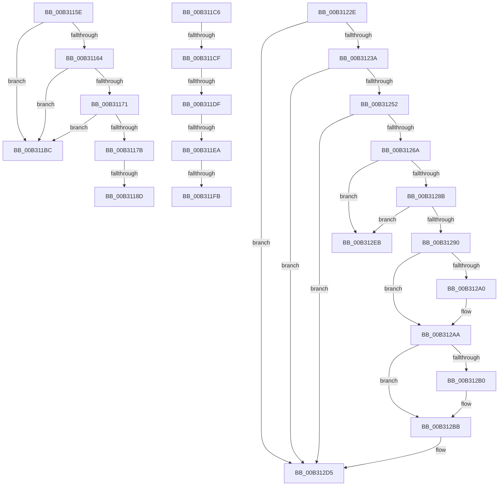

# sub_00B3115E

- RVA: `0x00B3115E`–`0x00B312F2` (길이 `404` bytes)
- VA: `0x0000000140B3115E`
- 실행 섹션: `PAGE`
- PDB 이름 있음: `아니요`; PDB Function 태그: `아니요`
- unwind 정보 RVA: `0x000A5F3C`
- 디코드: `99`개 명령, `404/404` bytes 표시
- 미해석 바이트: `0` (있으면 어셈블리에 `.byte`로 보존)

> 이 문서는 커널 이미지의 기계어와 PDB 기호를 분석해 생성했습니다. 4번과 5번은 함수 원형과 자료형을 바이너리 사용 방식에서 추정한 C 해석이며 원본 소스 복구 결과는 아닙니다.

## 1. Dependencies

- 직접 호출 지점: **11**; 고유 호출 대상: **11**
- 직접 호출자로 확인된 함수: **0**
- RIP 상대 이미지 참조: **0**

### Outgoing calls
- `0x00B3117E` → [FsRtlpAttachOplockKey](../../text/41/FsRtlpAttachOplockKey_function_0041DD70.md) (function, `0x0041DD70`)
- `0x00B311B1` → [FsRtlpRequestExclusiveOplock](../../text/3F/FsRtlpRequestExclusiveOplock_function_003F3800.md) (function, `0x003F3800`)
- `0x00B311D2` → [IoIsOperationSynchronous](../../text/41/IoIsOperationSynchronous_function_0041E6A0.md) (function, `0x0041E6A0`)
- `0x00B31223` → [FsRtlpRequestShareableOplock](../../text/4E/FsRtlpRequestShareableOplock_function_004E6EC8.md) (function, `0x004E6EC8`)
- `0x00B31261` → [FsRtlpCallerIsAtomicRequestor](../../text/47/FsRtlpCallerIsAtomicRequestor_function_00477E50.md) (function, `0x00477E50`)
- `0x00B31275` → [FsRtlpOplockDequeueRH](../../text/42/FsRtlpOplockDequeueRH_function_004258FC.md) (function, `0x004258FC`)
- `0x00B312B6` → [FsRtlpClearOwner](../../text/26/FsRtlpClearOwner_function_00265BE8.md) (function, `0x00265BE8`)
- `0x00B312C0` → [FsRtlpFreeRHOpContext](../../text/4F/FsRtlpFreeRHOpContext_function_004F2394.md) (function, `0x004F2394`)
- `0x00B312C8` → [FsRtlpComputeShareableOplockState](../../text/42/FsRtlpComputeShareableOplockState_function_004256EC.md) (function, `0x004256EC`)
- `0x00B312D0` → [FsRtlpReleaseIrpsWaitingForRH](../../text/42/FsRtlpReleaseIrpsWaitingForRH_function_00425CBC.md) (function, `0x00425CBC`)
- `0x00B312DE` → [IofCompleteRequest](../../text/29/IofCompleteRequest_function_0029B5C0.md) (function, `0x0029B5C0`)

### Direct callers
- 이 함수 시작 RVA로 연결되는 직접 call은 확인되지 않았습니다. 간접 호출은 완전히 역산할 수 없습니다.

### Static image references
- 디코드된 RIP-relative 메모리 참조가 없습니다.

## 2. Other-region calls and transfers

- 다른 실행 섹션으로 향하는 call: **11**
  - `0x00B3117E` → [FsRtlpAttachOplockKey](../../text/41/FsRtlpAttachOplockKey_function_0041DD70.md) (`PAGE` → `.text`)
  - `0x00B311B1` → [FsRtlpRequestExclusiveOplock](../../text/3F/FsRtlpRequestExclusiveOplock_function_003F3800.md) (`PAGE` → `.text`)
  - `0x00B311D2` → [IoIsOperationSynchronous](../../text/41/IoIsOperationSynchronous_function_0041E6A0.md) (`PAGE` → `.text`)
  - `0x00B31223` → [FsRtlpRequestShareableOplock](../../text/4E/FsRtlpRequestShareableOplock_function_004E6EC8.md) (`PAGE` → `.text`)
  - `0x00B31261` → [FsRtlpCallerIsAtomicRequestor](../../text/47/FsRtlpCallerIsAtomicRequestor_function_00477E50.md) (`PAGE` → `.text`)
  - `0x00B31275` → [FsRtlpOplockDequeueRH](../../text/42/FsRtlpOplockDequeueRH_function_004258FC.md) (`PAGE` → `.text`)
  - `0x00B312B6` → [FsRtlpClearOwner](../../text/26/FsRtlpClearOwner_function_00265BE8.md) (`PAGE` → `.text`)
  - `0x00B312C0` → [FsRtlpFreeRHOpContext](../../text/4F/FsRtlpFreeRHOpContext_function_004F2394.md) (`PAGE` → `.text`)
  - `0x00B312C8` → [FsRtlpComputeShareableOplockState](../../text/42/FsRtlpComputeShareableOplockState_function_004256EC.md) (`PAGE` → `.text`)
  - `0x00B312D0` → [FsRtlpReleaseIrpsWaitingForRH](../../text/42/FsRtlpReleaseIrpsWaitingForRH_function_00425CBC.md) (`PAGE` → `.text`)
  - `0x00B312DE` → [IofCompleteRequest](../../text/29/IofCompleteRequest_function_0029B5C0.md) (`PAGE` → `.text`)
- call이 아닌 외부 분기/꼬리 이동: **9**
  - `0x00B31187` → [FsRtlpOplockFsctrlInternal + 0x19B](../9F/FsRtlpOplockFsctrlInternal_function_009F1640.md) (`tail-transfer`)
  - `0x00B311B7` → [FsRtlpOplockFsctrlInternal + 0x329](../9F/FsRtlpOplockFsctrlInternal_function_009F1640.md) (`tail-transfer`)
  - `0x00B311C1` → [FsRtlpOplockFsctrlInternal + 0x19B](../9F/FsRtlpOplockFsctrlInternal_function_009F1640.md) (`tail-transfer`)
  - `0x00B311C9` → [FsRtlpOplockFsctrlInternal + 0x36A](../9F/FsRtlpOplockFsctrlInternal_function_009F1640.md) (`tail-transfer`)
  - `0x00B311D9` → [FsRtlpOplockFsctrlInternal + 0x36A](../9F/FsRtlpOplockFsctrlInternal_function_009F1640.md) (`tail-transfer`)
  - `0x00B311E4` → [FsRtlpOplockFsctrlInternal + 0x36A](../9F/FsRtlpOplockFsctrlInternal_function_009F1640.md) (`tail-transfer`)
  - `0x00B311F5` → [FsRtlpOplockFsctrlInternal + 0x36A](../9F/FsRtlpOplockFsctrlInternal_function_009F1640.md) (`tail-transfer`)
  - `0x00B31229` → [FsRtlpOplockFsctrlInternal + 0x329](../9F/FsRtlpOplockFsctrlInternal_function_009F1640.md) (`tail-transfer`)
  - `0x00B312E6` → [FsRtlpOplockFsctrlInternal + 0x19B](../9F/FsRtlpOplockFsctrlInternal_function_009F1640.md) (`tail-transfer`)

## 3. Assembly (complete function range)

```asm
00B3115E  41 83 FC 01                     cmp r12d, 1
00B31162  75 58                           jne 0x140b311bc
00B31164  48 8B 43 08                     mov rax, qword ptr [rbx + 8]
00B31168  F7 40 10 7F FF FF FF            test dword ptr [rax + 0x10], 0xffffff7f
00B3116F  75 4B                           jne 0x140b311bc
00B31171  0F B6 43 1A                     movzx eax, byte ptr [rbx + 0x1a]
00B31175  24 07                           and al, 7
00B31177  3C 07                           cmp al, 7
00B31179  75 41                           jne 0x140b311bc
00B3117B  48 8B CE                        mov rcx, rsi
00B3117E  E8 ED CB 8E FF                  call 0x14041dd70
00B31183  8B F8                           mov edi, eax
00B31185  85 C0                           test eax, eax
00B31187  0F 85 4E 06 EC FF               jne 0x1409f17db
00B3118D  8B 84 24 C0 00 00 00            mov eax, dword ptr [rsp + 0xc0]
00B31194  89 44 24 30                     mov dword ptr [rsp + 0x30], eax
00B31198  C7 44 24 28 C8 00 00 00         mov dword ptr [rsp + 0x28], 0xc8
00B311A0  44 89 6C 24 20                  mov dword ptr [rsp + 0x20], r13d
00B311A5  45 8B CC                        mov r9d, r12d
00B311A8  45 33 C0                        xor r8d, r8d
00B311AB  48 8B D3                        mov rdx, rbx
00B311AE  49 8B CE                        mov rcx, r14
00B311B1  E8 4A 26 8C FF                  call 0x1403f3800
00B311B6  90                              nop
00B311B7  E9 AD 07 EC FF                  jmp 0x1409f1969
00B311BC  BF E2 00 00 C0                  mov edi, 0xc00000e2
00B311C1  E9 15 06 EC FF                  jmp 0x1409f17db
00B311C6  45 85 E4                        test r12d, r12d
00B311C9  0F 85 DB 07 EC FF               jne 0x1409f19aa
00B311CF  48 8B CE                        mov rcx, rsi
00B311D2  E8 C9 D4 8E FF                  call 0x14041e6a0
00B311D7  84 C0                           test al, al
00B311D9  0F 85 CB 07 EC FF               jne 0x1409f19aa
00B311DF  8B 46 10                        mov eax, dword ptr [rsi + 0x10]
00B311E2  A8 40                           test al, 0x40
00B311E4  0F 85 C0 07 EC FF               jne 0x1409f19aa
00B311EA  48 8B 43 30                     mov rax, qword ptr [rbx + 0x30]
00B311EE  F7 40 50 00 40 00 00            test dword ptr [rax + 0x50], 0x4000
00B311F5  0F 85 AF 07 EC FF               jne 0x1409f19aa
00B311FB  8B 84 24 C0 00 00 00            mov eax, dword ptr [rsp + 0xc0]
00B31202  89 44 24 38                     mov dword ptr [rsp + 0x38], eax
00B31206  44 88 6C 24 30                  mov byte ptr [rsp + 0x30], r13b
00B3120B  C6 44 24 28 01                  mov byte ptr [rsp + 0x28], 1
00B31210  4C 89 6C 24 20                  mov qword ptr [rsp + 0x20], r13
00B31215  45 8D 4C 24 10                  lea r9d, [r12 + 0x10]
00B3121A  4C 8B C6                        mov r8, rsi
00B3121D  48 8B D3                        mov rdx, rbx
00B31220  49 8B CE                        mov rcx, r14
00B31223  E8 A0 5C 9B FF                  call 0x1404e6ec8
00B31228  90                              nop
00B31229  E9 3B 07 EC FF                  jmp 0x1409f1969
00B3122E  49 8B 3E                        mov rdi, qword ptr [r14]
00B31231  48 85 FF                        test rdi, rdi
00B31234  0F 84 9B 00 00 00               je 0x140b312d5
00B3123A  4C 89 BC 24 A8 00 00 00         mov qword ptr [rsp + 0xa8], r15
00B31242  F7 87 90 00 00 00 00 00 01 00   test dword ptr [rdi + 0x90], 0x10000
00B3124C  0F 84 83 00 00 00               je 0x140b312d5
00B31252  4C 8D 84 24 A8 00 00 00         lea r8, [rsp + 0xa8]
00B3125A  48 8B 53 30                     mov rdx, qword ptr [rbx + 0x30]
00B3125E  48 8B CF                        mov rcx, rdi
00B31261  E8 EA 6B 94 FF                  call 0x140477e50
00B31266  84 C0                           test al, al
00B31268  74 6B                           je 0x140b312d5
00B3126A  48 8B 9C 24 A8 00 00 00         mov rbx, qword ptr [rsp + 0xa8]
00B31272  48 8B CB                        mov rcx, rbx
00B31275  E8 82 46 8F FF                  call 0x1404258fc
00B3127A  4C 8D 4B 38                     lea r9, [rbx + 0x38]
00B3127E  49 8B 09                        mov rcx, qword ptr [r9]
00B31281  49 8B 41 08                     mov rax, qword ptr [r9 + 8]
00B31285  4C 39 49 08                     cmp qword ptr [rcx + 8], r9
00B31289  75 60                           jne 0x140b312eb
00B3128B  4C 39 08                        cmp qword ptr [rax], r9
00B3128E  75 5B                           jne 0x140b312eb
00B31290  48 89 08                        mov qword ptr [rax], rcx
00B31293  48 89 41 08                     mov qword ptr [rcx + 8], rax
00B31297  48 8D 47 78                     lea rax, [rdi + 0x78]
00B3129B  48 39 00                        cmp qword ptr [rax], rax
00B3129E  75 0A                           jne 0x140b312aa
00B312A0  81 A7 90 00 00 00 FF FF FC FF   and dword ptr [rdi + 0x90], 0xfffcffff
00B312AA  4C 39 7B 28                     cmp qword ptr [rbx + 0x28], r15
00B312AE  74 0B                           je 0x140b312bb
00B312B0  48 8B D3                        mov rdx, rbx
00B312B3  48 8B CF                        mov rcx, rdi
00B312B6  E8 2D 49 73 FF                  call 0x140265be8
00B312BB  B2 01                           mov dl, 1
00B312BD  48 8B CB                        mov rcx, rbx
00B312C0  E8 CF 10 9C FF                  call 0x1404f2394
00B312C5  48 8B CF                        mov rcx, rdi
00B312C8  E8 1F 44 8F FF                  call 0x1404256ec
00B312CD  48 8B CF                        mov rcx, rdi
00B312D0  E8 E7 49 8F FF                  call 0x140425cbc
00B312D5  44 89 7E 30                     mov dword ptr [rsi + 0x30], r15d
00B312D9  B2 01                           mov dl, 1
00B312DB  48 8B CE                        mov rcx, rsi
00B312DE  E8 DD A2 76 FF                  call 0x14029b5c0
00B312E3  41 8B FF                        mov edi, r15d
00B312E6  E9 F0 04 EC FF                  jmp 0x1409f17db
00B312EB  B9 03 00 00 00                  mov ecx, 3
00B312F0  CD 29                           int 0x29
```

## 4. C-style interpretation (structured pseudocode)

```c
__int64 __fastcall sub_00B3115E(__int64 a1, __int64 a2, int a3, __int64 a4, __int64 a5, __int64 a6, __int64 a7, __int64 a8, __int64 a9, __int64 a10, __int64 a11, __int64 a12, __int64 a13, __int64 a14, __int64 a15, __int64 a16, __int64 a17, __int64 a18, __int64 a19, __int64 a20, __int64 a21, __int64 a22, __int64 a23, unsigned int a24)
{
    __int64 result;
    unsigned int v_stack_p20;
    unsigned int v_stack_p28;
    unsigned int v_stack_p30;
    unsigned int v_stack_p38;
    unsigned __int64 v_stack_pA8;
    unsigned int v_stack_pC0;

    if (((unsigned int)(v_r12)) != 1) goto loc_00B311BC;
    if (((*(unsigned int *)(*(unsigned __int64 *)(v_rbx + 8) + 16)) & (0xFFFFFF7FULL)) != 0) goto loc_00B311BC;
    result = (unsigned __int8)((*(unsigned __int8 *)(v_rbx + 26)) & (7));
    if (((unsigned __int8)(result)) != 7) goto loc_00B311BC;
    result = FsRtlpAttachOplockKey(v_rsi, a2, a3, a4);
    v_stack_p30 = (unsigned int)((unsigned int)(a24));
    v_stack_p28 = 200;
    v_stack_p20 = (unsigned int)(v_r13);
    a3 = 0;
    result = FsRtlpRequestExclusiveOplock(v_r14, v_rbx, a3, (unsigned int)((unsigned int)(v_r12)));
loc_00B311BC:
}
```

## 5. (Beta) C Style

```c
int64_t sub_00B3115E(int64_t Arg1, int64_t Arg2, int32_t Arg3, int64_t Arg4, uint64_t Arg5, uint64_t Arg6, uint64_t Arg7, uint64_t Arg8, uint64_t Arg9, uint64_t Arg10, uint64_t Arg11, uint64_t Arg12, uint64_t Arg13, uint64_t Arg14, uint64_t Arg15, uint64_t Arg16, uint64_t Arg17, uint64_t Arg18, uint64_t Arg19, uint64_t Arg20, uint64_t Arg21, uint64_t Arg22, uint64_t Arg23, uint32_t Arg24)
{
    int64_t result;
    uint32_t v_stack_p20;
    uint32_t v_stack_p28;
    uint32_t v_stack_p30;
    uint32_t v_stack_p38;
    uint64_t v_stack_pA8;
    uint32_t v_stack_pC0;

    if (((uint32_t)(local_r12)) != 1) goto loc_00B311BC;
    if (((*(uint32_t *)(*(uint64_t *)(local_rbx + 0x8) + 0x10)) & (0xFFFFFF7FULL)) != 0) goto loc_00B311BC;
    result = (uint8_t)((*(uint8_t *)(local_rbx + 0x1A)) & (7));
    if (((uint8_t)(result)) != 7) goto loc_00B311BC;
    result = FsRtlpAttachOplockKey(local_rsi, Arg2, Arg3, Arg4);
    v_stack_p30 = (uint32_t)((uint32_t)(Arg24));
    v_stack_p28 = 200;
    v_stack_p20 = (uint32_t)(local_r13);
    Arg3 = 0;
    result = FsRtlpRequestExclusiveOplock(local_r14, local_rbx, Arg3, (uint32_t)((uint32_t)(local_r12)));
loc_00B311BC:
}
```

## 6. Execution-region graph

[열기: 2D/3D 그래프와 함수 탐색 컨트롤 패널](../../../control-panel.html?section=page&rva=0x00B3115E&view=graph)

- 2D 그래프는 위에서 아래로 흐르고, 3D 그래프는 빈 공간을 드래그해 회전합니다. Shift+드래그는 이동, 휠은 확대·축소, 함수 노드 선택은 대상 보고서 이동입니다.

### Static fallback


