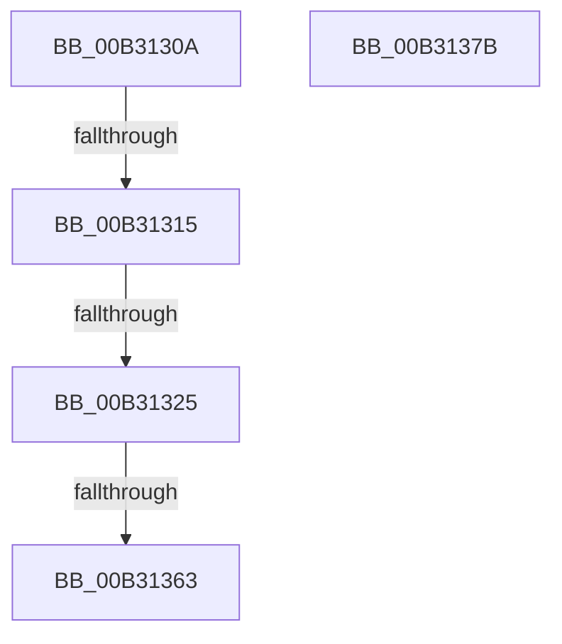

# sub_00B3130A

- RVA: `0x00B3130A`–`0x00B31387` (길이 `125` bytes)
- VA: `0x0000000140B3130A`
- 실행 섹션: `PAGE`
- PDB 이름 있음: `아니요`; PDB Function 태그: `아니요`
- unwind 정보 RVA: `0x000A659C`
- 디코드: `28`개 명령, `125/125` bytes 표시
- 미해석 바이트: `0` (있으면 어셈블리에 `.byte`로 보존)

> 이 문서는 커널 이미지의 기계어와 PDB 기호를 분석해 생성했습니다. 4번과 5번은 함수 원형과 자료형을 바이너리 사용 방식에서 추정한 C 해석이며 원본 소스 복구 결과는 아닙니다.

## 1. Dependencies

- 직접 호출 지점: **2**; 고유 호출 대상: **2**
- 직접 호출자로 확인된 함수: **0**
- RIP 상대 이미지 참조: **1**

### Outgoing calls
- `0x00B31346` → [ObReferenceObjectByHandle](../86/ObReferenceObjectByHandle_function_00868DB0.md) (function, `0x00868DB0`)
- `0x00B3136B` → [ExpPulseCrossVmEvent](../7D/ExpPulseCrossVmEvent_function_007D57A4.md) (function, `0x007D57A4`)

### Direct callers
- 이 함수 시작 RVA로 연결되는 직접 call은 확인되지 않았습니다. 간접 호출은 완전히 역산할 수 없습니다.

### Static image references
- `0x00B31315` → RVA `0x00EFA110` (`.data`; read)

## 2. Other-region calls and transfers

- 다른 실행 섹션으로 향하는 call: **0**
- call이 아닌 외부 분기/꼬리 이동: **5**
  - `0x00B3130F` → [NtPulseEvent + 0x89](../9F/NtPulseEvent_function_009F4460.md) (`tail-transfer`)
  - `0x00B3131F` → [NtPulseEvent + 0x89](../9F/NtPulseEvent_function_009F4460.md) (`tail-transfer`)
  - `0x00B3135D` → [NtPulseEvent + 0x89](../9F/NtPulseEvent_function_009F4460.md) (`tail-transfer`)
  - `0x00B31376` → [NtPulseEvent + 0x89](../9F/NtPulseEvent_function_009F4460.md) (`tail-transfer`)
  - `0x00B31382` → [NtPulseEvent + 0x8D](../9F/NtPulseEvent_function_009F4460.md) (`tail-transfer`)

## 3. Assembly (complete function range)

```asm
00B3130A  3D 24 00 00 C0                  cmp eax, 0xc0000024
00B3130F  0F 85 D4 31 EC FF               jne 0x1409f44e9
00B31315  4C 8B 05 F4 8D 3C 00            mov r8, qword ptr [rip + 0x3c8df4]
00B3131C  4D 85 C0                        test r8, r8
00B3131F  0F 84 C4 31 EC FF               je 0x1409f44e9
00B31325  48 83 64 24 70 00               and qword ptr [rsp + 0x70], 0
00B3132B  48 83 64 24 28 00               and qword ptr [rsp + 0x28], 0
00B31331  48 8D 44 24 70                  lea rax, [rsp + 0x70]
00B31336  48 89 44 24 20                  mov qword ptr [rsp + 0x20], rax
00B3133B  45 8A CF                        mov r9b, r15b
00B3133E  BA 02 00 00 00                  mov edx, 2
00B31343  49 8B CC                        mov rcx, r12
00B31346  E8 65 7A D3 FF                  call 0x140868db0
00B3134B  8B F8                           mov edi, eax
00B3134D  48 8B 74 24 70                  mov rsi, qword ptr [rsp + 0x70]
00B31352  48 89 74 24 78                  mov qword ptr [rsp + 0x78], rsi
00B31357  89 44 24 70                     mov dword ptr [rsp + 0x70], eax
00B3135B  85 C0                           test eax, eax
00B3135D  0F 88 86 31 EC FF               js 0x1409f44e9
00B31363  48 8D 54 24 68                  lea rdx, [rsp + 0x68]
00B31368  48 8B CE                        mov rcx, rsi
00B3136B  E8 34 44 CA FF                  call 0x1407d57a4
00B31370  8B F8                           mov edi, eax
00B31372  89 44 24 70                     mov dword ptr [rsp + 0x70], eax
00B31376  E9 6E 31 EC FF                  jmp 0x1409f44e9
00B3137B  8B 44 24 68                     mov eax, dword ptr [rsp + 0x68]
00B3137F  41 89 06                        mov dword ptr [r14], eax
00B31382  E9 66 31 EC FF                  jmp 0x1409f44ed
```

## 4. C-style interpretation (structured pseudocode)

```c
__int64 __fastcall sub_00B3130A(__int64 a1, __int64 a2, __int64 a3, __int64 a4, __int64 a5, __int64 a6, __int64 a7, __int64 a8, __int64 a9, __int64 a10, __int64 a11, __int64 a12, __int64 a13, __int64 a14)
{
    __int64 result;
    unsigned __int64 v_stack_p20;
    unsigned int v_stack_p68;
    unsigned int v_stack_p70;
    unsigned __int64 v_stack_p78;

    v_stack_p20 = a14;
    result = ObReferenceObjectByHandle(v_r12, 2, *(unsigned __int64 *)(v_rip + 3968500), (unsigned __int8)(v_r15));
    v_stack_p78 = a14;
    v_stack_p70 = (unsigned int)(result);
    result = ExpPulseCrossVmEvent(a14, a13, *(unsigned __int64 *)(v_rip + 3968500), (unsigned __int8)(v_r15));
    v_stack_p70 = (unsigned int)(result);
}
```

## 5. (Beta) C Style

```c
int64_t sub_00B3130A(int64_t Arg1, int64_t Arg2, int64_t Arg3, int64_t Arg4, int64_t Arg5, uint64_t Arg6, uint64_t Arg7, uint64_t Arg8, uint64_t Arg9, uint64_t Arg10, uint64_t Arg11, uint64_t Arg12, int64_t Arg13, int64_t Arg14)
{
    int64_t result;
    uint64_t v_stack_p20;
    uint32_t v_stack_p68;
    uint32_t v_stack_p70;
    uint64_t v_stack_p78;

    v_stack_p20 = Arg14;
    result = ObReferenceObjectByHandle(local_r12, 2, *(uint64_t *)(v_rip + 0x3C8DF4), (uint8_t)(local_r15));
    v_stack_p78 = Arg14;
    v_stack_p70 = (uint32_t)(result);
    result = ExpPulseCrossVmEvent(Arg14, Arg13, *(uint64_t *)(v_rip + 0x3C8DF4), (uint8_t)(local_r15));
    v_stack_p70 = (uint32_t)(result);
}
```

## 6. Execution-region graph

[열기: 2D/3D 그래프와 함수 탐색 컨트롤 패널](../../../control-panel.html?section=page&rva=0x00B3130A&view=graph)

- 2D 그래프는 위에서 아래로 흐르고, 3D 그래프는 빈 공간을 드래그해 회전합니다. Shift+드래그는 이동, 휠은 확대·축소, 함수 노드 선택은 대상 보고서 이동입니다.

### Static fallback


