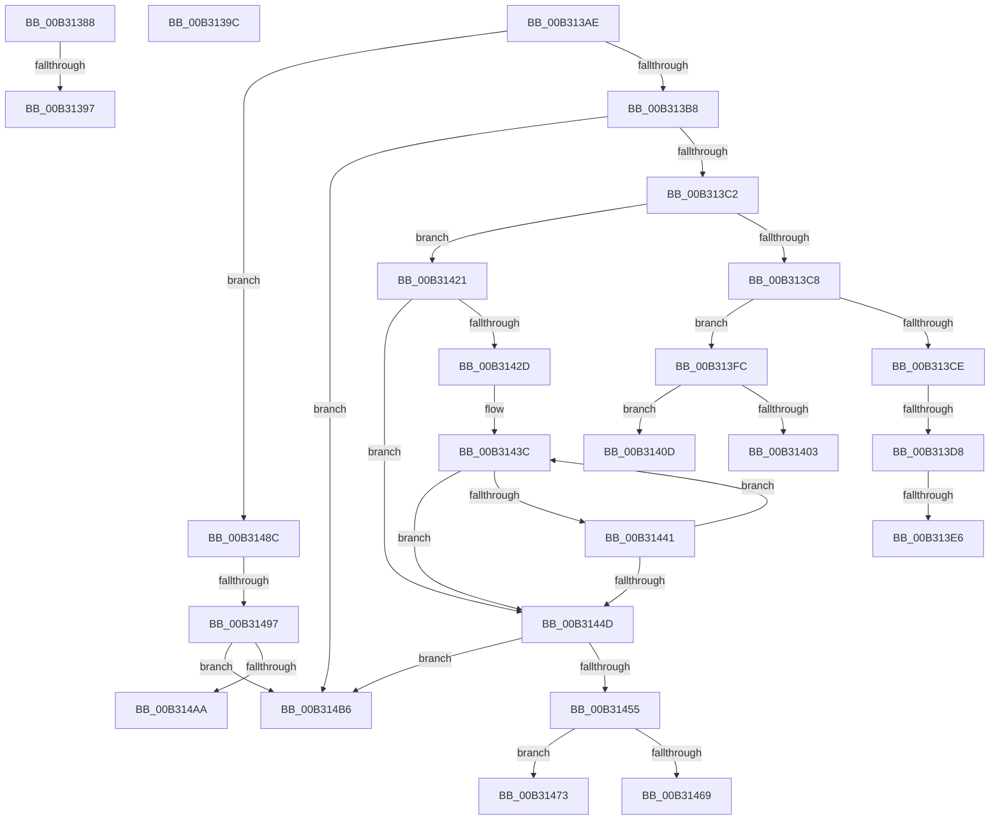

# sub_00B31388

- RVA: `0x00B31388`–`0x00B314C0` (길이 `312` bytes)
- VA: `0x0000000140B31388`
- 실행 섹션: `PAGE`
- PDB 이름 있음: `아니요`; PDB Function 태그: `아니요`
- unwind 정보 RVA: `0x000A661C`
- 디코드: `75`개 명령, `312/312` bytes 표시
- 미해석 바이트: `0` (있으면 어셈블리에 `.byte`로 보존)

> 이 문서는 커널 이미지의 기계어와 PDB 기호를 분석해 생성했습니다. 4번과 5번은 함수 원형과 자료형을 바이너리 사용 방식에서 추정한 C 해석이며 원본 소스 복구 결과는 아닙니다.

## 1. Dependencies

- 직접 호출 지점: **5**; 고유 호출 대상: **5**
- 직접 호출자로 확인된 함수: **0**
- RIP 상대 이미지 참조: **2**

### Outgoing calls
- `0x00B313F1` → [MiProcessRemoveFromWorkingSet](../7F/MiProcessRemoveFromWorkingSet_function_007FE624.md) (function, `0x007FE624`)
- `0x00B31416` → [VmPrefetchVirtualAddresses](../7A/VmPrefetchVirtualAddresses_function_007ACE98.md) (function, `0x007ACE98`)
- `0x00B31421` → [MiGetLargestPageIndex](../../text/49/MiGetLargestPageIndex_function_0049F730.md) (function, `0x0049F730`)
- `0x00B31460` → [SeSinglePrivilegeCheck](../87/SeSinglePrivilegeCheck_function_00871E20.md) (function, `0x00871E20`)
- `0x00B31481` → [MiProcessVaContiguityInformation](../../text/69/MiProcessVaContiguityInformation_function_006939C0.md) (function, `0x006939C0`)

### Direct callers
- 이 함수 시작 RVA로 연결되는 직접 call은 확인되지 않았습니다. 간접 호출은 완전히 역산할 수 없습니다.

### Static image references
- `0x00B31431` → RVA `0x00011C60` (`.rdata`; read)
- `0x00B31459` → RVA `0x00FD9AD0` (`PAGEDATA`; read)

## 2. Other-region calls and transfers

- 다른 실행 섹션으로 향하는 call: **2**
  - `0x00B31421` → [MiGetLargestPageIndex](../../text/49/MiGetLargestPageIndex_function_0049F730.md) (`PAGE` → `.text`)
  - `0x00B31481` → [MiProcessVaContiguityInformation](../../text/69/MiProcessVaContiguityInformation_function_006939C0.md) (`PAGE` → `.text`)
- call이 아닌 외부 분기/꼬리 이동: **13**
  - `0x00B31391` → [NtSetInformationVirtualMemory + 0x8C0](../9F/NtSetInformationVirtualMemory_function_009F4580.md) (`tail-transfer`)
  - `0x00B31397` → [NtSetInformationVirtualMemory + 0x103](../9F/NtSetInformationVirtualMemory_function_009F4580.md) (`tail-transfer`)
  - `0x00B313A9` → [NtSetInformationVirtualMemory + 0x4D0](../9F/NtSetInformationVirtualMemory_function_009F4580.md) (`tail-transfer`)
  - `0x00B313D2` → [NtSetInformationVirtualMemory + 0x4CB](../9F/NtSetInformationVirtualMemory_function_009F4580.md) (`tail-transfer`)
  - `0x00B313E0` → [NtSetInformationVirtualMemory + 0x612](../9F/NtSetInformationVirtualMemory_function_009F4580.md) (`tail-transfer`)
  - `0x00B313F7` → [NtSetInformationVirtualMemory + 0x4C9](../9F/NtSetInformationVirtualMemory_function_009F4580.md) (`tail-transfer`)
  - `0x00B31408` → [NtSetInformationVirtualMemory + 0x4CB](../9F/NtSetInformationVirtualMemory_function_009F4580.md) (`tail-transfer`)
  - `0x00B3141C` → [NtSetInformationVirtualMemory + 0x4C9](../9F/NtSetInformationVirtualMemory_function_009F4580.md) (`tail-transfer`)
  - `0x00B3146E` → [NtSetInformationVirtualMemory + 0x4CB](../9F/NtSetInformationVirtualMemory_function_009F4580.md) (`tail-transfer`)
  - `0x00B31487` → [NtSetInformationVirtualMemory + 0x4C9](../9F/NtSetInformationVirtualMemory_function_009F4580.md) (`tail-transfer`)
  - `0x00B31491` → [NtSetInformationVirtualMemory + 0x612](../9F/NtSetInformationVirtualMemory_function_009F4580.md) (`tail-transfer`)
  - `0x00B314B1` → [NtSetInformationVirtualMemory + 0x624](../9F/NtSetInformationVirtualMemory_function_009F4580.md) (`tail-transfer`)
  - `0x00B314BB` → [NtSetInformationVirtualMemory + 0x4CB](../9F/NtSetInformationVirtualMemory_function_009F4580.md) (`tail-transfer`)

## 3. Assembly (complete function range)

```asm
00B31388  41 BC 01 00 00 00               mov r12d, 1
00B3138E  4D 3B C4                        cmp r8, r12
00B31391  0F 85 A9 3A EC FF               jne 0x1409f4e40
00B31397  E9 E7 32 EC FF                  jmp 0x1409f4683
00B3139C  4C 8D B4 24 30 01 00 00         lea r14, [rsp + 0x130]
00B313A4  BF 9A 00 00 C0                  mov edi, 0xc000009a
00B313A9  E9 A2 36 EC FF                  jmp 0x1409f4a50
00B313AE  41 83 EE 01                     sub r14d, 1
00B313B2  0F 84 D4 00 00 00               je 0x140b3148c
00B313B8  41 83 EE 01                     sub r14d, 1
00B313BC  0F 84 F4 00 00 00               je 0x140b314b6
00B313C2  41 83 EE 01                     sub r14d, 1
00B313C6  74 59                           je 0x140b31421
00B313C8  41 83 EE 01                     sub r14d, 1
00B313CC  74 2E                           je 0x140b313fc
00B313CE  41 83 FE 01                     cmp r14d, 1
00B313D2  0F 85 73 36 EC FF               jne 0x1409f4a4b
00B313D8  F7 44 24 60 FE FF FF FF         test dword ptr [rsp + 0x60], 0xfffffffe
00B313E0  0F 85 AC 37 EC FF               jne 0x1409f4b92
00B313E6  44 8B 44 24 60                  mov r8d, dword ptr [rsp + 0x60]
00B313EB  49 8B D7                        mov rdx, r15
00B313EE  49 8B CB                        mov rcx, r11
00B313F1  E8 2E D2 CC FF                  call 0x1407fe624
00B313F6  90                              nop
00B313F7  E9 4D 36 EC FF                  jmp 0x1409f4a49
00B313FC  83 7C 24 60 00                  cmp dword ptr [rsp + 0x60], 0
00B31401  74 0A                           je 0x140b3140d
00B31403  BF 0D 00 00 C0                  mov edi, 0xc000000d
00B31408  E9 3E 36 EC FF                  jmp 0x1409f4a4b
00B3140D  45 8B C4                        mov r8d, r12d
00B31410  49 8B D3                        mov rdx, r11
00B31413  49 8B CF                        mov rcx, r15
00B31416  E8 7D BA C7 FF                  call 0x1407ace98
00B3141B  90                              nop
00B3141C  E9 28 36 EC FF                  jmp 0x1409f4a49
00B31421  E8 0A E3 96 FF                  call 0x14049f730
00B31426  8B F8                           mov edi, eax
00B31428  83 F8 03                        cmp eax, 3
00B3142B  73 20                           jae 0x140b3144d
00B3142D  8B 54 24 60                     mov edx, dword ptr [rsp + 0x60]
00B31431  48 8D 05 28 08 4E FF            lea rax, [rip - 0xb1f7d8]
00B31438  48 8D 04 F8                     lea rax, [rax + rdi*8]
00B3143C  48 39 10                        cmp qword ptr [rax], rdx
00B3143F  74 0C                           je 0x140b3144d
00B31441  41 03 FC                        add edi, r12d
00B31444  48 83 C0 08                     add rax, 8
00B31448  83 FF 03                        cmp edi, 3
00B3144B  72 EF                           jb 0x140b3143c
00B3144D  8D 47 FF                        lea eax, [rdi - 1]
00B31450  41 3B C4                        cmp eax, r12d
00B31453  77 61                           ja 0x140b314b6
00B31455  8A 54 24 50                     mov dl, byte ptr [rsp + 0x50]
00B31459  48 8B 0D 70 86 4A 00            mov rcx, qword ptr [rip + 0x4a8670]
00B31460  E8 BB 09 D4 FF                  call 0x140871e20
00B31465  84 C0                           test al, al
00B31467  75 0A                           jne 0x140b31473
00B31469  BF 61 00 00 C0                  mov edi, 0xc0000061
00B3146E  E9 D8 35 EC FF                  jmp 0x1409f4a4b
00B31473  44 8B C7                        mov r8d, edi
00B31476  48 8B 94 24 98 00 00 00         mov rdx, qword ptr [rsp + 0x98]
00B3147E  49 8B CF                        mov rcx, r15
00B31481  E8 3A 25 B6 FF                  call 0x1406939c0
00B31486  90                              nop
00B31487  E9 BD 35 EC FF                  jmp 0x1409f4a49
00B3148C  83 7C 24 60 00                  cmp dword ptr [rsp + 0x60], 0
00B31491  0F 85 FB 36 EC FF               jne 0x1409f4b92
00B31497  48 8B 84 24 80 00 00 00         mov rax, qword ptr [rsp + 0x80]
00B3149F  8B 88 F4 01 00 00               mov ecx, dword ptr [rax + 0x1f4]
00B314A5  F6 C1 10                        test cl, 0x10
00B314A8  74 0C                           je 0x140b314b6
00B314AA  45 33 C9                        xor r9d, r9d
00B314AD  45 8D 41 03                     lea r8d, [r9 + 3]
00B314B1  E9 EE 36 EC FF                  jmp 0x1409f4ba4
00B314B6  BF BB 00 00 C0                  mov edi, 0xc00000bb
00B314BB  E9 8B 35 EC FF                  jmp 0x1409f4a4b
```

## 4. C-style interpretation (structured pseudocode)

```c
__int64 __fastcall sub_00B31388(__int64 a1, __int64 a2, __int64 a3, int a4)
{
    unsigned __int64 v_stack_p130;
    unsigned __int8 v_stack_p50;
    unsigned int v_stack_p60;
    unsigned __int64 v_stack_p80;
    unsigned __int64 v_stack_p98;
}
```

## 5. (Beta) C Style

```c
int64_t sub_00B31388(int64_t Arg1, int64_t Arg2, int64_t Arg3, int32_t Arg4)
{
    uint64_t v_stack_p130;
    uint8_t v_stack_p50;
    uint32_t v_stack_p60;
    uint64_t v_stack_p80;
    uint64_t v_stack_p98;
}
```

## 6. Execution-region graph

[열기: 2D/3D 그래프와 함수 탐색 컨트롤 패널](../../../control-panel.html?section=page&rva=0x00B31388&view=graph)

- 2D 그래프는 위에서 아래로 흐르고, 3D 그래프는 빈 공간을 드래그해 회전합니다. Shift+드래그는 이동, 휠은 확대·축소, 함수 노드 선택은 대상 보고서 이동입니다.

### Static fallback


