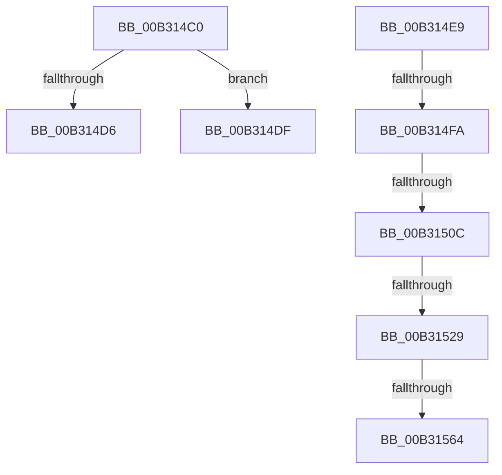

# sub_00B314C0

- RVA: `0x00B314C0`–`0x00B3156B` (길이 `171` bytes)
- VA: `0x0000000140B314C0`
- 실행 섹션: `PAGE`
- PDB 이름 있음: `아니요`; PDB Function 태그: `아니요`
- unwind 정보 RVA: `0x000A6664`
- 디코드: `42`개 명령, `171/171` bytes 표시
- 미해석 바이트: `0` (있으면 어셈블리에 `.byte`로 보존)

> 이 문서는 커널 이미지의 기계어와 PDB 기호를 분석해 생성했습니다. 4번과 5번은 함수 원형과 자료형을 바이너리 사용 방식에서 추정한 C 해석이며 원본 소스 복구 결과는 아닙니다.

## 1. Dependencies

- 직접 호출 지점: **5**; 고유 호출 대상: **5**
- 직접 호출자로 확인된 함수: **0**
- RIP 상대 이미지 참조: **0**

### Outgoing calls
- `0x00B314CA` → [MiValidateUserCallTarget](../AC/MiValidateUserCallTarget_function_00AC09A0.md) (function, `0x00AC09A0`)
- `0x00B314FA` → [MiSectionControlArea](../../text/29/MiSectionControlArea_function_00294CB0.md) (function, `0x00294CB0`)
- `0x00B3153A` → [MiGetProtoPteAddress](../../text/32/MiGetProtoPteAddress_function_0032E970.md) (function, `0x0032E970`)
- `0x00B31542` → [PsGetProcessSessionIdEx](../../text/22/PsGetProcessSessionIdEx_function_0022F8F0.md) (function, `0x0022F8F0`)
- `0x00B31552` → [MiStartingOffset](../../text/34/MiStartingOffset_function_003482E0.md) (function, `0x003482E0`)

### Direct callers
- 이 함수 시작 RVA로 연결되는 직접 call은 확인되지 않았습니다. 간접 호출은 완전히 역산할 수 없습니다.

### Static image references
- 디코드된 RIP-relative 메모리 참조가 없습니다.

## 2. Other-region calls and transfers

- 다른 실행 섹션으로 향하는 call: **4**
  - `0x00B314FA` → [MiSectionControlArea](../../text/29/MiSectionControlArea_function_00294CB0.md) (`PAGE` → `.text`)
  - `0x00B3153A` → [MiGetProtoPteAddress](../../text/32/MiGetProtoPteAddress_function_0032E970.md) (`PAGE` → `.text`)
  - `0x00B31542` → [PsGetProcessSessionIdEx](../../text/22/PsGetProcessSessionIdEx_function_0022F8F0.md) (`PAGE` → `.text`)
  - `0x00B31552` → [MiStartingOffset](../../text/34/MiStartingOffset_function_003482E0.md) (`PAGE` → `.text`)
- call이 아닌 외부 분기/꼬리 이동: **7**
  - `0x00B314DA` → [MiCfgMarkValidEntries + 0x102](../9F/MiCfgMarkValidEntries_function_009F4FE8.md) (`tail-transfer`)
  - `0x00B314E4` → [MiCfgMarkValidEntries + 0xBA](../9F/MiCfgMarkValidEntries_function_009F4FE8.md) (`tail-transfer`)
  - `0x00B314F4` → [MiCfgMarkValidEntries + 0x1CF](../9F/MiCfgMarkValidEntries_function_009F4FE8.md) (`tail-transfer`)
  - `0x00B31506` → [MiCfgMarkValidEntries + 0x1CF](../9F/MiCfgMarkValidEntries_function_009F4FE8.md) (`tail-transfer`)
  - `0x00B31523` → [MiCfgMarkValidEntries + 0x1CF](../9F/MiCfgMarkValidEntries_function_009F4FE8.md) (`tail-transfer`)
  - `0x00B3155E` → [MiCfgMarkValidEntries + 0x1CF](../9F/MiCfgMarkValidEntries_function_009F4FE8.md) (`tail-transfer`)
  - `0x00B31566` → [MiCfgMarkValidEntries + 0x179](../9F/MiCfgMarkValidEntries_function_009F4FE8.md) (`tail-transfer`)

## 3. Assembly (complete function range)

```asm
00B314C0  4A 8B 0C FE                     mov rcx, qword ptr [rsi + r15*8]
00B314C4  49 8B D5                        mov rdx, r13
00B314C7  48 03 CB                        add rcx, rbx
00B314CA  E8 D1 F4 F8 FF                  call 0x140ac09a0
00B314CF  45 33 DB                        xor r11d, r11d
00B314D2  85 C0                           test eax, eax
00B314D4  74 09                           je 0x140b314df
00B314D6  4C 8B 65 40                     mov r12, qword ptr [rbp + 0x40]
00B314DA  E9 0B 3C EC FF                  jmp 0x1409f50ea
00B314DF  B8 22 00 00 C0                  mov eax, 0xc0000022
00B314E4  E9 B9 3B EC FF                  jmp 0x1409f50a2
00B314E9  F7 47 30 00 00 20 00            test dword ptr [rdi + 0x30], 0x200000
00B314F0  48 89 55 50                     mov qword ptr [rbp + 0x50], rdx
00B314F4  0F 85 BD 3C EC FF               jne 0x1409f51b7
00B314FA  E8 B1 37 76 FF                  call 0x140294cb0
00B314FF  48 8B 4F 48                     mov rcx, qword ptr [rdi + 0x48]
00B31503  48 39 01                        cmp qword ptr [rcx], rax
00B31506  0F 85 AB 3C EC FF               jne 0x1409f51b7
00B3150C  0F B6 57 20                     movzx edx, byte ptr [rdi + 0x20]
00B31510  8B 4F 18                        mov ecx, dword ptr [rdi + 0x18]
00B31513  8B C2                           mov eax, edx
00B31515  48 C1 E0 20                     shl rax, 0x20
00B31519  48 0B C1                        or rax, rcx
00B3151C  48 C1 E0 0C                     shl rax, 0xc
00B31520  48 3B C3                        cmp rax, rbx
00B31523  0F 85 8E 3C EC FF               jne 0x1409f51b7
00B31529  48 C1 E2 20                     shl rdx, 0x20
00B3152D  4C 8D 4D 50                     lea r9, [rbp + 0x50]
00B31531  48 0B D1                        or rdx, rcx
00B31534  45 33 C0                        xor r8d, r8d
00B31537  48 8B CF                        mov rcx, rdi
00B3153A  E8 31 D4 7F FF                  call 0x14032e970
00B3153F  49 8B CC                        mov rcx, r12
00B31542  E8 A9 E3 6F FF                  call 0x14022f8f0
00B31547  48 8B 57 50                     mov rdx, qword ptr [rdi + 0x50]
00B3154B  44 8B C0                        mov r8d, eax
00B3154E  48 8B 4D 50                     mov rcx, qword ptr [rbp + 0x50]
00B31552  E8 89 6D 81 FF                  call 0x1403482e0
00B31557  48 3B 85 80 00 00 00            cmp rax, qword ptr [rbp + 0x80]
00B3155E  0F 85 53 3C EC FF               jne 0x1409f51b7
00B31564  33 D2                           xor edx, edx
00B31566  E9 F6 3B EC FF                  jmp 0x1409f5161
```

## 4. C-style interpretation (structured pseudocode)

```c
__int64 __fastcall sub_00B314C0(__int64 a1, __int64 a2, int a3)
{
    __int64 result;
    __int64 v_r11;

    a1 = (*(unsigned __int64 *)(v_rsi + v_r15 * 8)) + (v_rbx);
    result = MiValidateUserCallTarget(a1, v_r13, a3, a4);
    v_r11 = 0;
    if ((unsigned int)(result) == 0) goto loc_00B314DF;
loc_00B314DF:
}
```

## 5. (Beta) C Style

```c
int64_t sub_00B314C0(int64_t Arg1, int64_t Arg2, int32_t Arg3)
{
    int64_t result;
    int64_t local_r11;

    Arg1 = (*(uint64_t *)(local_rsi + local_r15 * 8)) + (local_rbx);
    result = MiValidateUserCallTarget(Arg1, local_r13, Arg3, a4);
    local_r11 = 0;
    if ((uint32_t)(result) == 0) goto loc_00B314DF;
loc_00B314DF:
}
```

## 6. Execution-region graph

[열기: 2D/3D 그래프와 함수 탐색 컨트롤 패널](../../../control-panel.html?section=page&rva=0x00B314C0&view=graph)

- 2D 그래프는 위에서 아래로 흐르고, 3D 그래프는 빈 공간을 드래그해 회전합니다. Shift+드래그는 이동, 휠은 확대·축소, 함수 노드 선택은 대상 보고서 이동입니다.

### Static fallback


