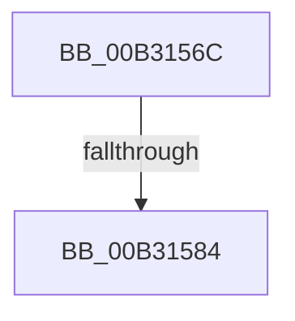

# sub_00B3156C

- RVA: `0x00B3156C`–`0x00B31590` (길이 `36` bytes)
- VA: `0x0000000140B3156C`
- 실행 섹션: `PAGE`
- PDB 이름 있음: `아니요`; PDB Function 태그: `아니요`
- unwind 정보 RVA: `0x000A6BE4`
- 디코드: `7`개 명령, `36/36` bytes 표시
- 미해석 바이트: `0` (있으면 어셈블리에 `.byte`로 보존)

> 이 문서는 커널 이미지의 기계어와 PDB 기호를 분석해 생성했습니다. 4번과 5번은 함수 원형과 자료형을 바이너리 사용 방식에서 추정한 C 해석이며 원본 소스 복구 결과는 아닙니다.

## 1. Dependencies

- 직접 호출 지점: **0**; 고유 호출 대상: **0**
- 직접 호출자로 확인된 함수: **0**
- RIP 상대 이미지 참조: **2**

### Outgoing calls
- 직접 디코드된 call 명령이 없습니다.

### Direct callers
- 이 함수 시작 RVA로 연결되는 직접 call은 확인되지 않았습니다. 간접 호출은 완전히 역산할 수 없습니다.

### Static image references
- `0x00B31571` → RVA `0x00FD9C6C` (`PAGEDATA`; read/write)
- `0x00B31584` → RVA `0x00F066E0` (`.data`; read)

## 2. Other-region calls and transfers

- 다른 실행 섹션으로 향하는 call: **0**
- call이 아닌 외부 분기/꼬리 이동: **2**
  - `0x00B3157E` → [PspRundownProcess + 0x5A](../9F/PspRundownProcess_function_009F65CC.md) (`tail-transfer`)
  - `0x00B3158B` → [PspRundownProcess + 0x50](../9F/PspRundownProcess_function_009F65CC.md) (`tail-transfer`)

## 3. Assembly (complete function range)

```asm
00B3156C  B8 01 00 00 00                  mov eax, 1
00B31571  F0 0F C1 05 F3 86 4A 00         lock xadd dword ptr [rip + 0x4a86f3], eax
00B31579  FF C0                           inc eax
00B3157B  83 F8 01                        cmp eax, 1
00B3157E  0F 85 A2 50 EC FF               jne 0x1409f6626
00B31584  48 8D 0D 55 51 3D 00            lea rcx, [rip + 0x3d5155]
00B3158B  E9 8C 50 EC FF                  jmp 0x1409f661c
```

## 4. C-style interpretation (structured pseudocode)

```c
__int64 __fastcall sub_00B3156C(void)
{
    __int64 result;

    result = (unsigned int)((1) + 1);
}
```

## 5. (Beta) C Style

```c
void sub_00B3156C(void)
{
    int64_t result;

    result = (uint32_t)((1) + 1);
}
```

## 6. Execution-region graph

[열기: 2D/3D 그래프와 함수 탐색 컨트롤 패널](../../../control-panel.html?section=page&rva=0x00B3156C&view=graph)

- 2D 그래프는 위에서 아래로 흐르고, 3D 그래프는 빈 공간을 드래그해 회전합니다. Shift+드래그는 이동, 휠은 확대·축소, 함수 노드 선택은 대상 보고서 이동입니다.

### Static fallback


