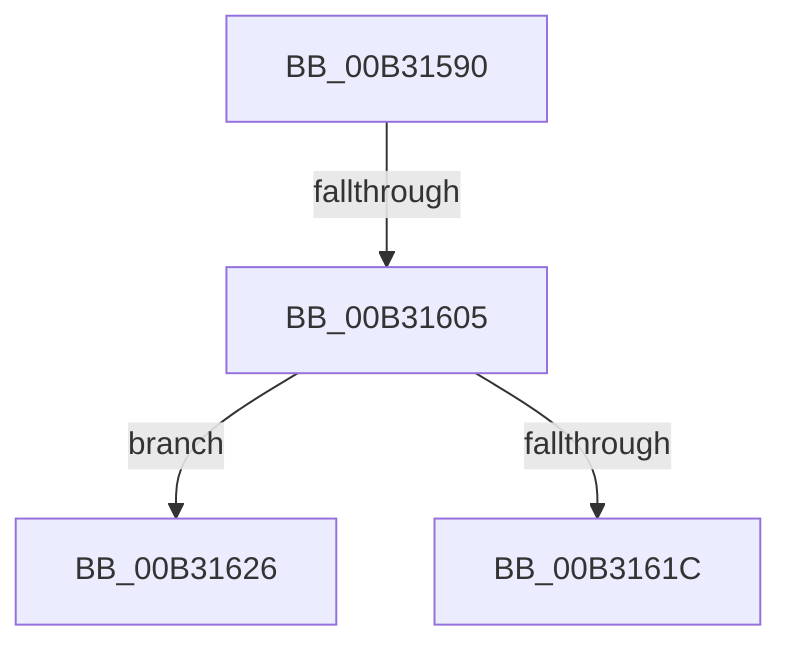

# sub_00B31590

- RVA: `0x00B31590`–`0x00B3163A` (길이 `170` bytes)
- VA: `0x0000000140B31590`
- 실행 섹션: `PAGE`
- PDB 이름 있음: `아니요`; PDB Function 태그: `아니요`
- unwind 정보 RVA: `0x000A6E28`
- 디코드: `37`개 명령, `170/170` bytes 표시
- 미해석 바이트: `0` (있으면 어셈블리에 `.byte`로 보존)

> 이 문서는 커널 이미지의 기계어와 PDB 기호를 분석해 생성했습니다. 4번과 5번은 함수 원형과 자료형을 바이너리 사용 방식에서 추정한 C 해석이며 원본 소스 복구 결과는 아닙니다.

## 1. Dependencies

- 직접 호출 지점: **4**; 고유 호출 대상: **4**
- 직접 호출자로 확인된 함수: **0**
- RIP 상대 이미지 참조: **0**

### Outgoing calls
- `0x00B31594` → [RtlInitUnicodeString](../../text/42/RtlInitUnicodeString_function_0042A780.md) (function, `0x0042A780`)
- `0x00B315F6` → [ZwCreateFile](../../text/6A/ZwCreateFile_function_006ADB70.md) (function, `0x006ADB70`)
- `0x00B3160F` → [IoDiskIoAttributionAllocate](../9F/IoDiskIoAttributionAllocate_function_009F7F6C.md) (function, `0x009F7F6C`)
- `0x00B31629` → [IoStartDiskIoAttributionForContext](../../text/46/IoStartDiskIoAttributionForContext_function_0046B434.md) (function, `0x0046B434`)

### Direct callers
- 이 함수 시작 RVA로 연결되는 직접 call은 확인되지 않았습니다. 간접 호출은 완전히 역산할 수 없습니다.

### Static image references
- 디코드된 RIP-relative 메모리 참조가 없습니다.

## 2. Other-region calls and transfers

- 다른 실행 섹션으로 향하는 call: **3**
  - `0x00B31594` → [RtlInitUnicodeString](../../text/42/RtlInitUnicodeString_function_0042A780.md) (`PAGE` → `.text`)
  - `0x00B315F6` → [ZwCreateFile](../../text/6A/ZwCreateFile_function_006ADB70.md) (`PAGE` → `.text`)
  - `0x00B31629` → [IoStartDiskIoAttributionForContext](../../text/46/IoStartDiskIoAttributionForContext_function_0046B434.md) (`PAGE` → `.text`)
- call이 아닌 외부 분기/꼬리 이동: **3**
  - `0x00B315FF` → [PspIoRateEntryActivate + 0xC4](../9F/PspIoRateEntryActivate_function_009F8398.md) (`tail-transfer`)
  - `0x00B31621` → [PspIoRateEntryActivate + 0xC4](../9F/PspIoRateEntryActivate_function_009F8398.md) (`tail-transfer`)
  - `0x00B31635` → [PspIoRateEntryActivate + 0x71](../9F/PspIoRateEntryActivate_function_009F8398.md) (`tail-transfer`)

## 3. Assembly (complete function range)

```asm
00B31590  48 8D 4D DF                     lea rcx, [rbp - 0x21]
00B31594  E8 E7 91 8F FF                  call 0x14042a780
00B31599  21 5C 24 50                     and dword ptr [rsp + 0x50], ebx
00B3159D  48 8D 45 DF                     lea rax, [rbp - 0x21]
00B315A1  48 21 5C 24 48                  and qword ptr [rsp + 0x48], rbx
00B315A6  4C 8D 4D EF                     lea r9, [rbp - 0x11]
00B315AA  48 21 5D 07                     and qword ptr [rbp + 7], rbx
00B315AE  4C 8D 45 FF                     lea r8, [rbp - 1]
00B315B2  C7 44 24 40 20 00 00 00         mov dword ptr [rsp + 0x40], 0x20
00B315BA  48 8D 4D 7F                     lea rcx, [rbp + 0x7f]
00B315BE  C7 44 24 38 01 00 00 00         mov dword ptr [rsp + 0x38], 1
00B315C6  0F 57 C0                        xorps xmm0, xmm0
00B315C9  C7 44 24 30 07 00 00 00         mov dword ptr [rsp + 0x30], 7
00B315D1  BA 80 00 10 00                  mov edx, 0x100080
00B315D6  21 5C 24 28                     and dword ptr [rsp + 0x28], ebx
00B315DA  48 21 5C 24 20                  and qword ptr [rsp + 0x20], rbx
00B315DF  C7 45 FF 30 00 00 00            mov dword ptr [rbp - 1], 0x30
00B315E6  C7 45 17 40 02 00 00            mov dword ptr [rbp + 0x17], 0x240
00B315ED  48 89 45 0F                     mov qword ptr [rbp + 0xf], rax
00B315F1  F3 0F 7F 45 1F                  movdqu xmmword ptr [rbp + 0x1f], xmm0
00B315F6  E8 75 C5 B7 FF                  call 0x1406adb70
00B315FB  8B F8                           mov edi, eax
00B315FD  85 C0                           test eax, eax
00B315FF  0F 88 57 6E EC FF               js 0x1409f845c
00B31605  49 8B 96 30 06 00 00            mov rdx, qword ptr [r14 + 0x630]
00B3160C  49 8B CE                        mov rcx, r14
00B3160F  E8 58 69 EC FF                  call 0x1409f7f6c
00B31614  48 8B D8                        mov rbx, rax
00B31617  48 85 C0                        test rax, rax
00B3161A  75 0A                           jne 0x140b31626
00B3161C  BF 9A 00 00 C0                  mov edi, 0xc000009a
00B31621  E9 36 6E EC FF                  jmp 0x1409f845c
00B31626  48 8B CB                        mov rcx, rbx
00B31629  E8 06 9E 93 FF                  call 0x14046b434
00B3162E  48 8B 45 7F                     mov rax, qword ptr [rbp + 0x7f]
00B31632  4C 8B C3                        mov r8, rbx
00B31635  E9 CF 6D EC FF                  jmp 0x1409f8409
```

## 4. C-style interpretation (structured pseudocode)

```c
__int64 __fastcall sub_00B31590(__int64 a1, __int64 a2, __int64 a3, __int64 a4, unsigned int a5, __int64 a6, __int64 a7, __int64 a8, __int64 a9, unsigned int a10)
{
    __int64 result;
    unsigned __int64 v_stack_p20;
    unsigned int v_stack_p30;
    unsigned int v_stack_p38;
    unsigned int v_stack_p40;

    result = RtlInitUnicodeString(v_rbp - 33, a2, a3, a4);
    v_stack_p40 = 32;
    v_stack_p38 = 1;
    v_stack_p30 = 7;
    *(unsigned int *)(v_rbp - 1) = 48;
    *(unsigned int *)(v_rbp + 23) = 576;
    *(unsigned __int64 *)(v_rbp + 15) = v_rbp - 33;
    *(unsigned __int64 *)(v_rbp + 31) = v_xmm0;
    result = ZwCreateFile(v_rbp + 127, (unsigned int)(0x100080ULL), v_rbp - 1, v_rbp - 17);
    result = IoDiskIoAttributionAllocate(v_r14, *(unsigned __int64 *)(v_r14 + 1584), v_rbp - 1, v_rbp - 17);
    if (result != 0) goto loc_00B31626;
loc_00B31626:
    result = IoStartDiskIoAttributionForContext(result, *(unsigned __int64 *)(v_r14 + 1584), v_rbp - 1, v_rbp - 17);
}
```

## 5. (Beta) C Style

```c
int64_t sub_00B31590(int64_t Arg1, int64_t Arg2, int64_t Arg3, int64_t Arg4, uint32_t Arg5, uint64_t Arg6, uint64_t Arg7, uint64_t Arg8, int64_t Arg9, uint32_t Arg10)
{
    int64_t result;
    uint64_t v_stack_p20;
    uint32_t v_stack_p30;
    uint32_t v_stack_p38;
    uint32_t v_stack_p40;

    result = RtlInitUnicodeString(local_rbp - 33, Arg2, Arg3, Arg4);
    v_stack_p40 = 32;
    v_stack_p38 = 1;
    v_stack_p30 = 7;
    *(uint32_t *)(local_rbp - 0x1) = 48;
    *(uint32_t *)(local_rbp + 0x17) = 576;
    *(uint64_t *)(local_rbp + 0xF) = local_rbp - 33;
    *(uint64_t *)(local_rbp + 0x1F) = v_xmm0;
    result = ZwCreateFile(local_rbp + 127, (uint32_t)(0x100080ULL), local_rbp - 1, local_rbp - 17);
    result = IoDiskIoAttributionAllocate(local_r14, *(uint64_t *)(local_r14 + 0x630), local_rbp - 1, local_rbp - 17);
    if (result != 0) goto loc_00B31626;
loc_00B31626:
    result = IoStartDiskIoAttributionForContext(result, *(uint64_t *)(local_r14 + 0x630), local_rbp - 1, local_rbp - 17);
}
```

## 6. Execution-region graph

[열기: 2D/3D 그래프와 함수 탐색 컨트롤 패널](../../../control-panel.html?section=page&rva=0x00B31590&view=graph)

- 2D 그래프는 위에서 아래로 흐르고, 3D 그래프는 빈 공간을 드래그해 회전합니다. Shift+드래그는 이동, 휠은 확대·축소, 함수 노드 선택은 대상 보고서 이동입니다.

### Static fallback


